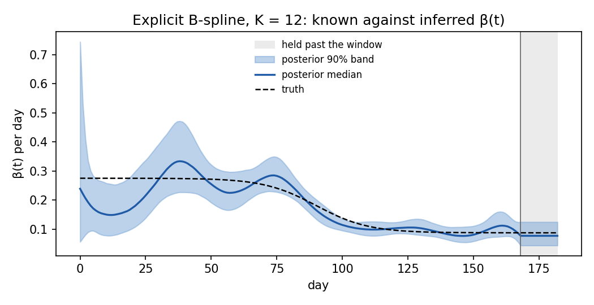

# Explicit B-spline forcing: the merge measurement

Date: 2026-10-29 Project: camdl Tags: bspline, pgas, nuts, if2, merge-criteria

The measurement for landing the `bspline` forcing kind with explicit
coefficients, ahead of the `smooth` coefficient form, against the merge criteria
of `docs/dev/proposals/2026-10-27-estimable-bsplines.md` (§8.1 R1–R4 required,
§8.2 documented here). R5, a small simulation-based calibration, is not part of
the criteria until the maintainer decides it.

## What is measured, and on what

An explicit `bspline` writes a transmission rate as β(t) = exp(Σₖ bₖ Bₖ(t)): K
cubic basis functions Bₖ over a window, one coefficient bₖ per basis function,
each a parameter with its own prior, held at the end value past the window.

Two synthetic outbreaks, both chain-binomial SEIR with daily onsets observed as
`neg_binomial(mean = 0.5 · projected, r = 10)`:

- **The R3 recovery outbreak** (`seir_bspline_recovery.camdl`): K = 5 over [0,
  86] days, 100 days of data, N₀ = 10⁶, truth in the spline space (b = −0.7,
  −1.0, −1.6, −1.4, −1.9), four datasets (data seeds 23, 31, 47, 59).
- **The §8.4 benchmark** (`seir_k12_explicit.camdl`): K = 12 over [0, 168] days,
  182 days of data, N₀ = 10⁶, E₀ = I₀ = 10, σ = 0.1, γ = 0.125, and a truth
  outside the spline space, R(t) = 0.7 + 1.5/(1 + exp((t − 90)/10)), generated
  by `seir_k12_truth.camdl` (the same model with an `interpolated` truth;
  `k12_truth_and_fit_models_differ_only_in_the_forcing` checks that nothing else
  differs). The simulated outbreak (seed 8) has 2,767 observed onsets, peaking
  at 70 per day.

Every number below comes from a named target in `tests/recovery/Makefile` or
from `make validate-bspline`. The committed tables are in
`tests/recovery/cases/spline_seir/diagnosis/`
(`make -f
tests/recovery/Makefile diagnosis-extract`) and
`assets/2026-10-29-explicit-bspline-benchmark/`.

## The required criteria are met

| Criterion                                                                                               | Evidence                                                                                                                                                       |
| ------------------------------------------------------------------------------------------------------- | -------------------------------------------------------------------------------------------------------------------------------------------------------------- |
| R1 basis values against scipy, R `splines` and the Bernstein anchors; partition of unity and the others | `bspline_reference_fixtures.rs`, `sim::bspline::tests` (`make validate-bspline`, 0 failures)                                                                   |
| R2 coefficient gradients against central differences, pointwise and through the likelihood              | `bspline_gradient_check.rs`, R2's step and bars                                                                                                                |
| R3 small epidemic: finite and bitwise reproducible                                                      | `small_epidemic_runs_finite_and_reproducibly` (`make validate-bspline`)                                                                                        |
| R3 prior-only run draws the prior                                                                       | `r3_prior_only_run_draws_the_explicit_prior`: worst \|z\| 1.98, smallest KS p 0.018, 0 divergences                                                             |
| R3 recovery: truth in its 99% interval, median log β within 0.2                                         | `r3c_explicit.tsv`: all four datasets pass under both start rules (worst curve error 0.078–0.185); the in-process `recovers_a_spline_transmission_rate` passes |
| R4 round trip, the `link` hash, reproducible builds                                                     | `spline_goldens_round_trip_ocaml_json_rust_json`, `ir_spline_link_changes_hash`, `spline_models_build_reproducibly`                                            |

The recovery criteria have little power: the default-start pools pass even where
their chains disagree (next section).

## The §8.2 benchmark: K = 12

PGAS with NUTS through `camdl fit run`, 4 chains, 64 particles, dense mass,
1,000 adaptation + 2,000 kept sweeps, starts drawn from the prior
(`benchmark_parameters.tsv`, `benchmark_summary.tsv`):

| Quantity                                  | Value                              |
| ----------------------------------------- | ---------------------------------- |
| Wall time                                 | 230 s                              |
| Divergences after adaptation              | 0                                  |
| Mean leapfrog steps per sweep             | 13.4                               |
| Mean path renewal                         | 0.74                               |
| Coefficient R̂ (rank-normalized)           | 1.010–1.035                        |
| Coefficient bulk-ESS (bulk-ESS per s)     | 86–521 (0.38–2.26)                 |
| log β(t), worst over the middle 80%       | R̂ 1.038, bulk-ESS 96, tail-ESS 218 |
| Chains' mean complete-data log-likelihood | −2,057.8 to −2,059.8 (agree)       |

The posterior median wanders around the truth: with twelve independent
normal(−1.9, 1) coefficients nothing ties neighbouring coefficients together,
and the curve bends where the data allow it to. The largest gap between the
posterior median of log β and the truth over the window's middle 80% is 0.55,
early in the outbreak where the counts are small. The truth itself is
representable: its least-squares projection onto the twelve basis functions is
within 0.008 in log β everywhere in the window.

IF2 (`if2_pfilter.tsv`), from eight prior draws at which the particle filter is
finite, one chain each, 500 particles, 50 iterations, `rw_sd` 0.05: all eight
reach particle-filter log-likelihoods of −544.1 to −540.0 (2,000 particles,
three seeds), against −544.4 at the truth's projection. The maximum likelihood
fits the noise a few nats better than the truth does — unpenalized coefficients.

## Known limitations

- **Default starts can leave chains stuck.** Under `starts = "from_prior"` (the
  default when every coefficient has a prior), some chains of the R3 recovery
  fits stopped in a path-and-parameter region that fits far worse (complete-data
  log-likelihood −2,332 against −1,705) and stayed there; β(t)'s R̂ was 1.18–1.50
  across the four datasets (`summary_default.tsv`). R̂ flags it. Workaround:
  start the chains from distinct good points, e.g. IF2 fits
  (`starts = { from_params = ... }` per chain, or `from_mle`), and give each
  chain its own latent path; from such starts R̂ was 1.03–1.15
  (`multistart_summary.tsv`). The `stuck_chains.tsv` restarts show that a fresh
  latent path frees a chain whose θ is good.
- **Many knots without a smoothness prior overfit.** The K = 12 benchmark shows
  it. Keep n_basis small (the R3 fits use five) until the `smooth` form lands;
  it puts a calibrated prior on curvature instead.
- **The level trades off** against an estimated intercept and against I₀ and ρ
  (proposal §4.4); here they are fixed.
- **The window end is the least-informed part of the curve**, and the value held
  past it inherits that uncertainty; the forecast past the window is a held
  value, not an extrapolated trend (§4.3).
- **IF2's automatic random-walk scale is too large** for log-β coefficients on a
  box: (hi − lo)/6, about 2 on the logit scale, moves β by a factor of about
  five per perturbation and can make a feasible start's whole swarm infeasible
  (−∞). Give `rw_sd` explicitly (0.05 here).
- The τ calibration table of §8.2 belongs to the `smooth` form and is not part
  of this measurement.
