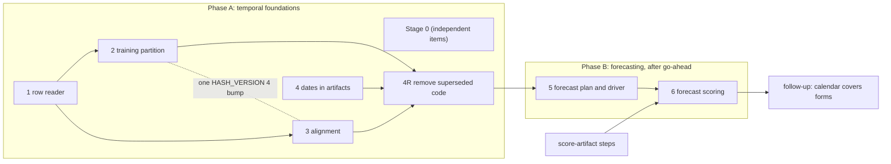

# Proposal: temporal architecture migration

**Status:** Decided 2026-11-15 (D35, D38–D57). Phase A (Stages 0–4 and Stage 4R)
has landed: Stage 0 in #1105 (the fixes, with Stage 1), #1107 (0(f)) and
`4a7c17f6f` (0(a)); Stage 1 in #1105; Stage 2 in #1113; Stage 3 in #1112; Stage
4 in #1109; Stage 4R in #1114. Phase B (Stages 5–6, forecasting) is not started;
it starts only on the maintainer's go-ahead. **Spec:**
`docs/dev/temporal-architecture.md` (the spec; "spec §N" below). **Motivation:**
forecasts, forecast scoring (gh#808) and published score artifacts
(`2026-11-14-score-artifact.md`) all consume observation times, training cutoffs
and forecast targets that today are bare model times re-interpreted at each
consumer under different conventions. This document is the runbook for moving
the code to the spec: the audit that motivates it, the stages as self-contained
work packages, the tests, and the landing rules.

Code references are to `main` at `0ed74876d`; files have moved since, so an
implementer locates each by its function or type name, not its line number.
_Verified (read)_ means read in the code at that commit; _verified (run)_ means
reproduced by running binaries built from it (`CAMDL_SKIP_VERSION_CHECK=1`,
`CAMDLC=ocaml/_build/default/bin/camdlc.exe`); _inferred_ means neither.

## Part 1. Audit of the current code

### 1.1 Compiler and IR

The time typing pass (`ocaml/lib/compiler/time_typing.ml`) classifies
expressions as exact durations, calendar durations, instants or other, and
enforces E320 (a month or year `time_unit` under an origin), E321 (a calendar
duration shifting an instant, under an origin), E322 (a calendar cadence in a
recurring schedule or `emit_schedule every`), E327 (anchor-only primitives
without an origin) and W324 (a bare number in a time position under an origin).
The IR keeps the calendar axis (`time_unit`, `origin`, `origin_rata_die`,
`ir.ml:1139-1145`), each stream's `covers`, column roles, emit schedules and
forcing knot times, and erases instant versus duration to `f64`. That erasure is
correct (spec §1.1). The defects are lowering holes:

| ID | Defect                                                                                                                                                                                                                                               | Evidence                                                                                    |
| -- | ---------------------------------------------------------------------------------------------------------------------------------------------------------------------------------------------------------------------------------------------------- | ------------------------------------------------------------------------------------------- |
| K1 | `date_range(d, count = n, calendar_months = k)` steps from the previous date, so after a month-end clamp later dates keep the clamped day: from 2020-01-31 it gives Feb 29, Mar 29, Apr 29, May 29, where `add_calendar_months` gives Mar 31, Apr 30 | `expander.ml:3343-3364` (`cur := step_fn !cur k_step`); verified (read, compiled)           |
| K2 | `covers = closing_at(time, 1 'months)` compiles to an affine span of 30.436875 days, though `emit_schedule = every 1 'months` is E322 and `origin + 1 'months` is E321                                                                               | `expander.ml:9481-9518`, `span_of` has no time-class check; verified (compiled)             |
| K3 | Instant arithmetic is unchecked except instant ± calendar duration: `date(a) + date(b)`, `date(a) * 2`, `7 'days - date(a)`, `date(a) + 5` and `date(b) - date(a)` used as an instant all compile in `at [...]`                                      | `time_typing.ml` `classify` (~:170) maps instant + anything to instant; verified (compiled) |
| K4 | `date()` lowers to a dimensionless constant, so `let d = date(...)` then `at [d]` is E315, and `if t > date(...)` in a rate is E302; `origin` works only because it lowers to 0                                                                      | `expander.ml:4388`; verified (compiled); fails closed                                       |
| K5 | A generated emit grid counts from `simulate.from`, while `docs/dates.md:525-531` says `origin`                                                                                                                                                       | `expander.ml:9706-9712`; verified (run)                                                     |
| K6 | Temporal expressions are accepted inconsistently across positions (`origin + 30 'days` is E401 in `emit_schedule at` and `simulate to`; `date_range` is E270 in `emit_schedule at` and `breakpoints`; non-monotone breakpoints compile)              | `resolve_float_expr` (`expander.ml:5622`); gh#844, gh#847; verified (compiled)              |
| K7 | `simulate --to` help says a month is 30.4375 days; the code uses 30.436875                                                                                                                                                                           | `cli/src/args/mod.rs:310` vs `ir/src/caltime.rs:87`; verified (read)                        |

### 1.2 Observation rows and training membership

`Period` (`sim/src/inference/multi_stream_obs.rs:1434`) and `StreamTimes`
(`:1505`) represent periods correctly, and `BoundObs::bind` (`:945`) refuses
non-increasing ends and overlaps. But the loader keeps each row as
`Observation { time, value }` (`particle_filter.rs:22`) with `time` the label,
and the training cut compares that label. Every site that resolves a cutoff or
`last_obs`, verified (read):

| Site                                                                                                             | Compares                     |
| ---------------------------------------------------------------------------------------------------------------- | ---------------------------- |
| `holdout_after` cut, `within_training` (`fit/runner.rs:2099`)                                                    | label                        |
| `holdout_after = "last_obs - N"`, `resolve_holdout_cutoff` (`runner.rs:2061`)                                    | label, over the full files   |
| `[data.holdout]` boundary and tail check (`runner.rs:1998`, `:2017`)                                             | label                        |
| `survey` truncation, a separate copy (`survey.rs:1001-1024`)                                                     | label                        |
| `profile` (`profile.rs:1003`)                                                                                    | label                        |
| `TrainingWindow.train_end` in `fit.meta.json` (`run_meta.rs:626`)                                                | label                        |
| `compare`, chain-binomial path (`training_scoring_ends`, `heldout_scoring_boundary`, `compare.rs:2069`, `:2145`) | period end (the gh#1062 fix) |
| `compare`, ODE path (`derive_ode_trace`, `compare.rs:2799-2802`)                                                 | label                        |
| `pfilter --score-from` and its `last_obs` anchor (`runner.rs:2121`, `pfilter.rs:975-990`)                        | period end                   |
| model anchors such as `simulate { to = last_obs + … }` (`main.rs:4139-4176`)                                     | label, over the full files   |
| `fit predict`'s `last_obs` and `value_at` (`fit/predict.rs:1791-1803`, `:1925`, `:3140`)                         | label, over the full files   |

Defects, each with a fixture in Part 6:

- **C2. Training runs past the cutoff it reports.** Verified (run), fixture F3:
  a `starting_on(time, 7 'days)` stream labelled 0–63 with `holdout_after = 24`
  trains on row 21 (days 21–27) and prints `training window [0, 24]`.
  `fit.meta.json` records `train_end: 24`. Nothing leaks in today's `compare`,
  which draws its own boundary, but a forecast from the recorded cutoff would
  score days the parameters were fitted to.
- **C3. The ODE comparison path cut by label** (the open half of gh#1062; fixed
  on `main` in `4a7c17f6f` since the audit). Verified (run), fixture F4: a
  `day(time)` stream with `holdout_after = 10` under `mh` on the `ode` backend
  makes `camdl compare` exit 1. The check `check_no_training_row_scored`
  (`compare.rs:2158`) refuses it, so this fails closed.
  `cli/tests/compare_ode_prequential.rs` covers only `closing_at`.
- **L1. `last_obs` means two things.** Verified (read): last label at some
  sites, last period end at others, and the model's anchors include held-out
  rows, so appending held-out data changes a fit's end time (one run resolved
  `last_obs + 14` to t = 84 from the full file).
- **No row identity reaches a score.** The fit records whole-file SHA-256
  digests and a label-time `train_end`; `compare` re-derives membership from
  labels (`compare.rs:2096-2125`). Verified (read).

A two-stream case was earlier reported here as a defect (a weekly row covering
days 21–27 scored as held-out while daily rows through day 24 trained). It is
not one: the weekly row was never fitted, and overlap with another stream's
training days is the ordinary condition of multi-stream scoring (spec §4.2).

### 1.3 Alignment, forecasting and forcings

- **A1. Off-grid observations are refused before the method is known.** Verified
  (run), fixture F1: `load_observations` refuses any `time % dt ≠ 0`
  (`runner.rs:1678-1688`), measured from 0, on every path, so `exact` stepping
  never sees an off-grid time. This contradicts `docs/dates.md:632` and
  `docs/camdl-run-spec.md:3126`. Fails closed.
- **A2. PGAS moves a period silently.** Verified (read), fixture F1's variant:
  PGAS receives period ends from `bind` (`runner.rs:485`) and rounds them onto
  its grid (`interval_steps`, `sim/src/time.rs:125`). With `from = 0.5`,
  `dt = 1`, a two-day period ending at 3 is scored on the step ending at 3.5 and
  its start rounds to 1.5: days 1.5–3.5 instead of 1–3. The label-based guard
  passes it (3 is a multiple of 1). No notice; nothing records it.
- **A3. Two PGAS errors advise `--obs-alignment exact`**, a flag that does not
  exist, for a policy PGAS refuses (`pgas.rs:1263`, `:1276`). Verified (read).
- **`obs_alignment` changes nothing.** Each method accepts only its own value
  (`fit/methods.rs:515-551`); nothing in `sim` reads it; it is a validation gate
  and a fit-identity input (`runid/src/inputs.rs:468`). Verified (read, grep).
- **T1. Forecast times continue the most common observed gap.** Verified (run),
  fixture F5: `forecast_times` (`predict.rs:3135`) uses `modal_value` of the
  observed gaps. Monthly rows ending at 31, 59, 90, 120, 151, 181 forecast at
  211, 241, …, where month-ends are 212, 243, … (gh#861).
- **T2. Forecast periods are not the observed periods.** Verified (read):
  `leaf_row_coverages` (`predict.rs:3049-3082`) gives a window-column forecast
  row `[previous label, label)`, wider than observed rows when they have gaps.
- **T3. A period under way at a restart is dropped silently.** Verified (run),
  fixture F6: `simulate --init-state` from day 25 drops the week covering days
  21–27.
- **T4. `fit predict` has no forecast length**: its reach is the model's
  `simulation.t_end` (`predict.rs:1915-1931`), and its `--horizon` flag picks a
  mode. Verified (read).
- **P1. `fit predict --horizon one_step` filters through held-out rows,
  unmarked.** Verified (run), fixture F3 under PMMH: all ten one-step rows are
  written; `predict.rs` never reads the holdout; neither JSON names the training
  extent.
- **F1. Forcings built from data hold their last value silently.** Verified
  (read): interpolated, cubic and piecewise forcings clamp
  (`sim/src/propensity.rs:378`, `:396-425`; `compiled_model.rs:335-337`); only
  B-splines report it (`cli/src/obs_anchor.rs:497-560`). The June audit
  reproduced it by running (a forcing held over t = 751–1100, exit 0, no
  message).
- **F2. Forecasts can read covariates from after the forecast origin.**
  Inferred: forcing values are baked into the IR with no notion of an origin.
- **No path makes a fixed-origin forecast for a stochastic model.** Verified
  (read and run): `fit predict` free-forward replays each draw from `init {}`
  with no conditioning; one-step is the filter's one-observation-ahead
  predictive over every row, held-out rows included (P1);
  `simulate --init-state fit` restarts from the last snapshot of PGAS's stored
  paths (`fit/joint.rs:203-300`), which is a valid state only when the forecast
  origin is the end of the fit's data, and PMMH stores no paths. The particle
  filter itself already supports the needed continuation: each particle's
  per-stream running total (`acc`) is filled at `particle_filter.rs:427-429`,
  copied with the particle on resampling (`:601-611`), and reset only where a
  declared period starts (`multi_stream_obs.rs:1332-1360`); a period with no
  value contributes nothing to the likelihood. An experiment confirmed it (spec
  §4.4): the filter with the target declared reproduced an importance-sampling
  reference (weekly mean 68.245 ± 0.021 against 68.227 ± 0.034), and the same
  target undeclared gave 256.951 ± 0.043 with no error.
- **R1. `pfilter --save-final-state` ignores `holdout_after`.** Verified (run):
  a fit that withheld 18 rows had its state saved at t = 40, filtered through
  the held-out rows; `pfilter.rs` reads no holdout (gh#1084).
- **R2. A window-column stream could emit a partial total after a restart.**
  Inferred (read, not run): `plan_emission` (`cli/src/obs_emit.rs:164`,
  `:224-225`) opens the first window at the restart origin, so a window that
  began earlier would be written as a partial total under the full row's label
  (gh#1085).
- **R3.** A `fit predict` message says PMMH saves smoothing paths
  (`predict.rs:2271`); only PGAS does (gh#1086).

### 1.4 Scoring, artifacts and the command line

- `PrequentialTrace` is at **schema 6** on `main` (`basis`, gh#312). The
  score-artifact proposal also calls its trace change schema 6; that change
  becomes schema 7. Verified (read).
- `Conditioning::{InSample, HoldOutTail}` (`score/src/trace.rs:109`) has no
  forecast variant; `Coverage` already records each scored value's period.
- **M1.** The stored simulation record has no calendar (gh#838). Verified (run).
- **M2.** Sub-day dated output does not load back (gh#839). Verified (run).
- **M3.** Dated diagnostics print numeric times beside dated error messages.
  Verified (run).
- "horizon" has four meanings today: the run end (`simulate --to` help), the
  predictive mode (`fit predict --horizon`), the scored-row count
  (`compare --allow-mismatched-horizon`), and the lead (gh#808). Verified
  (read).

## Part 2. Defects, ranked

Ranked by scientific severity: a silent wrong number first, then a misleading
record, then a refusal. "Trust gate" marks what must land before a forecast
score can be trusted.

| Rank | ID         | Effect                                                                                                                       | Stage                 | Trust gate                 |
| ---- | ---------- | ---------------------------------------------------------------------------------------------------------------------------- | --------------------- | -------------------------- |
| 1    | P1         | a band that saw held-out data looks like a forecast                                                                          | 5                     | yes                        |
| 2    | T1, T2     | wrong forecast targets for monthly and irregular series                                                                      | 5                     | yes                        |
| 3    | A2         | PGAS scores a different period than declared                                                                                 | 3                     | yes                        |
| 4    | C2         | parameters see data past the cutoff they report                                                                              | 2                     | yes                        |
| 5    | F1         | every run silently assumes a forcing's last value                                                                            | 0(f)                  | yes                        |
| 6    | K2         | a monthly `covers` width is silently 30.44 days                                                                              | 0(c)                  | yes, for monthly streams   |
| 7    | T3         | the period under way is dropped at a restart                                                                                 | 5                     | yes                        |
| 8    | L1         | appending held-out data changes a fit's end time                                                                             | 2                     | yes                        |
| 9    | F2         | a forecast silently uses realised future covariates                                                                          | 5                     | yes, as a record           |
| 9    | R1, R2     | a saved restart state filtered through held-out rows (R1); a partial total under a full label after a restart (R2, inferred) | 5                     | yes                        |
| 10   | K1         | month-end `date_range` instants drift                                                                                        | 0(b)                  | no                         |
| 11   | K3         | nonsensical instant arithmetic compiles                                                                                      | 0(d)                  | no                         |
| 12   | M1, M2, M3 | artifacts cannot be dated or reloaded                                                                                        | 4                     | M1 for published forecasts |
| 13   | C3         | ODE held-out compare refused                                                                                                 | fixed in `4a7c17f6f`  | —                          |
| 14   | A1, A3     | off-grid data refused; advice for a missing flag                                                                             | 3, 0(e)               | no                         |
| 15   | K4–K7      | refusals and documentation                                                                                                   | follow-up, 0(e), 0(g) | no                         |

**Issues.** Each defect is filed: K1 gh#1068, K2 gh#1069, K3 gh#1070, K4
gh#1071, K5 gh#1072, K7 and A3 gh#1073, A1 gh#1074, A2 gh#1075, `obs_alignment`
gh#1076, C2 gh#1077, L1 gh#1078, P1 gh#1079, T1 gh#861, T2 gh#1080, T3 gh#1081,
F1 gh#1082, F2 gh#1083, R1 gh#1084, R2 gh#1085, R3 gh#1086. C3 was gh#1062,
fixed on `main` in `4a7c17f6f`.

## Part 3. How agents run this plan

**Order and phases.** The plan has two phases.

- **Phase A, the current scope: the temporal foundations.** Stage 0's
  independent fixes, then Stages 1–4 (one row reader, the training partition,
  alignment, dates in artifacts), then Stage 4R, which removes every piece of
  code the new types supersede. Phase A changes how camdl represents and
  partitions time; it adds no forecasting feature.
- **Phase B, after a separate go-ahead: forecasting.** Stage 5 (the forecast
  plan and the fixed-origin driver) and Stage 6 (forecast scoring). The
  decisions that govern them (D49–D57) are recorded so that the Phase B stages
  need no further design, but no Phase B code is written until Phase A has
  landed and the maintainer starts Phase B.

Stage 0 items are independent of each other and of everything else. Stages 1–4
run one at a time, each finishing its gate before the next starts. The calendar
`covers` forms are a separate follow-up proposal (D45).

**One worktree per stage**, cut from a freshly fetched `origin/main`. Stage 0
items go through the existing `camdl-fixer` → `camdl-reviewer` loop
(`docs/dev/agentic-burn-down.md`), one issue each, except 0(f), which touches
the forcing lookup in `sim` and is done by a stage agent. Stages 1–6 each get
one implementing agent and then an independent review agent that re-runs the
stage's red tests on clean `main` (expected red) and on the branch (expected
green), redoes the sibling sweep, and checks each claim against a pasted
command.

**Read first, every stage:** `CLAUDE.md`; the spec; this document's stage entry;
`docs/dev/agent-verification-conventions.md`; the path-scoped rule for the files
touched (`.claude/rules/`); for any change to `pgas.rs`, `particle_filter.rs`,
`obs_loglik.rs`, `obs_model.rs`, `if2.rs` or `pgas_grad.rs`, the whole function
being edited.

**Within a stage:**

1. Write the stage's failing tests first, from its fixtures, and paste the red
   run.
2. Make the change. After it is green, revert the source change with the test
   kept and confirm the test fails again (the mutation check), then restore.
3. Run the stage's listed "must stay identical" tests and paste them green
   unmodified.
4. Run the full gate, `make test`, and paste its exit status. Never pipe a gate
   through `tail` or another filter; read its own exit code.
5. Update the documents the stage names, in the same branch; run `dprint fmt` on
   each Markdown file touched, never `docs/camdl-language-spec.md`.
6. Commit one thing per commit, staging files by name; each commit carries a
   `Proposal: docs/dev/proposals/2026-11-15-temporal-architecture-migration.md`
   footer and no assistant attribution.

**Stop and report instead of proceeding** when: a golden file changes; any
`HASH_VERSION`, `SimConfig` schema or `ir/VERSION` change is needed beyond what
the stage lists; a "must stay identical" test moves; or the stage's design does
not fit the code as found. Landing follows the maintainer's current rule for the
repository.

## Part 4. Stages

### Stage 0: independent fixes

_Landed:_ 0(a) in `4a7c17f6f`; 0(b)–0(e) and 0(g) in #1105; 0(f) in #1107.

Each item is one GitHub issue, one branch and one commit.

- **0(a) ODE held-out boundary (C3). Done:** fixed on `main` in `4a7c17f6f`
  (gh#1062, closed). The change was: in `derive_ode_trace`
  (`cli/src/compare.rs:2799`), use `heldout_scoring_boundary` as the
  chain-binomial path does. Red test: fixture F4 in
  `cli/tests/compare_ode_prequential.rs` (a `day(time)` stream); today it exits
  1. Behaviour change: a refusal becomes a score.
- **0(b) `date_range` from its start (K1).** In `expander.ml:3343-3364`, compute
  entry `i` as `step_fn start (i·k)`. Red test: the 2020-01-31 example, compared
  with `add_calendar_months` for each `i`. Behaviour change: month-end
  `date_range` instants. Check whether any golden uses such a `date_range`; if
  one moves, stop and report.
- **0(c) No calendar width in `covers` (K2).** E321 on a calendar-classified
  width in any `covers` form, with a hint naming window columns until the
  calendar `covers` forms exist. Red test: `closing_at(time, 1 'months)` must
  fail to compile. Behaviour change: a compiling form is refused.
- **0(d) Instant arithmetic (K3).** Refuse `Instant + Instant`, `k · Instant`,
  `Duration − Instant` and `Instant + bare number` under an origin, with a new
  error code registered in the warning catalog. Red tests: each form. Update
  `docs/camdl-language-spec.md` by hand (it is never run through `dprint`).
- **0(e) Text (A3, K7).** Correct the two PGAS messages to name the real fix
  (choose `dt` so the observation times lie on the grid); correct the
  `simulate --to` help to 365.2425/12 days.
- **0(f) Time functions outside their range (F1; D44, D48).** Evaluating a
  data-table forcing (interpolated, cubic, piecewise) outside its data range, or
  a B-spline outside its window, becomes an error naming the function, its range
  and the first time outside it. A run-level override,
  `--allow-forcing-extrapolation` on every command that runs a model, and the
  matching `[config] allow_forcing_extrapolation = true` in a fit config, holds
  the end value as today, prints one warning per function with the span held,
  and records the override in `run.json` (and later in score artifacts).
  - Detection: a set-once flag per function in the clamp branch of the lookup
    (`propensity.rs:378`, `:396-425`; `compiled_model.rs:46`, `:335-337`): load,
    and store only if unset. No counter: a counter would contend between
    particle threads on every clamped evaluation.
  - The B-spline notice (`spline-held-past-window`) becomes this warning.
  - Red tests: one model per forcing kind whose data end before `t_end`, under
    `simulate` and `fit run`, each refused; with the override, output
    bit-identical to today's and one warning per function.
  - Sweep: list every in-repo model, fixture and example whose forcings end
    before its run end. Each either gets its data extended, its run shortened,
    or the override with a comment saying why. Report the list.
  - Docs: `docs/dev/forcing-kinds.md`, `docs/commands.md`, `docs/fit-toml.md`,
    the warning catalog.
- **0(g) Generated observation times (K5; D46).** Rewrite
  `docs/dates.md:525-531` to say that generated observation times count from
  `simulate.from`, and that `origin` only names the calendar date of `t = 0` and
  moves nothing in time; say why (a simulation's first observation counts from
  its own start). No code change.

### Stage 1: one row reader

_Landed:_ #1105.

- **Goal.** One function reads a stream's rows once and records what each row
  measures. Pure refactor.
- **Depends on:** nothing.
- **Changes.** Add `observed_rows(...)` in `cli/src/fit/observed_rows.rs`,
  returning `ObservedRow { position, measures, temporal, cell, aux }` (spec
  §3.1), with `measures` computed by `Covers::period_of` or the window columns.
  It is the score-artifact proposal's step 1 with `measures` in place of its
  `time`. Rebuild `load_observations` (`runner.rs:1600`) and `stream_times_for`
  (`pfilter.rs:1489-1532`) on it, so the likelihood and every later step read
  the same rows.
- **Red tests.** None; this stage must change nothing. Add unit tests that
  `observed_rows` yields the periods in the spec's §2.2 table for each `covers`
  form.
- **Must stay identical:** every existing test, unmodified; fixed-seed fits and
  traces in the existing suites byte-identical.
- **Done when:** the full gate is green with no test edited.

### Stage 2: the training partition

_Landed:_ #1113.

- **Goal.** Training membership is decided once from periods and recorded as a
  per-stream prefix with a digest (D38, D40).
- **Depends on:** Stage 1. Its identity change is its own `HASH_VERSION` bump, 4
  to 5 (D58): each stage bumps the version when it re-keys, so Stage 2 lands
  after Stage 3's bump to 4 and before the score-artifact proposal's identity
  step, which re-keys separately.
- **Changes.**
  - Add `TrainingPartition` and `RowPrefix` (spec §3.2) with the two
    constructors; rule per spec §4.1.
  - Replace the label cuts listed in §1.2: `within_training`,
    `resolve_holdout_cutoff`, the `[data.holdout]` checks, `survey`'s copy,
    `profile`, and `compare`'s `training_scoring_ends` (which then reads the
    partition's extent).
  - Write `training_partition` in `fit.meta.json` for every fit, replacing
    `training_window`; the fit's summary prints "trained on N rows, through
    <extent as a date>".
  - `last_obs` (D40): the latest period end, one value per fit across streams;
    over the full files for `holdout_after`, over training rows for every other
    anchor (`main.rs:4139-4176`, `fit/predict.rs:1791-1803`,
    `pfilter.rs:975-990`).
  - Stale-stream note: `fit` prints a note naming any stream whose last
    observation is more than one of its own periods before `last_obs`, once per
    fit. The same note in `fit predict`, and `fit predict`'s free-forward grid,
    whose `last_obs` is still the largest label over the full file
    (`fit/predict.rs`), belong to Phase B's forecast plan (Stage 5), not to this
    stage.
  - Fit identity (D58): fold the partition rule version
    (`PARTITION_RULE_VERSION`) into `FitDigest`, so a later change to the rule
    re-keys every fit without a `HASH_VERSION` bump. The fit identity keeps the
    whole-file data digests and the `[data.holdout]` file digests for now: those
    files, `holdout_after` in the config blob and the rule version determine the
    partition, so no stored fit can answer for another partition. Replacing them
    with the per-stream training row digests is the score-artifact proposal's
    identity step, not this stage's.
- **Carried from the Stage 1 review (#1103).**
  - Move `survey`'s row reading (`load_observations_from_tsv`,
    `load_aux_from_tsv` in `cli/src/survey.rs`) onto `observed_rows` first,
    refusing `NA` cells there to keep survey's no-holes rule, so every partition
    is built from the same rows.
  - The row digest hashes a numeric time cell by value (`TemporalCell::Number`
    stores the parsed number, so `7`, `7.0` and `07` hash alike), which is what
    the score-artifact proposal's row digest specifies; a date cell is hashed as
    written.
  - Stage 1 keeps the row's label private behind `label()` for the sites Stages
    2 and 3 rewrite (the holdout cut and anchors in Stage 2; the `dt` alignment
    check in Stage 3). Stage 2 removes the label's uses it owns; the label field
    itself goes when Stage 3 lands.
- **Rules pinned for the implementer.**
  - Under `[data.holdout]`, a holdout row that does not end after the training
    extent is refused at fit time, as today (`check_holdout_files`); scoring
    therefore never meets one.
  - A stream left with no training rows by the period rule is refused at fit
    time, naming the stream and the cutoff.
  - The `first_obs < cutoff < last_obs` check (`resolve_holdout_cutoff`) is
    restated on periods: some row must train and some row must not.
  - "At or before" uses the existing named tolerance `TIME_TIE_EPS`; no new
    epsilon.
  - `first_obs` is the earliest start of an observed period, the counterpart of
    D40's `last_obs`. Rows whose value is `NA` count toward neither, since they
    were not observed (today `obs_anchors_from_bindings` counts trailing `NA`
    rows).
  - Further sites that carry the label-based boundary and change with it: the
    `holdout_after` values folded into the profile and survey identities
    (`cli/src/profile.rs`, `cli/src/survey_cas.rs`),
    `Conditioning::HoldOutTail
    { train_end }` in `score/src/trace.rs` (its
    `train_end` becomes the training extent), and `cli/src/compare_ode.rs`,
    which clears the holdout to score the full series.
  - The fit prints the date of the first held-out row of each stream at start:
    with the new rule `holdout_after = "2026-07-25"` holds out 25 July's row of
    a `day(time)` stream, which the key's name alone could hide.
- **Red tests (fail on `main`).**
  - Fixture F3: row 21 does not train; the recorded extent is 21, the end of row
    14's period.
  - A `day(time)` stream, labels 1–16, `holdout_after = 10`: 9 training rows,
    extent 10.
  - Fixture F2: daily rows 0–23 and weekly rows 7, 14, 21 train; extent 24;
    weekly row 28 is scored.
  - `[data.holdout]` and `holdout_after` describing the same split produce the
    same `training_partition`.
  - Appending held-out rows to a `holdout_after` file leaves the fit's
    `simulate { to = last_obs + … }` end time unchanged.
- **Must stay identical:** fits on `closing_at` and window-column streams
  (`cli/tests/holdout_applied.rs` and `compare_heldout_scoring_axis.rs`, their
  `closing_at`, file and window-column cases), bit for bit.
- **Intentional changes:** `holdout_after` fits on `day`, `starting_on` and
  `ending_on` streams lose the row straddling the cutoff, and re-key; models on
  `day(time)` streams anchored at `last_obs` end one day later.
- **Docs:** `docs/fit-toml.md` (`holdout_after`), `docs/camdl-run-spec.md` (fit
  record), `docs/dates.md` (one paragraph on which rows train).

### Stage 3: alignment once the method is known

_Landed:_ #1112.

- **Goal.** A period is never moved to fit a grid; the setting that pretends to
  choose is removed (D43).
- **Depends on:** Stage 1. Lands in the shared identity bump with Stage 2.
- **Changes.**
  - Delete the `time % dt` check in `load_observations`.
  - After the method is known, check every observed period's start and end,
    measured from `t_start`: if2, pfilter and pmmh pass them to the engine
    unchanged; PGAS refuses any that are off its grid, naming the row and the
    nearest grid times.
  - Delete the `[config] obs_alignment` key, `ObsAlignment`,
    `resolve_obs_alignment` and the field in the fit identity
    (`runid/src/inputs.rs:468`). A fit config carrying the key is refused with a
    message saying it was removed. Record what the method can do in the
    `METHODS` registry (`docs/dev/capabilities-system.md`); update the comment
    at `fit/pgas.rs:712`.
- **Red tests.** Fixture F1 fits under if2, pfilter and pmmh (today refused);
  F1's PGAS variant is refused (today shifted); a fit config with
  `obs_alignment` is refused.
- **Check:** F1 under each exact method agrees within Monte Carlo error with the
  same data fitted at `dt = 0.5`, where the times are on the grid. Not verified
  today: that every exact path honours an off-grid period end; this test settles
  it.
- **Must stay identical:** every on-grid fit, every method.
- **Docs:** `docs/dates.md:632`, `docs/camdl-run-spec.md:3126`,
  `docs/fit-toml.md`, `docs/dev/capabilities-system.md`.

### Stage 4: dates in every artifact

_Landed:_ #1109.

- **Goal.** Every artifact can be dated without the model source, and every date
  camdl writes loads back.
- **Depends on:** nothing.
- **Changes.** Add `CalendarAxis` to `ir::caltime` (spec §3.4); write a
  `calendar` block in the simulation record's `run.json`, in `fit.meta.json` and
  in the predictive sidecars, all through it. Make the loader accept the sub-day
  form the renderer writes (gh#839). Print dates beside numeric times in dated
  diagnostics (the prequential TSVs, pfilter's worst-scored table).
- **Red tests.** A sub-day dated output loads back to identical model times (a
  `proptest` property over times and origins); a simulation leaf's `run.json`
  carries `calendar`.
- **Identity:** the simulation record's stored bytes change, so `SimConfig`'s
  schema version is bumped in this stage.
- **Docs:** `docs/camdl-run-spec.md`, `docs/dates.md` ("Getting dates back
  out").

### Stage 4R: remove superseded code (end of Phase A)

_Landed:_ #1114.

- **Goal.** When Stages 1–4 have landed, no code from the old representation
  remains: nothing that compares a label with a cutoff, a second copy of a rule,
  or a helper the new types replaced.
- **Depends on:** Stages 1–4 landed on `main`.
- **Changes.** Delete, in separate commits each named for what it removes
  (`.claude/rules/rust-conventions.md`, "Delete dead code on sight"):
  - the label-based cut helpers and every caller left after Stage 2
    (`within_training` on labels, the label path in `resolve_holdout_cutoff`,
    `survey`'s copy of the truncation loop, `TrainingWindow` and
    `record_training_window`);
  - after Stage 3, every remnant of `obs_alignment` (`ObsAlignment`,
    `resolve_obs_alignment`, their tests, any `time % dt` check);
  - after Stage 1, the readers `observed_rows` replaced, and any per-row time
    the loader kept beside `measures`;
  - after Stage 4, per-artifact calendar reassembly that `CalendarAxis`
    replaced;
  - stale comments and documents that name removed symbols or describe the old
    behaviour, including the doc comment naming the removed
    `check_holes_output_compat` (`multi_stream_obs.rs`);
  - any `#[allow(dead_code)]` added during Phase A.
  - from Stage 1: the two `#[cfg(test)]` adapters that keep the old shapes of
    `load_data_tsv_column_cells` and `load_long_form_stream` (port their tests
    to `observed_rows`; clippy does not flag test-only callers), the private
    label behind `label()` and its remaining readers (`check_obs_before_origin`,
    the `Observation.time` built by `observation_columns`), and the
    `expect(dead_code)` attributes on `ObservedRow.position` and `temporal` once
    Stage 2 reads them;
  - from Stage 4: `stream_cells_were_dated`, which re-reads a time column that
    `ObservedRow.temporal` already records.
- **How to find them.** For each symbol the spec names as superseded, search the
  tree (`rg`) and confirm zero hits outside history; run `cargo clippy` for the
  workspace with dead-code warnings visible; search `docs/` and `.claude/` for
  the removed names.
- **Must stay identical:** every test result and every fixed-seed number from
  the end of Stage 4; this stage changes no behaviour.
- **Done when:** the searches above return nothing, the full gate is green, and
  the commit list names every removed item.

### Stage 5 (Phase B): the forecast plan and the fixed-origin driver

- **Goal.** Every prediction is made against one validated list of targets by
  one fixed-origin driver, with what conditioned it recorded (D39, D41, D42,
  D49–D55, D57). No inference backend gains new support.
- **Depends on:** Stages 1 and 2 (D55). If Stage 4 has landed, the forecast
  artifact writes the calendar block through `CalendarAxis`; if not, it writes
  the model's `time_unit` and `origin` directly. A forecast from a model with an
  origin always carries its calendar axis.
- **What is supported** (D51; the backend-matrix rule,
  `.claude/rules/sim-and-inference.md`), each cell with a test:

  | Fit method                                      | Forecast                                                                                |
  | ----------------------------------------------- | --------------------------------------------------------------------------------------- |
  | PMMH (chain-binomial)                           | supported: the driver per posterior draw                                                |
  | PGAS (chain-binomial)                           | supported: the driver per posterior draw; stored paths not used                         |
  | MH (ODE)                                        | supported: cumulative-flow differences per draw                                         |
  | IF2 (chain-binomial)                            | refused: single estimate (D51)                                                          |
  | NLopt `nl-sbplx`, `nl-bobyqa`, `nl-lbfgs` (ODE) | refused: single estimate (D51)                                                          |
  | `pfilter` with fixed parameters                 | refused in Stage 5                                                                      |
  | Gillespie                                       | refused: not a fitting backend; `simulate --backend gillespie --init-state` refuses too |

- **Changes.**
  - Add `ForecastPlan`, `StateConditioning` and `Target` (spec §3.3). The
    conditioning fields are built only from the fit record and from what the
    filter returns.
  - **Targets are declared by the plan.** `ForecastPlan::new` derives the
    targets (spec §4.3) and turns each into a declared period of its stream (a
    row carrying no value) before any filtering; it also checks targets against
    the same stream's observed rows and refuses an overlap. The driver reads a
    stream's running total only at the end of a declared period; callers cannot
    declare periods. An undeclared period gives a wrong prediction silently
    (spec §4.4).
  - **The fixed-origin driver.** The forecast origin is the training extent and
    the state is conditioned on the training rows only (D57). For each posterior
    draw, run the existing bootstrap particle filter (through `BoundObs::bind`
    and `bootstrap_filter`) over the training rows plus the plan's declared
    target periods, and record each stream's predictive draws from the
    observation model at each target's end. The existing per-draw filter loop of
    `one_step_bands` (`cli/src/fit/predict.rs`) and the per-stream samples the
    filter already records (`PrequentialRecorded.per_stream_samples`) are the
    starting point; no second propagation path is written. ODE forecasts take
    the cumulative-flow difference on each draw's trajectory
    (`project_coverages`). No change to `particle_filter.rs`, resampling or the
    saved-state format.
  - **Run extent (D49).** The driver runs to the latest end among its targets,
    past the model's `simulate { to }` when needed, and builds the intervention
    plan to that end. A recurring schedule with a literal end keeps it; a
    forcing or B-spline past its range is Stage 0(f)'s error.
  - **The period under way (D39).** Computed by the same driver with no special
    case.
  - **Pooling and failures (D53).** Draws are pooled with equal weights. No draw
    is dropped: a draw whose filter collapses, or a particle that dies after the
    origin (a numerical failure, not epidemic extinction), fails the forecast
    with a diagnostic naming the draw, the time and the cause.
  - **Joint samples (D54).** Particle _i_'s draws across targets are one joint
    sample (equal weights keep particle order); they are written as samples.
  - **Modes (D50).** `fit predict` gains a forecast mode beside free-forward and
    one-step, which stay as they are. Scenarios whose first difference from the
    baseline is at or after the forecast origin run as separate arms of the
    driver with the same seed; scenarios that differ before the origin, and
    sweeps over parameters used before it, are refused in forecast mode. Each
    arm repeats the historical filtering; filtering once and forking at the
    origin is deferred (spec Part 7).
  - **Design columns (D52).** A stream whose likelihood reads a data column
    (such as a binomial's `n`) is refused a forecast tail unless a design file
    supplies the column for the target periods; reuse `fit predict`'s existing
    design handling if it fits, otherwise refuse with a message naming the
    column.
  - **Restarts stay conservative.** `simulate --init-state` refuses to emit any
    period that began before the restart (T3, gh#1081; R2, gh#1085).
    `pfilter --save-final-state` honours `holdout_after` or refuses under it
    (R1, gh#1084). Correct the PMMH message (R3, gh#1086).
  - `fit predict` reads the fit's partition; one-step rows are marked `trained`
    or `held_out` and the JSON states both information sets (P1, P2). Delete
    `forecast_times` and `leaf_row_coverages`. A stream with no declared rhythm
    is refused a tail (D42).
  - Flags (D41): `fit predict --horizon` (a mode today) becomes the mode flag's
    value set; `--horizon DURATION` sets the reach;
    `compare
    --allow-mismatched-horizon` becomes
    `--allow-mismatched-scored-steps`. No other CLI redesign.
  - Each target records its stream, interval, lead time and horizon (spec §2.5);
    hub horizons are computed only at hub export.
  - Notes: covariates read after the forecast origin (F2), through the Stage
    0(f) flag; the stale-stream note from Stage 2.
  - Predictive TSVs gain `role`, `t_start`, `t_stop`, `horizon` and `lead`
    (gh#624).
- **Red tests.**
  - **Reference distribution.** The spec §4.4 model (daily and weekly incidence,
    origin day 24, target days 21–27): the driver's predictive mean and variance
    of the weekly flow agree with an importance-sampling reference within Monte
    Carlo error. A slow test.
  - **Observation noise.** The same model with negative-binomial reported counts
    (mean `rho · flow`, dispersion `k`): the predictive mean of the reported
    count agrees with `rho · E[W]` and its variance with
    `rho² · Var[W] + E[rho·W + (rho·W)² / k]`, both from the reference, within
    Monte Carlo error.
  - **Undeclared periods are refused.** Requesting a prediction at a time that
    is not the end of a declared period is an error.
  - **Layout invariance of the latent flow.** With matched random streams, the
    target's latent flow is bit-identical whether the data stop at the origin,
    every day is listed, or only the weekly times are. (Observation draws are
    not compared: they come from per-particle streams consumed once per
    scheduled step, so listing other targets changes them.)
  - **No assimilation after the origin.** No row ending after the origin is
    bound, and every value-carrying cell after the origin is absent (each is a
    declared period with no value); a particle death after the origin fails the
    forecast.
  - **Run extent.** A `to = last_obs` model with `holdout_after`, forecast 4
    weeks: runs past `to`; an intervention scheduled after the original `to`
    fires; a recurring schedule with a literal end does not extend.
  - **Joint samples.** Across three targets, each sample's draws come from one
    particle's trajectory (pairing verified directly, not only means and
    variances).
  - **Scenario arms.** Two arms differing only after the origin: identical
    particle states, weights and running totals at the origin; an arm differing
    before the origin is refused.
  - **Failure policy.** A draw forced to collapse fails the forecast with the
    diagnostic; nothing is silently dropped.
  - **Origin inside a week**, on PMMH and PGAS draws and on ODE: identical
    target lists, intervals, leads and horizons.
  - **Capability matrix.** Each refused cell in the table above is refused with
    its message.
  - **Restarts.** `simulate --init-state` across a period under way is refused,
    for a uniform stream and a window-column stream;
    `pfilter
    --save-final-state` under `holdout_after` saves at the training
    extent or refuses.
  - Fixture F5: the forecast tail is refused (today a 30-day step).
  - A `closing_at(time, 7 'days)` stream with one `NA` week: the tail continues
    by 7 days, not by the most common gap.
  - Fixture F3 under PMMH: one-step rows past the training extent are marked
    `held_out`; `[data.holdout]` describing the same split gives the same
    record.
  - `--horizon "4 weeks"` from a week boundary gives weekly horizons 0–3 and
    daily horizons 0–27.
- **Must stay identical:** free-forward and one-step output
  (`cli/tests/fit_predict_e2e.rs`);
  `fit/predict.rs::forecast_times_land_on_the_snapshot_grid`, converted to
  assert the same times through the plan for a regular `closing_at` stream;
  every filter likelihood.
- **Not verified before this stage; its tests settle them:** interventions or
  events between the origin and a target; streams that are a ratio of flows; the
  ODE accumulator path; step sizes other than 1 and off-grid boundaries.
- **Intentional changes:** forecast target times move wherever the most common
  gap differed from the declared width or schedule; restarts across a period
  under way are refused; `gh696_predict_horizon_rows.rs`,
  `predict_forecast_close_past_horizon.rs` and
  `predict_keeps_one_step_when_tail_fails.rs` are re-expressed against plan
  targets.
- **Docs:** `docs/commands.md`, `docs/camdl-run-spec.md`, `docs/inference.md`,
  `docs/agents.md`; the principles document's vocabulary lifts the ban on
  "horizon" with its one meaning.

### Stage 6 (Phase B): forecast scoring

- **Goal.** Fixed-origin forecasts are scored per horizon on the score artifact
  (gh#808).
- **Depends on:** Stage 5 and the score-artifact proposal's artifact steps.
- **Changes.** The score artifact's lead-time type gains a fixed-origin variant
  carrying the forecast origin; each scored target records its horizon and lead;
  scores are kept per (stream, horizon) and never pooled across horizons.
  `camdl score FIT --horizon "4 weeks"` scores the forecast whose origin is the
  training extent, against the held-out rows. Rolling forecast dates, which need
  the state conditioned on rows after the fit, are deferred (D57). `compare`
  refuses to difference scores whose modes, origins or horizon sets differ.
  Forecasts come from the Stage 5 driver unchanged.
- **The log score (D56).** CRPS, quantiles and the weighted interval score come
  from the predictive draws. The log score is
  `logsumexp_i log p(y | x_i, θ_i) − log N` over the predictive particles at the
  target's end, evaluated with the same likelihood code as fitting
  (`log_likelihood_per_stream`) and before the observation could be assimilated.
  The implementer compares three ways of obtaining it and takes the first that
  works without duplicating likelihood code: (1) record each particle's
  projected value at each target's end and evaluate the existing per-stream
  likelihood afterwards with the held-out value; (2) a filter switch that
  evaluates a row's likelihood without reweighting on it (a change in
  `particle_filter.rs`, a high-risk file); (3) exporting each observation
  family's parameters to the `score` crate. None changes the forecast contract
  of Stage 5.
- **Red tests.** A forecast score's targets equal the held-out rows' periods;
  the forecast never binds a row ending after the origin; scores at different
  horizons are never summed; the log score at a target equals an independent
  computation from the same particles' likelihoods.
- **Docs:** `docs/inference.md` ("Out-of-sample validation"), the score-artifact
  schema documentation.

### Dependencies



**Before forecast scores can be trusted:** all of Phase A, then Stage 5; Stage
0(a) is already on `main`, and 0(c) and 0(f) are in Phase A.

**Scope.** Phase A (Stages 0–4 and 4R) is the temporal refactor: Stage 0 is
seven small items (one already done), Stage 1 one medium refactor, Stage 2 the
largest refactor step, Stages 3, 4 and 4R small each. Phase B (Stages 5–6) is
new forecasting and waits on a separate go-ahead and, for Stage 6, the score
artifact. These are relative sizes, not measurements.

## Part 5. Acceptance suite

| Property                                  | Test                                                                                                                                                                                                                                                                    |
| ----------------------------------------- | ----------------------------------------------------------------------------------------------------------------------------------------------------------------------------------------------------------------------------------------------------------------------- |
| Start- and end-labelled periods           | one synthetic series written under `day`, `starting_on`, `ending_on` and `closing_at`: identical training partitions and identical held-out scores                                                                                                                      |
| A period straddling the cutoff            | fixture F3 and the `day(time)` case: the straddling row does not train; the recorded extent equals the latest training end                                                                                                                                              |
| Streams at different rates                | fixture F2: training per spec §4.1; targets per stream tile from that stream's own periods; horizons count each stream's own unit                                                                                                                                       |
| Irregular periods                         | window-column rows with gaps: held-out targets are exactly the observed periods; the tail uses `emit_schedule` or is refused                                                                                                                                            |
| Exact versus grid-bound methods           | Stage 3 tests                                                                                                                                                                                                                                                           |
| Calendar months and leap years            | the `date_range` 2020-01-31 case; window-column month-end rows across 2020-02-29                                                                                                                                                                                        |
| Deterministic and stochastic prediction   | one plan on chain-binomial, PGAS and ODE: identical target lists and identical start and end per target; the ODE mean within Monte Carlo error of the chain-binomial mean at large population. No trajectory equality required                                          |
| Flow at period boundaries                 | a target over `[a, b)` equals the difference of the cumulative flow at the recorded snapshots, on each backend; for a period under way, the pre-origin part matches the filter's running count                                                                          |
| Intervention on a boundary with live flow | an intervention at a day boundary, a `day(time)` stream and non-zero rates, on chain-binomial, Gillespie and ODE: the previous day's flow is unchanged with and without it, and the day it opens is affected (`docs/dates.md`, "Interventions and events are instants") |
| Continuing the declared rhythm            | Stage 5's `NA`-week case                                                                                                                                                                                                                                                |
| Forcing data ending before the run end    | Stage 0(f) tests                                                                                                                                                                                                                                                        |
| Observation-model predictive              | Stage 5's negative-binomial test: the reported count's mean and variance match the law of total variance against the reference                                                                                                                                          |
| Declared target periods                   | Stage 5's undeclared-period test                                                                                                                                                                                                                                        |
| Parameter versus state information sets   | Stage 5's PMMH case and Stage 6's no-row-after-origin assertion                                                                                                                                                                                                         |
| Membership proof                          | a score on a file with an edited training row is refused as changed data; appended rows keep the fit's identity and are scored                                                                                                                                          |
| Round-trips                               | Stage 4's property test                                                                                                                                                                                                                                                 |
| Forecast origin validation                | the origin-before-data refusal                                                                                                                                                                                                                                          |

**Must stay unchanged throughout** (numbers bit-identical unless a stage names
the change): `sim/tests/prequential_scores_oracle.rs`,
`sim/tests/prequential_loglik_invariant.rs`, `sim/tests/ode_prequential.rs`,
`cli/tests/compare_ode_prequential.rs` (its `closing_at` cases),
`cli/tests/dated_data_loader.rs` (including `dated_loglik_matches_numeric` and
`numeric_shift_invariance`), the `closing_at`, file and window-column cases of
`cli/tests/holdout_applied.rs` and `compare_heldout_scoring_axis.rs`, and the
exact-value `compare.rs` unit tests (`:5193`, `:5266-5269`).

## Part 6. Fixtures

The fixtures were built in a scratch directory for the audit and are restated
here.

**F1, off-grid observation periods.**

```camdl
time_unit = 'days
compartments { S, I, R }
parameters { beta : rate in [0.01, 2.0]  gamma : rate in [0.01, 1.0]  rho : probability in [0.01, 1.0] }
transitions { infection : S --> I @ beta * S * I / (S + I + R)
              recovery  : I --> R @ gamma * I }
observations { cases { columns { time : time, cases : count }
  covers = closing_at(time, 2.5 'days)  projected = incidence(infection)
  cases ~ poisson(rate = rho * projected + 0.1) } }
init { S = 990  I = 10  R = 0 }
simulate { from = 0 'days  to = 30 'days  dt = 1 'days }
```

Data at t = 2.5, 5, …, 15. PGAS variant: `from = 0.5 'days`,
`covers = closing_at(time, 2 'days)`, data at 3, 5, 7, 9.

**F2, two streams at different rates.** F1's compartments, with

```camdl
weekly { columns { time : time, cases : count }
  covers = closing_at(time, 7 'days)  projected = incidence(infection)
  cases ~ poisson(rate = rho * projected + 0.1) }
daily  { columns { time : time, recovered : count }
  covers = day(time)  projected = incidence(recovery)
  recovered ~ poisson(rate = rho * projected + 0.1) }
```

Weekly labels 7–70, daily labels 0–69, `holdout_after = 24`.

**F3, training past the cutoff.** One `starting_on(time, 7 'days)` stream,
labels 0–63, `holdout_after = 24`, fitted with PMMH; then
`camdl fit predict --fit fit.toml --horizon one_step` (`--mode one-step` after
Stage 5).

**F4, ODE held-out compare.** One `day(time)` stream, labels 1–16,
`holdout_after = 10`, `algorithm = "mh"`, `backend = "ode"`; two fits differing
in a fixed parameter; `camdl compare`.

**F5, monthly window columns.** Window rows ending at 31, 59, 90, 120, 151 and
181; `simulate { to = 365 }`; no `emit_schedule`.

**F6, the period under way at a restart.** F2's weekly stream with
`emit_schedule = every 7 'days`; filter through data at 11, 18, 25; then
`simulate --init-state … --to 49 --obs`.

## Part 7. Compatibility and risks

- **Alpha posture.** No shims: `training_window` becomes `training_partition`
  and `obs_alignment` is refused, atomically. A fit record written before Stage
  2 cannot be scored held-out; the refusal says to re-run the fit, which the
  hash bump requires anyway.
- **Identity.** Each stage bumps `HASH_VERSION` when it re-keys (D58): Stage 3
  to 4, Stage 2 to 5, and the score-artifact identity step separately. Each bump
  re-keys every stored run once and old results stay readable by path. Stage 4
  bumps `SimConfig`'s schema version. No stage changes `ir/VERSION`.
- **Fitted numbers move** in Stage 2 for `holdout_after` fits on start- or
  day-labelled streams. This corrects the record; the release notes name the
  `covers` forms affected.
- **Models stop running** in Stage 0(f) when a forcing's data end before the run
  end. Stage 0(f)'s sweep lists them, and the error names the override.
- **Stage 3 removes a refusal.** Off-grid observations become fittable under
  exact methods; the dt-agreement check is the guard.
- **High-risk files.** Stage 3 touches PGAS's error text and how it receives
  periods; Stage 5 runs the particle filter through a new driver but changes
  neither the filter nor its saved-state format. Both require reading the full
  functions first.

## Part 8. Decisions

Recorded in the maintainer's docket; each is reflected in the spec and above.

- **D35.** Rolling forecast dates with parameters fixed from one fit; the state
  may be conditioned on all data up to each forecast date; scores per (forecast
  date, horizon), never pooled across horizons.
- **D38.** A row trains if the end of its period is at or before the cutoff;
  `compare` scores every row that did not train.
- **D39.** The period under way at the forecast origin is a target, computed by
  the in-process fixed-origin driver from the particle filter's existing
  per-stream running totals; restarts across such a period are refused and the
  saved-state format is unchanged (narrowed after the investigation recorded in
  spec §4.4).
- **D40.** `last_obs` is the latest period end across streams; over full files
  for `holdout_after`, over training rows elsewhere.
- **D41.** `--horizon` on the command line is a duration; a target's horizon is
  a count of its stream's periods from the one under way at the origin, as in
  forecast hubs; `fit predict --horizon` becomes `--mode`.
- **D42.** A stream with no declared rhythm is refused a forecast tail.
- **D43.** PGAS refuses off-grid periods; `obs_alignment` is removed.
- **D44.** A data-table forcing past its data is an error unless overridden.
- **D45.** Calendar `covers` forms are the immediate follow-up, with their own
  proposal.
- **D46.** Generated observation times count from `simulate.from`; the document
  is corrected.
- **D47.** One `HASH_VERSION` 4 bump with the score artifact. Superseded by D58.
- **D48.** D44's rule covers every time function outside its range, B-spline
  windows included.
- **D49.** A forecast runs to the latest end among its targets, past
  `simulate { to }` when needed, with interventions planned to that end; nothing
  else is extended.
- **D50.** A forecast mode beside free-forward and one-step, which stay as they
  are; post-origin scenarios as same-seed arms with identical origin states;
  pre-origin scenarios and sweeps refused; no CLI redesign.
- **D51.** Single-estimate fits (IF2, NLopt) are refused for forecasting, with
  the full matrix listed and tested.
- **D52.** A stream whose likelihood reads a data column is refused a forecast
  tail unless a design supplies the column.
- **D53.** Equal-weight pooling of posterior draws; no draw dropped; any
  particle death after the origin fails the forecast with a diagnostic.
- **D54.** Joint samples are exposed: equal weights keep particle order, and
  deaths already fail the forecast.
- **D55.** Stage 5 depends on Stages 1 and 2, not Stage 4; a forecast still
  carries its calendar axis.
- **D56.** The log score uses the fitting likelihood code, before assimilation;
  the implementer picks the route that avoids duplicating it.
- **D57.** Conditioning the state on rows after the fit is deferred: the
  forecast origin is the training extent and the state is conditioned on the
  training rows only. Rolling forecast dates (D35) wait for it.
- **D58.** Each stage bumps `HASH_VERSION` when it changes identity, rather than
  one shared bump (supersedes D47): Stage 3 to 4, Stage 2 to 5, the
  score-artifact identity step on its own. A shared bump holds every
  identity-changing stage on one integration branch until the last is ready. The
  fit identity carries the partition rule version, and keeps whole-file and
  holdout-file digests until the score-artifact step replaces them with row
  digests.
- **D59** (2026-11-16). The observation-row label is not used for any downstream
  work. Its evaluation half is done: `fit predict`, `simulate --obs`,
  `--design-from` and the stored observation subtree draw each row where the fit
  scores it, refusals read what a row measures, and the calendar block is
  required on every record (#1153). Its remaining uses (the row set, forecast
  start, cadence and time column of `fit predict`, and the time column the
  design-from writer emits) are removed by Stage 5's `ForecastPlan` (D69).
- **D60** (2026-11-16). Phase B starts only after the Phase A tidy-up and after
  every issue opened during the temporal work is closed, so that it starts
  clean. Amended by D71: the remaining compiler issues may stay open while Stage
  5 runs.
- **D61** (2026-11-16). `date_range` generates every cadence from one
  offset-from-start function, with no golden change, pinned by a 660-call grid
  (gh#1093; #1153). A brief for a change of this kind says where the function
  enters the language, so the reader can see which models it reaches.
- **D62** (2026-11-16). Time positions are derived from the grammar, each tagged
  with the kind of time it holds, with one lowering function per kind. Whether a
  calendar duration in such a position under an origin is an error, a warning,
  an `--allow` override or resolved automatically is decided per kind of
  position in the calendar-durations proposal
  (`docs/dev/proposals/2026-11-16-calendar-durations-by-position.md`, merged in
  #1171).
- **D63** (2026-11-16). Printed output in `docs/dates.md` is checked by the test
  suite, by extending `camdlc doctest` (which today compiles `camdl` blocks and
  runs no commands) rather than adding a second harness (#1168).
- **D64** (2026-11-16). `--save-final-state` and `--init-state` stay as a
  permanent lower-level tool and are hardened: the saved state carries each
  stream's running period totals so that a restart in the middle of a period is
  exact, records the model, parameters and scenario and checks them on restart,
  and detects an edited file. This supersedes the refusal of restarts across a
  period under way in D39.
- **D65** (2026-11-16). `dt` and a periodic `period` given in months or years
  stay average lengths. The year length of `1 'years` (365.2425 days) keeps a
  periodic forcing within -0.9 to +1.3 days of 1 January over 400 years, whereas
  `365 'days` drifts by 3 days by year 10. The drift is documented (D75) rather
  than flagged at compile time.
- **D66** (2026-11-16). A periodic forcing whose `on` range runs past the end of
  its period is refused with E406, with a hint to split it into two ranges
  (gh#1139; #1153).
- **D67** (2026-11-16). `camdl data split` is removed (#1168).
  `pfilter --fit
  --save-final-state` on a fit with `holdout_after` applies the
  fit's training cutoff itself and says so, and seven documentation passages are
  rewritten to `holdout_after`. This is how a forecast holdout is validated
  against the rows the fit did not train on. PR #1144, gh#1138 and gh#1143 are
  closed with it.
- **D68** (2026-11-16). A calendar duration in a date or repeat position is
  resolved automatically to the calendar function where that is provably safe,
  rather than refused. The analysis and the per-position rule are in the
  proposal named under D62.
- **D69** (2026-11-16). The evaluation half of D59 is carried by #1153. The
  remaining uses of the row label are removed by Stage 5's `ForecastPlan`; the
  forecast start that ignores the training extent (gh#1151) and the predictive
  file that names one row at two times (gh#1152) are filed for Stage 5.
- **D70** (2026-11-16). Endpoints of a periodic `on` range that carry units are
  days, and a range that does not fall on bin edges is refused.
- **D71** (2026-11-16). Phase B Stage 5 starts now, in parallel with the
  compiler calendar work, and D60 is amended so that the remaining compiler
  issues may stay open. Stage 5's restart clause waits on D72 and on the design
  for exact restarts from a filtered state (#1158).
- **D72** (2026-11-16). A filter assimilates only where some stream holds an
  observed (non-`NA`) value; every stream observed at that time is one joint
  update. A stop with none (a row every stream holds as `NA`, a declared
  period's start) folds and resets the accumulators and adds no likelihood term,
  opens no collapse-check window and does not resample, the resampling call
  being skipped rather than left to equal weights. IF2 perturbs and cools once
  per assimilation event (and once at t = 0), the perturbation drawn before the
  step that carries the swarm to it, as in Ionides et al. (2015, PNAS
  112(3):719–724) Algorithm 1. PGAS and its initialisation are unchanged: their
  equal-weight rule already skips resampling and ancestor sampling at such a
  stop. The invariant: a grid-aligned boundary added only for reporting,
  forecasting or missing data does not change the latent process, the particle
  ancestry, the parameter evolution or the likelihood for a fixed seed.
  `HASH_VERSION` 6.
- **D73** (2026-11-16). Stage 1a refuses the old spellings with a hint that
  names the explicit form before Stage 1b gives them the calendar meaning, so a
  model is told before its meaning changes; each stage has an entry in the
  language-changes list. Stage 1a (typed positions and the census) resolves
  nothing: every calendar duration in a date or repeat position under an origin,
  including `simulate { to = 2 'years }`, which compiles silently before it, is
  a hard error (#1175).
- **D74** (2026-11-16). A calendar duration in a date or repeat position under
  an origin resolves to the calendar step from its known base (Stage 1b of the
  calendar-durations proposal), on three conditions: the rule is named, its
  rules are set out in `docs/dates.md`, and that page carries a
  request-for-feedback box, a new box kind added to
  `docs/documentation-style.md`. It lands only after Stage 1a.
- **D75** (2026-11-16). The seasonal-forcing drift is documented, with no flag.
  `docs/dates.md` separates the fixed days of each year (periodic `on` ranges,
  as in He et al. 2010) from this year's real dates (piecewise forcing with date
  breakpoints), and states the drift of each year length (#1169).
- **D76** (2026-11-18). Every `fit predict` mode follows one stream contract. A
  stream the fit bound data to is eligible and produced. A stream with no bound
  data that `--stream` did not name is skipped with the reason `no_bound_data`,
  not refused, since it was never eligible: it is named on stderr and in
  `report.json`, and the exit status is 0. The exit status is 1 when `--stream`
  names a stream with no bound data, when any of several named streams cannot be
  produced, when no stream is eligible, and when an eligible stream fails.
  `forecast.json` and `predictive.json` list `produced`, `skipped` (each with
  its reason) and `failed`, so completeness is read off the artifact; free
  forward's silent skip of an unbound stream becomes the same named skip.
  `--stream` becomes repeatable to make several named streams expressible.
- **D78** (2026-11-18). Every prediction mode inherits the fit's binomial
  sampler. The one-step band and the free-forward replay (with its `y_rep`
  draws), like the forecast, draw with the sampler the fit ran (BTPE or BTRS),
  read from the fit leaf as the forecast reads it, and record it as `binomial`
  in `predictive.json`; the contrast forks of `fit predict` draw with it too.
  There is no override flag. The principle, in `docs/camdl-run-spec.md`: unless
  explicitly overridden, every downstream simulation inherits the stochastic
  configuration recorded by its parent fit. The guarantee is the same sampler
  and recorded configuration, not identical realised draws.

Open, not yet decided in the docket: D77, whether the particle filter also skips
resampling whenever all particle weights are exactly equal, as PGAS does.

## Part 9. Documents this plan changes

- **Archived** (the commit "archive the closed time and observation proposals"):
  the June interval model, its overview and runbook, the burn-in conditioning
  window, the two observation-anchor proposals, the June observation system, the
  conditioned-scenario predictive.
- **Amended now:** `2026-11-14-score-artifact.md` (status line naming the
  sections this plan changes: its `ObservedRow`, `train_end`, held-out rule,
  trace schema number and lead-time type);
  `2026-08-29-honest-predictive-evaluation.md` (status line: §3.7.2 forecast
  mode and §3.8 rolling origins are refined by the spec and D35);
  `2026-06-22-predictive-ergonomics.md` (status line: forecast targets and
  conditioning are governed by the spec).
- **Amended by the stage that changes behaviour:** listed under each stage's
  "Docs". `docs/dates.md` stays the modeler's document; the spec does not
  replace it.
