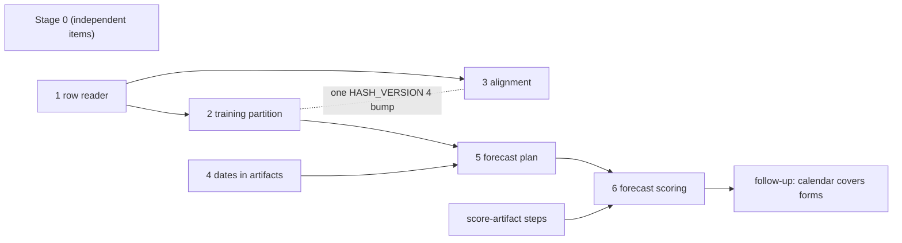

# Proposal: temporal architecture migration

**Status:** Decided 2026-11-15 (D35, D38–D48); implementation not started.
**Spec:** `docs/dev/temporal-architecture.md` (the spec; "spec §N" below).
**Motivation:** forecasts, forecast scoring (gh#808) and published score
artifacts (`2026-11-14-score-artifact.md`) all consume observation times,
training cutoffs and forecast targets that today are bare model times
re-interpreted at each consumer under different conventions. This document is
the runbook for moving the code to the spec: the audit that motivates it, the
stages as self-contained work packages, the tests, and the landing rules.

Code references are to `main` at `0ed74876d`. _Verified (read)_ means read in
the code at that commit; _verified (run)_ means reproduced by running binaries
built from it (`CAMDL_SKIP_VERSION_CHECK=1`,
`CAMDLC=ocaml/_build/default/bin/camdlc.exe`); _inferred_ means neither.

## Part 1. Audit of the current code

### 1.1 Compiler and IR

The time typing pass (`ocaml/lib/compiler/time_typing.ml`) classifies
expressions as exact durations, calendar durations, instants or other, and
enforces E320 (a month or year `time_unit` under an origin), E321 (a calendar
duration shifting an instant, under an origin), E322 (a calendar cadence in a
recurring schedule or `emit_schedule every`), E327 (anchor-only primitives
without an origin) and W324 (a bare number in a time position under an origin).
The IR keeps the calendar axis (`time_unit`, `origin`, `origin_rata_die`,
`ir.ml:1139-1145`), each stream's `covers`, column roles, emit schedules and
forcing knot times, and erases instant versus duration to `f64`. That erasure is
correct (spec §1.1). The defects are lowering holes:

| ID | Defect                                                                                                                                                                                                                                               | Evidence                                                                                    |
| -- | ---------------------------------------------------------------------------------------------------------------------------------------------------------------------------------------------------------------------------------------------------- | ------------------------------------------------------------------------------------------- |
| K1 | `date_range(d, count = n, calendar_months = k)` steps from the previous date, so after a month-end clamp later dates keep the clamped day: from 2020-01-31 it gives Feb 29, Mar 29, Apr 29, May 29, where `add_calendar_months` gives Mar 31, Apr 30 | `expander.ml:3343-3364` (`cur := step_fn !cur k_step`); verified (read, compiled)           |
| K2 | `covers = closing_at(time, 1 'months)` compiles to an affine span of 30.436875 days, though `emit_schedule = every 1 'months` is E322 and `origin + 1 'months` is E321                                                                               | `expander.ml:9481-9518`, `span_of` has no time-class check; verified (compiled)             |
| K3 | Instant arithmetic is unchecked except instant ± calendar duration: `date(a) + date(b)`, `date(a) * 2`, `7 'days - date(a)`, `date(a) + 5` and `date(b) - date(a)` used as an instant all compile in `at [...]`                                      | `time_typing.ml` `classify` (~:170) maps instant + anything to instant; verified (compiled) |
| K4 | `date()` lowers to a dimensionless constant, so `let d = date(...)` then `at [d]` is E315, and `if t > date(...)` in a rate is E302; `origin` works only because it lowers to 0                                                                      | `expander.ml:4388`; verified (compiled); fails closed                                       |
| K5 | A generated emit grid counts from `simulate.from`, while `docs/dates.md:525-531` says `origin`                                                                                                                                                       | `expander.ml:9706-9712`; verified (run)                                                     |
| K6 | Temporal expressions are accepted inconsistently across positions (`origin + 30 'days` is E401 in `emit_schedule at` and `simulate to`; `date_range` is E270 in `emit_schedule at` and `breakpoints`; non-monotone breakpoints compile)              | `resolve_float_expr` (`expander.ml:5622`); gh#844, gh#847; verified (compiled)              |
| K7 | `simulate --to` help says a month is 30.4375 days; the code uses 30.436875                                                                                                                                                                           | `cli/src/args/mod.rs:310` vs `ir/src/caltime.rs:87`; verified (read)                        |

### 1.2 Observation rows and training membership

`Period` (`sim/src/inference/multi_stream_obs.rs:1434`) and `StreamTimes`
(`:1505`) represent periods correctly, and `BoundObs::bind` (`:945`) refuses
non-increasing ends and overlaps. But the loader keeps each row as
`Observation { time, value }` (`particle_filter.rs:22`) with `time` the label,
and the training cut compares that label. Every site that resolves a cutoff or
`last_obs`, verified (read):

| Site                                                                                                             | Compares                     |
| ---------------------------------------------------------------------------------------------------------------- | ---------------------------- |
| `holdout_after` cut, `within_training` (`fit/runner.rs:2099`)                                                    | label                        |
| `holdout_after = "last_obs - N"`, `resolve_holdout_cutoff` (`runner.rs:2061`)                                    | label, over the full files   |
| `[data.holdout]` boundary and tail check (`runner.rs:1998`, `:2017`)                                             | label                        |
| `survey` truncation, a separate copy (`survey.rs:1001-1024`)                                                     | label                        |
| `profile` (`profile.rs:1003`)                                                                                    | label                        |
| `TrainingWindow.train_end` in `fit.meta.json` (`run_meta.rs:626`)                                                | label                        |
| `compare`, chain-binomial path (`training_scoring_ends`, `heldout_scoring_boundary`, `compare.rs:2069`, `:2145`) | period end (the gh#1062 fix) |
| `compare`, ODE path (`derive_ode_trace`, `compare.rs:2799-2802`)                                                 | label                        |
| `pfilter --score-from` and its `last_obs` anchor (`runner.rs:2121`, `pfilter.rs:975-990`)                        | period end                   |
| model anchors such as `simulate { to = last_obs + … }` (`main.rs:4139-4176`)                                     | label, over the full files   |
| `fit predict`'s `last_obs` and `value_at` (`fit/predict.rs:1791-1803`, `:1925`, `:3140`)                         | label, over the full files   |

Defects, each with a fixture in Part 6:

- **C2. Training runs past the cutoff it reports.** Verified (run), fixture F3:
  a `starting_on(time, 7 'days)` stream labelled 0–63 with `holdout_after = 24`
  trains on row 21 (days 21–27) and prints `training window [0, 24]`.
  `fit.meta.json` records `train_end: 24`. Nothing leaks in today's `compare`,
  which draws its own boundary, but a forecast from the recorded cutoff would
  score days the parameters were fitted to.
- **C3. The ODE comparison path cuts by label** (the open half of gh#1062).
  Verified (run), fixture F4: a `day(time)` stream with `holdout_after = 10`
  under `mh` on the `ode` backend makes `camdl compare` exit 1. The check
  `check_no_training_row_scored` (`compare.rs:2158`) refuses it, so this fails
  closed. `cli/tests/compare_ode_prequential.rs` covers only `closing_at`.
- **L1. `last_obs` means two things.** Verified (read): last label at some
  sites, last period end at others, and the model's anchors include held-out
  rows, so appending held-out data changes a fit's end time (one run resolved
  `last_obs + 14` to t = 84 from the full file).
- **No row identity reaches a score.** The fit records whole-file SHA-256
  digests and a label-time `train_end`; `compare` re-derives membership from
  labels (`compare.rs:2096-2125`). Verified (read).

A two-stream case was earlier reported here as a defect (a weekly row covering
days 21–27 scored as held-out while daily rows through day 24 trained). It is
not one: the weekly row was never fitted, and overlap with another stream's
training days is the ordinary condition of multi-stream scoring (spec §4.2).

### 1.3 Alignment, forecasting and forcings

- **A1. Off-grid observations are refused before the method is known.** Verified
  (run), fixture F1: `load_observations` refuses any `time % dt ≠ 0`
  (`runner.rs:1678-1688`), measured from 0, on every path, so `exact` stepping
  never sees an off-grid time. This contradicts `docs/dates.md:632` and
  `docs/camdl-run-spec.md:3126`. Fails closed.
- **A2. PGAS moves a period silently.** Verified (read), fixture F1's variant:
  PGAS receives period ends from `bind` (`runner.rs:485`) and rounds them onto
  its grid (`interval_steps`, `sim/src/time.rs:125`). With `from = 0.5`,
  `dt = 1`, a two-day period ending at 3 is scored on the step ending at 3.5 and
  its start rounds to 1.5: days 1.5–3.5 instead of 1–3. The label-based guard
  passes it (3 is a multiple of 1). No notice; nothing records it.
- **A3. Two PGAS errors advise `--obs-alignment exact`**, a flag that does not
  exist, for a policy PGAS refuses (`pgas.rs:1263`, `:1276`). Verified (read).
- **`obs_alignment` changes nothing.** Each method accepts only its own value
  (`fit/methods.rs:515-551`); nothing in `sim` reads it; it is a validation gate
  and a fit-identity input (`runid/src/inputs.rs:468`). Verified (read, grep).
- **T1. Forecast times continue the most common observed gap.** Verified (run),
  fixture F5: `forecast_times` (`predict.rs:3135`) uses `modal_value` of the
  observed gaps. Monthly rows ending at 31, 59, 90, 120, 151, 181 forecast at
  211, 241, …, where month-ends are 212, 243, … (gh#861).
- **T2. Forecast periods are not the observed periods.** Verified (read):
  `leaf_row_coverages` (`predict.rs:3049-3082`) gives a window-column forecast
  row `[previous label, label)`, wider than observed rows when they have gaps.
- **T3. A period under way at a restart is dropped silently.** Verified (run),
  fixture F6: `simulate --init-state` from day 25 drops the week covering days
  21–27.
- **T4. `fit predict` has no forecast length**: its reach is the model's
  `simulation.t_end` (`predict.rs:1915-1931`), and its `--horizon` flag picks a
  mode. Verified (read).
- **P1. `fit predict --horizon one_step` filters through held-out rows,
  unmarked.** Verified (run), fixture F3 under PMMH: all ten one-step rows are
  written; `predict.rs` never reads the holdout; neither JSON names the training
  extent.
- **F1. Forcings built from data hold their last value silently.** Verified
  (read): interpolated, cubic and piecewise forcings clamp
  (`sim/src/propensity.rs:378`, `:396-425`; `compiled_model.rs:335-337`); only
  B-splines report it (`cli/src/obs_anchor.rs:497-560`). The June audit
  reproduced it by running (a forcing held over t = 751–1100, exit 0, no
  message).
- **F2. Forecasts can read covariates from after the forecast origin.**
  Inferred: forcing values are baked into the IR with no notion of an origin.

### 1.4 Scoring, artifacts and the command line

- `PrequentialTrace` is at **schema 6** on `main` (`basis`, gh#312). The
  score-artifact proposal also calls its trace change schema 6; that change
  becomes schema 7. Verified (read).
- `Conditioning::{InSample, HoldOutTail}` (`score/src/trace.rs:109`) has no
  forecast variant; `Coverage` already records each scored value's period.
- **M1.** The stored simulation record has no calendar (gh#838). Verified (run).
- **M2.** Sub-day dated output does not load back (gh#839). Verified (run).
- **M3.** Dated diagnostics print numeric times beside dated error messages.
  Verified (run).
- "horizon" has four meanings today: the run end (`simulate --to` help), the
  predictive mode (`fit predict --horizon`), the scored-row count
  (`compare --allow-mismatched-horizon`), and the lead (gh#808). Verified
  (read).

## Part 2. Defects, ranked

Ranked by scientific severity: a silent wrong number first, then a misleading
record, then a refusal. "Trust gate" marks what must land before a forecast
score can be trusted.

| Rank | ID         | Effect                                                  | Stage                 | Trust gate                 |
| ---- | ---------- | ------------------------------------------------------- | --------------------- | -------------------------- |
| 1    | P1         | a band that saw held-out data looks like a forecast     | 5                     | yes                        |
| 2    | T1, T2     | wrong forecast targets for monthly and irregular series | 5                     | yes                        |
| 3    | A2         | PGAS scores a different period than declared            | 3                     | yes                        |
| 4    | C2         | parameters see data past the cutoff they report         | 2                     | yes                        |
| 5    | F1         | every run silently assumes a forcing's last value       | 0(f)                  | yes                        |
| 6    | K2         | a monthly `covers` width is silently 30.44 days         | 0(c)                  | yes, for monthly streams   |
| 7    | T3         | the period under way is dropped at a restart            | 5                     | yes                        |
| 8    | L1         | appending held-out data changes a fit's end time        | 2                     | yes                        |
| 9    | F2         | a forecast silently uses realised future covariates     | 5                     | yes, as a record           |
| 10   | K1         | month-end `date_range` instants drift                   | 0(b)                  | no                         |
| 11   | K3         | nonsensical instant arithmetic compiles                 | 0(d)                  | no                         |
| 12   | M1, M2, M3 | artifacts cannot be dated or reloaded                   | 4                     | M1 for published forecasts |
| 13   | C3         | ODE held-out compare refused                            | 0(a)                  | yes, for ODE               |
| 14   | A1, A3     | off-grid data refused; advice for a missing flag        | 3, 0(e)               | no                         |
| 15   | K4–K7      | refusals and documentation                              | follow-up, 0(e), 0(g) | no                         |

**Issues.** Each defect is filed: K1 gh#1068, K2 gh#1069, K3 gh#1070, K4
gh#1071, K5 gh#1072, K7 and A3 gh#1073, A1 gh#1074, A2 gh#1075, `obs_alignment`
gh#1076, C2 gh#1077, L1 gh#1078, P1 gh#1079, T1 gh#861, T2 gh#1080, T3 gh#1081,
F1 gh#1082, F2 gh#1083. C3 was gh#1062, fixed on `main` in `4a7c17f6f`.

## Part 3. How agents run this plan

**Order.** Stage 0 items are independent of each other and of everything else.
Stages 1–6 depend on each other (Part 4, "Dependencies") and run one at a time,
each finishing its gate before the next starts. The calendar `covers` forms are
a separate follow-up proposal written after Stage 6 (D45).

**One worktree per stage**, cut from a freshly fetched `origin/main`. Stage 0
items go through the existing `camdl-fixer` → `camdl-reviewer` loop
(`docs/dev/agentic-burn-down.md`), one issue each, except 0(f), which touches
the forcing lookup in `sim` and is done by a stage agent. Stages 1–6 each get
one implementing agent and then an independent review agent that re-runs the
stage's red tests on clean `main` (expected red) and on the branch (expected
green), redoes the sibling sweep, and checks each claim against a pasted
command.

**Read first, every stage:** `CLAUDE.md`; the spec; this document's stage entry;
`docs/dev/agent-verification-conventions.md`; the path-scoped rule for the files
touched (`.claude/rules/`); for any change to `pgas.rs`, `particle_filter.rs`,
`obs_loglik.rs`, `obs_model.rs`, `if2.rs` or `pgas_grad.rs`, the whole function
being edited.

**Within a stage:**

1. Write the stage's failing tests first, from its fixtures, and paste the red
   run.
2. Make the change. After it is green, revert the source change with the test
   kept and confirm the test fails again (the mutation check), then restore.
3. Run the stage's listed "must stay identical" tests and paste them green
   unmodified.
4. Run the full gate, `make test`, and paste its exit status. Never pipe a gate
   through `tail` or another filter; read its own exit code.
5. Update the documents the stage names, in the same branch; run `dprint fmt` on
   each Markdown file touched, never `docs/camdl-language-spec.md`.
6. Commit one thing per commit, staging files by name; each commit carries a
   `Proposal: docs/dev/proposals/2026-11-15-temporal-architecture-migration.md`
   footer and no assistant attribution.

**Stop and report instead of proceeding** when: a golden file changes; any
`HASH_VERSION`, `SimConfig` schema or `ir/VERSION` change is needed beyond what
the stage lists; a "must stay identical" test moves; or the stage's design does
not fit the code as found. Landing follows the maintainer's current rule for the
repository.

## Part 4. Stages

### Stage 0: independent fixes

Each item is one GitHub issue, one branch and one commit.

- **0(a) ODE held-out boundary (C3). Done:** fixed on `main` in `4a7c17f6f`
  (gh#1062, closed); the description below is kept as the record. **0(a) ODE
  held-out boundary (C3).** In `derive_ode_trace` (`cli/src/compare.rs:2799`),
  use `heldout_scoring_boundary` as the chain-binomial path does. Red test:
  fixture F4 in `cli/tests/compare_ode_prequential.rs` (a `day(time)` stream);
  today it exits
  1. Behaviour change: a refusal becomes a score.
- **0(b) `date_range` from its start (K1).** In `expander.ml:3343-3364`, compute
  entry `i` as `step_fn start (i·k)`. Red test: the 2020-01-31 example, compared
  with `add_calendar_months` for each `i`. Behaviour change: month-end
  `date_range` instants. Check whether any golden uses such a `date_range`; if
  one moves, stop and report.
- **0(c) No calendar width in `covers` (K2).** E321 on a calendar-classified
  width in any `covers` form, with a hint naming window columns until the
  calendar `covers` forms exist. Red test: `closing_at(time, 1 'months)` must
  fail to compile. Behaviour change: a compiling form is refused.
- **0(d) Instant arithmetic (K3).** Refuse `Instant + Instant`, `k · Instant`,
  `Duration − Instant` and `Instant + bare number` under an origin, with a new
  error code registered in the warning catalog. Red tests: each form. Update
  `docs/camdl-language-spec.md` by hand (it is never run through `dprint`).
- **0(e) Text (A3, K7).** Correct the two PGAS messages to name the real fix
  (choose `dt` so the observation times lie on the grid); correct the
  `simulate --to` help to 365.2425/12 days.
- **0(f) Time functions outside their range (F1; D44, D48).** Evaluating a
  data-table forcing (interpolated, cubic, piecewise) outside its data range, or
  a B-spline outside its window, becomes an error naming the function, its range
  and the first time outside it. A run-level override,
  `--allow-forcing-extrapolation` on every command that runs a model, and the
  matching `[config] allow_forcing_extrapolation = true` in a fit config, holds
  the end value as today, prints one warning per function with the span held,
  and records the override in `run.json` (and later in score artifacts).
  - Detection: a set-once flag per function in the clamp branch of the lookup
    (`propensity.rs:378`, `:396-425`; `compiled_model.rs:46`, `:335-337`): load,
    and store only if unset. No counter: a counter would contend between
    particle threads on every clamped evaluation.
  - The B-spline notice (`spline-held-past-window`) becomes this warning.
  - Red tests: one model per forcing kind whose data end before `t_end`, under
    `simulate` and `fit run`, each refused; with the override, output
    bit-identical to today's and one warning per function.
  - Sweep: list every in-repo model, fixture and example whose forcings end
    before its run end. Each either gets its data extended, its run shortened,
    or the override with a comment saying why. Report the list.
  - Docs: `docs/dev/forcing-kinds.md`, `docs/commands.md`, `docs/fit-toml.md`,
    the warning catalog.
- **0(g) Generated observation times (K5; D46).** Rewrite
  `docs/dates.md:525-531` to say that generated observation times count from
  `simulate.from`, and that `origin` only names the calendar date of `t = 0` and
  moves nothing in time; say why (a simulation's first observation counts from
  its own start). No code change.

### Stage 1: one row reader

- **Goal.** One function reads a stream's rows once and records what each row
  measures. Pure refactor.
- **Depends on:** nothing.
- **Changes.** Add `observed_rows(...)` in `cli/src/fit/observed_rows.rs`,
  returning `ObservedRow { position, measures, temporal, cell, aux }` (spec
  §3.1), with `measures` computed by `Covers::period_of` or the window columns.
  It is the score-artifact proposal's step 1 with `measures` in place of its
  `time`. Rebuild `load_observations` (`runner.rs:1600`) and `stream_times_for`
  (`pfilter.rs:1489-1532`) on it, so the likelihood and every later step read
  the same rows.
- **Red tests.** None; this stage must change nothing. Add unit tests that
  `observed_rows` yields the periods in the spec's §2.2 table for each `covers`
  form.
- **Must stay identical:** every existing test, unmodified; fixed-seed fits and
  traces in the existing suites byte-identical.
- **Done when:** the full gate is green with no test edited.

### Stage 2: the training partition

- **Goal.** Training membership is decided once from periods and recorded as a
  per-stream prefix with a digest (D38, D40).
- **Depends on:** Stage 1. Its identity change lands in the shared
  `HASH_VERSION` 4 bump (D47), so Stage 2 is developed on the identity
  integration branch together with Stage 3 and the score-artifact proposal's
  identity steps, and lands with them.
- **Changes.**
  - Add `TrainingPartition` and `RowPrefix` (spec §3.2) with the two
    constructors; rule per spec §4.1.
  - Replace the label cuts listed in §1.2: `within_training`,
    `resolve_holdout_cutoff`, the `[data.holdout]` checks, `survey`'s copy,
    `profile`, and `compare`'s `training_scoring_ends` (which then reads the
    partition's extent).
  - Write `training_partition` in `fit.meta.json` for every fit, replacing
    `training_window`; the fit's summary prints "trained on N rows, through
    <extent as a date>".
  - `last_obs` (D40): the latest period end, one value per fit across streams;
    over the full files for `holdout_after`, over training rows for every other
    anchor (`main.rs:4139-4176`, `fit/predict.rs:1791-1803`,
    `pfilter.rs:975-990`).
  - Stale-stream note: `fit` prints a note naming any stream whose last
    observation is more than one of its own periods before `last_obs`.
  - Fit identity: fold the partition rule version and the per-stream training
    row digests into `FitDigest`.
- **Red tests (fail on `main`).**
  - Fixture F3: row 21 does not train; the recorded extent is 21, the end of row
    14's period.
  - A `day(time)` stream, labels 1–16, `holdout_after = 10`: 9 training rows,
    extent 10.
  - Fixture F2: daily rows 0–23 and weekly rows 7, 14, 21 train; extent 24;
    weekly row 28 is scored.
  - `[data.holdout]` and `holdout_after` describing the same split produce the
    same `training_partition`.
  - Appending held-out rows to a `holdout_after` file leaves the fit's
    `simulate { to = last_obs + … }` end time unchanged.
- **Must stay identical:** fits on `closing_at` and window-column streams
  (`cli/tests/holdout_applied.rs` and `compare_heldout_scoring_axis.rs`, their
  `closing_at`, file and window-column cases), bit for bit.
- **Intentional changes:** `holdout_after` fits on `day`, `starting_on` and
  `ending_on` streams lose the row straddling the cutoff, and re-key; models on
  `day(time)` streams anchored at `last_obs` end one day later.
- **Docs:** `docs/fit-toml.md` (`holdout_after`), `docs/camdl-run-spec.md` (fit
  record), `docs/dates.md` (one paragraph on which rows train).

### Stage 3: alignment once the method is known

- **Goal.** A period is never moved to fit a grid; the setting that pretends to
  choose is removed (D43).
- **Depends on:** Stage 1. Lands in the shared identity bump with Stage 2.
- **Changes.**
  - Delete the `time % dt` check in `load_observations`.
  - After the method is known, check every observed period's start and end,
    measured from `t_start`: if2, pfilter and pmmh pass them to the engine
    unchanged; PGAS refuses any that are off its grid, naming the row and the
    nearest grid times.
  - Delete the `[config] obs_alignment` key, `ObsAlignment`,
    `resolve_obs_alignment` and the field in the fit identity
    (`runid/src/inputs.rs:468`). A fit config carrying the key is refused with a
    message saying it was removed. Record what the method can do in the
    `METHODS` registry (`docs/dev/capabilities-system.md`); update the comment
    at `fit/pgas.rs:712`.
- **Red tests.** Fixture F1 fits under if2, pfilter and pmmh (today refused);
  F1's PGAS variant is refused (today shifted); a fit config with
  `obs_alignment` is refused.
- **Check:** F1 under each exact method agrees within Monte Carlo error with the
  same data fitted at `dt = 0.5`, where the times are on the grid. Not verified
  today: that every exact path honours an off-grid period end; this test settles
  it.
- **Must stay identical:** every on-grid fit, every method.
- **Docs:** `docs/dates.md:632`, `docs/camdl-run-spec.md:3126`,
  `docs/fit-toml.md`, `docs/dev/capabilities-system.md`.

### Stage 4: dates in every artifact

- **Goal.** Every artifact can be dated without the model source, and every date
  camdl writes loads back.
- **Depends on:** nothing.
- **Changes.** Add `CalendarAxis` to `ir::caltime` (spec §3.4); write a
  `calendar` block in the simulation record's `run.json`, in `fit.meta.json` and
  in the predictive sidecars, all through it. Make the loader accept the sub-day
  form the renderer writes (gh#839). Print dates beside numeric times in dated
  diagnostics (the prequential TSVs, pfilter's worst-scored table).
- **Red tests.** A sub-day dated output loads back to identical model times (a
  `proptest` property over times and origins); a simulation leaf's `run.json`
  carries `calendar`.
- **Identity:** the simulation record's stored bytes change, so `SimConfig`'s
  schema version is bumped in this stage.
- **Docs:** `docs/camdl-run-spec.md`, `docs/dates.md` ("Getting dates back
  out").

### Stage 5: the forecast plan

- **Goal.** Every prediction is made against one validated list of targets, with
  what conditioned it recorded (D39, D41, D42).
- **Depends on:** Stages 1, 2 and 4.
- **Changes.**
  - Add `ForecastPlan`, `StateConditioning` and `Target` (spec §3.3). Its
    conditioning fields are built only from the fit record and from what the
    filter or sampler returns.
  - `fit predict` and `simulate --init-state` build a plan; delete
    `forecast_times` and `leaf_row_coverages`. Targets per spec §4.3; a stream
    with no declared rhythm is refused a forecast tail.
  - `fit predict` reads the fit's partition. Under one-step prediction, rows are
    marked `trained` or `held_out`; the JSON states both information sets.
  - The period under way at the origin is a target on every backend (D39): the
    particle filter's saved state (`particle_filter.rs`, a high-risk file)
    carries each stream's running count since its current period began, and
    `--init-state` restores it.
  - Flags (D41): `fit predict --horizon` (a mode today) becomes
    `--mode {free-forward, one-step}`; `--horizon DURATION` sets the reach on
    `fit predict` and `simulate --init-state`;
    `compare
    --allow-mismatched-horizon` becomes
    `--allow-mismatched-scored-steps`. Horizons per target per spec §2.5.
  - Notes: covariates read after the forecast origin (F2), detected through the
    Stage 0(f) flag over the forecast run; the stale-stream note from Stage 2.
  - Predictive TSVs gain `role`, `t_start`, `t_stop`, `horizon` and `lead`
    (gh#624).
- **Red tests.**
  - Fixture F5: the forecast tail is refused (today a 30-day step).
  - A `closing_at(time, 7 'days)` stream with one `NA` week: the tail continues
    by 7 days, not by the most common gap.
  - Fixture F6: the week under way at the restart is a target, on the particle
    filter, ODE and PGAS paths, with the same target list on each.
  - Fixture F3 under PMMH: one-step rows past the training extent are marked
    `held_out`; `[data.holdout]` describing the same split gives the same
    record.
  - A forecast origin earlier than the state's last row is refused.
  - `--horizon "4 weeks"` from a week boundary gives weekly horizons 0–3 and
    daily horizons 0–27.
- **Must stay identical:** free-forward bands at observed times
  (`cli/tests/fit_predict_e2e.rs`);
  `fit/predict.rs::forecast_times_land_on_the_snapshot_grid`, converted to
  assert the same times through the plan for a regular `closing_at` stream.
- **Intentional changes:** forecast target times move wherever the most common
  gap differed from the declared width or schedule;
  `gh696_predict_horizon_rows.rs`, `predict_forecast_close_past_horizon.rs` and
  `predict_keeps_one_step_when_tail_fails.rs` are re-expressed against plan
  targets.
- **Docs:** `docs/commands.md`, `docs/camdl-run-spec.md`, `docs/inference.md`,
  `docs/agents.md`; the principles document's vocabulary lifts the ban on
  "horizon" with its one meaning.

### Stage 6: forecast scoring

- **Goal.** Fixed-origin forecasts are scored per forecast date and horizon, on
  the score artifact (gh#808, D35).
- **Depends on:** Stage 5 and the score-artifact proposal's artifact steps.
- **Changes.** The score artifact's lead-time type gains a fixed-origin variant
  carrying the forecast origin; each scored target records its horizon and lead;
  rolling forecast dates reuse one fit's parameters and condition the state up
  to each date; scores are kept per (forecast date, stream, horizon) and never
  pooled across horizons. `camdl score FIT --horizon "4 weeks"` scores the
  fixed-origin plan whose origin is the training extent; rolling dates are given
  as a stride. `compare` refuses to difference scores whose modes, forecast
  dates or horizon sets differ. The particle filter stops assimilating at the
  origin through the Stage 5 machinery; the ODE path uses its existing
  free-forward basis.
- **Red tests.** A forecast score's targets equal the held-out rows' periods; a
  forecast at origin _s_ never reads a row ending after _s_ (asserted by the
  plan's record of assimilated rows); scores at different horizons are never
  summed.
- **Docs:** `docs/inference.md` ("Out-of-sample validation"), the score-artifact
  schema documentation.

### Dependencies



**Before forecast scores can be trusted:** Stages 1, 2, 3, 5 and 0(a), 0(c),
0(f); Stage 4's calendar block for any forecast that is published. Stage 0(b),
0(d), 0(e) and 0(g) are independent improvements.

**Scope.** The temporal refactor (Stages 0–4) is roughly half the work: Stage 0
is seven small items, Stage 1 one medium refactor, Stage 2 the largest refactor
step, Stages 3 and 4 small each. New forecasting (Stages 5–6) is the other half,
and Stage 6 also waits on the score artifact. These are relative sizes, not
measurements.

## Part 5. Acceptance suite

| Property                                  | Test                                                                                                                                                                                                                                                                    |
| ----------------------------------------- | ----------------------------------------------------------------------------------------------------------------------------------------------------------------------------------------------------------------------------------------------------------------------- |
| Start- and end-labelled periods           | one synthetic series written under `day`, `starting_on`, `ending_on` and `closing_at`: identical training partitions and identical held-out scores                                                                                                                      |
| A period straddling the cutoff            | fixture F3 and the `day(time)` case: the straddling row does not train; the recorded extent equals the latest training end                                                                                                                                              |
| Streams at different rates                | fixture F2: training per spec §4.1; targets per stream tile from that stream's own periods; horizons count each stream's own unit                                                                                                                                       |
| Irregular periods                         | window-column rows with gaps: held-out targets are exactly the observed periods; the tail uses `emit_schedule` or is refused                                                                                                                                            |
| Exact versus grid-bound methods           | Stage 3 tests                                                                                                                                                                                                                                                           |
| Calendar months and leap years            | the `date_range` 2020-01-31 case; window-column month-end rows across 2020-02-29                                                                                                                                                                                        |
| Deterministic and stochastic prediction   | one plan on chain-binomial, PGAS and ODE: identical target lists and identical start and end per target; the ODE mean within Monte Carlo error of the chain-binomial mean at large population. No trajectory equality required                                          |
| Flow at period boundaries                 | a target over `[a, b)` equals the difference of the cumulative flow at the recorded snapshots, on each backend; for a period under way, the pre-origin part matches the filter's running count                                                                          |
| Intervention on a boundary with live flow | an intervention at a day boundary, a `day(time)` stream and non-zero rates, on chain-binomial, Gillespie and ODE: the previous day's flow is unchanged with and without it, and the day it opens is affected (`docs/dates.md`, "Interventions and events are instants") |
| Continuing the declared rhythm            | Stage 5's `NA`-week case                                                                                                                                                                                                                                                |
| Forcing data ending before the run end    | Stage 0(f) tests                                                                                                                                                                                                                                                        |
| Parameter versus state information sets   | Stage 5's PMMH case and Stage 6's no-row-after-origin assertion                                                                                                                                                                                                         |
| Membership proof                          | a score on a file with an edited training row is refused as changed data; appended rows keep the fit's identity and are scored                                                                                                                                          |
| Round-trips                               | Stage 4's property test                                                                                                                                                                                                                                                 |
| Forecast origin validation                | the origin-before-data refusal                                                                                                                                                                                                                                          |

**Must stay unchanged throughout** (numbers bit-identical unless a stage names
the change): `sim/tests/prequential_scores_oracle.rs`,
`sim/tests/prequential_loglik_invariant.rs`, `sim/tests/ode_prequential.rs`,
`cli/tests/compare_ode_prequential.rs` (its `closing_at` cases),
`cli/tests/dated_data_loader.rs` (including `dated_loglik_matches_numeric` and
`numeric_shift_invariance`), the `closing_at`, file and window-column cases of
`cli/tests/holdout_applied.rs` and `compare_heldout_scoring_axis.rs`, and the
exact-value `compare.rs` unit tests (`:5193`, `:5266-5269`).

## Part 6. Fixtures

The fixtures were built in a scratch directory for the audit and are restated
here.

**F1, off-grid observation periods.**

```camdl
time_unit = 'days
compartments { S, I, R }
parameters { beta : rate in [0.01, 2.0]  gamma : rate in [0.01, 1.0]  rho : probability in [0.01, 1.0] }
transitions { infection : S --> I @ beta * S * I / (S + I + R)
              recovery  : I --> R @ gamma * I }
observations { cases { columns { time : time, cases : count }
  covers = closing_at(time, 2.5 'days)  projected = incidence(infection)
  cases ~ poisson(rate = rho * projected + 0.1) } }
init { S = 990  I = 10  R = 0 }
simulate { from = 0 'days  to = 30 'days  dt = 1 'days }
```

Data at t = 2.5, 5, …, 15. PGAS variant: `from = 0.5 'days`,
`covers = closing_at(time, 2 'days)`, data at 3, 5, 7, 9.

**F2, two streams at different rates.** F1's compartments, with

```camdl
weekly { columns { time : time, cases : count }
  covers = closing_at(time, 7 'days)  projected = incidence(infection)
  cases ~ poisson(rate = rho * projected + 0.1) }
daily  { columns { time : time, recovered : count }
  covers = day(time)  projected = incidence(recovery)
  recovered ~ poisson(rate = rho * projected + 0.1) }
```

Weekly labels 7–70, daily labels 0–69, `holdout_after = 24`.

**F3, training past the cutoff.** One `starting_on(time, 7 'days)` stream,
labels 0–63, `holdout_after = 24`, fitted with PMMH; then
`camdl fit predict --fit fit.toml --horizon one_step` (`--mode one-step` after
Stage 5).

**F4, ODE held-out compare.** One `day(time)` stream, labels 1–16,
`holdout_after = 10`, `algorithm = "mh"`, `backend = "ode"`; two fits differing
in a fixed parameter; `camdl compare`.

**F5, monthly window columns.** Window rows ending at 31, 59, 90, 120, 151 and
181; `simulate { to = 365 }`; no `emit_schedule`.

**F6, the period under way at a restart.** F2's weekly stream with
`emit_schedule = every 7 'days`; filter through data at 11, 18, 25; then
`simulate --init-state … --to 49 --obs`.

## Part 7. Compatibility and risks

- **Alpha posture.** No shims: `training_window` becomes `training_partition`
  and `obs_alignment` is refused, atomically. A fit record written before Stage
  2 cannot be scored held-out; the refusal says to re-run the fit, which the
  hash bump requires anyway.
- **Identity.** Stages 2 and 3 and the score-artifact identity steps share one
  `HASH_VERSION` bump to 4 (D47); every stored fit re-keys once and old results
  stay readable by path. Stage 4 bumps `SimConfig`'s schema version. No stage
  changes `ir/VERSION`.
- **Fitted numbers move** in Stage 2 for `holdout_after` fits on start- or
  day-labelled streams. This corrects the record; the release notes name the
  `covers` forms affected.
- **Models stop running** in Stage 0(f) when a forcing's data end before the run
  end. Stage 0(f)'s sweep lists them, and the error names the override.
- **Stage 3 removes a refusal.** Off-grid observations become fittable under
  exact methods; the dt-agreement check is the guard.
- **High-risk files.** Stage 3 touches PGAS's error text and how it receives
  periods; Stage 5 changes the particle filter's saved state. Both require
  reading the full functions first.

## Part 8. Decisions

Recorded in the maintainer's docket; each is reflected in the spec and above.

- **D35.** Rolling forecast dates with parameters fixed from one fit; the state
  may be conditioned on all data up to each forecast date; scores per (forecast
  date, horizon), never pooled across horizons.
- **D38.** A row trains if the end of its period is at or before the cutoff;
  `compare` scores every row that did not train.
- **D39.** The period under way at the forecast origin is a target on every
  backend; the particle filter's saved state carries the running count.
- **D40.** `last_obs` is the latest period end across streams; over full files
  for `holdout_after`, over training rows elsewhere.
- **D41.** `--horizon` on the command line is a duration; a target's horizon is
  a count of its stream's periods from the one under way at the origin, as in
  forecast hubs; `fit predict --horizon` becomes `--mode`.
- **D42.** A stream with no declared rhythm is refused a forecast tail.
- **D43.** PGAS refuses off-grid periods; `obs_alignment` is removed.
- **D44.** A data-table forcing past its data is an error unless overridden.
- **D45.** Calendar `covers` forms are the immediate follow-up, with their own
  proposal.
- **D46.** Generated observation times count from `simulate.from`; the document
  is corrected.
- **D47.** One `HASH_VERSION` 4 bump with the score artifact.
- **D48.** D44's rule covers every time function outside its range, B-spline
  windows included.

## Part 9. Documents this plan changes

- **Archived** (`671be6ef3`): the June interval model, its overview and runbook,
  the burn-in conditioning window, the two observation-anchor proposals, the
  June observation system, the conditioned-scenario predictive.
- **Amended now:** `2026-11-14-score-artifact.md` (status line naming the
  sections this plan changes: its `ObservedRow`, `train_end`, held-out rule,
  trace schema number and lead-time type);
  `2026-08-29-honest-predictive-evaluation.md` (status line: §3.7.2 forecast
  mode and §3.8 rolling origins are refined by the spec and D35);
  `2026-06-22-predictive-ergonomics.md` (status line: forecast targets and
  conditioning are governed by the spec).
- **Amended by the stage that changes behaviour:** listed under each stage's
  "Docs". `docs/dates.md` stays the modeler's document; the spec does not
  replace it.
