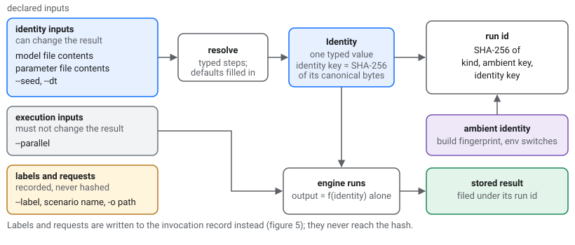
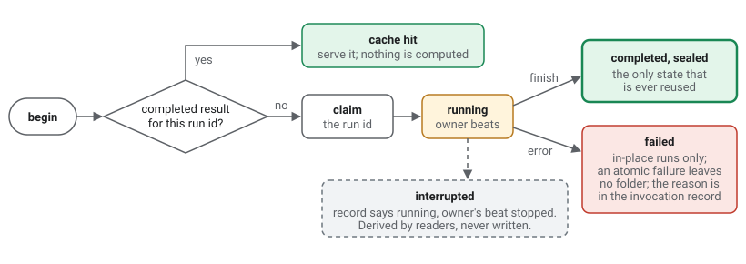
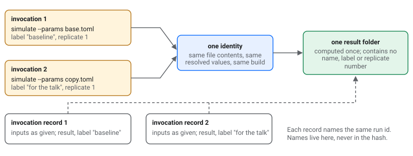
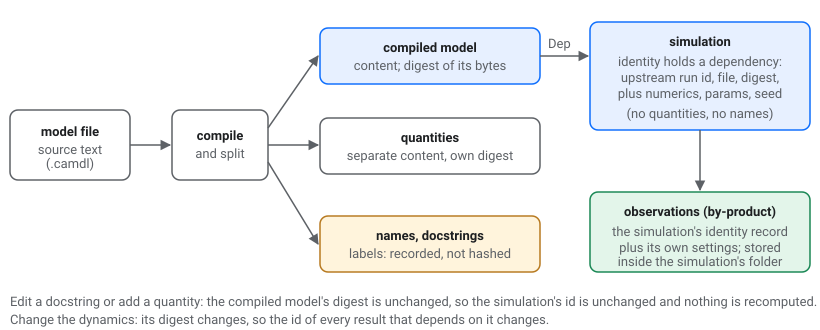

# Run store API: identity, provenance and layout from argument types

Nov 20, 2026 · @Vince Buffalo

Supersedes: phase 3 of `2026-11-17-honest-input-addressed-store.md` (the input
architecture) and its named follow-up, the fit's typed identity. Phases 1 and 2
of that proposal stand.

## Inputs, identity and the store

Scientific software has two bookkeeping problems that are usually left to the
scientist. This design solves each once, in a library, so that nobody solves it
by hand. Three words carry it.

- **An input** is anything that reaches a command: an argument, the contents of
  a settings or data file, an environment switch.
- **An identity** is the typed value that fully determines one result.
- **A store** is the directory tree that holds results, together with the only
  code that reads or writes it.


### Knowing what a run was given

Reproducing a result needs a record of everything that went into it: the
arguments, the contents of the settings and data files, the environment
switches. A scientist should not have to keep that record. The software should
write it.

Some tools already write part of it. bcftools, for example, appends its version
and command line to the header of each VCF file it writes, unless told not to
with `--no-version`
([bcftools manual](https://samtools.github.io/bcftools/bcftools.html), "Common
Options", version 1.22). The VCF format holds such lines in its header as
meta-information
([VCFv4.3 specification](https://samtools.github.io/hts-specs/VCFv4.3.pdf),
"Meta-information lines").

What is new here is a wall between the user's input and the program. Each input
is given a class once, in its type, and an input with no class does not compile.

- **identity:** can change the result, and is hashed into the run id.
- **expands:** decides which results a batch has, such as a list of seeds.
- **adds:** requests a by-product, such as observations drawn from a simulation.
- **execution:** used by the engine and must not change the result, such as a
  number of threads.
- **export and render:** write a copy or a rendering of stored files to a path,
  or shape that rendering.
- **store and recorded:** a request to the store, such as a label, or something
  kept on record that nothing reads.
- **group:** a nested set of inputs, each with its own class.
- **skip:** affects only what is printed, and is recorded nowhere.

Past the wall the inputs are four typed structures: the identity, the execution
settings, the exports and the store request. Only the identity is hashed. Every
classed input is recorded as given; `skip` is the one exception.

### Keeping an output's name tied to its inputs

When users name their own output files, the name drifts from the inputs they
care about. A file called `baseline_final_v2.tsv` says nothing reliable about
the model or the scenario that produced it.

Here the store derives the folder from the identity.

- **The run id** is a hash of the kind of result, the ambient identity and the
  identity.
- **The ambient identity** is the build of camdl and the environment switches
  that can change results.
- **A layout** places the folder. It groups parts of the identity into directory
  levels, so results that share a model or a block of settings share a
  directory. The tool's author writes one layout for each kind of result.

What a user chooses sits around a result, not in it.

- **A label** (`--label`, found again as `@L`) names an invocation, one run of a
  command. It is never part of the identity.
- **An export** writes a copy or a rendering of stored files to a path of the
  user's choosing.

A reader never parses a path. It asks the result's record.

## Summary

This is the target design for camdl's run store, in two parts. Part 1 is the
store library, written without reference to camdl's commands. Part 2 is camdl on
that store: worked examples, the features that depend on it, and the path from
today's store.

The core of it: a project declares every input once, in arguments and in the
files they name. Typed steps turn those into one identity per result. An output
is a function of its identity alone. The store does every write and every read
of a stored file.

Much of the library exists in camdl today, scattered: locks naming process and
host, heartbeats, `progress.json`, `.attempts/`, `.quarantine/`, `.staging/`,
profile invocation records and `index.json`. This design unifies them. Four
mechanisms are new or reshaped: an owner whose beat file carries its process
start time, in place of a lock per claim; per-owner index logs, in place of one
`index.json`; by-products with a reproducing mode, in place of children added to
a parent's record; and an invocation record for every command run, which also
holds the labels.

The main points:

- **Names are labels, never identity.** A scenario's name, a model file's name,
  a replicate number and the user's seed are recorded with the invocation. No
  stored result file contains them; a folder's name may show them, and is never
  read back.
- **The combined table of a multi-cell `simulate` is a rendering, not a stored
  result.** `-o` and `camdl cat` render it from the stored cells and the
  invocation record, so it keeps today's shape.
- **An export is a copy or a rendering of stored files.** `--dates` and a file
  format are rendering options. An export never runs the model again.
- **Every command run writes an invocation record.** It holds the inputs as
  given and the ordered list of results the command asked for, with their
  labels. A batch is an invocation with several results. Looking a result up by
  its configuration file is a query over these records.
- **One compile yields several contents.** A section says which part of a model
  file is identity for which result. Adding a quantity or editing a docstring
  still recomputes nothing.
- **By-products commit with their upstream,** and every particle-filter
  diagnostic is stored. Thinning large ones is a later feature.
- **A fit is a problem and the runs on it.** Method settings, including those
  that sit in `[estimate]`, belong to the run.
- **Existing fits are abandoned at migration.**
- **The compiled model is stored whole,** derivative tables included, under the
  digest of what is stored. The IR loses two fields nothing reads,
  `output.format` and `simulation.time_semantics`, and is otherwise unchanged.
- **A configuration file never names a run.** Labels, ids and paths do.
- **Some features are left for later.** Archive and prune, search by identity
  field, `diff`, a `watch` command and stored combinations are listed under
  future features and are not built.

Status: accepted design; not yet implemented. The code in this document is a
sketch and has not been compiled. File and line references are to camdl at
`1c79769fe`.

## Part 1: the store library

Everything from here to the enforcement section is the library. It names no
camdl command.

## Guarantees

The store must never return a wrong answer; every other guarantee serves that
one. Recomputing something reusable costs time. Reusing something that should
have been recomputed is a silent scientific error, so doubt resolves towards
recomputing.

1. **Sound reuse.** A stored result is reused only if the requested computation
   would have produced it, by the same build, under a stated meaning of "same".
2. **A stored result file is a function of its identity alone.** Any value
   written into a result that is not in its identity is a bug: a position in a
   grid, the order of a list the identity treats as a set, a label. A recompute
   that differs from the stored bytes makes such a bug visible. What a user
   recognises a result by (a name, a replicate number, the seed they typed) is a
   label: it is recorded with the invocation and appears only in renderings.
3. **Complete identity by construction.** Everything that can change a result is
   part of its identity: arguments, file contents, environment switches, derived
   seeds, the build. Adding an input without deciding its class does not
   compile.
4. **Canonical identity.** Two requests that mean the same thing get the same
   id. Files are hashed by content and their paths only recorded. Defaults are
   resolved first, so a flag at its default and no flag are one identity.
5. **A content's digest is the SHA-256 of what is stored and consumed.** Never
   of a projection of it.
6. **Only completed results are reused.** Every result folder has a status:
   running, completed, failed (an in-place run only) or interrupted. A failed
   atomic result leaves no folder; its failure and reason are kept in the
   invocation record. A running or stopped run is visible and explains itself,
   and is never served as a result.
7. **Completed records are sealed.** Nothing rewrites a completed result or its
   record, without exception.
8. **Every write and every read of a stored file goes through the store.**
   Claims, manifests and records cannot be skipped, and every read of another
   result's files is recorded.
9. **Self-explaining results.** The record, with the invocation record it names,
   says what produced a result: the inputs as given (the full command line is in
   the invocation record), the build, the environment, and the results it
   consumed with their digests and builds.
10. **Readers ask the record.** Seed, kind, parent and status come from the
    record, never from a folder name or its depth.
11. **Old records are refused loudly, never misread.**
12. **Cheap adoption.** A project declares inputs in one place and writes no
    hashing or locking code. The library knows nothing about the science.

## Concepts

Two ideas carry the design: every input has a class and only identity inputs are
hashed, and every stored folder has a status and only completed ones are reused.



The split separates the arguments by class. Typed resolution steps then turn the
identity inputs into the identity, and the engine receives that identity and the
execution values. Requests to the store, such as a label, are recorded and never
hashed.



Running, completed and failed are written to the record. Interrupted is never
written: a reader concludes it when the record says running and the owner is
gone.

| Term              | Meaning                                                                                                                                                                                                                                                                                                                                   |
| ----------------- | ----------------------------------------------------------------------------------------------------------------------------------------------------------------------------------------------------------------------------------------------------------------------------------------------------------------------------------------- |
| Input             | Anything that reaches a command: a flag, a key in a settings file, the content of a data file, an environment variable, or an earlier result.                                                                                                                                                                                             |
| Class             | What an input may do. The main three: identity (can change a result, hashed), execution (used by the engine, must not change the result), store (a request to the store). API 1 lists them all.                                                                                                                                           |
| Declared inputs   | The struct of `identity`, `expands` and `adds` inputs that a derive generates from a command's arguments or from a settings file. Its fields are private. It has no key and cannot be passed to the store; only the identity resolved from it can.                                                                                        |
| Resolution        | The typed steps that consume declared inputs by value and produce identity values: parsing a file, compiling a model, merging flags over file settings, filling in defaults.                                                                                                                                                              |
| Identity          | A project-written typed value that fully determines one result's bytes.                                                                                                                                                                                                                                                                   |
| Content           | A typed value with a byte form. Its digest is the SHA-256 of those bytes.                                                                                                                                                                                                                                                                 |
| Content artifact  | An artifact whose identity is the digest of its one result file, such as a compiled model. Other results depend on it.                                                                                                                                                                                                                    |
| Identity record   | The form of an identity that `identity.json` holds and readers get. Content the artifact stores itself appears there as its digest.                                                                                                                                                                                                       |
| Key               | A 32-byte SHA-256 digest of a value's canonical encoding (the "Keys" section). A struct's encoding covers its tag, its version, and each field's name and encoding.                                                                                                                                                                       |
| Ambient identity  | The build fingerprint and the identity-class environment variables. The store adds it to every run id.                                                                                                                                                                                                                                    |
| Artifact          | A kind of stored result, such as a simulation, a fit problem, a fit run or a prediction. Each has one identity type, one labels type and one write mode.                                                                                                                                                                                  |
| By-product        | A second artifact produced by the same computation as another, such as observations drawn while a trajectory is simulated. Its identity holds the upstream's identity record plus its own settings.                                                                                                                                       |
| Run id            | The hash of the artifact's kind, the ambient identity and the identity key.                                                                                                                                                                                                                                                               |
| Status            | Running, completed or failed, as written in the record. Interrupted is derived by readers and never written. Only an in-place run is ever recorded as failed in its folder; a failed atomic result leaves no folder.                                                                                                                      |
| Claim             | Exclusive ownership of a run id while it is computed.                                                                                                                                                                                                                                                                                     |
| Owner and beat    | The process holding claims, named by host, process id and start time. It increments one counter, its beat, every few seconds.                                                                                                                                                                                                             |
| Invocation record | The store-owned, durable record of one command run: the inputs as given, a digest of each configuration file, the `--label` if one was given, the ordered list of results the command asked for with each one's labels, and how many completed and failed. It is written on a cache hit too, and is not rewritten after the command ends. |
| Batch             | An invocation that asks for several results.                                                                                                                                                                                                                                                                                              |
| Label             | Anything a user recognises a result by that is not in its identity: a scenario's name, a model file's name, a replicate number, the seed the user typed, a `--label`. Labels live only in invocation records. A result's labels are a value the project supplies (`Artifact::Labels`); the `--label` names the invocation.                |
| Dependency        | An identity field naming a file of another result: the upstream run id, the file, and the digest of what was consumed. The upstream may come from another build.                                                                                                                                                                          |
| Record            | `identity.json` (the identity record) and `run.json` (status, manifest, dependencies, lineage, inputs as given). Sealed once completed.                                                                                                                                                                                                   |
| File role         | Result files are in the manifest and determined by the identity. Provenance files are in the manifest but not compared on a recompute. Attempt files describe one attempt and are outside the manifest.                                                                                                                                   |
| Export            | A file written to a path the user gave: a copy of a stored result file, or a rendering computed from stored files and the invocation record.                                                                                                                                                                                              |
| Rendering         | A pure function of stored result files, an invocation record and rendering options such as date columns or a file format. It is not stored.                                                                                                                                                                                               |
| Index             | A rebuildable log of results, their folders, the invocations that asked for them (with those invocations' labels) and their dependency edges in both directions. It can be rebuilt from the records and the invocation records.                                                                                                           |
| Layout            | Where a folder sits under the store root. It is a view; readers never parse it.                                                                                                                                                                                                                                                           |
| Store             | The only code that writes or reads stored folders. One command uses one store root.                                                                                                                                                                                                                                                       |

## API 1: inputs and identity

Inputs are declared where they enter: in arguments, in settings files and in the
environment. Typed steps turn them into the identity. Nothing is loaded outside
those steps.

### Declaring arguments

`#[derive(Inputs)]` goes on the clap structs. A field with no `#[input(..)]`
attribute is a compile error.

```rust
#[derive(clap::Args, Inputs)]
pub struct NumericsArgs {
    #[arg(long)] #[input(identity)] pub dt: f64,
    #[arg(long)] #[input(identity)] pub binomial: bool,
}

#[derive(clap::Args, Inputs)]
pub struct ExampleArgs {
    #[command(flatten)] #[input(group)] pub numerics: NumericsArgs,
    #[input(identity, vary = fixtures::other_model)]
                                        pub model: InputFile<ModelSource>,
    #[arg(long)] #[input(identity, vary = fixtures::other_params)]
                                        pub params: InputFile<ParamsToml>,
    #[arg(long)] #[input(identity)]     pub seed: u64,
    #[arg(long)] #[input(execution, exercised_by = fixtures::example_two_cells)]
                                        pub parallel: usize,
    #[arg(long)] #[input(store)]        pub label: Option<String>,
    #[arg(long)] #[input(skip)]         pub quiet: bool,
}
```

| Attribute   | Use it when                                                                 | Where it goes                                                              | Its generated test                                                                                       |
| ----------- | --------------------------------------------------------------------------- | -------------------------------------------------------------------------- | -------------------------------------------------------------------------------------------------------- |
| `identity`  | The value can change a result                                               | The declared inputs, and from there the identity                           | Varying it changes the run id                                                                            |
| `expands`   | It decides which results a batch has, such as a list of scenarios or seeds  | The declared inputs; each member's own value enters that member's identity | A smaller set's members keep their run ids inside a larger set                                           |
| `adds`      | It requests a by-product, such as observations                              | The declared inputs; it selects by-products                                | The upstream's run id is unchanged and the by-product exists                                             |
| `execution` | The engine needs it, and it must not change the result                      | The execution struct; recorded                                             | Outputs are identical across two values, on a fixture that exercises it                                  |
| `export`    | It is a path to write a copy or a rendering of stored files to              | The exports                                                                | A copy matches the stored digest; a rendering made twice from the same stored files gives the same bytes |
| `render`    | It chooses how an export is rendered, such as date columns or a file format | The exports                                                                | No stored file differs across two values                                                                 |
| `store`     | It is a request to the store: a label, or which store root to use           | The store request                                                          | None                                                                                                     |
| `recorded`  | People want it on record and nothing reads it                               | `Given`, and from there `run.json` and the invocation record               | None                                                                                                     |
| `group`     | The field is a nested struct that itself derives `Inputs`                   | Wherever its own fields go                                                 | Its fields' tests                                                                                        |
| `skip`      | It only affects what is printed                                             | Nowhere                                                                    | None                                                                                                     |

This is close to the set camdl's input classes have today, without the level.

- **An `execution` field may not be an `InputFile`;** the derive refuses it. A
  file that is read is an input.
- **A group shared between commands must mean the same in each.** If a flag is
  an identity input in one command and only a check in another, it is not
  shared: the second command gets its own field. camdl's `--backend` is the case
  in point. In `profile` it only decides whether the run is refused, since each
  algorithm runs on one backend (the comment at `input_class.rs:290-293`); in
  `simulate` it changes the result.

The derive generates one struct per destination and implements one trait. The
split does no reading and cannot fail.

```rust
/// Implemented by #[derive(Inputs)] on a clap struct.
pub trait Inputs: Sized {
    type Declared;    // the identity, expands and adds fields; groups as their own Declared
    type Execution;   // the execution fields
    type Exports;     // the export and render fields; () when there are none
    type Request;     // the store fields
    fn fields() -> &'static [FieldInfo];
    fn split(self) -> Split<Self>;
    /// These arguments with one identity or render field changed to a second value:
    /// by `Vary` on the field's type, or by the function its `vary = ...` names.
    /// For the class checks; any other field panics, naming it.
    fn varied(&self, field: &str) -> Self;
    /// The arguments of the fixture this struct's own execution field's
    /// `exercised_by = ...` names, at two values of the field. For the class checks.
    fn exercised(field: &str) -> (Self, Self);
}

/// The split arguments. Taken apart once, in full.
pub struct Split<I: Inputs> { /* the four parts and the Given */ }

impl<I: Inputs> Split<I> {
    /// The declared inputs, the execution inputs, the exports, the store request,
    /// and the inputs as given (the recorded fields included, with argv), for the records.
    pub fn into_parts(self) -> (I::Declared, I::Execution, I::Exports, I::Request, Given);
}

/// One field, for the generated tests. A field of a group is named `group.field`.
pub struct FieldInfo {
    pub name: &'static str,                  // the clap id, the settings key, or the variable
    pub class: Class,
    pub vary: Option<&'static str>,          // the path given as `vary = ...`; None uses Vary
    pub exercised_by: Option<&'static str>,  // the path given as `exercised_by = ...`
}

pub enum Class { Identity, Expands, Adds, Execution, Export, Render, Store, Recorded, Skip }
```

For `ExampleArgs` the derive generates these. `Declared`, `Exports` and
`Request` have private fields and one `into_parts` that returns every field, in
declaration order; `Execution` has public fields, since the engine reads them
and nothing needs to prove they were all consumed, and derives `Serialize`,
since `RunInfo::new` records it.

A group contributes its own part to each of its parent's parts, as a field under
the group's name, `()` when the group has no field of that class. A derive sees
one type at a time and cannot tell whether a group's part is empty, so
`ExampleExecution` holds `numerics: ()` beside `parallel`, and `ExampleExports`
exists, holding `numerics: ()` alone.

`fields()` is a function, not a constant: a group's field names are prefixed
with the group's name (`numerics.dt`), which a constant cannot build from
another type's list.

A generated struct is named after the struct it came from, with a trailing
`Args` removed, followed by its part: `ExampleArgs` gives `ExampleDeclared`,
`ExampleExecution` and `ExampleRequest`, and would give `ExampleExports` if it
had export fields; `FitToml` gives `FitTomlDeclared`; `FitProblemFlags` gives
`FitProblemFlagsDeclared`. `#[derive(EnvInputs)]` names its identity part
`<Name>Identity`, and `#[derive(Identity)]` names a record form `<Name>Record`.
A part with no fields is `()` rather than a struct.

```rust
pub struct ExampleDeclared { /* numerics, model, params, seed */ }

impl ExampleDeclared {
    pub fn into_parts(self) -> (NumericsDeclared, InputFile<ModelSource>, InputFile<ParamsToml>, u64);
}

#[derive(Serialize)]
pub struct ExampleExecution { pub numerics: (), pub parallel: usize }

pub struct ExampleExports { /* numerics */ }

impl ExampleExports {
    pub fn into_parts(self) -> ((),);
}

pub struct ExampleRequest { /* numerics, label */ }

impl ExampleRequest {
    pub fn into_parts(self) -> ((), Option<String>);
}

impl Inputs for ExampleArgs {
    type Declared  = ExampleDeclared;
    type Execution = ExampleExecution;
    type Exports   = ExampleExports;          // only the group's empty part
    type Request   = ExampleRequest;
    fn fields() -> &'static [FieldInfo] { /* numerics.dt, numerics.binomial, model, ... */ }
    fn split(self) -> Split<Self> { /* generated */ }
    fn varied(&self, field: &str) -> Self { /* generated */ }
    fn exercised(field: &str) -> (Self, Self) { /* generated */ }
}
```

The `Given` holds every field except `skip` and `store` ones, by name, as typed,
and the full command line, `argv`. `run.json` records the fields as "given". The
invocation record records them too, and is the only record that holds `argv`,
since the command line carries the `--label`, `--force` and the store root,
which no result's record holds.

```rust
/// The inputs as given, for the records.
pub struct Given { /* argv, and each field's value as typed, by name, store and skip fields excluded */ }

impl Given {
    /// Add a parsed settings file's own Given under the field that named it,
    /// with the digest of its raw bytes.
    pub fn with_file(self, field: &str, file: Given, source: &SourceBytes) -> Given;
}
```

A command's `Exports` is generated the same way: its fields are the `export` and
`render` fields, and `into_parts` returns them all, so a new export flag breaks
the caller until it is used. The rendering options a command passes to a
rendering are built from them by the project (the `simulate` example).

Two rules follow from the private fields, and they apply to every generated
struct that has them, groups included.

- **No field access.** `declared.seed` does not compile. A caller gets the
  fields only from `into_parts`, all at once, so adding a field breaks every
  caller until it is handled.
- **A group is taken apart in full or passed on whole.** `NumericsDeclared` is
  either split with its own `into_parts` or handed to one function that takes
  it.

`into_parts` returns a tuple, so two neighbouring fields of the same type could
be swapped by mistake. Distinct types for distinct meanings, such as a seed
type, keep that rare.

`ExampleDeclared` does not implement `ContentAddressed` or `Identity`. It has no
key and cannot be passed to the store; resolution turns it into something that
can.

### Declaring the contents of input files

A file argument says what kind of file it is, and a settings file declares a
class for every key.

```rust
/// A file argument. T says what the file holds.
pub struct InputFile<T>(PathBuf);

/// A settings file. An unknown key is a parse error; a key with no class is a compile error.
#[derive(Serialize, Deserialize, FileInputs)]
#[serde(deny_unknown_fields)]
pub struct ParamsToml {
    #[input(identity)] pub values: BTreeMap<String, f64>,
    #[input(identity, vary = fixtures::other_tables)]
                       pub tables: BTreeMap<String, InputFile<Table>>,
}

/// Implemented by #[derive(FileInputs)]. The same as Inputs, without exports:
/// the derive refuses `export` and `render` on a settings key. Serialize lets the
/// class checks write a varied copy of the file.
pub trait FileInputs: DeserializeOwned + Serialize + Sized {
    type Declared;
    type Execution;   // () when the file has no execution keys
    type Request;     // () when the file has no store keys
    fn fields() -> &'static [FieldInfo];
    /// Called by InputFile::parse with the bytes it read.
    fn split(self, source: SourceBytes) -> Parsed<Self>;
    /// As Inputs::varied, for one key.
    fn varied(&self, key: &str) -> Self;
}

impl<T: FileInputs> InputFile<T> {
    /// Read, parse and split, as for arguments.
    pub fn parse(self) -> Result<Parsed<T>>;
}

/// A parsed and split settings file.
pub struct Parsed<T: FileInputs> { /* the parts, the Given and the raw bytes */ }

impl<T: FileInputs> Parsed<T> {
    /// Every part of the file: declared inputs, execution inputs, store request, the
    /// keys as given (recorded keys included), and the raw bytes.
    pub fn into_parts(self) -> (T::Declared, T::Execution, T::Request, Given, SourceBytes);
}

/// A settings file's raw bytes, its path as given, and their digest.
pub struct SourceBytes { /* path, bytes, Key */ }

impl SourceBytes {
    pub fn digest(&self) -> Key;
    /// Write the bytes as they were read, to a file of a run (a provenance file).
    pub fn write(&self, to: &FileHandle) -> Result<()>;
}

impl<T: Content> InputFile<T> {
    /// Read a file that is hashed whole. The path is recorded; only the content is hashed.
    pub fn content(self) -> Result<Hashed<T>>;
}
```

The classes behave in a settings file as they do in arguments, with three points
particular to files.

- **A `group` is a nested table** whose type itself derives `FileInputs`. Its
  declared, execution and store parts become fields of the parent's parts, and
  its recorded keys go into the parent's `Given` under the table's name. An
  `Option<group>` is a table that may be absent: each of the parent's parts then
  holds an `Option` of the group's part, `None` when the table is absent, so
  `[data]` absent and `[data]` present with every key at its default stay
  distinct until resolution decides what absence means.
- **An `expands` key** holds the whole set, as an `expands` flag does. The
  declared inputs carry the set; resolution makes one member per value, and only
  that value enters the member's identity. `fit_seeds` in `fit.toml` is the case
  in point.
- **A `recorded` key** goes into the file's `Given`, which the command adds to
  its own with `Given::with_file`.

| Kind of file | Example                      | What is hashed                   | What is kept                                                              |
| ------------ | ---------------------------- | -------------------------------- | ------------------------------------------------------------------------- |
| Settings     | `fit.toml`, a parameter file | The parsed identity-class values | The raw bytes, as a provenance file                                       |
| Content      | A data table                 | The content                      | The content, as a content artifact                                        |
| Source       | A model file                 | What it compiles to              | The compiled parts, as content artifacts; the source as a provenance file |

Comments and formatting in a settings file never change a run id. Field classes
replace a hand-kept list of excluded keys.

### Declaring environment variables

Environment variables get the same classes. The project lists them once; nothing
else may read the environment.

```rust
#[derive(EnvInputs)]
pub struct CamdlEnv {
    #[env("CAMDL_EVAL_UNRESOLVED")]         #[input(identity)] pub eval_unresolved: bool,
    #[env("CAMDL_NO_BINDING_CACHE")]        #[input(identity)] pub no_binding_cache: bool,
    #[env(prefix = "CAMDL_EXPERIMENTAL_")]  #[input(identity)] pub experimental: BTreeMap<String, String>,
    #[env("CAMDL_STORE")]                   #[input(store)]    pub store: Option<PathBuf>,
}

/// Implemented by #[derive(EnvInputs)].
pub trait EnvInputs: Sized {
    /// The identity-class variables. Unlike a command's declared inputs, this struct
    /// implements ContentAddressed and Identity itself: an ambient value needs no
    /// resolution, so what is read is what is hashed.
    type Identity: Identity;
    type Execution;
    type Request;
    fn fields() -> &'static [FieldInfo];
    /// Read every declared variable once, and no other.
    fn read() -> Result<EnvParts<Self>>;
}

/// The identity, execution and store parts, and the variables as given.
pub type EnvParts<E> = (<E as EnvInputs>::Identity, <E as EnvInputs>::Execution, <E as EnvInputs>::Request, Given);
```

For `CamdlEnv` the derive generates `CamdlEnvIdentity` (the three identity
fields, public, with `#[derive(Identity)]` and the tag `camdl_env`),
`CamdlEnvRequest` (`store`, private, with `into_parts`), and an `Execution` of
`()`. Every variable is parsed by one rule, by its field's type:

- **A `bool` variable is true when the variable is set,** whatever its value,
  the empty string and `0` included.
- **A `prefix` field collects every set variable whose name starts with the
  prefix,** keyed by the full variable name, prefix included, with its value as
  a string.
- **A `String` or `PathBuf` variable is its text,** the empty string included,
  and `None` in an `Option` when unset.

Today's parsing follows this rule for most variables (`cli/src/env.rs:183-221`):
`is_set` for a `bool` (`env.rs:191`, `:203-204`), the prefix scan
(`env.rs:194-200`) and the text of a path or string (`env.rs:192-193`). Two
variables differ, and keep their own parsing in the target, declared on the
field: `CAMDL_TRACE_STEPS` is true only for the value `"1"` (`env.rs:202`), and
`CAMDL_IR_CACHE_DIR` set to the empty string is read as unset (`env.rs:209`).

### From declared inputs to identity

Resolution is a function that takes the declared inputs by value and hands each
one to the typed step that uses it.

```rust
#[derive(Identity, Clone)]
#[identity(tag = "example", version = 1)]
pub struct ExampleIdentity {
    pub model: Dep<CompiledModel>,    // shared content: a dependency on a content artifact
    pub numerics: Numerics,
    pub params: ResolvedParams,
    pub seed: ProcessSeed,
}

#[deny(unused_variables)]
pub fn resolve(declared: ExampleDeclared, store: &Store, info: &RunInfo) -> Result<ExampleIdentity> {
    // Every declared input, by value. A new one changes this tuple and breaks the build here.
    let (numerics, model, params, seed) = declared.into_parts();

    let parts  = compile(model.content()?)?;                                 // CompiledParts
    let params = resolve_params(Some(params.parse()?), Vec::new(), &parts.model)?;   // the parsed file whole
    let model  = store.put::<CompiledModel>(parts.model, &parts.labels, &parts.provenance, info)?.dep(CompiledModel::FILE)?;

    Ok(ExampleIdentity {
        model,
        numerics: Numerics::check(numerics)?,             // takes the group whole
        params,
        seed: ProcessSeed::new(seed),
    })
}
```

`compile`, `resolve_params`, `CompiledParts` and the other value types here are
the project's; camdl's are declared in Part 2, under "camdl's types".

- **Every step is a typed function** that takes the declared values it uses. No
  function takes "everything that was loaded".
- **A new input does not compile until it is handled.** `into_parts` returns
  every field, an unused binding is an error, and there is no field access to
  skip one with.
- **Every part of a parsed file is handled too:** its declared inputs, its
  execution inputs and its store request.
- **Defaults are resolved here, before the identity.** An identity field holds a
  plain value, not an `Option`, so a flag at its default and no flag give one
  key.
- **A merge is one function.** Where a flag overrides a key in a file, one
  `merge` takes both values and sets the precedence.
- **An input a command does not use is released by name,** with a reason, such
  as held-out tables in a command that only fits. `release` consumes the value,
  so the unused binding is visible in the code with its reason:

  ```rust
  pub fn release<T>(value: T, reason: &'static str);
  ```
- **Files are read only through `InputFile`.**
- **What the compiler cannot see** is a step that takes an input and ignores
  what it means. The generated identity tests cover that.

The declared inputs are also written to `run.json` as given. The user's `--seed`
stays on record even when a derived seed is what is hashed.

### Content: one key, one value

A key must be the digest of exactly what is stored and consumed. Today's model
digest hashes a projection of the compiled model: it leaves out quantities,
contrasts, derivative tables and some presentation fields. Two compiles that
differ only in those then share one digest, so storing either under that key
could hand a method a model without the derivatives it needs.

The rule: normalize by splitting the content, never by hashing part of it. The
split is one project-written function that takes the whole compiled output
apart, so a new field does not compile until it is assigned to a part.

```rust
/// A typed value with a byte form.
pub trait Content: Sized {
    fn to_bytes(&self) -> Vec<u8>;
    fn from_bytes(bytes: &[u8]) -> Result<Self>;
}

/// Content with its digest, the SHA-256 of to_bytes(), computed in the only constructor.
pub struct Hashed<T: Content> { /* Arc<T>, Key */ }

impl<T: Content> Hashed<T> {
    pub fn new(value: T) -> Self;
    /// The SHA-256 of the content's bytes.
    pub fn digest(&self) -> Key;
    pub fn get(&self) -> &T;
}

/// Cloning shares the value, so T need not implement Clone.
impl<T: Content> Clone for Hashed<T> { /* Arc::clone */ }

/// Writes the digest's 32 bytes, as a Key does.
impl<T: Content> ContentAddressed for Hashed<T> { /* ... */ }
```

The digest of `Hashed<T>` is the plain SHA-256 of the bytes, with no framing,
the digest the manifest records for a file (`ContentHash::digest_bytes`,
`runid/src/hash.rs:213`). So a `Hashed<T>` written as a result file has the
digest that file's manifest entry shows. `Hashed<T>` has no method of its own
named `key`; as a field of an identity, or as a content artifact's whole
identity, it is hashed through `ContentAddressed`, which writes the digest.

- **Everything a result consumes is a typed value** whose digest is the SHA-256
  of its bytes.
- **Content a result does not depend on is not part of that value.** A
  trajectory consumes a model's dynamics. Quantities and contrasts are separate
  content, keyed separately and depended on only by the results that use them.
- **The parts of one file do not overlap.** If two results need different parts
  of a file, the file's layout is changed until those parts are separate
  sections. A key is never the digest of a file with some fields blanked.
- **Labels are not content.** A name carried inside a file is taken out before
  the content is keyed and recorded as a label.
- **The whole is recorded.** A content artifact's record holds the digest of the
  full compiled output and of the source file it came from, as provenance.
  Neither is part of any key.
- **Content lives in one of two places:** an artifact's result files, or an
  input file. There is no separate content area.

An identity can hold content in two ways.

| The identity holds             | When                                                                                               | The record holds | The running code gets the content by           |
| ------------------------------ | -------------------------------------------------------------------------------------------------- | ---------------- | ---------------------------------------------- |
| `Dep<C>` on a content artifact | The content is shared by many results, such as a compiled model                                    | The dependency   | `run.load(&dep)`, cached per process by digest |
| `Hashed<T>`                    | The artifact writes that content among its own result files, such as a fit problem's training rows | Its digest       | `run.identity()`                               |

For the second case the derive generates a record form of the identity, with
each `Hashed<T>` replaced by its digest, as a `Key`, and each nested identity by
its record. The record form hashes to exactly the same bytes as the identity: a
`Hashed<T>` writes its 32-byte digest, as a `Key` does, and every other field
writes the same encoding in both forms. So the key of an identity equals the key
of its record, and a record nested inside another identity, such as a
by-product's copy of its upstream's record, hashes exactly as the identity it
came from.

```rust
/// A value that can stand in an identity: it has a key and a record form.
pub trait Identity: ContentAddressed + Clone + 'static {
    type Record: ContentAddressed + Serialize + DeserializeOwned + Clone + 'static;
    fn record(&self) -> Self::Record;
    /// The digest of every Hashed<T> this value holds, nested values included.
    fn held_content(&self) -> Vec<Key>;
    /// Every Dep this value holds, nested values included, in field order: what
    /// run.json lists under `deps` and the index records as edges. A record
    /// holds none, so a by-product's copy of its upstream's record adds no edge.
    fn deps(&self) -> Vec<DepInfo>;
    /// self.content_hash(), which equals self.record().content_hash().
    fn key(&self) -> Key { self.content_hash() }
}
```

The library implements `Identity` for the types an identity is built from: each
primitive, `String`, `Finite` and `Key` (each its own record, holding no
content); `Hashed<T>` (record: its digest as a `Key`, holding that digest);
`Dep<A>` (its own record, holding no content: a dependency's digest is checked
when it is read, not at `finish`); and `Option`, `Vec`, `BTreeMap` and
`BTreeSet` of such types, element by element. `#[derive(Identity)]` implements
it for every named type in an identity, nested ones included, generating
`<Name>Record` with each field's type replaced by its `Record`, and
`held_content` as the concatenation of the fields'. The generated record type
implements `ContentAddressed`, writing the tag and version of the type it came
from, which is what makes the two encodings equal, and implements `Identity` as
its own record, holding no content. A record can therefore be a field of another
identity, and hashes there exactly as the identity it came from:
`ObsIdentity.sim` is a `SimIdentityRecord`. At `finish` the store calls
`held_content` and checks that a result file with each digest is in the
manifest; a missing one fails the run.

`Run::identity()` returns the identity. `Stored::identity()` returns the record.

### Keys

There is one trait for a value that has a key, and one encoder. Both are
today's: the trait `ContentAddressed` (`runid/src/hash.rs:473`) and the
streaming hasher `CanonicalHasher` (`hash.rs:263`), which every implementation
drives. No project writes hashing code for a struct. The type this document
calls `Key` is today's `ContentHash`, 32 bytes (`hash.rs:180`).

```rust
/// Today's trait, unchanged.
pub trait ContentAddressed {
    /// Write this value's canonical bytes into the hasher. Composition only.
    fn hash_into(&self, h: &mut CanonicalHasher);
    /// SHA-256 of HASH_VERSION (u16, little-endian) followed by hash_into's bytes.
    fn content_hash(&self) -> Key;
}
```

`content_hash` writes the hash version once, at the root (`hash.rs:478-484`), so
one bump of `HASH_VERSION` re-keys everything. Nested values compose through
`hash_into`: a field's bytes are streamed into its parent's hash, not hashed
separately first. The bytes written are these.

| Value                          | Bytes written by `hash_into`                                                                                                                                                                                             |
| ------------------------------ | ------------------------------------------------------------------------------------------------------------------------------------------------------------------------------------------------------------------------ |
| A struct                       | Its tag as a string, its version as a `u16`, then for each field in name order: the field's name as a string, then the field's bytes                                                                                     |
| An enum                        | Its tag and version, then the variant's name as a string, then the variant's fields: named fields as for a struct, tuple fields in position order                                                                        |
| `bool`                         | One byte, `0` or `1` (`hash.rs:368-370`)                                                                                                                                                                                 |
| `u8` to `u64`, `i32`, `i64`    | Fixed width, little-endian; `usize` as a `u64` (`hash.rs:494-529`)                                                                                                                                                       |
| `char`                         | Its code point as a `u32` (`hash.rs:371-373`)                                                                                                                                                                            |
| `String`, `str`                | Its UTF-8 length as a `u64`, then the bytes (`hash.rs:376-384`)                                                                                                                                                          |
| `Finite` (today's `FiniteF64`) | The `f64` bit pattern as a `u64`. NaN and infinity are refused when the value is made, and `-0.0` is made `+0.0`, so `0` and `-0` are one key (`runid/src/float.rs:38-47`, `:54-60`)                                     |
| `f64`                          | Not implemented, so an unchecked float cannot enter an identity (`hash.rs:488-492`)                                                                                                                                      |
| `Option<T>`                    | A byte `0`, or a byte `1` then the value (`hash.rs:551-561`). Allowed only where absence is itself meaningful, never for an unset default                                                                                |
| `Vec<T>`                       | The element count as a `u64`, then each element in order (`hash.rs:418-424`)                                                                                                                                             |
| `BTreeMap<K, V>`               | The entry count as a `u64`, then each key and value, in key order (`hash.rs:600-610`)                                                                                                                                    |
| `BTreeSet<T>`                  | The element count as a `u64`, then each element in order (`hash.rs:613-620`)                                                                                                                                             |
| `(A, B)`                       | `A` then `B`, with no prefix (`hash.rs:578-583`)                                                                                                                                                                         |
| `Key`                          | Its 32 bytes, with no prefix (`hash.rs:588-592`)                                                                                                                                                                         |
| `Hashed<T>`                    | Its digest's 32 bytes, as a `Key`; the digest is the plain SHA-256 of the content's bytes                                                                                                                                |
| `Dep<A>`                       | As a struct with tag `dep` and version 1 and three fields, in name order: `digest` (a `Key`), `file` (a string) and `run_id` (a `Key`), as API 3 defines them. The upstream's kind and build are recorded and not hashed |

The hash version of this encoding is 9. It continues the numbering of `runid`'s
encoding, whose last version is 8, because the three rules below change the
bytes of every key.

A run id is the SHA-256 of the hash version as a `u16`, the artifact's `KIND` as
a string, the ambient key's 32 bytes and the identity key's 32 bytes. Today's
run id hashes the version, a kind index and a count-prefixed list of level
hashes instead (`runid/src/kind.rs:79-88`).

`#[derive(Identity)]` evolves today's `#[derive(RunInput)]`
(`rust/crates/runid-derive/src/lib.rs`). It writes through the same encoder,
with three rules changed.

| Rule     | Today, `#[derive(RunInput)]`                                                                  | Target, `#[derive(Identity)]`                          |
| -------- | --------------------------------------------------------------------------------------------- | ------------------------------------------------------ |
| Type tag | The module path and the type's name, `module_path!()::Name` (`runid-derive/src/lib.rs:52-55`) | The string the type states, `#[identity(tag = "sim")]` |
| Fields   | Hashed in declaration order, without their names (`lib.rs:71-94`)                             | Each field's name, then its bytes, in name order       |
| Enums    | The variant's position, as a `u32` in declaration order (`lib.rs:96-141`)                     | The variant's name, as a string                        |

The version is written as today, a `u16` after the tag (`hash.rs:388-396`),
declared as `version = N` where today it is `schema_version = N`
(`lib.rs:162-182`). Today's `#[run_input(provenance)]`, which skips a field
(`lib.rs:143-160`), has no counterpart: a value that is not identity is not a
field of an identity.

- **Names matter, location does not.** Renaming a field, a variant or the tag
  changes the key. Moving the type to another module, or reordering its fields
  or variants, does not.
- **Every field is always hashed,** including at its default. Adding a field
  changes the key of every value of that type. That is accepted; a schema is not
  bent to keep old ids.
- **The version is bumped** when the same values would now produce different
  stored bytes.
- **Nothing is keyed by hashing a JSON rendering.** Today's fit identity hashes
  canonical JSON of the configuration (`cli/src/fit/cas.rs:151-160`); in the
  target every key comes from the encoder above.

### Ambient identity

The build and the identity-class environment variables are part of every run id.
The project supplies them once, when it opens the store.

```rust
#[derive(Identity, Clone)]
#[identity(tag = "engine", version = 1)]
pub struct Engine {
    pub build: String,              // fingerprint of source, lockfile, features, compiler, target
    pub env: CamdlEnvIdentity,      // generated by #[derive(EnvInputs)]; hashed as read
}

pub enum Build<T> {
    Known(T),
    Incomplete(T),                  // some part of the fingerprint could not be determined
}

/// The artifact kinds a project stores. Commands that work across kinds
/// (list, show, status, verify, reindex) read any kind's record through it.
pub struct Kinds { /* KIND -> how to read that kind's identity record */ }

impl Kinds {
    pub fn new() -> Self;
    pub fn register<A: Artifact>(self) -> Self;   // a KIND registered twice: Error::KindRegisteredTwice at open
}

/// What sits at the top of the store's result trees. Required, with no default.
pub enum TopLevel {
    /// <root>/<label>-<12 hex of the ambient key>/<kind>/...: one directory per build.
    /// `label` is a short readable name for the build, such as a version string; it
    /// names the directory and is never hashed.
    ByBuild { label: String },
    /// <root>/<kind>/...: every build's results side by side.
    ByKind,
}

impl Store {
    pub fn open<E: Identity>(root: &Path, ambient: Build<E>, top: TopLevel, kinds: Kinds) -> Result<Store>;
}

let store = Store::open(&root, Build::Known(engine), camdl_top_level(), camdl_kinds())?;
```

A project chooses, when it opens the store, whether results are grouped by build
at the top level, and states it: there is no default, for the reason
`Primary::layout` has none. The choice is recorded in `store.json`, and opening
an existing store with the other choice is refused with
`Error::TopLevelDiffers`, since the two lay the same results out differently.
Neither choice changes what is reused, because the build is in every run id
either way. The "Layout" section of API 4 says when each suits.

With `TopLevel::ByBuild`, every result placed under its kind's directory sits
first under a directory for the build that made it:
`<root>/<build label>-<12 hex of the ambient key>/`. The ambient key is the key
of the ambient identity, the build fingerprint and the identity-class
environment switches, so one build directory holds everything one build made
under one set of switches, and removing it by hand removes exactly that. The
library places it; a kind's layout does not name it. The build label is
sanitised and capped as any label is ("How a run id becomes a folder").

camdl groups by build. `camdl_top_level()` is `TopLevel::ByBuild` with camdl's
readable version as the label, `VERSION_SHORT` (`cli/src/version.rs:19-22`),
such as `0.1.0+ce78a5e`: the package version and the source label the build
script writes (`CAMDL_SOURCE_LABEL`, `cli/build.rs:78`), which is the short
commit, with `.dirty-` and 8 hex of the uncommitted changes when there are any,
`nogit-` and 8 hex without git, or `unknown`
(`cli/src/engine_fingerprint.rs:153-160`). Today has no build directory: the
engine identity is folded into the model level's key (`ModelDigest.engine`,
`runid/src/inputs.rs:329-337`).

`Store::open` refuses a root it cannot read as a store of this format with
`Error::NotAStore` ("On disk" under "Behaviour and formats"), and an open store
refuses to read a record whose kind is not registered with `Error::UnknownKind`.

With `Build::Incomplete`, the store never reuses anything: it computes, moves
any stored result of the same id to quarantine, and writes its own. The one
exception is a content artifact, which `Store::put` stores the same way under
either build: it is keyed by its own bytes, so a stored copy has nothing to
distrust ("Content artifacts and `put`"). Because the build is in every id, a
new build reuses nothing from an old one.

### Artifacts

Each kind of stored result implements `Artifact`. It then implements one of two
further traits, which say how its folder is placed.

| Trait       | The kind is                                                                  | Its folder is placed by                                          | camdl's                                                   |
| ----------- | ---------------------------------------------------------------------------- | ---------------------------------------------------------------- | --------------------------------------------------------- |
| `Primary`   | The main output of its own computation: something a command asks for by name | Its own `layout`: the groups of its identity, or a parent result | a simulation cell, a fit problem, a fit run, a prediction |
| `ByProduct` | A second output of another kind's computation (API 2)                        | The library, inside that other result's folder                   | observations, an event log, a filter's saved paths        |

The split exists so that the types say which is which. Only a `Primary` kind can
be begun, planned or stored on its own, and it must state a layout. A by-product
cannot be begun alone and has no layout to state.

```rust
pub trait Artifact: 'static {
    const KIND: &'static str;                  // such as "sim"; also the kind's directory name
    const WRITE: WriteMode;
    type Identity: Identity;

    /// What a user recognises one result by: a scenario's name, a replicate number, the
    /// seed typed. An opaque value the project supplies with each identity; the library
    /// stores it in the invocation record and never looks inside it.
    type Labels: Serialize + DeserializeOwned + Clone;
}

/// A kind that is the main output of its own computation, placed by its own layout.
pub trait Primary: Artifact {
    /// Where the folder sits and what its own folder is called: the groups of its
    /// identity, or the parent it sits inside, and the result folder's label. Fixed by
    /// the first writer, whose labels it may use. Required, with no default, so a kind
    /// cannot be placed without stating where. Nothing reads it back.
    fn layout(identity: &Self::Identity, labels: &Self::Labels) -> Placed;
}

pub enum WriteMode {
    Atomic,    // written into a staging folder and renamed into place by finish
    InPlace,   // written in its final folder, visible while it runs
}

/// A typed run id.
pub struct Id<A: Artifact> { /* Key + PhantomData<A> */ }

impl<A: Artifact> Id<A> {
    pub fn key(&self) -> Key;
}

// Written by hand, so that A, a unit marker type, need not implement them.
impl<A: Artifact> Clone for Id<A> { /* ... */ }
impl<A: Artifact> Copy for Id<A> {}
impl<A: Artifact> PartialEq for Id<A> { /* compares the keys */ }
impl<A: Artifact> Eq for Id<A> {}
```

The run id is the hash of `KIND`, the ambient key and `identity.key()`, encoded
as the "Keys" section says. `Clone` on `Dep<A>` and `Wanted<A>` is written by
hand for the same reason as on `Id<A>`.

### Generated tests

Every input is declared once with a class, and each class is a testable promise:
an identity input changes the run id, an execution input changes nothing, an
`adds` input leaves its upstream alone. Because the declaration is data, one
loop can check every input of every command against its promise. A new flag is
tested the moment it is declared, and a flag with the wrong class fails.

For example, suppose `--parallel` is declared `execution` but a bug makes the
output depend on the number of threads. The execution check runs its fixture at
two values, compares every stored file, and fails naming the field and its
class. Today the same protection needs a hand-written case per flag, and a flag
added without one is caught only by a separate table test.

The derives generate no test code. They emit `fields()`: each field's name and
class, with its `vary` and `exercised_by` values as text for messages. They also
generate `Inputs::varied`, `Inputs::exercised` and `FileInputs::varied`, which
is how a harness reaches a field's second value and its fixture. One library
function checks every field of a command against its class. The project supplies
a harness that says how to run that command in a fresh store and read back what
it stored.

The `fixtures::...` paths in this document's examples name functions the project
writes in its own test support code. None of them is defined here, and the names
are placeholders. A `vary` function returns another valid value of the field's
type, such as a second model file. An `exercised_by` function returns the
command's arguments at two values of the field, on a case where the field is
actually used. Today's equivalents are the hand-written cases in
`rust/crates/cli/tests/simulate_input_classes.rs` and its siblings.

```rust
/// Another valid value of the same type.
pub trait Vary { fn vary(&self) -> Self; }

#[arg(long)] #[input(identity)]
pub dt: f64,                                        // numbers and enums provide Vary

#[input(identity, vary = fixtures::other_model)]
pub model: InputFile<ModelSource>,                  // a file needs a named second file
                                                    // fn other_model() -> InputFile<ModelSource>

#[arg(long)] #[input(execution, exercised_by = fixtures::two_cell_grid)]
pub parallel: usize,                                // fn two_cell_grid() -> (SimulateArgs, SimulateArgs)

/// How to run one command for the class checks. Written once per command by the project.
pub trait InputHarness {
    type Invocation: Clone;
    /// The command with its base arguments.
    fn base(&self) -> Self::Invocation;
    /// The base with one field changed: for identity, a second value (Inputs::varied, or
    /// for a settings-file key, the file written again from FileInputs::varied); for
    /// expands, a larger set containing the base's; for adds, the request switched on;
    /// for export and render, the option set.
    fn varied(&self, field: &FieldInfo) -> Self::Invocation;
    /// The fixture `exercised_by` names, at two values of the field (Inputs::exercised).
    fn exercised(&self, field: &FieldInfo) -> (Self::Invocation, Self::Invocation);
    /// Whether a run of the fixture shows the field was used.
    fn shows_use(&self, field: &FieldInfo, seen: &Observed) -> bool;
    /// Run in a fresh store, or in `store` when given, and read back what was stored.
    fn run(&self, invocation: &Self::Invocation, store: Option<&Path>) -> Result<Observed>;
}

/// What one run left behind, as the checks compare it.
pub struct Observed {
    pub results: Vec<ObservedResult>,
    pub exports: BTreeMap<PathBuf, Key>,             // each export file's digest
}

pub struct ObservedResult {
    pub kind: String,
    pub run_id: Key,
    pub files: BTreeMap<String, Key>,                // each result file's digest, checked on read
    pub upstream: Option<Key>,                       // a by-product's upstream run id
}

/// Every field's check, for one command. Each failure names the field and its class.
pub fn check_input_classes<H: InputHarness>(
    fields: &[FieldInfo], harness: &H,
) -> std::result::Result<(), Vec<ClassFailure>>;

pub struct ClassFailure { pub field: &'static str, pub class: Class, pub what: String }
```

This is how camdl's tests work today, written by hand per command. The runner
runs the release `camdl` in a fresh temporary store with a cleared environment
and reads back every leaf's kind, run id and file digests
(`cli/tests/simulate_input_classes.rs:371-439`). One assertion per class does
the comparing (`assert_rekeys` at `:544`, `assert_same_result` at `:572`,
`assert_shared_cells_keep_ids` at `:583`, `assert_child_written` at `:609`), and
a table test fails when an input of the command has no case
(`cli/src/input_class.rs:542-584`). The target keeps the runner and the
assertions and replaces the hand-written case per input with the loop over
`fields()`.

- **Identity.** Vary the field and require the run id to change.
- **Expands.** Run a set and a larger set; require the shared members to keep
  their run ids.
- **Adds.** Run without and then with the request; require the upstream's run id
  to be unchanged and the by-product to exist.
- **Execution.** Run the named fixture with two values. Require identical
  outputs, and require the fixture to show the input was used.
- **Export.** For a copy, require its digest to equal the stored file's. For a
  rendering, render twice from the same stored files and require identical
  bytes.
- **Render.** Run with two values and require every stored file to be unchanged.
- **An execution field with no `exercised_by` is a compile error.** Without a
  fixture that exercises it, an input wrongly marked execution would pass.
- **A file identity field with no `vary` is a compile error.** `InputFile<T>`,
  and every container of one, does not implement `Vary`, so the generated
  `varied` does not compile until `vary = ...` names a function returning a
  second example file of the field's type.

## API 2: running a computation

Every result except a content artifact is produced under a claim, and its record
carries a status. Only a completed result is ever reused.

### Statuses

| Status      | Written by                                         | Meaning                                                                | Reused |
| ----------- | -------------------------------------------------- | ---------------------------------------------------------------------- | ------ |
| Running     | The store, at the claim                            | A process holds the claim                                              | Never  |
| Completed   | `finish`                                           | The manifest is built and the result is whole                          | Yes    |
| Failed      | `fail`, or the claim being dropped; `InPlace` only | The run stopped; the reason is kept when one was given                 | Never  |
| Interrupted | Nobody; readers derive it                          | The record says running, but the owner is dead or its beat has stopped | Never  |

A failed `Atomic` result has no status, because it has no folder: `fail`, or the
claim being dropped, removes its staging folder, and the failure and its reason
are kept in the invocation record's entry for that result. A failed `InPlace`
run keeps its folder, marked failed.

Interrupted has to be derived. A killed process, a lost node, or a build
compiled to abort on panic runs no cleanup, so nothing can write it.

### Starting a run

```rust
pub enum Begin<A: Artifact> {
    Reused(Stored<A>),       // a completed result exists, with every by-product that was wanted
    Busy(Owner),             // an InPlace run's live owner holds the claim, an owner on another
                             // host is not known to have stopped, or this process holds it; an
                             // Atomic claim another live process holds is waited for instead
    Claimed(Run<A>),         // this process now owns the run id
}

pub enum Reuse { IfCompleted, Force }

impl Store {
    pub fn begin<A: Primary>(
        &self, identity: &A::Identity, labels: &A::Labels, info: &RunInfo, reuse: Reuse,
    ) -> Result<Begin<A>>;

    /// As begin, also wanting by-products of the same computation.
    pub fn begin_with<A: Primary>(
        &self, identity: &A::Identity, labels: &A::Labels, wanted: &Wanted<A>,
        info: &RunInfo, reuse: Reuse,
    ) -> Result<Begin<A>>;

    /// begin, then the match below: reuse, refuse a busy id with Error::InProgress,
    /// or run `compute` and finish, or fail with its error's text under `operation`.
    pub fn run<A: Primary, E: std::fmt::Display>(
        &self, identity: &A::Identity, labels: &A::Labels, info: &RunInfo, reuse: Reuse,
        operation: &str, compute: impl FnOnce(&mut Run<A>) -> std::result::Result<(), E>,
    ) -> std::result::Result<Stored<A>, RunError<E>>;

    pub fn get<A: Artifact>(&self, id: &Id<A>) -> Result<Option<Stored<A>>>;     // completed only
    pub fn inspect<A: Artifact>(&self, id: &Id<A>) -> Result<Option<Entry<A>>>;  // any status
}
```

`begin` writes the labels into the invocation record's entry for this result,
whatever it returns. What `begin` does for each prior state of the run id is in
"Behaviour and formats".

Two processes that want the same result are handled by the artifact's kind:

- **A quick result (`Atomic`) waits.** When `begin` or `begin_many` finds the id
  claimed by a live owner, it waits for that owner to end the claim and then
  returns `Reused`. If the owner fails, or dies, it claims the id itself. It
  reads the owner's liveness by the rules in "Owners and the beat": on the
  owner's host, by checking the process and its start time; from another host,
  by watching the beat counter. An owner on another host whose beat stops makes
  the waiter return `Busy`, as any run that stopped on another host does. The
  wait has no timeout; it is bounded only by the owner's liveness. A claim the
  calling process itself holds is not waited for: `begin` returns `Busy` for it.
- **A long run (`InPlace`) is refused.** A live owner's claim returns
  `Busy(owner)`, which the command reports as `Error::InProgress` naming the
  owner, as today's claim refuses a live `.lock` with `CasError::FitInProgress`
  (`runid/src/store.rs:672`, `:1689-1702`).
- **A content artifact is not claimed.** Two writers produce identical bytes, so
  `Store::put` lets both write and keeps the first ("Content artifacts and
  `put`"). It never returns `Error::InProgress`.

What a run records besides its identity comes from one `RunInfo`, built once per
command and passed by reference to every `begin`, `begin_with`, `begin_many` and
`put`.

```rust
/// The store-class inputs, from every source.
pub struct StoreRequest { /* label, force, root */ }

impl StoreRequest {
    pub fn new(label: Option<String>, force: bool, root: Option<PathBuf>) -> Self;
    /// Each value given in `self` wins over `other`'s; `force` is true if either is.
    pub fn merge(self, other: StoreRequest) -> StoreRequest;
    /// The given root, else the project's default (camdl's is `./camdl-store`).
    pub fn root(&self, default: &Path) -> PathBuf;
    pub fn reuse(&self) -> Reuse;                  // Force when force was asked for
    pub fn label(&self) -> Option<&str>;
}

/// What every result of one command records: the inputs as given, the execution
/// values, the store request and the lineage.
pub struct RunInfo { /* ... */ }

impl RunInfo {
    pub fn new(given: &Given, execution: &impl Serialize, request: &StoreRequest) -> Result<Self>;
    /// Record an upstream in run.json without hashing it. Applies to every result this
    /// RunInfo is passed to from now on.
    pub fn lineage(&mut self, item: impl Into<Lineage>);
}

/// Something a result came from that is recorded and not hashed.
pub enum Lineage {
    Result { kind: String, run_id: Key, file: String, digest: Key, build: String },
    Input { field: String, digest: Key },          // a file input, by its content digest
}

impl<A: Artifact> From<&Dep<A>> for Lineage { /* ... */ }

/// A result in any status, for commands that show unfinished runs.
pub struct Entry<A: Artifact> { /* id, identity record, state */ }

pub enum EntryState {
    Running { owner: Owner, liveness: Liveness },
    Completed,
    Damaged { what: String },
    Failed { operation: Option<String>, reason: Option<String> },   // InPlace only
    Interrupted { owner: Owner },
}

impl<A: Artifact> Entry<A> {
    pub fn id(&self) -> &Id<A>;
    pub fn identity(&self) -> &<A::Identity as Identity>::Record;
    pub fn state(&self) -> &EntryState;
    pub fn progress(&self) -> Result<Option<serde_json::Value>>;   // the latest snapshot
    pub fn stored(self) -> Option<Stored<A>>;                       // Some when completed and not damaged
}
```

The store root comes from `StoreRequest` and is the only one a command uses.
`RunInfo::new` takes the request because the `--label` is part of what the
invocation records. The invocation record is first written at the command's
first call to the store, `begin`, `begin_with`, `begin_many` or `put`, whether
or not anything is claimed. That is when the label is checked, the store-wide
invocation lock taken and the sequence number assigned (API 4, "Labels").

An artifact picks one of two write modes. Both take the claim first, so two
concurrent runs of one id never both compute it. A content artifact, stored with
`put`, is the exception: it takes no claim.

| Mode      | The claim is                                                    | Files go to                                         | Visible while running    | After a failure                                                    | Suits                                       |
| --------- | --------------------------------------------------------------- | --------------------------------------------------- | ------------------------ | ------------------------------------------------------------------ | ------------------------------------------- |
| `Atomic`  | The staging folder itself, created exclusively under the run id | That staging folder, renamed into place by `finish` | No                       | No folder; the failure and its reason are in the invocation record | Quick results: a simulation, a fit problem  |
| `InPlace` | A lock in the final folder                                      | The final folder                                    | Yes, with status running | The folder stays, marked failed                                    | Long runs: a fit, a survey, a profile point |

### Writing and ending a run

```rust
impl<A: Artifact> Run<A> {
    pub fn id(&self) -> &Id<A>;
    pub fn identity(&self) -> &A::Identity;

    pub fn result_file(&self, name: &str) -> Result<FileHandle>;      // in the manifest
    pub fn provenance_file(&self, name: &str) -> Result<FileHandle>;  // in the manifest, not compared
    pub fn attempt_file(&self, name: &str) -> Result<FileHandle>;     // outside the manifest

    pub fn finish(self) -> Result<Stored<A>>;
    pub fn fail(self, operation: &str, reason: &str) -> Result<()>;
}

/// One file of a run, opened once by name. It can be sent to another thread, and
/// cloned to share it between threads; every clone writes to the same file.
#[derive(Clone)]
pub struct FileHandle { /* the role, the name, the open file */ }

impl FileHandle {
    /// Append bytes to the file.
    pub fn write_all(&self, bytes: &[u8]) -> Result<()>;
    /// A buffered writer that appends to the file; flushed when dropped.
    pub fn writer(&self) -> impl Write + '_;
}
```

The run hands out files; it does not hand out its folder. A file's role is
chosen when it is opened, which replaces today's list of per-attempt file names
(`PER_ATTEMPT_RECORDS`, `runid/src/store.rs:1156`).

- **A name is a relative path.** It may contain subdirectories, such as
  `chain_0/trace.tsv`, which the store creates. A name with `..`, an absolute
  path, or one that starts with `.` is refused with `Error::BadFileName`, so a
  run cannot write over the store's own entries.
- **The store's own names are refused too,** in any role: `identity.json`,
  `run.json`, `run.json.tmp`, `progress.json` and `events.jsonl` at the folder
  root, which the store writes itself (`Run::progress` and `Run::event` write
  the last two), and a first path component equal to any registered `KIND`,
  since by-products are placed under their `KIND`. Today's store reserves
  `run.json`, `run.json.tmp` and its lock files the same way (`is_reserved`,
  `store.rs:1119-1121`).
- **A name is opened once.** Opening a name a second time in the same run, in
  any role, is refused with `Error::FileOpenedTwice`; a caller that needs the
  file in two places clones the handle.
- **`finish` syncs and closes every handle.** A write through a handle after
  `finish` or `fail` is refused with `Error::WriteAfterEnd`.

Ending the run takes it by value, so that stays with the owner.

| How the run ends                                            | `Atomic` result afterwards                                | `InPlace` record afterwards  | A reader sees                                    |
| ----------------------------------------------------------- | --------------------------------------------------------- | ---------------------------- | ------------------------------------------------ |
| `finish`                                                    | Completed, with the manifest                              | Completed, with the manifest | Completed                                        |
| `fail(operation, reason)`                                   | No folder; both strings in the invocation record          | Failed, with both strings    | Failed                                           |
| The `Run` is dropped: an early return or an unwinding panic | No folder; failed with no reason in the invocation record | Failed, no reason            | Failed, reason unknown                           |
| The process is killed or the node is lost                   | A staging folder whose record says running                | Still says running           | Interrupted, derived from the owner and the beat |

A command uses it like this, in a function returning the project's own `Result`,
whose error converts from the store's. `Store::run` wraps the same match for the
common case.

```rust
match store.begin::<FitRun>(&identity, &labels, &info, reuse)? {
    Begin::Reused(stored) => Ok(stored),
    Begin::Busy(owner)    => Err(store::Error::InProgress(owner).into()),
    Begin::Claimed(mut run) => match engine::fit(&mut run, &execution) {
        Ok(())   => Ok(run.finish()?),
        Err(err) => { run.fail("fitting", &err.to_string())?; Err(err) }
    },
}
```

- **Retry.** `begin` on a failed or interrupted `InPlace` run, or on an
  interrupted `Atomic` claim whose owner is dead on this host, reclaims it. For
  an `InPlace` run every file at the folder's root except the store's own
  (`identity.json` and `.lock`) moves into `.attempts/<n>/`, result files
  included, with `run.json` kept as `attempt.json`; subdirectories are cleared;
  the last three attempts are kept. That is today's behaviour
  (`runid/src/store.rs:1186`, `:1199-1236`, `clear_except_lock` at `:1797`). An
  interrupted `Atomic` claim's staging folder is removed. A failed `Atomic`
  result left no folder, so `begin` finds nothing and computes.
- **Force.** `Reuse::Force` recomputes. It moves a completed result, damaged or
  not, of the same id to quarantine, with any by-products nested in it, and
  claims afresh; it moves a run that stopped on another host to quarantine and
  claims afresh; on every other state it does what `IfCompleted` does. It never
  takes a claim from a live owner and never touches another id. The full table
  is in "Behaviour and formats".
- **Divergence.** In reproducing mode (a by-product produced later), the
  upstream's computation runs again beside its stored result, and the result
  files' digests are compared. A difference is `Error::Divergent`, and the new
  bytes go to quarantine as evidence. This is the check that exposes an output
  that depends on something outside its identity. It runs only in reproducing
  mode: a claim or a wait means two processes never both finish one id, and
  `Force` and an incomplete build move the stored result to quarantine before
  computing.
- **Readers.** `get` returns only completed results, and checks the manifest:
  every listed file present with its recorded size and modification time, and no
  unlisted file, as today (`store.rs:1332-1354`). Full digests are checked by
  `verify`, and by `Run::open` as it reads. `Stored<A>` is the only type that
  opens result files.
- **Damaged results.** A completed result whose files fail a check is reported
  as damaged and is not served. The next `begin` for that id moves it to
  quarantine and computes again.
- **No store.** `Store::scratch(ambient, kinds)` has the same API over a
  temporary root that is deleted when dropped. A command that must not store,
  such as the filter runs inside `compare`, uses it.

```rust
impl Store {
    /// Laid out by kind (TopLevel::ByKind): a temporary root no person browses.
    pub fn scratch<E: Identity>(ambient: Build<E>, kinds: Kinds) -> Result<Store>;
}
```

### By-products

One computation may produce several artifacts. Observations are the example:
they are drawn from the simulation's in-memory state, which the stored
trajectory file does not contain, so they cannot be made from that file
afterwards.

```rust
/// An artifact produced by the same computation as another.
pub trait ByProduct: Artifact {
    type Of: Primary;
    /// The upstream's identity record, which this by-product's identity holds.
    fn upstream(identity: &Self::Identity) -> &<<Self::Of as Artifact>::Identity as Identity>::Record;
    /// The label of this by-product's folder, `<label>-<12 hex of its run id>/`. The
    /// library places that folder inside the upstream's folder, under `KIND/`.
    fn label(identity: &Self::Identity, labels: &Self::Labels) -> String;
}

/// The by-products wanted from one run of A, each with its identity and labels.
pub struct Wanted<A: Artifact> { /* ... */ }

impl<A: Artifact> Clone for Wanted<A> { /* ... */ }

impl<A: Artifact> Wanted<A> {
    pub fn none() -> Self;
    pub fn with<B: ByProduct<Of = A>>(self, identity: B::Identity, labels: B::Labels) -> Self;
}

impl<A: Artifact> Run<A> {
    /// The by-product's part of this run, if it was wanted and is not already stored.
    pub fn also<B: ByProduct<Of = A>>(&mut self) -> Result<Option<ByProductRun<B>>>;

    /// True when A itself is already stored and this run exists only for by-products.
    pub fn reproducing(&self) -> bool;

    /// End every wanted by-product as failed, with what was running and why, and
    /// leave the run to finish: for a computation that completed without the state
    /// its by-products are written from. None of them is committed.
    pub fn fail_by_products(&mut self, operation: &str, reason: &str);
}

/// A by-product's files, claimed with its upstream. It has no finish or fail: the
/// upstream's run commits or fails it, and dropping it does neither.
pub struct ByProductRun<B: ByProduct> { /* the claim, shared with the upstream's Run */ }

impl<B: ByProduct> ByProductRun<B> {
    pub fn identity(&self) -> &B::Identity;
    pub fn result_file(&self, name: &str) -> Result<FileHandle>;
    pub fn provenance_file(&self, name: &str) -> Result<FileHandle>;
    pub fn attempt_file(&self, name: &str) -> Result<FileHandle>;
}
```

- **Identity.** A by-product's identity holds the upstream's identity record
  plus its own settings. It holds no dependency on a file.
- **Produced together.** A by-product wanted with its upstream comes from the
  same run. `also` claims it and the engine writes it.
- **Committed with the upstream.** The engine does not finish a by-product. The
  upstream's `finish` commits the upstream first and then each by-product, so a
  completed by-product never exists without a completed upstream. If the
  upstream fails or diverges, its by-products are failed with it.
- **Produced later.** If the upstream is stored and a by-product is not,
  `begin_with` returns a claimed run in reproducing mode. The engine runs the
  computation again. The upstream's run id does not change and its stored files
  are not rewritten; the recomputed files are compared with them, which is a
  free determinism check.
- **Layout.** The library places a by-product inside its upstream's folder,
  under a subdirectory named by the by-product's `KIND`. It finds that folder
  from the by-product's identity alone: `ByProduct::upstream` gives the upstream
  record, whose key equals the upstream identity's key, and with the ambient key
  the store holds that gives the upstream's run id. A by-product supplies only
  its folder's label, through `ByProduct::label`; it implements no `Primary`, so
  it has no layout of its own to state. Where the claims and files go in each
  case is in "Behaviour and formats".

### Exports

An export is a file written to a path the user gave. It is the user's way to
work with results without the store, so it must be directly usable: tidy,
labelled, in the format asked for. It is made after `finish` or `get`, never by
running the computation again.

```rust
/// A path the user gave for an export.
pub struct ExportPath(PathBuf);

impl<A: Artifact> Stored<A> {
    /// A byte copy of one stored result file.
    pub fn export(&self, file: &str, to: &ExportPath) -> Result<()>;
}

/// A rendering: a pure function of stored result files, an invocation's labels and options.
pub trait Rendering {
    /// The kind of result it renders: the invocation's results of this kind, in order.
    type Of: Artifact;
    /// Such as date columns or a file format; built by the project from its Exports.
    type Options;
    fn render(
        members: &[(Stored<Self::Of>, <Self::Of as Artifact>::Labels)],
        options: &Self::Options,
        out: &mut dyn Write,
    ) -> Result<()>;
}

/// An invocation record, as read back.
pub struct Invocation { /* the record: seq, label, given, results with their labels */ }

impl Invocation {
    pub fn seq(&self) -> u64;
    pub fn label(&self) -> Option<&str>;
    /// The results this invocation asked for, of kind A, in order, with their labels.
    /// Labels that do not read as A::Labels are refused with Error::Parse.
    pub fn members<A: Artifact>(&self) -> Result<Vec<(Id<A>, A::Labels)>>;

    /// Render this invocation's results of kind R::Of to a path. Every one must be completed;
    /// otherwise Error::MemberNotCompleted, naming those that are not.
    pub fn render<R: Rendering>(&self, store: &Store, options: &R::Options, to: &ExportPath) -> Result<()>;
    /// The same rendering, to any writer, such as the terminal.
    pub fn render_to<R: Rendering>(&self, store: &Store, options: &R::Options, out: &mut dyn Write) -> Result<()>;
}
```

A rendering that also reads one by-product of each member, such as a combined
table of the observations drawn beside each simulated trajectory, implements a
second trait. It is given, beside each member, the by-product of kind `By` that
the invocation asked for of that member: the entry registered with the member's
own in the invocation record. The store reads it; the rendering is given no
store.

```rust
/// A rendering over an invocation's members and one by-product kind of each.
pub trait ByProductRendering {
    type Of: Primary;
    type By: ByProduct<Of = Self::Of>;
    type Options;
    /// `None` for a member the invocation asked no `By` of.
    fn render(
        members: &[(Member<Self::Of>, Option<Stored<Self::By>>)],
        options: &Self::Options,
        out: &mut dyn ExportSink,
    ) -> Result<()>;
}

/// Where a rendering writes: one file, or files named under a directory.
pub trait ExportSink {
    /// The writer of `name`, relative to the export path. A single-file sink
    /// accepts one name and writes it to the path itself.
    fn file(&mut self, name: &str) -> Result<&mut dyn Write>;
}

impl Invocation {
    /// Render to a file, or under a directory when the rendering names several.
    /// A member, or an asked-for by-product, that is not completed is refused with
    /// Error::MemberNotCompleted, naming each.
    pub fn render_by_products<R: ByProductRendering>(&self, store: &Store, options: &R::Options, to: &ExportPath) -> Result<()>;
    pub fn render_by_products_to<R: ByProductRendering>(&self, store: &Store, options: &R::Options, out: &mut dyn ExportSink) -> Result<()>;
}
```

`Rendering` and `Member<A>` are unchanged, so the renderings that read no
by-product keep their signatures.

- **A copy** reproduces a stored file exactly.
- **A rendering** combines or reshapes stored files and adds labels from the
  invocation record: a combined table across cells, date columns, a rounded
  summary, another file format.
- **The same function serves the path and the screen.** A project's `cat`
  command calls `render_to` with the rendering that `-o` passes to `render`, so
  the two always agree.
- **An invocation with a member that did not complete is refused,** with
  `Error::MemberNotCompleted` naming every such member, rather than rendered
  with it left out.
- **A rendering's options come from the command line only,** such as `--dates`.
  Nothing stored supplies a format or a date option.
- **If what a user wants cannot be made from stored files,** it becomes a
  by-product first and is then exported.

### Invocation records

Every command run writes one invocation record, whether its results were
computed or were already stored.

- **What it holds.** The inputs as given, with `argv`; a digest of each
  configuration file; the `--label`, if one was given; the ordered list of
  results the command asked for, each with its labels and its outcome (computed,
  reused, failed with its reason, or busy); counts of completed and failed; the
  last progress snapshot.
- **When it is written.** Twice: at the command's first call to the store
  (`begin`, `begin_with`, `begin_many` or `put`), whether or not anything is
  claimed, with status running and the results planned so far; and when the
  command ends, replacing the first atomically. It is not written again after
  that. A batch's progress while it runs goes to a separate snapshot file beside
  it ("On disk").
- **It is durable.** It is not a cache: the index is rebuilt from the records
  and the invocation records together.
- **It is where a second request for a stored result is recorded.** The result's
  own record is sealed and is not touched.
- **`clean` does not remove invocation records.**



### Sealed records

After `finish`, a result's files and its record are not written again, with no
exception. Anything that would have been added later has another home: a
by-product, an attempt file written before `finish`, or an invocation record. A
label given later is part of a later invocation record.

### Owners and the beat

Liveness belongs to the process, not to each claim. A process that holds claims
is an owner, named by host, process id and process start time. It keeps one beat
file and increments a counter in it every few seconds. Every claim it holds
points at that owner.

```rust
#[derive(Clone, Serialize, Deserialize)]
pub struct Owner {
    pub host: String,
    pub pid: u32,
    pub started: Timestamp,      // the process start time, as this host's OS reports it
}

/// A time for people to read, in UTC to the millisecond. Never compared across hosts
/// and never used to order events.
#[derive(Clone, Serialize, Deserialize)]
pub struct Timestamp(String);
```

| Observer            | Rule                                                                                               |
| ------------------- | -------------------------------------------------------------------------------------------------- |
| On the owner's host | A process with that id and that start time exists: alive. Otherwise dead. No waiting.              |
| On another host     | Read the counter, wait a few intervals on the reader's own clock, read it again. Unchanged: stale. |

The start time is checked so that a reused process id is not read as the owner
still being alive. Today's lock records the process id and host only
(`runid/src/store.rs:1513-1516`), so a reused id reads as alive. No timestamp is
compared across machines, because on a shared filesystem a file's time comes
from the file server.

```rust
pub enum Liveness { Alive, Dead, Stale { unchanged_for: Duration }, Unknown }

impl Store {
    pub fn liveness(&self, owner: &Owner, wait: Duration) -> Result<Liveness>;
}
```

- **A beat means alive, not progressing.** A deadlocked fit still beats.
- **Same-host reclaim is automatic.** A dead owner's claims are reclaimed by the
  next `begin`.
- **Cross-host reclaim is manual.** A run whose owner is on another host and
  stale or unknown is reported as possibly still alive there, and a rerun
  returns `Busy`; only `Reuse::Force` reclaims it. Today's store refuses the
  same way and names `--force` (`store.rs:1700-1702`, `:316-347`).
- **A long-lived reader** keeps the last counter it saw, so it needs no wait
  after the first look.

### Batches

A command that produces several results opens a batch. Its invocation record
lists the planned run ids in the order the command asked for them, each with its
labels, and how many are completed and failed.

- **`status` shows batches as well as runs.** A 10,000-cell grid is one line
  with a count, not 10,000 lines.
- **Results appear as they finish.** Each member is visible the moment its
  `finish` returns.
- **A failed member does not stop the batch.** Its failure and reason are
  recorded in the invocation record, the remaining members are computed, and the
  command reports every failure at the end and exits non-zero. A rerun computes
  only the members that are not stored. This is what `simulate` does today: a
  cell whose identity or commit fails is added to the sink's `errors` and the
  next cell proceeds (`cli/src/cas_sink.rs:141`, `:620-626`, `:750-758`), and
  the command prints every one and exits 1 (`cli/src/main.rs:2524-2531`).
- **The same identity may be listed twice,** such as two scenarios with the same
  effect. It is claimed and computed once, and both entries point at the one
  result.
- **A dead owner's staging folders are found through the owner** that each
  staging folder's `run.json` names, and reclaimed with it.
- **Within one atomic result there are no partial files.** An in-place run shows
  its traces growing.

### What a result costs

A large grid on a shared filesystem cannot afford a lock, a beat and several
renames per cell. These counts are rough estimates, not measurements.

| Step                         | Atomic result                                                                                                       | In-place run                                     |
| ---------------------------- | ------------------------------------------------------------------------------------------------------------------- | ------------------------------------------------ |
| Check for a completed result | One read, or none when a batch has planned from the index                                                           | One read                                         |
| Claim                        | One exclusive folder create                                                                                         | A folder create and a lock create                |
| Records                      | Two writes at the claim, one rewrite at `finish`                                                                    | Two writes at the claim, one rewrite at `finish` |
| Result files                 | One write each                                                                                                      | One write each, over the run                     |
| Commit                       | One rename                                                                                                          | One rename of the record                         |
| Index                        | One buffered append to the owner's log                                                                              | The same                                         |
| Beat and invocation record   | None per result; per process, one beat file, the invocation record written twice and the store-wide lock taken once | None per run; the owner's                        |

An atomic result with one file is about seven filesystem operations. After
claiming, the store checks once more that no completed result arrived in the
meantime.

### Progress and events

The store owns the channel and the file formats. The project owns what is in
them.

```rust
impl<A: Artifact> Run<A> {
    /// Replace the latest snapshot atomically.
    pub fn progress(&self, snapshot: &impl Serialize) -> Result<()>;

    /// Append one numbered line to the event log.
    pub fn event(&self, item: &impl Serialize) -> Result<()>;
}
```

Both are attempt files, `progress.json` and `events.jsonl`, so they sit outside
the manifest and survive in `.attempts/` after a retry, as today's per-attempt
records do (`runid/src/store.rs:1156-1157`). Every kind of run gets them, not
only fits. A live view reads the two files, whose formats are in "Behaviour and
formats", and finds them by handle.

## Behaviour and formats

Wherever this document does not say otherwise, the new store does what today's
store does: `runid/src/store.rs`, `leaf.rs`, `record.rs` and `layout.rs`, and,
for simulations and the index, `cli/src/cas_sink.rs` and `cli/src/cas_index.rs`.
This section states the behaviour an implementer needs and cites today's code
for it. Where the target differs, the difference is stated. Where the document
is silent, the implementer does what today's store does, and records that choice
in this document in the same change.

### What `begin` does

`begin` reads what the store holds for the run id (the folder rule under "How a
run id becomes a folder"), classifies it as one of the states below, and acts.
After claiming, it checks once more that no completed result arrived in the
meantime, as today's in-place claim does under its lock (`store.rs:675-689`); if
one did, it releases the claim and returns `Reused`. Content artifacts do not
pass through `begin`; `Store::put` has its own rule ("Content artifacts and
`put`").

| Prior state of the run id                                                                                                                              | `IfCompleted`, `Atomic`                                                                                                                                                                                                                                                                                                                                                                                                                      | `IfCompleted`, `InPlace`                                                                                                                                                         | `Force`, either mode                                                                                                                                      |
| ------------------------------------------------------------------------------------------------------------------------------------------------------ | -------------------------------------------------------------------------------------------------------------------------------------------------------------------------------------------------------------------------------------------------------------------------------------------------------------------------------------------------------------------------------------------------------------------------------------------- | -------------------------------------------------------------------------------------------------------------------------------------------------------------------------------- | --------------------------------------------------------------------------------------------------------------------------------------------------------- |
| Absent                                                                                                                                                 | Create the staging folder exclusively; `Claimed`                                                                                                                                                                                                                                                                                                                                                                                             | Create the group directories if absent, then the final folder and its `.lock` exclusively, and write both records with status running; `Claimed`                                 | As `IfCompleted`                                                                                                                                          |
| Running, with a live owner: alive on this host, or on another host with a beat that changes                                                            | Wait until the owner ends the claim, then act on the state found: `Reused` if it completed, a claim if it failed or its owner died                                                                                                                                                                                                                                                                                                           | `Busy(owner)`, which the command reports as `Error::InProgress`                                                                                                                  | `Atomic`: wait as under `IfCompleted`, then act on the state found as `Force` does. `InPlace`: `Busy(owner)`. Force never takes a claim from a live owner |
| Running, held by the calling process itself                                                                                                            | `Busy(owner)`                                                                                                                                                                                                                                                                                                                                                                                                                                | `Busy(owner)`                                                                                                                                                                    | `Busy(owner)`                                                                                                                                             |
| Running, with an owner that is dead on this host                                                                                                       | Remove its staging folder, then claim; `Claimed`                                                                                                                                                                                                                                                                                                                                                                                             | Reclaim: every root-level file except `identity.json` and `.lock` moves to `.attempts/<n>/`, `run.json` as `attempt.json`, and subdirectories are cleared, then claim; `Claimed` | As `IfCompleted`                                                                                                                                          |
| Running, with an owner on another host whose beat is stale, or whose beat file cannot be read                                                          | `Busy(owner)`, reported as possibly still alive on that host, with `--force` named                                                                                                                                                                                                                                                                                                                                                           | `Busy(owner)`, likewise                                                                                                                                                          | Move the staging folder, or the folder, to quarantine, then claim; `Claimed`                                                                              |
| Failed                                                                                                                                                 | Cannot occur: a failed atomic result leaves no folder, so the run id is absent                                                                                                                                                                                                                                                                                                                                                               | Reclaim, as for a dead owner; `Claimed`                                                                                                                                          | As `IfCompleted`                                                                                                                                          |
| Completed                                                                                                                                              | `Reused`                                                                                                                                                                                                                                                                                                                                                                                                                                     | `Reused`                                                                                                                                                                         | Move the folder, with every result nested in it, to quarantine, then claim; `Claimed`                                                                     |
| Completed but damaged: a listed file missing or changed in size or modification time, an unlisted file, an unreadable record, or an old format version | Move the folder, with every result nested in it, to quarantine, then claim; `Claimed`                                                                                                                                                                                                                                                                                                                                                        | The same                                                                                                                                                                         | As `IfCompleted`                                                                                                                                          |
| Completed, with a wanted by-product missing (`begin_with`, `begin_many`)                                                                               | `Claimed` in reproducing mode: only the missing by-products are claimed                                                                                                                                                                                                                                                                                                                                                                      | The same                                                                                                                                                                         | Move the folder, with its by-products, to quarantine, then claim the upstream and every wanted by-product; `Claimed`                                      |
| Completed, with a wanted by-product in another state (`begin_with`, `begin_many`)                                                                      | Each wanted by-product is classified by the rows above as if it were begun alone. One that is completed is not claimed. One that is failed, damaged or held by an owner dead on this host is cleared as its row says and claimed in reproducing mode. One a live owner holds is waited for. If any is held by an owner on another host that is stale, or by the calling process, the whole call returns `Busy(owner)` and nothing is claimed | The same                                                                                                                                                                         | As for a missing by-product                                                                                                                               |

With `Build::Incomplete`, every state is treated as under `Force`, as today's
simulation sink does (`cli/src/cas_sink.rs:523-530`).

A waiting `begin` reads the claim and the owner's liveness once per beat
interval: on the owner's host by the process check, from another host by the
beat counter, as "Owners and the beat" says. It stops when the claim's staging
folder is gone (renamed into place by `finish`, or removed by `fail`) or the
owner is no longer alive, and then classifies the run id again.

Today's code classifies a leaf the same way (`store.rs:259-286`), reuses a
completed one, refuses a live or another host's lock (`store.rs:1689-1702`),
reclaims a dead holder's (`store.rs:1689-1795`), and under `--force` moves a
completed leaf, or one held from another host, to quarantine and refuses one a
process on this host holds (`store.rs:316-347`). Four things differ.

- **A damaged result is moved to quarantine.** Today a stale leaf of the same
  identity is removed and recomputed (`store.rs:598-608`) or cleared by the
  claim (`store.rs:695-696`).
- **An atomic claim is taken before computing.** Today an atomic result is held
  in memory and its staging folder is made at the commit, named by run id,
  process id and a counter so that two writers never share one
  (`store.rs:487-545`). In the target the staging folder is the claim, so the
  second writer waits for the first and reuses its result.
- **A completed result found under the claim is reused.** Today an in-place
  claim that finds, under its lock, a completed result of the same identity
  refuses with `CasError::ReclaimRaceCompleted` (`store.rs:675-689`). In the
  target `begin` releases the claim and returns `Reused`.
- **A by-product missing from a stored result is produced in reproducing mode.**
  Today the cell is treated as absent and simulated again in full
  (`cas_sink.rs:469-519`).

### What is written, and where

| Moment                                                                               | `Atomic`                                                                                                                                                                                                                                       | `InPlace`                                                                                                                                             |
| ------------------------------------------------------------------------------------ | ---------------------------------------------------------------------------------------------------------------------------------------------------------------------------------------------------------------------------------------------- | ----------------------------------------------------------------------------------------------------------------------------------------------------- |
| The command's first call to the store (`begin`, `begin_with`, `begin_many` or `put`) | The owner's beat file; the invocation record's first version                                                                                                                                                                                   | The same                                                                                                                                              |
| The claim                                                                            | `.staging/<run id>/`, created exclusively, holding `identity.json` and `run.json` with status running and the owner                                                                                                                            | The group directories, created if absent; the final folder; `.lock`, created exclusively, first; then `identity.json`; `run.json` with status running |
| During the run                                                                       | Result, provenance and attempt files, in the staging folder                                                                                                                                                                                    | The same, in the final folder                                                                                                                         |
| `finish`                                                                             | Every handle synced; the manifest built; `held_content` checked against it; `run.json` written completed; the group directories created if absent; the staging folder renamed into its final folder; the by-products committed; one index line | The manifest; `run.json` written completed through a temporary file and a rename; `.lock` removed; the by-products; one index line                    |
| `fail`                                                                               | The staging folder removed; the failure kept for the invocation record                                                                                                                                                                         | `run.json` rewritten as failed, with the reason; `.lock` removed                                                                                      |
| The `Run` is dropped                                                                 | As `fail`, with no reason                                                                                                                                                                                                                      | As `fail`, with no reason                                                                                                                             |
| The command ends                                                                     | The invocation record's last version, replacing the first; the beat file removed                                                                                                                                                               | The same                                                                                                                                              |

Every write is made durable in today's order: each file synced, then the record,
then its folder, then the rename, then the destination's parent
(`store.rs:14-18`, `:1838-1903`). Before that rename `finish` creates the chain
of group directories the layout names, and syncs each directory it made and that
directory's parent, so a result renamed into place never sits under a group
directory that a crash could lose. The `InPlace` record is replaced through
`run.json.tmp` and a rename, as today (`store.rs:979-993`, `:1004-1029`), and a
dropped claim is marked failed with no reason, as today (`store.rs:1040-1048`).

Staging lives on the same filesystem as the results, so the rename is atomic:

- **A result that is not a by-product** stages in
  `<root>/.staging/<64 hex of the run id>/`, whether its layout starts at the
  kind's directory or `Layout::inside` a parent, and with or without groups.
- **A content artifact written by `put`** stages in a temporary folder of its
  own, `<root>/.staging/<64 hex of the run id>.<host>-<pid>-<start>.<n>/`, as
  today's atomic commit names one per attempt (`store.rs:493-503`).
- **A by-product produced with an `Atomic` upstream** stages inside the
  upstream's staging folder, at `<KIND>/<label>-<12 hex>/`, so the upstream's
  rename places both.
- **A by-product produced with an `InPlace` upstream, or produced later,**
  stages in `<upstream folder>/.staging/<64 hex of its run id>/` and is renamed
  to `<upstream folder>/<KIND>/<label>-<12 hex>/`. A retry of an `InPlace`
  upstream clears its `.staging/` with its other subdirectories, so the
  by-products of a failed attempt leave nothing behind.

When a by-product's record becomes completed:

- **With an `Atomic` upstream,** the upstream's `run.json` and then each
  by-product's are written completed inside the staging folder, before the one
  rename that places them all. No reader sees a completed by-product before its
  upstream is in place.
- **With an `InPlace` upstream,** the upstream's `run.json` is written completed
  first; then each by-product's `run.json` is written completed in its staging
  folder and the folder is renamed into place, in the order wanted.
- **Produced later,** each by-product's `run.json` is written completed and its
  folder renamed into place after the comparison in reproducing mode matches.

A completed folder's check passes over the store's own entries (`.staging/`,
`.attempts/`, `.lock`, `identity.json`, `run.json`), over the attempt files the
record names with the role `attempt`, and over the subdirectories that hold
nested results, and treats anything else not in the manifest as damage. A
root-level subdirectory that no manifest entry lies under is a nested-results
subdirectory when every file below it lies inside a result folder: one holding
an `identity.json` whose kind is registered and whose record names this result
as its upstream or its `Layout::inside` parent, or, while it is being claimed,
one holding only the `.lock` an `InPlace` claim writes first. The directories
between the subdirectory and those folders are the nested kind's group
directories, which hold no files. Each such folder is checked as a result of its
own. Any other unlisted subdirectory makes the folder damaged. Today's check
passes over the subdirectories the record declares as children, and over
`.attempts/` (`store.rs:1380-1414`); the target has no children list, since a
sealed record cannot gain one.

A result placed with `Layout::inside` moves with its parent: quarantining a
folder moves it whole, nested results and by-products included, as today's
quarantine renames the whole leaf (`store.rs:818-831`).

### On disk

```text
<root>/
  store.json                         { "format": 1, "top_level": "by_build" }
  <build label>-<12 hex>/            TopLevel::ByBuild: one build's results, named by the ambient key
    <KIND>/<group>/.../<label>-<12 hex>/  a result, under its layout's group directories
  <KIND>/<group>/.../<label>-<12 hex>/    TopLevel::ByKind: the same, with no build directory
  .staging/                          claims of atomic results, and put's temporary folders
  .quarantine/                       results moved aside
  .invocations/
    .lock                            the store-wide invocation lock
    <seq>.json                       an invocation record
    <seq>.progress.json              a running batch's progress snapshot
  .owners/<host>-<pid>-<start>.json  an owner's beat file
  .index/<host>-<pid>-<start>.log    an owner's index log
```

The store's format is the `format` number in `store.json`, and `top_level`
(`by_build` or `by_kind`) is the project's `TopLevel` choice; a build's label is
not recorded there, since each build brings its own. `Store::open` refuses, with
`Error::NotAStore`, a root that is not empty and has no `store.json`, a
`store.json` it cannot read, and a format number this binary does not know; and,
with `Error::TopLevelDiffers`, a store whose `top_level` is not the one asked
for. There is no other layout version.

Every record carries `format`, a version number. A reader that finds another
version refuses the record by name and says which version it found and which it
reads. `begin` treats a result whose record has another version as damaged: it
is never read as a result, and is moved to quarantine and computed again.
Today's lookup likewise never serves a record whose `format_version` or
`hash_version` differs, and the claim recomputes it (`store.rs:274-277`).

`identity.json` holds what the run id is computed from, so `verify` can compute
it again:

```json
{
  "format": 1,
  "kind": "sim",
  "run_id": "<64 hex>",
  "hash_version": 9,
  "ambient": { "build": "1ae16a5ce28b...", "env": { "eval_unresolved": false, "no_binding_cache": false, "experimental": {} } },
  "identity": { "model": { "run_id": "...", "file": "model.ir.json", "digest": "...", "kind": "compiled_model", "build": "..." }, "config": { "...": "..." } },
  "parent": null
}
```

`parent` is `null` for a result placed under its kind's directory, and
`{ "relation": "upstream" | "inside", "kind": ..., "run_id": ... }` for a
by-product and for a result placed with `Layout::inside`: it is how the
completed-folder check tells a nested result from damage, and how a walk finds
the parent of a result found by its id alone. A `Dep` is written with its
recorded `kind`, `build` and, for a part, `whole`, beside the three hashed
values.

`run.json` holds the status and everything recorded about the run:

```json
{
  "format": 1,
  "status": "completed",
  "owner": { "host": "node12", "pid": 22149, "started": "2026-11-20T09:14:03.120Z" },
  "invocation": 123,
  "started": "2026-11-20T09:14:05.002Z",
  "finished": "2026-11-20T09:14:06.410Z",
  "given": { "model": "models/sir.camdl", "...": "..." },
  "execution": { "parallel": 8 },
  "files": { "traj.tsv": { "role": "result", "bytes": 10234, "mtime": "1763630046.410000000", "sha256": "..." },
             "progress.json": { "role": "attempt" } },
  "deps": [ { "kind": "compiled_model", "run_id": "...", "file": "model.ir.json", "sha256": "...", "build": "..." } ],
  "lineage": [],
  "reads": [ { "kind": "compiled_model", "run_id": "...", "file": "model.ir.json" } ],
  "recorded": {},
  "failure": null
}
```

An attempt file is listed with its role only; it is outside the manifest.
`recorded` holds a content artifact's `Provenance` values, which
`Stored::recorded` reads. `build`, here and in a `Dep`, is the 64 hex digits of
the key of the ambient identity the upstream was made under.

`failure` is `{ "operation": "...", "reason": "..." }`, or
`{ "operation": null,
"reason": null }` for a dropped claim, on a failed
`InPlace` run. The manifest records size, modification time and digest per file,
as today's does (`record.rs:162-168`).

An invocation record:

```json
{
  "format": 1,
  "seq": 123,
  "record": "invocation",
  "status": "ended",
  "owner": { "host": "node12", "pid": 22149, "started": "2026-11-20T09:14:03.120Z" },
  "started": "2026-11-20T09:14:04.880Z",
  "ended": "2026-11-20T09:14:09.311Z",
  "label": "baseline",
  "argv": ["simulate", "models/sir.camdl", "--scenario", "slow,fast", "--seeds", "1,2", "--obs", "--label", "baseline"],
  "given": { "model": "models/sir.camdl", "scenario": ["slow", "fast"], "seeds": [1, 2], "obs": true, "...": "..." },
  "config_files": [],
  "results": [
    { "kind": "compiled_model", "run_id": "...", "labels": { "name": "sir" }, "outcome": "reused", "failure": null },
    { "kind": "sim", "run_id": "...", "labels": { "scenario": "slow", "replicate": 0, "seed": 1 },
      "outcome": "computed", "failure": null },
    { "kind": "obs", "run_id": "...", "labels": null, "outcome": "computed", "failure": null }
  ],
  "counts": { "completed": 9, "failed": 0 },
  "progress": null
}
```

`status` is `running` in the first version and `ended` in the last. `outcome` is
one of `planned` (first version only), `computed`, `reused`, `failed` (with
`failure`) or `busy`.

`results` lists every result the command passed to the store, in the order of
its calls: each `put` (a compiled model, a data table), each member of a
`begin`, `begin_with` or `begin_many`, and each by-product wanted of one,
directly after its upstream, each as an entry of its own with its kind. A result
asked for twice is listed twice. `counts` counts the entries by outcome: a
computed or reused entry is completed, a failed one failed, and a planned or
busy entry is in neither. The example's nine completed are the compiled model,
four cells and the four cells' observations. `Invocation::members::<A>` returns
the entries of kind `A` only, so a rendering of the cells sees the four cells.

`argv` and `given` have one shape everywhere. `argv` is the command line as an
array of strings. `given` is an object with one entry per field of the `Given`,
keyed by the field's name: a group's fields sit in an object under the group's
name, a value is written as serde writes its typed value, and a file argument is
its path as typed. A settings file added with `Given::with_file` sits under its
field as `{ "path": ..., "sha256": ..., "keys": { ... } }`, where `keys` is that
file's own `given`.

An owner's beat file, replaced through a temporary file and a rename every few
seconds:

```json
{ "format": 1, "host": "node12", "pid": 22149, "started": "2026-11-20T09:14:03.120Z", "beat": 1841, "invocation": 123 }
```

An index log line, appended when a result is committed and when an invocation
ends:

```json
{ "format": 1, "event": "completed", "kind": "sim", "run_id": "...", "folder": "0.1.0_ce78a5e-4b1f07d2a9e3/sim/sir-6d02b7e914fa/chain_binomial-dt1-5e2a90c417bd/base-77c0d1e25f3a/slow-9b1e44a07c62/seed_1-3fa9c1d2e07b", "invocation": 123, "deps": ["..."], "lineage": [], "upstream": null }
{ "format": 1, "event": "invocation", "seq": 123, "label": "baseline", "results": ["..."] }
```

`.lock`, in an `InPlace` folder, created exclusively and naming the owner. Today
it holds `"{pid}\n{host}\n"` (`store.rs:1513-1516`):

```json
{ "format": 1, "owner": { "host": "node12", "pid": 22149, "started": "2026-11-20T09:14:03.120Z" } }
```

`.invocations/.lock`, the store-wide invocation lock, has the same contents as a
folder's `.lock`: the format and the owner. A command holds it only while it
checks the label and takes the next sequence number, a few file operations. A
command that finds it held acts by the holder's liveness: a holder alive on this
host, or on another host with a beat that changes, is waited for, as today's
short record edits wait for a leaf's lock (`RECORD_EDIT_WAIT`, `store.rs:1613`);
a holder dead on this host has its lock taken over as today's `.lock` is
(`store.rs:1689-1795`); a holder on another host whose beat is stale, or whose
beat file cannot be read, is refused with `Error::InvocationLockHeld`, naming
the owner and the lock file, which only a person may remove.

`.attempts/<n>/` holds one earlier attempt: its `run.json`, kept unchanged as
`attempt.json` so no walk mistakes it for a second result, and every other file
it had at the folder root except `identity.json` and `.lock`, result files
included. Attempts are numbered from 1 and the last three are kept, as today
(`store.rs:1174-1236`).

`.quarantine/` holds whole folders moved aside, under their own name, with `.1`,
`.2` appended when that name is taken, their records unchanged, as today
(`store.rs:818-831`). A quarantined result keeps only its own folder name, not
the group directories it sat under; its identity record says what it was.
Reproducing mode's recomputed upstream files go there the same way when they
diverge.

### How a run id becomes a folder

The folder name comes from the first writer's labels, so the path cannot be
computed from the run id alone. To find the folder of a run id:

1. Look in the index.
2. Failing that, and when the identity is in hand (as in `begin`), compute the
   layout and walk it. Start at the kind's directory: under `TopLevel::ByBuild`,
   inside the directory named by the ambient key the store was opened with, and
   under `TopLevel::ByKind`, at the root; or, for a nested result, at its
   subdirectory of the parent's folder (the `subdir` given to `Layout::inside`,
   or a by-product's `KIND`). The parent's or upstream's folder is found from
   its run id, which the identity gives, by step 1 or step 3. At each group,
   follow every directory whose name ends in
   `-<first 12 hex of the group's key>`, not one. Below the last group, take
   every folder whose name ends in `-<first 12 hex of the run id>` or in all 64
   hex digits of it.
3. Failing the index when only a run id is in hand (a handle typed as an id
   prefix, or the parent of an `inside` result found from its id alone), walk
   the result trees under the root: every kind's directory, in every build
   directory under `TopLevel::ByBuild`, nested results included and the store's
   own entries passed over. Take every folder that has an `identity.json` of the
   kind asked for whose run id starts with the prefix. Today's prefix lookup
   does the same over a kind's leaves, filtering by the run id each record
   holds, and then rebuilds the index (`cli/src/cas_read.rs:156-170`); the
   target rebuilds the index the same way. The walk covers every build, because
   an upstream may come from another build, and every kind's directory, because
   a kind placed with `Layout::inside` sits under its parent's kind.
4. Confirm the full run id against each candidate's `identity.json`. A candidate
   whose id differs is another result and is passed over.

The walk never works out which key a group directory belongs to. Two group keys
that share their first 12 hex digits share directories, and results of both sit
below them; that is harmless, because the result is verified against its
`identity.json` at the end. Today's `find_leaf` works the same way
(`runid/src/store.rs:847-924`): it tries the exact path first (`:883-888`), then
widens, at each level, to every directory whose name ends in that level's 8-hex
hash (`:892-920`), and verifies a candidate only at the leaf, against its record
(`:921-923`).

The walk itself never writes: it creates and removes no directory. Where it
matters, a group directory is told from a result folder by depth, never by what
the directory lacks: the walk of step 2 knows how many groups the layout has. An
`InPlace` claim writes its `.lock` before anything else in the result folder, so
a half-made result folder always holds a `.lock` or an `identity.json` and is
never mistaken for anything else.

A group directory is created if it is absent, and an existing one is used: a
writer places its result in the first directory, in name order, whose name ends
in the group's suffix, and otherwise creates
`<label>-<12 hex of the group's
key>`. Creation has `create_dir_all` semantics,
so a directory another writer created a moment earlier is not an error. If the
same group key arrives under two labels at once, two directories can result,
both ending in the same suffix; the widened walk of step 2 finds results in
both. A build directory is created and found the same way, by the ambient key's
suffix. Empty group and build directories are removed only by `clean`.

A new result folder is `<label>-<12 hex>`. If that name is taken by another run
id, the later folder is `<label>-<64 hex>`, the whole run id, which cannot
collide. Today escalates the leaf's segment from the plain segment to a `~` and
16 hex and then a `~` and all 64 (`disambiguation_candidates`,
`store.rs:1462-1483`).

`<label>`, for a build directory, a group and a result folder alike, is the
label made safe for a path as today's `path_label` does
(`runid/src/layout.rs:62-106`): lowercased, and every character outside `a-z`,
`0-9`, `_`, `-` and `.` replaced by `_`. A sanitised label longer than 64 bytes
is cut to a 46-byte prefix and ended with `..` and the first 16 hex digits of
the SHA-256 of the whole sanitised label, so it is 64 bytes; today's cap is 200
(`layout.rs:34`), with the same truncation (`:94-105`). One rule is added: a
leading `.` becomes `_`, so no folder is hidden among the store's own entries.

The cap bounds every path. The longest component is a result folder whose name
escalated, 64 + 1 + 64 = 129 bytes; a build or group directory is at most 64 +
1 + 12 = 77 bytes, well under the 255-byte limit on one component. A
simulation's deepest path in camdl's store, which groups by build, holds the
build's directory, the kind's directory, four groups, the result folder, a
by-product's `KIND` directory and folder, and a file: the build directory (78
bytes with its separator), `sim/` (4), four groups of at most 78 bytes (312),
the result folder (130), `obs/` (4) and the by-product's folder (130), 658 bytes
before the file's name. That leaves 366 bytes for the store root and the file's
name under macOS's limit on a path, 1,024 bytes with the terminating zero
(`PATH_MAX` in `sys/syslimits.h`).

### Content artifacts and `put`

`Store::put` writes a content artifact without a claim, because any two writers
of one content artifact produce identical bytes.

1. It finds the content artifact's folder by the rule above. If a completed one
   is there, its manifest is checked as `get` checks it, nothing is written, and
   it is returned. A damaged one is moved to quarantine.
2. Otherwise it writes `identity.json`, `C::FILE`, the provenance files and
   `run.json`, completed, into a temporary folder of its own under `.staging/`,
   and renames the folder into place if the destination is absent.
3. If the destination is present, because another writer renamed first, its
   temporary folder is removed and the stored result is returned. A rename onto
   a folder that is not empty fails, which is how it finds this out, as today's
   commit does (`try_rename`, `store.rs:625-645`).

`put` never returns `Error::InProgress`, and two writers never compare their
bytes. It does the same under `Build::Incomplete`: content is keyed by its own
bytes, so a stored copy has nothing to distrust. The run id of a content
artifact is computed as every artifact's is, from `KIND`, the ambient key and
`Identity::key()` of its `Hashed<T>`; it is never the content's digest itself.

### Reproducing mode

A by-product produced later runs the upstream's computation again without
claiming the upstream.

- **What is claimed.** Only the missing by-products' run ids, never the
  upstream's. The stored upstream is not locked, moved or written.
- **Where the upstream's files go.** Every file the upstream's `Run` opens, in
  any role, goes into `.reproduce/` inside the first by-product's staging
  folder, never into the upstream's folder: its result files, its provenance and
  attempt files, and the `progress.json` and `events.jsonl` that `Run::progress`
  and `Run::event` write. `status` finds the progress there through the
  by-product's claim.
- **What is compared.** At `finish`, each file written there is compared by
  digest with the stored upstream's file of the same name. A stored result file
  that was not written again is a mismatch too. Provenance and attempt files are
  not compared.
- **On a match,** `.reproduce/` is removed before any by-product's folder is
  renamed into place, the by-products are committed, and `finish` returns the
  stored upstream.
- **On a mismatch,** `finish` returns `Error::Divergent`, `.reproduce/` goes to
  quarantine, and the by-products are failed.
- **On a failure,** the by-products are failed and the upstream is untouched.

### By-products

- **Produced together,** a by-product is claimed inside the upstream's staging
  folder (`Atomic`), or in the `.staging/` of the upstream's final folder
  (`InPlace`).
- **Produced later,** it is claimed in the `.staging/` of the upstream's final
  folder.
- **Committed** by the upstream's `finish`: the upstream first, then each
  by-product in the order wanted, each with its own records.
- **Failed** with the upstream: when the upstream fails, is dropped or diverges,
  each by-product claimed with it is failed the same way. An `Atomic` by-product
  leaves no folder, and the invocation record holds its failure.

### Dependencies

A `Dep<A>` holds five values. Three are hashed, as a struct with tag `dep` and
version 1, in name order: `digest`, a `Key`; `file`, a string; and `run_id`, the
upstream's run id as a `Key`. Two are recorded and not hashed: the upstream's
`build`, and for a part of a file, `whole`, the digest of the whole file the
part was taken from. Today's dependency, `ArtifactRef`, hashes the same three
values (`run_id`, `artifact`, `digest`) and records the kind without hashing it
(`runid/src/inputs.rs:404-419`). In `run.json` each entry of `deps` holds
`kind`, `run_id`, `file`, `sha256` (the `digest`), `build`, and `whole` when it
is a part.

| Made by                                 | `file`                                                                               | `digest`                                                                                                                                                               | What `Run::open` or `Run::open_in` checks                                                                                                                                                                |
| --------------------------------------- | ------------------------------------------------------------------------------------ | ---------------------------------------------------------------------------------------------------------------------------------------------------------------------- | -------------------------------------------------------------------------------------------------------------------------------------------------------------------------------------------------------- |
| `Stored::dep(file)`                     | The file's name                                                                      | The file's digest, from the manifest                                                                                                                                   | The bytes read, against `digest`                                                                                                                                                                         |
| `Stored::dep_part(file, part, extract)` | `<file>:<part>`, as today's `fit_state.toml:start_values` (`cli/src/fit/cas.rs:797`) | The SHA-256 of the extracted bytes                                                                                                                                     | `open` returns the whole file and checks its bytes against `whole`; the reader applies the same extraction. The upstream is sealed, so an unchanged file yields the same part                            |
| `Stored::dep_all()`                     | `*`                                                                                  | The SHA-256 of the upstream's result files in name order, each written as its name (a `u64` little-endian length, then the UTF-8 bytes) followed by its 32-byte digest | `open_in(dep, file)` refuses a file that is not a result file of the upstream, recomputes this digest from the upstream's manifest and compares it, then checks the bytes read against the file's digest |

`Stored::dep_files(files)` is the same as `dep_all` over the named files only:
its `file` is the names joined in name order, and its digest is computed the
same way over those files. A provenance file is never part of a dependency.
Today's resumed fit holds a dependency of this shape, one digest over each
chain's carried files (`cli/src/fit/cas.rs:680-717`).

### `clean`, `verify` and `reindex`

None exists today except `dev reindex`, which rebuilds `index.json`
(`cli/src/cas_index.rs:115-130`, `cli/src/args/mod.rs:2816-2820`).

- **`clean`** deletes the staging folders whose owner is dead on this host,
  everything in `.quarantine/`, and every `.attempts/` folder, and removes each
  group directory, and each build directory, that is empty and has no live
  owner's staging below it. It does not touch a completed result, a running
  claim, an invocation record or the index. It is the only command that removes
  a group or build directory. A `finish` that finds a directory of its chain
  gone when it renames, because `clean` removed it a moment before, makes the
  chain again and renames once more; nothing is lost, since the result is still
  whole in staging.
- **`verify [<handle>]`** checks every completed result, or the one named. It
  computes the run id again from `identity.json` and compares it with the
  folder's, and computes each manifest file's SHA-256 and compares it with the
  recorded digest. It reports each result that fails as damaged and writes
  nothing; the next `begin` moves a damaged result to quarantine.
- **`reindex`** reads every `identity.json`, `run.json` and invocation record,
  writes one compacted log through a temporary file and a rename, and removes
  the logs it covered of owners known to be dead. Any other owner's log is kept.

### Handles

- **An id prefix** names the one result whose run id starts with it. There is no
  minimum length, as today: the prefix is matched against every run id and a
  prefix with several matches is refused with every match listed
  (`cli/src/fit/handle.rs:365-394`, `cli/src/cas_read.rs:156-170`).
- **`@L`** is the latest invocation labelled `L`, by sequence number, whose
  results all completed; **`@L~n`** counts `n` such invocations back from it. An
  invocation labelled `L` with a member that failed, was busy or is still
  running is passed over. Today `@L~n` counts back through the completed runs
  that carry the label, newest label first (`handle.rs:405-423`, `:458-466`).
- **A handle's kind is checked.** Resolving a handle as `RunRef<A>` refuses a
  result whose record's kind is not `A::KIND`, naming both kinds.
- **A group directory is not a handle.** It has no record, so a path to one is
  refused with `Error::NoRecord`. What is addressable is a result, such as a fit
  problem or a fit run, or an invocation, such as a profile or a batch of cells,
  by its label. Today's handles to an intermediate directory map onto these: a
  fit folder is the `FitProblem` result, and a profile's base folder is the
  profile's invocation. "Every cell of one model" has no handle today either.

### Details of the library

These rules complete the sections above for an implementer.

- **Settings files** are TOML. A relative path inside one is read relative to
  that file's directory, as a `fit.toml`'s paths are today
  (`cli/src/fit/config_v2.rs:3677`), and is recorded as typed.
- **A claim is created whole.** An atomic claim, and a by-product's claim under
  `<upstream folder>/.staging/`, is built in a temporary folder beside its final
  name, holding `identity.json` and `run.json`, and renamed to
  `<64 hex of the run id>/`. The rename fails when another claimant's folder is
  there. A staging folder whose `run.json` does not read is debris and is moved
  to quarantine.
- **Claim folders are made and removed under one lock.** Creating
  `.staging/<64 hex>/` (by its rename), removing one whose owner is dead, and
  moving one to quarantine under `Force` each take `.staging/<64 hex>.lock`
  first, and a removal acts only if the folder's record still names the owner it
  was decided from. Without it, a claimant that read a dead owner's claim could
  remove the claim another process made after that read. A by-product's claim
  under `<upstream folder>/.staging/` takes the same lock there. This adds one
  lock create per atomic claim to "What a result costs".
- **A damaged in-place folder** is moved to quarantine only under its `.lock`,
  after the damage is seen again there.
- **An atomic `finish` that finds its id already stored**, placed by a writer
  whose claim this one did not see (a claim moved aside under `Force`), compares
  the result files: a difference is `Error::Divergent`, with the staged files
  kept in quarantine; on a match the stored copy is the result and is recorded
  as reused. A by-product produced here that the stored copy lacks is recorded
  as failed, so a later request produces it in reproducing mode. `put` keeps the
  stored copy without comparing, since a content artifact is keyed by its bytes.
- **A buffered writer** (`FileHandle::writer`) must be dropped before its run
  ends: `finish` refuses with `Error::WriterOpen` while one is alive, because
  its buffer would never reach the file and the manifest would record the file
  without those bytes. The run is then failed.
- **A folder whose `identity.json` does not read**, under a run id's name, is
  damaged and moved to quarantine; it is never passed over, which would leave
  its name taken.
- **A lock file is never seen empty.** `.lock`, `.invocations/.lock` and the
  serialiser beside each are written to a temporary file and hard-linked into
  place. A lock whose owner is dead on this host is taken over as today's
  `.lock` is (`store.rs:1689-1795`): the taker creates `<lock>.reclaim`, checks
  that the lock still names the dead owner, and renames a lock naming itself
  over it. A serialiser left by a dead taker is removed.
- **A folder with no record and no lock** is decided under its lock, as today's
  `quarantine_debris` decides (`store.rs:781-814`): empty beside the lock, it is
  claimed; holding anything else, it is moved to quarantine. Deciding from
  outside the lock would quarantine a claimant's folder between its creation and
  its `.lock`.
- **The beat** is raised every 2 seconds. A reader on another host calls an
  owner stale when its counter has not changed for 6 seconds, three beats. A
  waiting `begin` reads the claim and the owner's liveness once per beat. An
  owner on this host whose process exists but whose start time cannot be read is
  treated as alive.
- **The store-wide lock**, when its holder is alive, is tried again every 20 ms,
  today's `LOCK_RETRY_INTERVAL` (`store.rs:1616`). The sequence number is
  reserved by writing `<seq>.json` before the lock is released.
- **Names.** An owner's beat file and index log are named
  `<host>-<pid>-<start>`, made safe as a label is. A run's file name may not
  contain `:` or `,` or be `*`, which mark a part and a list of files in a
  `Dep`'s `file`, and none of its components may start with `.`. `dep_files`
  joins its names with `,` in name order. An empty label stays empty after
  sanitising, as today's `path_label` leaves it (`runid/src/layout.rs:62-106`).
- **Progress and events.** `progress.json` and `<seq>.progress.json` hold
  `{ "format", "at", "snapshot" }`; each line of `events.jsonl` is
  `{ "format", "n", "at", "event" }`, numbered from 1.
- **Reads.** `Run::open` and `Stored::open` read the whole file and check its
  digest before returning any byte of it.
- **A by-product** is always staged and renamed into place; its kind's `WRITE`
  does not change how it is produced.
- **An invocation that ends** with a result still planned records that result as
  failed, with the reason "the command ended before this result did".
- **The note** that a label has a new holder is returned by
  `Invocation::took_label_from` for the project to print; the library prints
  nothing.
- **Second values.** `Inputs::varied` gives one for identity and render fields;
  a harness builds the second value of an `expands`, `adds` or `export` field
  itself. `Vary` is provided for integers (plus one), `f64` (doubled, or 1 for
  0), `bool`, `String`, and `Option`, `Vec` and `BTreeMap` of these, an empty
  container gaining one default element. An environment variable's execution
  field needs no `exercised_by`.
- **Bounds.** A wanted by-product's identity is `Send + Sync`, and a content
  artifact's content is `Send + Sync + 'static`, so a run can move between
  threads and parsed content can be cached for the process.
- **A handle** of up to 64 lowercase hex digits that names no file or directory
  is an id prefix; anything else not starting with `@` is a path.
- **`clean`** also removes empty kind directories, so a build directory that
  held only empty ones goes too. After an id-only walk the index is compacted,
  and another owner's log is removed when that owner has no beat file or its
  beat file names a process dead on this host.
- **`Store::scratch`** roots its store in the system's temporary directory and
  writes no index.
- **`Store` methods behind the commands:** `verify`, `clean`, `reindex`,
  `invocations`, and `runs_of_configuration` with `configuration_not_a_run`,
  which builds `Error::ConfigurationNotARun`.

### Errors

```rust
pub enum Error {
    InProgress(Owner),                                     // a busy claim the caller cannot take
    NotAStore { root: PathBuf, why: String },              // open: unreadable, foreign, or an unknown format
    UnknownKind { kind: String },                          // a record whose kind is not registered
    KindRegisteredTwice { kind: &'static str },            // open: one KIND registered by two artifacts
    TopLevelDiffers { root: PathBuf, stored: String, asked: String },  // open: the other TopLevel
    Divergent { run_id: Key, file: String, stored: Key, recomputed: Key },
    Damaged { run_id: Key, what: String },
    OldRecord { path: PathBuf, found: u16, reads: u16 },
    NotFound { handle: String },
    Ambiguous { handle: String, matches: Vec<Key> },
    WrongKind { handle: String, expected: &'static str, found: String },
    NotOneResult { handle: String, members: Vec<Key> },     // a label on several results, where one is needed
    LabelInUse { label: String, running: Option<Key>, owner: Owner },  // a running invocation labelled L, and a result it
                                                            // has not ended; None when its record lists none yet
    InvocationLockHeld { owner: Owner, path: PathBuf },     // .invocations/.lock held from another host, stale
    MemberNotCompleted { invocation: u64, members: Vec<Key> },  // a rendering of an invocation not all completed
    ConfigurationNotARun { path: PathBuf, runs: Vec<Key> },     // a configuration file where one run is needed
    NoRecord { path: PathBuf },                             // a directory with no record, offered as a run
    FileOpenedTwice { name: String },
    BadFileName { name: String },
    WriteAfterEnd { name: String },                         // a write through a handle after finish or fail
    WriterOpen { name: String },                            // finish or fail while a buffered writer is alive
    ContentMissing { digest: Key },                         // finish: a held digest with no result file
    Parse { what: String, why: String },                    // a settings file, an environment variable or a
                                                            // content's bytes that do not read as their type
    Io { op: &'static str, path: PathBuf, source: std::io::Error },
}

pub type Result<T> = std::result::Result<T, Error>;

/// What Store::run returns on failure: the store's error, or the computation's.
pub enum RunError<E> { Store(Error), Compute(E) }
```

A project's own error type converts from `Error`; camdl's is declared in Part 2.

## API 3: results that use other results

A result that reads another result's files names each one in its identity, and
the store does the reading.

### Dependencies

```rust
/// One file, one named part of a file, or every result file of an upstream result.
/// Hashed as the "Keys" section says; its record form is itself. The upstream's build,
/// and for a part the whole file's digest, are recorded, not hashed ("Dependencies",
/// under "Behaviour and formats").
#[derive(Serialize, Deserialize)]
pub struct Dep<A: Artifact> { /* upstream Id<A>, file, digest; recorded: build, whole */ }

impl<A: Artifact> Clone for Dep<A> { /* ... */ }

impl<A: Artifact> Dep<A> {
    pub fn id(&self) -> &Id<A>;                               // the upstream's run id
    pub fn file(&self) -> &str;                               // the file, `<file>:<part>`, or `*`
    pub fn digest(&self) -> Key;
}

impl<A: Artifact> Stored<A> {
    pub fn id(&self) -> &Id<A>;
    pub fn identity(&self) -> &<A::Identity as Identity>::Record;   // the record form

    pub fn dep(&self, file: &str) -> Result<Dep<A>>;          // digest taken from the manifest
    pub fn dep_all(&self) -> Dep<A>;                          // every result file, never a provenance file
    pub fn dep_files(&self, files: &[&str]) -> Result<Dep<A>>; // the named result files, as one dependency
    pub fn dep_part(
        &self, file: &str, part: &str,
        extract: impl Fn(&[u8]) -> Result<Vec<u8>>,
    ) -> Result<Dep<A>>;                                      // digest of the extracted bytes

    /// Read one result file, checked against its digest as it is read. For readers
    /// outside a run, such as a rendering; a running computation uses Run::open.
    pub fn open(&self, file: &str) -> Result<impl Read>;
}

impl<B: Artifact> Run<B> {
    /// The only way a running computation reads an upstream file.
    pub fn open<A: Artifact>(&mut self, dep: &Dep<A>) -> Result<impl Read>;

    /// One file out of a whole-result dependency made with dep_all.
    pub fn open_in<A: Artifact>(&mut self, dep: &Dep<A>, file: &str) -> Result<impl Read>;

    /// The typed content of a content artifact, parsed once per process and cached by digest.
    pub fn load<C: ContentArtifact>(&mut self, dep: &Dep<C>) -> Result<Arc<C::Content>>;
}
```

The sequence is always the same:

1. Before the run, get the upstream as a `Stored<A>`, which exists only for
   completed results.
2. Take a `Dep` for each file to be consumed and put it in the identity.
3. During the run, read through `run.open(&dep)`. It checks the bytes against
   the digest as they are read and writes the read into `run.json`.

`Stored<A>` gives a running computation no path, so a file cannot be read
without being declared.

**What a `Dep` hashes:** the upstream run id, the name, and the digest. The
digest catches an upstream file that changed after it was stored. The run id
keeps a margin if some read ever escapes `open`. The cost is small: two fits
with identical draws get separate predictions instead of sharing one.

**A dependency may point at a result made by another build.** Otherwise
rebuilding camdl would leave every stored fit unusable for prediction, and fits
take hours. It is sound because the dependent is keyed to exactly the bytes it
consumed, under its own build. The upstream's build is recorded in the
dependency, and `show` flags a cross-build dependency.

| Case                                                                   | How it is written                                                                            |
| ---------------------------------------------------------------------- | -------------------------------------------------------------------------------------------- |
| A whole file of an upstream result                                     | `stored.dep("draws.tsv")`                                                                    |
| Part of a file, such as a fit's start values                           | `stored.dep_part("fit_state.toml", "start_values", extract)`                                 |
| Recorded but not hashed, because the values enter identity another way | `info.lineage(&dep)` puts it in `run.json` only                                              |
| A loose file outside any store, such as a starting point in a TSV      | An ordinary `InputFile`, hashed by content                                                   |
| A result in a different store root                                     | Foreign input: its files are content-hashed input files, recorded as lineage, never a `Dep`. |
| A directory with no record, offered as a run to resume                 | Refused with `Error::NoRecord`, whose message says to name the run to resume by handle       |

### Content artifacts

Content that many results consume is stored once, as an artifact whose identity
is the digest of its one result file.

```rust
/// An artifact whose identity is its content. Hashed<T> implements Identity
/// (record: its digest, as a Key), so this is a valid Artifact::Identity.
pub trait ContentArtifact: Primary<Identity = Hashed<Self::Content>> {
    type Content: Content;
    const FILE: &'static str;                // such as "model.ir.json"
}

impl Store {
    /// Store the content if it is not there yet, and return it as a result to depend on.
    /// The labels and the provenance are the first writer's; the labels name the folder.
    pub fn put<C: ContentArtifact>(
        &self, content: Hashed<C::Content>, labels: &C::Labels, provenance: &Provenance, info: &RunInfo,
    ) -> Result<Stored<C>>;
}

/// What a content artifact's first writer records beside its one result file:
/// provenance files (in the manifest, never compared) and named values in run.json.
#[derive(Clone)]
pub struct Provenance { /* files by name, values by name */ }

impl Provenance {
    pub fn none() -> Self;
    pub fn file(self, name: &str, bytes: Vec<u8>) -> Self;
    pub fn value(self, name: &str, value: &impl Serialize) -> Result<Self>;
}

impl<A: Artifact> Stored<A> {
    /// A value recorded in run.json, such as the digest of a compiled model's whole file.
    pub fn recorded(&self, name: &str) -> Option<&serde_json::Value>;
}
```

A content artifact also implements `Artifact`, with `WRITE = WriteMode::Atomic`
and `Identity = Hashed<Self::Content>`, and `Primary`, which places it; camdl's
are in Part 2.

- **Key equals stored bytes by construction.** The identity is the digest of the
  file the artifact holds, and `put` checks that the `FILE` it wrote has that
  digest (`Identity::held_content`), as `finish` does for any other result.
- **Normalization happens before `put`.** Two model files that compile to the
  same content are one artifact.
- **Results depend on it with an ordinary `Dep`.** The index holds the edge.
  Nothing needs separate reference counting.
- **If the content was built from other inputs,** such as a model rewritten from
  data before it is hashed, the step that builds it takes those inputs' content,
  and the content artifact's record lists them as lineage.

### Shared content that a problem owns

A fit's problem is content several runs share, but it is more than one file: the
training rows, the bound tables and the resolved problem settings. It is an
ordinary `Atomic` artifact whose identity is the problem itself.

- **Results that use it depend on it** through a `Dep`.
- **Nothing rewrites it.** A second run of the same problem finds it completed
  and writes nothing.
- **The user's original files are provenance files.** They are kept from the
  first writer and are not part of what the id promises.

### Combining results

A combination that only reshapes its members and adds labels is a rendering. A
combined table across the cells of a batch is the case in point: its rows are
the members' rows, and its extra columns (the scenario's name, and the cell's
position in the invocation as `replicate`) are labels. It is rendered from the
invocation record and is not stored.

The members never hold the combination in their own identity, so they keep their
ids when it grows. camdl's two combinations, the combined simulation table and
the profile table, are both renderings. A stored result that computes something
new from several others is not needed by any command and is not part of this
design.

### Planning a batch

```rust
pub struct Planned<A: Artifact> { pub id: Id<A>, pub state: PlanState }

pub enum PlanState { Absent, Running(Owner), Completed, Damaged, Failed, Interrupted }

impl Store {
    /// Read-only: what exists for each identity. Nothing is claimed.
    pub fn plan<A: Primary>(&self, members: &[(A::Identity, A::Labels)]) -> Result<Vec<Planned<A>>>;

    /// Open a batch and claim its members in one pass, each with its labels and the
    /// by-products wanted of it. An Atomic id a live owner holds is waited for, as begin
    /// waits; an InPlace one comes back as Busy.
    pub fn begin_many<A: Primary>(
        &self, members: &[(A::Identity, A::Labels, Wanted<A>)], info: &RunInfo, reuse: Reuse,
    ) -> Result<Batch<A>>;
}

/// Several claims opened together, under one invocation.
pub struct Batch<A: Artifact> { /* ... */ }

impl<A: Artifact> Batch<A> {
    /// One Begin per distinct identity, in the order first asked for. The claims
    /// themselves were taken by begin_many, in run-id order.
    pub fn members(&mut self) -> impl Iterator<Item = Begin<A>> + '_;
    pub fn progress(&self, snapshot: &impl Serialize) -> Result<()>;
}

impl RunInfo {
    /// End the invocation: write the record's last version and return it. A RunInfo
    /// dropped without this writes the last version too, with what is known.
    pub fn finish(self, store: &Store) -> Result<Invocation>;
}
```

A grid, a sweep or a profile plans first, reports how many results are already
stored, and runs the rest. `begin_many` adds the members to the invocation
record, removes repeated identities, then claims in run-id order, waiting on an
atomic id that a live owner holds. It waits only there, before any member is
computed, and a batch waiting on an id holds only ids that sort before it, so
two overlapping batches cannot deadlock or compute the same id twice. The
invocation record belongs to the `RunInfo`, so a command that opens several
batches, such as a batch of fit problems and a batch of runs on each, writes one
invocation record that lists them all.

### The index

The index records every result, its folder, the invocations that asked for it
with their labels, and its dependency edges. It is a cache: everything in it can
be rebuilt from the records and the invocation records.

- **It is a set of append-only logs, one per owner.** A finish, or the end of an
  invocation, appends one line. No shared file is rewritten per result. Readers
  merge the logs, and `reindex` rebuilds and compacts them.
- **It holds edges in both directions:** which results a result consumed, and
  which results consumed it.
- **It holds both kinds of edge:** dependencies that are hashed, and lineage
  that is only recorded. Removing an upstream leaves either kind dangling.
- **Nothing destructive reads it.** Results are removed by hand, as today.

## API 4: layout, handles and commands

Where a folder sits is a view chosen per artifact. Nothing reads meaning out of
a path.

### Layout

```rust
/// Where a result's folder will sit: a base (the kind's directory, or a subdirectory of
/// a parent result) and the groups below it, in order.
pub struct Layout { /* the base and a list of (label, key) */ }

/// A whole placement: the layout and the result folder's own label. Only Layout::result
/// makes one, so a layout that does not name its result folder does not compile.
pub struct Placed { /* the Layout and the label */ }

impl Layout {
    /// Under the kind's directory: <root>/<kind>/, or with TopLevel::ByBuild
    /// <root>/<build label>-<12 hex of the ambient key>/<kind>/. The library adds
    /// the build directory; the kind does not name it.
    pub fn in_kind() -> Self;

    /// Under a subdirectory of a parent result: <parent's folder>/<subdir>/, in
    /// whichever build's directory the parent sits.
    pub fn inside<P: Artifact>(parent: &Id<P>, subdir: &'static str) -> Self;

    /// One directory level: <label>-<12 hex of the part's key>/. `part` is a part of
    /// the identity, so results that share that part share the directory. Groups nest
    /// in the order they are added.
    pub fn group<T: ContentAddressed + ?Sized>(self, label: &str, part: &T) -> Self;

    /// The result folder itself: <label>-<12 hex of the run id>/. Ends the layout.
    pub fn result(self, label: &str) -> Placed;
}
```

A layout says how a kind's results are grouped on disk. Each group is a part of
the identity that many results share, and it becomes a directory level, so a
large batch is spread over a tree the way today's levels spread it and no
directory holds every result of a kind. `group` takes the part itself, not a key
the caller computed, so a layout cannot group by something that is not in the
identity.

```rust
// camdl's simulation cells, written out in full (Part 2 writes the first three
// groups through one shared helper): the model, the settings, the parameters, the scenario.
fn layout(id: &SimIdentity, labels: &CellLabels) -> Placed {
    Layout::in_kind()                                     // <build>/sim/
        .group(&labels.model, &id.model)                  //   sir-6d02b7e914fa/
        .group(&id.config.label(), &id.config)            //     chain_binomial-dt1-5e2a90c417bd/
        .group(&labels.params, &id.params)                //       base-77c0d1e25f3a/
        .group(&labels.scenario, &id.scenario)            //         slow-9b1e44a07c62/
        .result(&format!("seed_{}", labels.seed))         //           seed_1-3fa9c1d2e07b/  (the result)
}
```

- **A group directory is a view.** It holds no files of its own, has no record,
  and nothing reads meaning from its name. A reader gets a result's model,
  settings or seed from the identity record.
- **A group's name is fixed by its first writer,** like a result folder's. A
  later result with the same group key and another label goes into the directory
  that exists; it is found by the `-<12 hex>` suffix. The first writer's label
  exists only as the directory's name and is recorded nowhere else. That is
  deliberate: nothing reads it.
- **A group directory is never matched back to a key.** Two group keys that
  share 12 hex digits share the directory, and the run id, checked against
  `identity.json`, tells their results apart ("How a run id becomes a folder").
- **Every field of the identity is still in the run id.** Grouping chooses where
  the folder sits and never what the result is. A field left out of every group
  only means results that differ in it are siblings.
- **Groups and `inside` combine.** A result laid out inside a parent can be
  grouped below the parent's subdirectory.
- **The top level is the project's choice.** Under `TopLevel::ByBuild` every
  `Layout::in_kind` result sits under its build's directory. That suits a tool
  whose results are recomputed after an upgrade and removed by hand, because
  everything one build made is one directory. `TopLevel::ByKind` suits a tool
  whose users keep results across upgrades and browse them by subject first. The
  build is in every run id either way, so neither choice changes what is reused.
  camdl groups by build.
- **A nested result follows its parent's build.** Under `TopLevel::ByBuild`, a
  result placed `inside` a parent, and a by-product, follow the parent's folder,
  whichever build made the parent: a prediction made by a new build from an old
  build's fit sits inside the old build's run folder. Removing the old build's
  directory removes that prediction too, which is consistent, since it depends
  on that fit. The store-wide entries (`store.json`, `.invocations/`,
  `.owners/`, `.index/`, `.staging/`, `.quarantine/`) stay at the root, under no
  build.
- **The result's folder name is fixed by the first writer.** It is the label
  given to `Layout::result` plus the first 12 hex digits of the run id. The
  label may use that writer's labels, such as a scenario's name, so a later
  request for the same result under another name finds the folder already named.
  A seed shown in it is the seed the user typed, from the labels, never a
  formatting of a seed the identity derived. The user's `--label` is not in it.
- **A folder is found by id and then verified.** The full run id in
  `identity.json` decides, never the path ("How a run id becomes a folder").
- **Two run ids can share their first 12 digits.** The later result folder then
  gets the whole run id as its suffix. A test covers it.
- **A by-product is placed by the library,** inside its upstream's folder (API
  2, "By-products"). It implements `ByProduct::label` and no `Primary`, so it
  states no layout.
- **A nested result is still its own artifact,** with its own records and
  manifest. Removing a parent removes what is nested in it.
- **Readers never parse a path.** The seed, the kind and the settings come back
  as the identity record. The parent comes from the dependencies, or for a
  by-product from the upstream record in its identity.

### Handles

A command-line argument that names a stored result has the type `RunRef<A>`.

```rust
/// A handle as typed: a path, an id prefix, `@L` or `@L~n`. Parsing is syntactic and
/// cannot fail on a well-formed string; resolution does the I/O.
pub enum Handle {
    Path(PathBuf),
    IdPrefix(String),
    Label { name: String, back: u32 },              // @L is back = 0
}

impl std::str::FromStr for Handle { /* ... */ }

/// A handle that must name a result of kind A.
pub struct RunRef<A: Artifact> { /* Handle + PhantomData<A> */ }

impl<A: Artifact> std::str::FromStr for RunRef<A> { /* ... */ }

impl Store {
    pub fn resolve<A: Artifact>(&self, handle: &RunRef<A>) -> Result<Stored<A>>;      // completed only
    pub fn resolve_entry<A: Artifact>(&self, handle: &RunRef<A>) -> Result<Entry<A>>; // any status

    /// The invocation a handle names: for `@L` and `@L~n`, that invocation; for a path
    /// or an id, the latest invocation that listed that result. Used by `cat @L` and
    /// by exports, which render an invocation.
    pub fn invocation(&self, handle: &Handle) -> Result<Invocation>;
}
```

| Form                      | Resolves to                                                                                        |
| ------------------------- | -------------------------------------------------------------------------------------------------- |
| A path to a stored folder | That result                                                                                        |
| An id prefix              | The one result whose run id starts with it; an ambiguous prefix is refused with every match listed |
| `@L`                      | The latest invocation labelled `L` whose results all completed                                     |
| `@L~n`                    | The n-th such invocation before it                                                                 |

- **One store root per command.** Every handle resolves in the root the command
  writes to, never in a default one.
- **A label on several results.** `@L` names an invocation. A command that
  renders, such as `cat` or an export, takes it as it is, through
  `Store::invocation`. `Store::resolve` takes its only member of kind `A` when
  there is one, and otherwise refuses with `Error::NotOneResult`, listing the
  members.
- **The kind is checked.** A handle that resolves to a result of another kind is
  refused with `Error::WrongKind`.
- **Only these forms name a result.** A configuration file passed where a fit is
  expected names a configuration: it is an `InputFile`, merged with the flags
  and resolved to a fit problem, which is created if absent.
- **A configuration file never names a run.** One unchanged file produces
  several runs whenever something outside its text changes: the data, a seed
  list, a sweep, or the build. A command that needs one run and is given a
  configuration file refuses with `Error::ConfigurationNotARun`, and lists the
  runs that file has produced, newest first, with their labels and ids. The list
  comes from the invocation records, which hold a digest of each configuration
  file.

### Labels

A `--label L` is part of the invocation record of the command run that carried
it. No result's record holds a label, and no record is edited to add one.

- **Minting.** `--label L` is a request to the store, carried in `RunInfo`. It
  is written into the invocation record at the command's first call to the
  store, whether its results are computed now or were already stored.
- **A label names what the command made, once.** It names the invocation: for a
  command that makes one result, that result; for a command that makes several,
  all of them together, and never each member.
- **Who holds a label.** `@L` is the latest invocation labelled `L` whose
  results all completed, and `@L~n` counts back through such invocations. A
  newer invocation labelled `L` takes the name once every one of its results has
  completed, with a printed note naming the invocation that held it. An
  invocation with a result that failed or was busy never holds the name, and
  `@L` goes on naming the earlier one.
- **Naming again.** Running the same command again with `--label L`, on the same
  build, finds the stored results and writes an invocation record labelled `L`
  that lists them. That is also how an earlier result becomes the current holder
  of a name again. A result made by an older build is reached by its id or its
  path.
- **One refusal.** Minting is refused, with `Error::LabelInUse`, while a result
  of an invocation labelled `L` is still running. An invocation is running while
  its record says running and its owner is not known to be dead. An owner on
  another host whose beat is stale is not known to be dead, so its invocation
  still blocks the label, and the refusal names the owner and its host; under
  `Reuse::Force` such an invocation does not block, as `Force` reclaims a run
  that stopped on another host.
- **Order.** The command's first call to the store (`begin`, `begin_with`,
  `begin_many` or `put`) takes one store-wide lock, `.invocations/.lock`, by
  exclusive file create. While it is held, the label is checked against running
  invocations and the record gets the next sequence number; the lock is then
  released. A counter per owner would avoid the lock, but it cannot say which of
  two owners' invocations came later, and "latest" is what `@L` means. What a
  command does when it finds the lock held is in "On disk".
- **Movable tags** such as "best current model" are out of scope. They would be
  a separate mechanism with its own history.

### Commands

The library ships a clap subcommand set that a project adds to its own. Every
command works from the index and the records. The commands that work across
kinds (`list`, `show`, `status`, `verify`, `reindex`) read each record through
the `Kinds` the project registered when it opened the store.

| Command             | What it answers or does                                                                                          |
| ------------------- | ---------------------------------------------------------------------------------------------------------------- |
| `list <kind>`       | What results exist, with status, the labels of the invocations that asked for them, and time                     |
| `show <handle>`     | What produced this result: identity record, dependencies, sources, files, the invocations that asked for it      |
| `status`            | Which runs and batches are running, failed or interrupted, with owner, liveness and progress                     |
| `verify [<handle>]` | Whether each folder's id matches its `identity.json` and each file matches its digest                            |
| `clean`             | Deletes dead owners' staging, everything in quarantine, every earlier attempt, empty group and build directories |
| `reindex`           | Rebuilds and compacts the index from the records and the invocation records                                      |

What each does exactly is in "Behaviour and formats".

## What is enforced, and by what

The compiler and the types carry most of it. Two things they cannot carry are
that an execution input leaves the result unchanged, and that engine code reads
nothing behind the store's back.

| Property                                                               | Enforced by                                                                                                                                                                                                                          | What remains open                                                                                                                                   |
| ---------------------------------------------------------------------- | ------------------------------------------------------------------------------------------------------------------------------------------------------------------------------------------------------------------------------------ | --------------------------------------------------------------------------------------------------------------------------------------------------- |
| Every argument, settings-file key and environment variable has a class | Compiler: the derives reject an unannotated field; an unknown file key fails to parse                                                                                                                                                | Code that reads the environment outside the declared struct                                                                                         |
| Every declared input reaches a resolution step                         | Compiler: generated structs have private fields and one `into_parts` that returns them all; unused bindings are denied                                                                                                               | A step that ignores what an input means; the identity tests cover it                                                                                |
| The hash covers the whole identity                                     | Compiler: one derive, every field hashed, the key computed from the record form                                                                                                                                                      | A content type whose byte form leaves something out                                                                                                 |
| A content's digest is the SHA-256 of the stored bytes                  | Types: a content artifact's identity is its file's digest; `put` and `finish` check each digest `Identity::held_content` lists against a result file                                                                                 | Nothing                                                                                                                                             |
| What ran is what was hashed                                            | Types: the engine takes its settings and content from the run                                                                                                                                                                        | Engine code that reads a global or opens a file directly                                                                                            |
| An output is a function of its identity                                | Library: the divergence check in reproducing mode, whenever a by-product is produced after its upstream                                                                                                                              | A dependence that no reproducing run has yet exposed; a recompute under `Force` or an incomplete build, which quarantines first and is not compared |
| Execution inputs do not change results                                 | Generated tests, each with a named fixture that exercises the input                                                                                                                                                                  | Only as good as the fixture; not provable                                                                                                           |
| Identity inputs do change the id                                       | Generated tests, using each field's `Vary` value                                                                                                                                                                                     | A second value that happens to be equivalent                                                                                                        |
| Only completed results are reused or read as results                   | Types: `Stored<A>` exists only for a completed result                                                                                                                                                                                | A reader that opens files by a path it built                                                                                                        |
| Completed records are sealed                                           | Types: nothing takes a completed result mutably; labels live in invocation records                                                                                                                                                   | A hand-built path                                                                                                                                   |
| Every write goes through the store                                     | Types: a run hands out files and never its folder                                                                                                                                                                                    | A hand-built path under the root; a test can check that non-store commands leave the root untouched                                                 |
| Every upstream read is declared                                        | Types: `Run::open` takes a `Dep`                                                                                                                                                                                                     | A plain file read on a hand-built path; the two guards below                                                                                        |
| One id is never computed twice at once                                 | Library: a claim in both write modes; a second request for an atomic id waits for the first, and one for an in-place id is refused. A content artifact is not claimed: two writers produce identical bytes and the first rename wins | Filesystems without exclusive create                                                                                                                |
| A dead run is noticed                                                  | Library: the owner check, with start time, and the beat counter                                                                                                                                                                      | A hung process still beats                                                                                                                          |
| Old records are never misread                                          | Library: versions in every record; a mismatch is refused by name                                                                                                                                                                     | Nothing                                                                                                                                             |

### Guarding against undeclared reads

The types stop the obvious route, because a stored result gives the engine no
path. What they cannot stop is an ordinary file read on a path someone built by
hand. Two guards cover that.

**1. A lint, at compile time.** Clippy's `disallowed_methods` setting bans
direct file and environment reads in the engine crates.

```toml
# clippy.toml for the engine crates
disallowed-methods = [
    { path = "std::fs::read",           reason = "read inputs through Run::open or InputFile" },
    { path = "std::fs::read_to_string", reason = "read inputs through Run::open or InputFile" },
    { path = "std::fs::File::open",     reason = "read inputs through Run::open or InputFile" },
    { path = "std::env::var",           reason = "declare the variable in the environment inputs" },
]
```

Only the store crate, where `InputFile` lives, is exempt. CI treats the lint as
an error. An `#[allow]` can silence it, so it is a strong default and not a
proof.

**2. A poisoning test.** For each kind of run, corrupt every upstream file that
is not among its declared dependencies, run again, and require identical output.
A changed output means an undeclared read.

Two stronger guards, an open-file audit and a sandbox, are listed under future
features.

## Part 2: camdl on the store

The rest of the document is camdl: what a model file contributes to identity,
two worked examples, the features that build on the store, and the path from
today's store.

## What a model file contributes to identity

A model file is compiled to one output, and different results depend on
different parts of it. This section is the definition. It belongs in the
run-identity engineering document (`docs/engineering/run-identity.md`) when the
design lands.



### Today

One function decides, by listing every field of the compiled model and either
hashing it or naming the reason it is left out.

- **`impl HashFields for Model`** (`runid/src/ir_hash.rs:1654`) takes the model
  apart field by field, so a new field does not compile until it is hashed or
  excluded. `impl ContentAddressed for Model` (`ir_hash.rs:1634`) calls it,
  after digesting each hoisted subtree's body.
- **`normalize_for_hash`** (`runid/src/inputs.rs:396`) blanks two presentation
  fields first.
- **`model_ir_hash`** and **`model_ir_hash_with_gradients`** (`inputs.rs:361`,
  `:377`) are the two digests: without and with the derivative tables.
- **Documentation** sits outside the model, in the envelope
  (`ir/src/envelope.rs:97-104`), so no digest covers it.

The weakness is that the digest covers part of the file while the whole file is
what is stored and read.

### In the target

The same exhaustive function becomes a split. It takes the compiled output apart
and assigns every field to one part.

| Part       | What it holds                                                                                                                                                                                                                                                                                                   | Who depends on it                                                                                         |
| ---------- | --------------------------------------------------------------------------------------------------------------------------------------------------------------------------------------------------------------------------------------------------------------------------------------------------------------- | --------------------------------------------------------------------------------------------------------- |
| Model      | Everything the engine runs: compartments, transitions, equations, time functions, tables, interventions, observation models, parameters, constants, bindings, initial conditions, the output schedule, the simulation window, presets, and every derivative table, each beside the expression it differentiates | Every simulation, filter, fit problem and prediction, as `Dep<CompiledModel>`                             |
| Quantities | The `quantities` and `contrasts` blocks                                                                                                                                                                                                                                                                         | A prediction, and a `--quantities-out` by-product                                                         |
| Labels     | The model's name, which is the file's stem                                                                                                                                                                                                                                                                      | Nothing; recorded with the invocation                                                                     |
| Provenance | The `#'` documentation, the model as its author wrote it, the source file, the `description`, and the envelope's `ir_version` and `validated_by`                                                                                                                                                                | Nothing; kept as provenance files or in the record. `ir_version` is also checked when the model is loaded |

- **The parts are disjoint.** Each is one or more whole top-level fields of the
  compiled output, without exception. No field appears in two parts and none is
  blanked, so each part's key is simply the digest of its bytes.
- **Two fields leave the IR.** `output.format` and `simulation.time_semantics`
  are the two fields today's digest blanks (`runid/src/inputs.rs:396-401`), and
  nothing reads either. They are deleted from the IR, with an `ir/VERSION` bump,
  before the first command moves ("Order"). A rendering's format and date
  options come from the command line only.
- **The record of every compiled model holds two more digests:** of the full
  compiled output and of the source file. They answer "is this the same file"
  without being part of any key.

### Derivative tables stay beside their expressions

The compiler writes, next to each rate and each likelihood argument, the formula
for its derivative with respect to each parameter. They are stored together on
purpose: `Diffable { expr, grad, proj_grad }` (`ir/src/deriv.rs:155-168`) makes
it impossible for a differentiable position to lack its derivative
(`docs/dev/proposals/2026-07-06-seal-differentiation-coverage-3b.md`). In a
gradient table an absent key means a true zero, so a table that was lost or
misaligned would read as a zero gradient and a fit would continue with a wrong
answer.

The model part therefore includes the derivative tables, which stay where the IR
has them. Today's digest leaves them out; the target's key covers them because
they are in the stored bytes.

- **Nothing is lost by covering them.** Derivative tables change without the
  dynamics changing only when the compiler changes. A committed compiler change
  is a new build, since the build fingerprint includes the commit
  (`cli/src/engine_fingerprint.rs:10-15`), and a new build already re-keys every
  result. An uncommitted one now recomputes too, which is the safe direction.
- **The gradient digest goes away.** Today a gradient-reading fit adds a second
  digest that includes the tables (`fit/cas.rs:527`). The model's key now does
  that for every result.

### The compile with the state Jacobian

One table is optional. The derivatives of each rate with respect to the
compartments, the state Jacobian, can be most of a compiled model's size, so the
compiler omits them unless asked. Only `nl-lbfgs` on the ODE backend reads them
(`fit/config_v2.rs:2890`).

- **The two compiles are two contents,** each keyed by its own bytes.
- **A fit problem depends on the ordinary compile,** so every method shares one
  problem.
- **An `nl-lbfgs` run on the ODE backend also depends on the larger compile,**
  and runs on it.
- **The two are checked to be the same model.** Today's structural model hash
  (`runid/src/inputs.rs:361`), which ignores derivative tables and hoisting
  names, must agree for both. It is kept for this check and is no longer a key.

### What changes a result, and what does not

This is today's behaviour, kept.

| Change to the model file                             | Effect                                                                                                      |
| ---------------------------------------------------- | ----------------------------------------------------------------------------------------------------------- |
| Reformatting, comments, a `#'` docstring             | Nothing is recomputed                                                                                       |
| Renaming or copying the file                         | Nothing is recomputed                                                                                       |
| Adding or editing a quantity or a contrast           | Trajectories, filters and fits are reused; predictions that use quantities are new                          |
| A change to the dynamics                             | Everything that depends on the model is new                                                                 |
| A compiler change that alters only derivative tables | Everything that depends on the model is new. It arrives with a new build, which re-keys every result anyway |

One row changes. Editing the model's `description` re-keys the model today; in
the target it is provenance, so nothing is recomputed.

### A model rewritten from data

Some values are written into the compiled model before it is keyed.

- **Anchored times.** `first_obs` and `last_obs` become the simulation's start
  and end. They are the earliest and latest training rows that hold a value.
- **Bound tables.** The contents of tables named in `[data.tables]`.

The content artifact is keyed by the bytes that result, so data that does not
change those bytes does not change the key. Its record lists the data files as
lineage.

Held-out rows need a rule. Their outcome values never reach the compiled model.
Their dates and their pattern of missing values can, because a cutoff such as
`last_obs - 6 weeks` is resolved over the whole file. That is accepted: when
observations were made is part of the study design, and what was observed is
not.

## camdl's types

The worked examples below call these camdl functions and types. They are project
code, not library code. The value types an identity holds (`SimConfig`,
`ResolvedParams`, `ResolvedScenario`, `ProcessSeed`, `Numerics`, `Estimate`,
`MethodSettings` and the rest) each derive `Identity` with a tag of their own
and are not listed.

```rust
/// camdl's error. The store's errors convert into it.
pub enum Error {
    Store(store::Error),
    NoMethod,                 // fit.toml has no [method] table
    Resolve(String),          // a resolution step refused its input, with the reason
    Engine(String),           // the computation failed
    Members(Vec<Error>),      // every member of a batch that did not complete, reported at the end
}

impl From<store::Error> for Error { /* Error::Store */ }
impl std::fmt::Display for Error { /* the message; Members lists one line per failure */ }

pub type Result<T> = std::result::Result<T, Error>;

/// Every kind camdl stores, registered with the store when it is opened.
pub fn camdl_kinds() -> Kinds;    // CompiledModel, Quantities, DataTable, Sim, Obs, EventLog,
                                  // FitProblem, FitRun, Prediction, Score, Pfilter, SavedPaths,
                                  // Survey, ProfilePoint

/// camdl's readable version, `0.1.0+ce78a5e` (`cli/src/version.rs:19-22`).
pub const VERSION_SHORT: &str;

/// camdl groups its results by build: TopLevel::ByBuild with VERSION_SHORT as the label.
pub fn camdl_top_level() -> TopLevel;

/// camdl's shared grouping, under the kind's directory: the model, then the settings,
/// then the parameters for a kind that has them. Each kind's layout starts from it.
pub fn camdl_groups<S: ContentAddressed>(
    model_label: &str, model: &Dep<CompiledModel>,
    settings_label: &str, settings: &S,
    params: Option<(&str, &ResolvedParams)>,
) -> Layout {
    let layout = Layout::in_kind().group(model_label, model).group(settings_label, settings);
    match params {
        Some((label, params)) => layout.group(label, params),
        None => layout,
    }
}

impl SimConfig {
    /// The settings group's label, `<backend>-dt<dt>`, as today's (`cli/src/resolve.rs:156-160`).
    pub fn label(&self) -> String;
}

/// Everything one compile yields, assigned to exactly one part ("The model split", in the appendix).
pub struct CompiledParts {
    pub model: Hashed<CompiledModelContent>,
    pub quantities: Hashed<QuantitiesContent>,
    pub labels: ModelLabels,
    pub provenance: Provenance,       // docs, declared model, source, description, ir_version,
                                      // validated_by, both whole-file digests
}

/// The compile of a model file as it is.
pub fn compile(source: Hashed<ModelSource>) -> Result<CompiledParts>;

/// The compile of a model file rewritten from data: anchored times and bound tables are
/// written in before the parts are keyed. `jacobian` asks for the state Jacobian.
pub fn compile_from_data(
    source: Hashed<ModelSource>,
    simulate: Option<SimulateSpec>,
    observations: &Observations,
    tables: &BTreeMap<String, Hashed<Table>>,
    jacobian: StateJacobian,
) -> Result<CompiledParts>;

pub enum StateJacobian { Omit, Include }

/// Today's structural model hash must agree for both compiles.
pub fn check_same_model(a: &Hashed<CompiledModelContent>, b: &Hashed<CompiledModelContent>) -> Result<()>;

/// Every parameter after all sources: the parameter file, then each `--param`.
pub fn resolve_params(
    file: Option<Parsed<ParamsToml>>,
    overrides: Vec<ParamOverride>,
    model: &Hashed<CompiledModelContent>,
) -> Result<ResolvedParams>;

impl Numerics {
    pub fn check(declared: NumericsDeclared) -> Result<Numerics>;
}

impl CellLabels {
    /// `seed_<seed typed>`, with `-r<n>` for every replicate of that seed after the first.
    pub fn seed_label(&self) -> String;
}

impl Cell {
    /// One cell per scenario and seed, in the order asked for; each cell's `replicate`
    /// label is its position in that order.
    pub fn grid(scenarios: Vec<String>, seeds: Vec<u64>, model: &Hashed<CompiledModelContent>) -> Result<Vec<Cell>>;
}

/// The training data as read: one wide table, or one table per stream.
pub struct Observations { /* ... */ }

impl Observations {
    pub fn read(file: Option<InputFile<Table>>, per_stream: IndexMap<String, InputFile<Table>>) -> Result<Observations>;
}

/// The content of each named table file.
pub fn content_of_each(files: IndexMap<String, InputFile<Table>>) -> Result<BTreeMap<String, Hashed<Table>>>;

pub fn check_holdout_files(holdout: &Option<BTreeMap<String, Hashed<Table>>>, observations: &Observations) -> Result<()>;

impl ResolvedScenario {
    pub fn new(scenario: Option<String>, enable: Vec<String>, disable: Vec<String>,
               model: &Hashed<CompiledModelContent>) -> Result<ResolvedScenario>;
}
impl FitSettings {
    pub fn merge(config: FitBackendConfigDeclared, allow_forcing_extrapolation: bool) -> Result<FitSettings>;
}
impl Method {
    pub fn merge(file: MethodSpecDeclared, flags: FitMethodFlagsDeclared) -> Result<Method>;
    pub fn needs_state_jacobian(&self) -> bool;
}
impl Seeds {
    pub fn exactly_one_source(fit_seeds: Option<Vec<u64>>, seed_flag: Option<u64>) -> Result<Seeds>;
}
impl StartSource {
    pub fn resolve(starts: Option<ChainStarts>, chains: Option<ChainSelection>, store: &Store) -> Result<StartSource>;
}
impl Estimate {
    /// The problem's half of [estimate], and the per-parameter settings that belong to the run.
    pub fn split(estimate: IndexMap<String, EstimateSpec>) -> Result<(Estimate, PerturbationSettings)>;
}
impl Partitioned {
    pub fn new(observations: Observations, holdout_after: Option<TimeSpec>) -> Result<Partitioned>;
}
impl DataSources {
    pub fn none() -> DataSources;
}

/// The fit problem as the engine reads it, through the run.
pub struct Problem { pub model: Dep<CompiledModel>, /* training rows, tables, settings */ }

impl Problem {
    pub fn read(run: &mut Run<FitRun>, problem: &Dep<FitProblem>) -> Result<Problem>;
}

/// Write a claimed problem's result and provenance files.
pub fn write_problem(run: &mut Run<FitProblem>, plan: &FitPlan) -> Result<()>;

// The engine's side, as the examples use it.
pub struct Stepper { /* a backend stepping one cell */ }
impl Stepper {
    pub fn new(model: &CompiledModelContent, identity: &SimIdentity, execution: &SimulateExecution) -> Self;
}
impl Iterator for Stepper { type Item = Step; /* ... */ }

pub struct Step { /* the state after one output step */ }
impl Step {
    pub fn write_row(&self, to: &FileHandle) -> Result<()>;
}

pub fn draw_observations(obs: &mut ByProductRun<Obs>, step: &Step) -> Result<()>;
pub fn record_events(log: &mut ByProductRun<EventLog>, step: &Step) -> Result<()>;

pub struct MethodStep { pub loglik: f64, /* one iteration's draws */ }
impl MethodStep {
    pub fn write_row(&self, to: &FileHandle) -> Result<()>;
}
pub fn method_step(model: &CompiledModelContent, problem: &Problem, identity: &FitRunIdentity,
                   execution: &FitRunExecution) -> Result<MethodStep>;
pub fn write_summary(to: &FileHandle) -> Result<()>;

#[derive(Serialize)]
pub struct FitProgress { pub iteration: u64, pub of: u64, pub loglik: f64 }

#[derive(Serialize)]
pub enum FitEvent { ChainFinished { chain: u32 } }
```

## Layouts, kind by kind

Every way camdl stores results today can be written with `Layout::in_kind`,
`Layout::inside`, `group` and the result label. This section shows each case:
the command, the layout, and the tree it makes. The names are invented but
consistent with one another, and every tree starts in camdl's build directory,
`camdl-store/0.1.0_ce78a5e-4b1f07d2a9e3/`, written `<build>/`: camdl
`0.1.0+ce78a5e`, sanitised, and 12 hex digits of the ambient key.

| Kind              | Today's levels                                                                                                                                                                                                                                              | The proposal's groups, then the result label                                            | What differs                                                                                                                                           |
| ----------------- | ----------------------------------------------------------------------------------------------------------------------------------------------------------------------------------------------------------------------------------------------------------- | --------------------------------------------------------------------------------------- | ------------------------------------------------------------------------------------------------------------------------------------------------------ |
| `Sim`             | `sims/`: model (the file's stem), config (`<backend>-dt<dt>`), params (`base`, or the point's `name=value` pairs), scenario (its name, or `(none)`), seed (`seed_<process seed>`) (`cli/src/resolve.rs:156-160`, `:168-172`; `cas_sink.rs:307-319`, `:354`) | model, settings, parameters, scenario; `seed_<seed typed>`                              | The seed level becomes the result folder, and its label is the seed typed, not the seed the cell derived                                               |
| `Obs`, `EventLog` | `<leaf>/obs/<8 hex>-<obs seed>/` and `<leaf>/event_log/event_log.tsv`, children declared in the leaf's record (`cas_sink.rs:1103-1109`, `:1343-1357`)                                                                                                       | inside the cell, under `obs/` or `event_log/`; the streams' names, or `event_log`       | Each is a result folder with its own records; the cell's record is not touched                                                                         |
| `SimQuantities`   | Not stored: `--quantities-out` writes a sidecar from the in-memory cells (`main.rs:2647`)                                                                                                                                                                   | inside the cell, under `sim_quantities/`; `quantities`                                  | New; the banded tables are a rendering of the stored cells                                                                                             |
| `Pfilter`         | `pfilters/`: model, config (`pf-N<particles>-r<replicates>-dt<dt>`), params (always labelled `params`), seed (`seed_<seed>`) (`pfilter_cas.rs:165-171`)                                                                                                     | model, settings, parameters; `seed_<seed typed>`                                        | Saved files are by-products inside the run, under `saved_paths/` and the like; today they are not stored                                               |
| `Survey`          | `surveys/`: model, config (`<eval>-P<particles>-r<replicates>`), box (`box-n<points>`), seed (`seed_<seed>`) (`survey_cas.rs:153-161`); `landscape_html/` as a child                                                                                        | model, settings, the box; `seed_<seed typed>`                                           | The HTML page is a rendering, not a child                                                                                                              |
| `ProfilePoint`    | `profiles/`: profile (the model's stem; its key includes the grid), point (`name=value` to 4 decimals, joined by `__`), method, seed (`seed_<seed>`), start (`start_<index>`) (`profile_cas.rs:99-110`, `:122-138`)                                         | the problem, the focal values, the method; `seed_<n>-start_<i>`                         | The first group is the problem, without the grid; seed and start become one result folder; the base folder's sidecar and `invocations/` leave the tree |
| `FitProblem`      | `fits/`: fit (the `fit.toml`'s stem; its key is the problem), a level directory with no record (`fit/cas.rs:654`, `fit/mod.rs:894-895`)                                                                                                                     | no group; the model's label                                                             | A result folder with its own records, written once, named by the model                                                                                 |
| `FitRun`          | under the fit level: method (the algorithm's name), seed (`seed_<seed>`) (`fit/cas.rs:655-656`)                                                                                                                                                             | inside its problem at `runs/`: the method's settings; `seed_<seed typed>`               | The runs sit under `runs/` in the problem's folder; the seed level becomes the result folder                                                           |
| `Prediction`      | `<fit level>/predict/<12 hex of the run id>-<address key>/`, with no record (`fit/fit_view.rs:172-184`)                                                                                                                                                     | from a posterior, inside the run at `predict/`; from a fixed point, the model; the mode | It sits inside the run whose draws it used, with its own records; fixed-point predictions are new                                                      |
| `Score`           | Not stored                                                                                                                                                                                                                                                  | inside its prediction at `scores/`; the rule's name                                     | New                                                                                                                                                    |
| Content artifacts | Not stored; the model's digest is folded into the model level's key                                                                                                                                                                                         | no group; the model's or the file's label                                               | New                                                                                                                                                    |

Above every kind, today has no build directory: the engine identity is part of
the model level's key (`runid/src/inputs.rs:329-337`).

### One simulation

```bash
camdl simulate sir.camdl
```

The `Sim` layout is the one in section 4 of the simulate example: the shared
model, settings and parameters groups, then the scenario, then the seed typed.
With no scenario the cell runs the implicit arm, labelled `(none)` as today
(`cli/src/sim_job.rs:351`), which sanitises to `_none_`. The seed is `--seed`'s
default, 1.

```text
<build>/
  compiled_model/
    sir-81cc03a1f2d4/
  sim/
    sir-6d02b7e914fa/                       # the model
      chain_binomial-dt1-5e2a90c417bd/      # the settings
        base-77c0d1e25f3a/                  # the parameters
          _none_-0c4d21e9b7a3/              # the scenario
            seed_1-e81f5a0c3d29/            # the cell
```

### Scenarios and seeds

```bash
camdl simulate sir.camdl --scenario slow --scenario fast --seeds 1,2
```

Each scenario is a directory under the parameters, and each seed a cell below
it. With `--seeds` a cell's process seed is the listed seed itself
(`cli/src/engine.rs:59-60`), so today's labels and the target's agree.

```text
<build>/sim/sir-6d02b7e914fa/chain_binomial-dt1-5e2a90c417bd/base-77c0d1e25f3a/
  slow-9b1e44a07c62/
    seed_1-3fa9c1d2e07b/
    seed_2-a41be07c9d02/
  fast-2c7f0d93b518/
    seed_1-0b77c2e1f6a3/
    seed_2-e2f09d14b8c5/
```

### Replicates

```bash
camdl simulate sir.camdl --seed 7 --replicates 3
```

Three cells share the seed the user typed, 7. Each derives its own process seed:
the first keeps 7, and the others XOR the replicate's index, times a mixing
constant, into it (`cli/src/engine.rs:52-66`, `cli/src/util.rs:36-38`). Today
the seed level is labelled with that derived process seed (`resolve.rs:172`,
with `base_seed` set to the cell's process seed at `cas_sink.rs:354`), so
today's three folders read `seed_7` and two `seed_<20-digit number>`. In the
target the label is the seed typed, followed by the replicate's number for every
replicate after the first: `seed_7`, `seed_7-r1`, `seed_7-r2`. That number is
the one the cell's seed is derived from, so it is the same in whichever command
the cell appears; it is not the `replicate` column of the rendered table, which
is the cell's position in one invocation.

```text
<build>/sim/sir-6d02b7e914fa/chain_binomial-dt1-5e2a90c417bd/base-77c0d1e25f3a/_none_-0c4d21e9b7a3/
  seed_7-5d91c0e2a7b4/
  seed_7-r1-a03e6f18c25d/
  seed_7-r2-f4b2097de1c6/
```

### A sweep

```bash
camdl simulate sir.camdl --sweep beta=0.2,0.3,0.6
```

One parameters directory per sweep point under one settings directory. Today the
label is the point's parameters at the values the cell ran, sorted and joined
with `_`, `base` when there are none, and `draws` when the text is over 96 bytes
(`cli/src/cas_sink.rs:404-423`); the target uses the same text for
`CellLabels.params`. Every point uses one random stream: a sweep point does not
enter the process seed (`engine.rs:182-193`), so each cell is `seed_1`. A sweep
file, `--sweep-file`, gives the same shape, one directory per row.

```text
<build>/sim/sir-6d02b7e914fa/chain_binomial-dt1-5e2a90c417bd/
  beta_0.2-1c8e05a3f9d2/_none_-0c4d21e9b7a3/seed_1-6a2d4f01e8b7/
  beta_0.3-9e47b2c0d561/_none_-0c4d21e9b7a3/seed_1-b5c83e9a0f14/
  beta_0.6-3f0a91d7c2e8/_none_-0c4d21e9b7a3/seed_1-07e6d1b4a29c/
```

### Parameter draws

```bash
camdl simulate sir.camdl --draws draws.tsv --replicates 2
```

One parameters directory per row of `draws.tsv`, labelled as a sweep point is,
and two cells in each. A draw row is a sample, so its index enters the process
seed (`engine.rs:182-193`), but both cells of a row show the seed typed, 1.

```text
<build>/sim/sir-6d02b7e914fa/chain_binomial-dt1-5e2a90c417bd/
  beta_0.31_gamma_0.12-4e1b9d07a3c5/_none_-0c4d21e9b7a3/
    seed_1-c29f03e7b18a/
    seed_1-81d6a5c0f4e2/
  beta_0.27_gamma_0.09-d0a73f2e5b16/_none_-0c4d21e9b7a3/
    seed_1-2b7e94c1d05f/
    seed_1-e9035a8d6c71/
```

### Observations and the event log

```bash
camdl simulate sir.camdl --obs obs.tsv --event-log --quantities-out q/
```

All three are by-products: the library places each inside the cell, under its
`KIND`, with the label `ByProduct::label` gives (section 4). `obs.tsv` and `q/`
are exports rendered from them; the bare `--event-log` exports nothing.

```text
<build>/sim/.../_none_-0c4d21e9b7a3/seed_1-e81f5a0c3d29/
  identity.json  run.json  traj.tsv
  obs/
    cases-5c0d93aa41e7/
      identity.json  run.json  cases.tsv
  event_log/
    event_log-7a2c0e4f91b3/
      identity.json  run.json  event_log.tsv
  sim_quantities/
    quantities-2b90e4c7a1d6/
      identity.json  run.json  quantities.json
```

A cell whose engine stopped with an error holds `failure.toml` in place of
`traj.tsv`, and each by-product asked of it holds the same `failure.toml` in
place of its own files (section 4):

```text
<build>/sim/.../_none_-0c4d21e9b7a3/seed_2-a41be07c9d02/
  identity.json  run.json  failure.toml
  obs/
    cases-91f3d0a2c7e8/
      identity.json  run.json  failure.toml
```

### A filter run and its saved files

```bash
camdl pfilter sir.camdl --data cases.tsv --particles 1000 --save-paths paths.tsv
```

The `Pfilter` layout is in "By-products of a filter run": the shared model,
settings and parameters groups, then the seed typed. The saved paths are a
by-product, and `paths.tsv` is an export of it.

```text
<build>/pfilter/
  sir-2e5d8b1a0c73/
    pf-n1000-r1-dt1-6f0c2a9d4e18/
      params-a1d47e3b9c02/
        seed_1-0d93f6c2b7e5/
          identity.json  run.json  ...
          saved_paths/
            paths-48c1e7a0d3b9/
              identity.json  run.json  paths.tsv
```

### A survey

```bash
camdl survey sir.camdl --estimate beta=0.1:1 --data cases.tsv --n-points 200 --eval pfilter
```

The `Survey` layout is in "Surveys": the shared model and settings groups, the
box, then the seed typed. The particle filter evaluates each point with 200
particles and 5 replicates by default (`cli/src/args/mod.rs:2373-2374`,
`:2383-2384`). The HTML page is rendered from `landscape.tsv` and is not in the
tree.

```text
<build>/survey/
  sir-2e5d8b1a0c73/
    pfilter-p200-r5-8b3f1d0e6a27/
      box-n200-c7e2a49f0d13/
        seed_1-5a0e3c8d17b9/
          identity.json  run.json  landscape.tsv  summary.json
```

### A profile, and a grid that grows

```bash
camdl profile sir.camdl --fit fit.toml --sweep beta=0.2,0.3 --n-starts 2 --seeds 1,2
camdl profile sir.camdl --fit fit.toml --sweep beta=0.2,0.3,0.4 --n-starts 2 --seeds 1,2
```

The `ProfilePoint` layout is in "Profiles": the problem, the focal values, the
method, then the seed typed and the start's index. The first command stores
eight points, two values by two seeds by two starts. The second finds those
eight and computes four more, in a new `beta_0.4000` directory beside the
others. Today the second command writes everything again under a new first
level, because the first level's key includes the grid
(`profile_cas.rs:99-110`). Both commands' invocation records list their points,
so each renders its own profile table.

```text
<build>/
  fit/
    sir-71c3e0a9b2d5/                       # the FitProblem the profile is of
  profile_point/
    sir-e6b20d4f8a13/                       # the problem
      beta_0.2000-1f6c9e2a0d47/             # the focal values
        if2-3b8d05e1c9a2/                   # the method
          seed_1-start_0-a7e02c4f1d93/
          seed_1-start_1-04d9b3e7c5a1/
          seed_2-start_0-c18f6a2d09e4/
          seed_2-start_1-6e3a0d91b7c2/
      beta_0.3000-8a2e4d7c1f05/
        if2-3b8d05e1c9a2/ ...
      beta_0.4000-d5c1907e3a2b/             # added by the second command
        if2-3b8d05e1c9a2/ ...
```

The problem group's suffix is 12 hex digits of the key of the dependency on the
`FitProblem`, which hashes the problem's run id with a file name and a digest,
so it differs from the problem folder's own suffix.

### A fit: one problem and one run

```bash
camdl fit run fit.toml
```

The `FitProblem` and `FitRun` layouts are in the fit example's section 2: the
problem is one folder named by the model, and each run sits inside it under
`runs/`, grouped by the method's settings and named by the seed typed.

```text
<build>/fit/
  seir-2696ab0a41c7/                        # the FitProblem
    runs/
      if2-8d4e11a0c27b/                     # the method's settings
        seed_1-7b21e4c09a3d/                # the FitRun
```

### Several seeds, two methods, a resume

```bash
camdl fit run fit.toml                       # fit_seeds = [1, 2, 3], IF2
camdl fit run fit_pmmh.toml                  # the same problem, [method] is PMMH
camdl fit run fit_pmmh_long.toml --resume @scout   # the PMMH run, continued to a longer length
```

`fit_seeds` gives three runs under one method directory. A second `fit.toml`
whose problem half is the same, with another `[method]`, finds the problem
stored and adds a method directory beside the first. A resume keeps the base
run's method settings and seed, `chain` in its identity, and differs in `length`
and `resumed_from`, so it is a new run folder beside its base, with the same
label.

```text
<build>/fit/seir-2696ab0a41c7/runs/
  if2-8d4e11a0c27b/
    seed_1-7b21e4c09a3d/
    seed_2-c3d1e88a0f52/
    seed_3-51a9f0e6d2c8/
  pmmh-5a0c93e1d4f8/
    seed_1-19ab44d0e7c6/                    # the base run, @scout
    seed_1-6e02d8b3a4f1/                    # the resumed run
```

Today a resume's method level differs from its base's, since that level hashes
the target length and the resume dependency (`fit/cas.rs:640-647`), so today the
resumed run sits under a second `pmmh` method directory.

### Several problems: a sweep, or synthetic datasets

```bash
camdl fit run fit.toml --sweep beta=0.2,0.3
camdl fit run fit_synthetic.toml             # [synthetic] with three datasets
```

Each sweep point, and each synthetic dataset, is a problem of its own, and every
problem folder carries the model's label. Today the same holds: each sweep point
and each dataset gets its own fit level, all labelled with the `fit.toml`'s
stem, because each cell's fit level hashes its own problem and data
(`fit/mod.rs:1030-1035`, `fit/cas.rs:654`); the generated tables are written
under the fit directory announced with no data, at `synthetic/data/`
(`fit/mod.rs:708`, `:812-815`). In the target the generated rows are each
problem's training rows, stored in the problem.

```text
<build>/fit/
  seir-2696ab0a41c7/runs/if2-8d4e11a0c27b/seed_1-7b21e4c09a3d/
  seir-e04b7c19d3a5/runs/if2-8d4e11a0c27b/seed_1-92f1c6a0e8d4/
```

### Predictions and a score

```bash
camdl predict @scout --mode forecast
camdl predict seir.camdl --params best.toml --mode free_forward
```

A posterior prediction sits inside the run whose draws it used, under
`predict/`, and is named by its mode. A fixed-point prediction sits under
`prediction/`, grouped by its model. A score sits inside the prediction it
scores, under `scores/`, named by its rule. The fixed-point command line is a
sketch: that command is born on the new store ("Order", step 7), and its flags,
like the command that writes a score, belong to the unified-prediction proposal.

```text
<build>/
  fit/seir-2696ab0a41c7/runs/pmmh-5a0c93e1d4f8/seed_1-19ab44d0e7c6/
    predict/
      forecast-3c7a0e9f15d2/                # the posterior prediction
        scores/
          crps-b81d4f06a2e9/                # its score
  prediction/
    seir-0f2c8a71d4e3/                      # the model
      free_forward-d6e9013b7c4a/            # the fixed-point prediction
```

### Rough edges

These are the places where the layouts are awkward. None is a defect: each is a
consequence of a group or a label being a part of the identity or a label, and
the identity record answers what the path does not show.

- **Each rebuild of camdl starts new model directories.** The model group's key
  is the key of the `Dep<CompiledModel>`, which holds the compiled model's run
  id, and a run id includes the ambient key, so a new build gives a new model
  group with the same label. Today's model level has the same property: its key
  includes the engine identity (`ModelDigest.engine`,
  `runid/src/inputs.rs:329-337`), so today's `sims/` holds one `sir-...`
  directory per build, side by side. In the target each build's model
  directories sit under that build's directory, so a label does not repeat
  within one directory.
- **A large sweep makes the parameters level as wide as the sweep.** One
  parameters directory per point sits under one settings directory, so a
  thousand-point sweep puts a thousand directories in one. Today's params level
  has the same width.
- **The group order is fixed per kind.** A simulation is grouped by model, then
  settings, then parameters, then scenario, so a view by scenario across models
  is not available on disk; it comes from `list` or the index. Today's level
  order is fixed in the same way.
- **Problems that differ only in data or a sweep point share a label.** Sweep
  points and synthetic datasets are problems whose folders read `seir-...`, told
  apart only by the suffix. Today's fit levels have the same property, with the
  `fit.toml`'s stem as the label.
- **Runs that differ in something other than the method's settings and the seed
  share a folder name.** A resume and its base, or two runs that differ only in
  `rw_sd` or `--starts`, are siblings named `seed_<n>-...`. Today a resume sits
  under a second method directory labelled with the same method's name, so the
  same ambiguity sits one level up.
- **Long or near-equal labels collapse.** A draw row whose text is over 96 bytes
  is labelled `draws`, as today (`cas_sink.rs:415-422`), and focal values that
  agree to four decimals share a label, as today (`profile_cas.rs:122-127`); in
  both cases the directories differ only in the suffix.

## Worked example: `camdl simulate`

One `simulate` invocation is a batch of cells. Each cell is one atomically
written `Sim` result, and may have by-products. The struct below shows the
classes on a subset of the real flags; `rust/crates/cli/src/input_class.rs`
lists every flag with its class today.

### 1. Declared inputs

```rust
#[derive(clap::Args, Inputs)]
pub struct SimulateArgs {
    #[input(identity, vary = fixtures::other_model)]
                                              pub model: InputFile<ModelSource>,
    #[arg(long)] #[input(identity, vary = fixtures::other_params)]
                                              pub params: Option<InputFile<ParamsToml>>,
    #[arg(long = "param")] #[input(identity)] pub overrides: Vec<ParamOverride>,
    #[command(flatten)] #[input(group)]       pub numerics: NumericsArgs,     // backend, dt, flags
    #[arg(long)] #[input(expands)]            pub scenario: Vec<String>,
    #[arg(long)] #[input(expands)]            pub seeds: Vec<u64>,
    #[arg(long)] #[input(adds)]               pub obs: Option<ExportPath>,        // one table, every stream
    #[arg(long)] #[input(adds)]               pub obs_dir: Option<ExportPath>,    // one table per stream
    #[arg(long)] #[input(adds)]               pub event_log: Option<ExportPath>,  // bare: store only
    #[arg(long)] #[input(adds)]               pub quantities_out: Option<ExportPath>,
    #[arg(short = 'o')] #[input(export)]      pub output: Option<ExportPath>,
    #[arg(long)] #[input(export)]             pub stdout: bool,
    #[arg(long)] #[input(render)]             pub dates: bool,
    #[arg(long)] #[input(execution, exercised_by = fixtures::two_cell_grid)]
                                              pub parallel: usize,
    #[arg(long)] #[input(store)]              pub force: bool,
    #[arg(long)] #[input(store)]              pub label: Option<String>,
    #[arg(long)] #[input(store)]              pub store: Option<PathBuf>,
    #[arg(long)] #[input(skip)]               pub dry_run: bool,
    #[arg(long)] #[input(skip)]               pub quiet: bool,
}
```

`--scenario` and `--seeds` decide which cells exist; one scenario's effects and
one derived seed enter each cell's identity. `--obs`, `--obs-dir`, `--event-log`
and `--quantities-out` each ask for a by-product of every cell and name the path
its export is written to. `-o` and `--stdout` export the combined table, a
rendering made afterwards, and `--dates` adds date columns to it.

The real command has more axes than this sketch: sweep points, parameter draws
and replicates each add cells the same way, as `expands` inputs. Every flag of
the real command, and its class:

| Flag                                                                                                                                                                                                                                                                                                 | Class       | What it does on the store                                                                                                                                                 |
| ---------------------------------------------------------------------------------------------------------------------------------------------------------------------------------------------------------------------------------------------------------------------------------------------------- | ----------- | ------------------------------------------------------------------------------------------------------------------------------------------------------------------------- |
| the model, `--params`, `--param`, `--param-vec`, `--table`, `--enable`, `--disable`, `--fit`, `--to`, `--from`, `--init-state`, `--backend`, `--dt`, `--integrator`, `--output-every`, `--no-flows`, `--columns`, `--allow-degenerate-rates`, `--allow-forcing-extrapolation`, `--seed`, `--no-licm` | `identity`  | Enters each cell's identity, through the compiled model, the settings, the parameters, the scenario or the seed                                                           |
| `--emit-every`                                                                                                                                                                                                                                                                                       | `identity`  | Enters the `Obs` and quantities by-products' identities, never the cell's                                                                                                 |
| `--quantities FILE`                                                                                                                                                                                                                                                                                  | `identity`  | The vocabulary, compiled against the model and stored as a `Quantities` content artifact, enters the quantities by-product's identity                                     |
| `--scenario`, `--seeds`, `--replicates`, `--draws`, `-n`, `--chains`, `--exclude-chains`, `--sweep`, `--sweep-file`                                                                                                                                                                                  | `expands`   | Decides which cells the batch has                                                                                                                                         |
| `--obs`, `--obs-dir`, `--obs-only`, `--obs-only-dir`                                                                                                                                                                                                                                                 | `adds`      | Asks for each cell's `Obs` by-product and exports the combined observation table; the `-only` forms also leave the trajectory unexported                                  |
| `--event-log [PATH]`                                                                                                                                                                                                                                                                                 | `adds`      | Asks for the `EventLog` by-product; a path exports it                                                                                                                     |
| `--quantities-out DIR`                                                                                                                                                                                                                                                                               | `adds`      | Asks for each cell's `SimQuantities` by-product and exports the quantity tables                                                                                           |
| `-o`, `--stdout`, `--reactive-log`, `--design-from`, `--projected-out`, `--draws-out`                                                                                                                                                                                                                | `export`    | `-o` and `--stdout` render the combined table; `--reactive-log` copies a cell's `reactive_log.tsv`; the last three write files from the resolved inputs and store nothing |
| `--dates`, `--format`, `--tsv`                                                                                                                                                                                                                                                                       | `render`    | Shape an export: date columns, the event log's file format                                                                                                                |
| `--parallel`, `--no-ir-cache`                                                                                                                                                                                                                                                                        | `execution` | How the cells are computed                                                                                                                                                |
| `--force`, `--label`, `--store`                                                                                                                                                                                                                                                                      | `store`     | Requests to the store                                                                                                                                                     |
| `--dry-run`, `--verbosity`, `--progress`, `--no-progress`                                                                                                                                                                                                                                            | `skip`      | What is printed. `--dry-run` resolves every cell, asks the store which it holds (`Store::plan`), prints the plan and stops                                                |

`--design-from`, `--projected-out` and `--draws-out` are the one kind of export
not made from stored files. A dataset simulated on a fit's design, the projected
value on that design and the sampled parameter draws are written from the
resolved inputs, and nothing is stored; the class check for an export (the same
bytes twice) holds because each is deterministic in its inputs.

`--stdout` writes the combined table to standard output from the stored cells,
with the columns `-o` writes. Today it writes one cell's table with no
coordinate columns and stores nothing; the release note says:
"`simulate
--stdout` now stores its cell and prints the combined table, with the
`replicate`, `scenario` and `seed` columns `-o` writes."

### 2. Resolution

```rust
pub struct SimShared {
    pub model: Dep<CompiledModel>,
    pub numerics: Numerics,
    pub params: ResolvedParams,
}

pub struct Cell {
    pub scenario: ResolvedScenario,   // the scenario's effects, without its name
    pub seed: ProcessSeed,            // derived from the user's seed, the point and the
                                      // replicate number (the index within the replicates
                                      // asked for, an internal value and not a label)
    pub window: Window,
    pub labels: CellLabels,           // never hashed
}

/// A cell's labels: Sim's Artifact::Labels.
#[derive(Clone, Serialize, Deserialize)]
pub struct CellLabels {
    pub model: String,                // the model file's stem
    pub params: String,               // `base`, or a sweep point's or draw row's values, as today's
                                      // label (`cas_sink.rs:404-423`)
    pub scenario: String,
    pub replicate: u32,               // the cell's position in the invocation, from 0: the
                                      // rendered table's `replicate` column
    pub seed: u64,                    // the seed the user typed
    pub seed_replicate: u32,          // which replicate of that seed this cell is, from 0: the
                                      // number its process seed is derived from
    pub point: PointLabel,            // the cell's place on the parameter-point axis
}

/// Where a cell sits on the parameter-point axis, as the combined tables show it.
#[derive(Clone, Serialize, Deserialize)]
pub enum PointLabel {
    None,                                                     // one parameter point
    Draw { index: usize },                                    // `--draws`: the `draw` column
    Sweep { point_id: usize, values: Vec<(String, f64)> },    // `--sweep`, `--sweep-file`: `point_id`
                                                              // and one `sweep:<param>` column each
}

#[deny(unused_variables)]
pub fn resolve(declared: SimulateDeclared, store: &Store, info: &RunInfo)
    -> Result<(SimShared, Vec<Cell>, ByProductRequest)>
{
    let (model, params, overrides, numerics, scenario, seeds, obs, event_log) = declared.into_parts();

    // One compile, split into its parts; the model part is stored once, by its own digest.
    let parts    = compile(model.content()?)?;                          // CompiledParts
    let cells    = Cell::grid(scenario, seeds, &parts.model)?;          // consumes `scenario` and `seeds`
    let file     = params.map(InputFile::parse).transpose()?;           // the parsed file, whole
    let params   = resolve_params(file, overrides, &parts.model)?;      // takes every part of it
    let request  = ByProductRequest::new(obs, event_log, &parts.model);
    let model    = store.put::<CompiledModel>(parts.model, &parts.labels, &parts.provenance, info)?.dep(CompiledModel::FILE)?;

    Ok((SimShared { model, numerics: Numerics::check(numerics)?, params }, cells, request))
}
```

`CompiledModel` holds everything the engine runs, derivative tables included.
Quantities and contrasts are other content, which no cell's identity holds: a
`simulate` run with `--quantities-out` stores them with `put::<Quantities>` and
names them in its quantities by-products only. The model's name is a label.

### 3. The identities

The five fields of `SimIdentity` are the five levels `simulate` hashes today. A
cell's labels are not among them.

```rust
#[derive(Identity, Clone)]
#[identity(tag = "sim", version = 1)]
pub struct SimIdentity {
    pub model: Dep<CompiledModel>,
    pub config: SimConfig,            // backend, dt, this cell's window, flags; the calendar when it changes output
    pub params: ResolvedParams,       // every parameter, after all sources
    pub scenario: ResolvedScenario,   // the scenario's effective changes
    pub seed: ProcessSeed,
}

impl SimIdentity {
    /// One cell's identity, and its labels apart from it.
    pub fn for_cell(shared: &SimShared, cell: Cell) -> Result<(SimIdentity, CellLabels)>;
}

/// Observations drawn while the trajectory is simulated.
#[derive(Identity, Clone)]
#[identity(tag = "obs", version = 3)]
pub struct ObsIdentity {
    pub sim: <SimIdentity as Identity>::Record,     // the upstream's identity, not a file of it
    pub observation: ObsModel,                      // has `streams() -> Vec<String>`, the streams' names
    pub emit_every: Option<u32>,
    pub seed: ObsSeed,
}

/// The event log written while the trajectory is simulated. It has no settings of its
/// own: today its address is derived from the leaf's run id alone (`cas_sink.rs:1266-1268`).
#[derive(Identity, Clone)]
#[identity(tag = "event_log", version = 1)]
pub struct EventLogIdentity {
    pub sim: <SimIdentity as Identity>::Record,
}

/// One cell's generated quantities, evaluated from the in-memory trajectory and
/// the cell's observation draws, at full precision.
#[derive(Identity, Clone)]
#[identity(tag = "sim_quantities", version = 1)]
pub struct SimQuantitiesIdentity {
    pub sim: <SimIdentity as Identity>::Record,
    pub quantities: Dep<Quantities>,  // the model's own block, or the `--quantities FILE` vocabulary
                                      // compiled against the model
    pub emit_every: Option<EmitEvery>,// an `observations.<stream>` quantity reduces the draws `--obs`
                                      // would emit under the same cadence
    pub seed: ObsSeed,
}

/// What `--obs*`, `--event-log` and `--quantities-out` ask for.
pub struct ByProductRequest { /* the three requests, `--emit-every`, the quantities dep and the streams */ }

impl ByProductRequest {
    pub fn new(obs: bool, event_log: bool, quantities: Option<Dep<Quantities>>,
               emit_every: Option<EmitEvery>, model: &Hashed<CompiledModelContent>) -> Self;
    /// The by-products wanted of one cell, each with its identity; their labels are ().
    pub fn for_cell(&self, sim: &SimIdentity) -> Wanted<Sim>;
}
```

There is no ensemble identity. The combined table is a rendering (section 6).

### 4. The artifacts

The content artifacts, with the `Artifact` and `Primary` impls every content
artifact has. Each is one folder named by the model's or the file's label, with
no group. That is not a large directory: a content artifact is one folder per
distinct content per build, so even a long project holds a few per model file in
each build's `compiled_model/`.

```rust
/// The compiled model's name, from the file's stem: a label.
#[derive(Clone, Serialize, Deserialize)]
pub struct ModelLabels { pub name: String }

pub struct CompiledModel;

impl Artifact for CompiledModel {
    const KIND: &'static str = "compiled_model";
    const WRITE: WriteMode = WriteMode::Atomic;
    type Identity = Hashed<CompiledModelContent>;
    type Labels = ModelLabels;
}

impl Primary for CompiledModel {
    fn layout(_id: &Self::Identity, labels: &ModelLabels) -> Placed { Layout::in_kind().result(&labels.name) }
}

impl ContentArtifact for CompiledModel {
    type Content = CompiledModelContent;
    const FILE: &'static str = "model.ir.json";
}

pub struct Quantities;

impl Artifact for Quantities {
    const KIND: &'static str = "quantities";
    const WRITE: WriteMode = WriteMode::Atomic;
    type Identity = Hashed<QuantitiesContent>;
    type Labels = ModelLabels;
}

impl Primary for Quantities {
    fn layout(_id: &Self::Identity, labels: &ModelLabels) -> Placed { Layout::in_kind().result(&labels.name) }
}

impl ContentArtifact for Quantities {
    type Content = QuantitiesContent;            // the quantities and contrasts blocks
    const FILE: &'static str = "quantities.json";
}

/// A data table stored for results that depend on it: observations a prediction
/// conditions on, held-out tables a score uses.
pub struct DataTable;

#[derive(Clone, Serialize, Deserialize)]
pub struct TableLabels { pub stream: String, pub path: String }   // the stream and the path as given

impl Artifact for DataTable {
    const KIND: &'static str = "data_table";
    const WRITE: WriteMode = WriteMode::Atomic;
    type Identity = Hashed<Table>;
    type Labels = TableLabels;
}

impl Primary for DataTable {
    fn layout(_id: &Self::Identity, labels: &TableLabels) -> Placed { Layout::in_kind().result(&labels.stream) }
}

impl ContentArtifact for DataTable {
    type Content = Table;
    const FILE: &'static str = "table.tsv";
}
```

`Quantities` and `DataTable` are content artifacts and are used only through
`Dep<Quantities>` and `Dep<DataTable>`. A `Hashed<Table>` inside an identity is
content the artifact stores itself, such as a fit problem's bound tables; a
`Dep<DataTable>` is a table stored once and depended on.

The simulation and its by-products:

```rust
pub struct Sim;

impl Artifact for Sim {
    const KIND: &'static str = "sim";
    const WRITE: WriteMode = WriteMode::Atomic;
    type Identity = SimIdentity;
    type Labels = CellLabels;
}

impl Primary for Sim {
    // Grouped as today's levels are: model, settings, parameters, scenario. The result
    // folder shows the seed the first writer typed, a label, so it is not read back.
    fn layout(id: &SimIdentity, labels: &CellLabels) -> Placed {
        camdl_groups(&labels.model, &id.model, &id.config.label(), &id.config,
                     Some((labels.params.as_str(), &id.params)))
            .group(&labels.scenario, &id.scenario)
            .result(&labels.seed_label())      // `seed_7`, or `seed_7-r2` for a later replicate
    }
}

pub struct Obs;

impl Artifact for Obs {
    const KIND: &'static str = "obs";
    const WRITE: WriteMode = WriteMode::Atomic;
    type Identity = ObsIdentity;
    type Labels = ();
}

impl ByProduct for Obs {
    type Of = Sim;
    fn upstream(id: &ObsIdentity) -> &<SimIdentity as Identity>::Record { &id.sim }
    fn label(id: &ObsIdentity, _labels: &()) -> String { id.observation.streams().join("+") }
}

pub struct EventLog;

impl Artifact for EventLog {
    const KIND: &'static str = "event_log";
    const WRITE: WriteMode = WriteMode::Atomic;
    type Identity = EventLogIdentity;
    type Labels = ();
}

impl ByProduct for EventLog {
    type Of = Sim;
    fn upstream(id: &EventLogIdentity) -> &<SimIdentity as Identity>::Record { &id.sim }
    fn label(_id: &EventLogIdentity, _labels: &()) -> String { "event_log".into() }
}

pub struct SimQuantities;

impl Artifact for SimQuantities {
    const KIND: &'static str = "sim_quantities";
    const WRITE: WriteMode = WriteMode::Atomic;
    type Identity = SimQuantitiesIdentity;
    type Labels = ();
}

impl ByProduct for SimQuantities {
    type Of = Sim;
    fn upstream(id: &SimQuantitiesIdentity) -> &<SimIdentity as Identity>::Record { &id.sim }
    fn label(_id: &SimQuantitiesIdentity, _labels: &()) -> String { "quantities".into() }
}

/// The combined table across a simulate invocation's cells: `-o` and `--stdout`.
pub struct CombinedTable;

pub struct CombinedTableOptions { pub dates: bool }

impl Rendering for CombinedTable {
    type Of = Sim;
    type Options = CombinedTableOptions;
    fn render(
        members: &[(Stored<Sim>, CellLabels)], options: &CombinedTableOptions, out: &mut dyn Write,
    ) -> store::Result<()> { /* each member's traj.tsv, with its labels as columns */ }
}

/// The combined observation tables: `--obs FILE` (every stream in one table)
/// and `--obs-dir DIR` (one table per observation source).
pub struct ObsTable;

pub struct ObsTableOptions { pub dates: bool, pub layout: ObsLayout }
pub enum ObsLayout { OneFile, PerSource }

impl ByProductRendering for ObsTable {
    type Of = Sim;
    type By = Obs;
    type Options = ObsTableOptions;
    fn render(
        members: &[(Member<Sim>, Option<Stored<Obs>>)], options: &ObsTableOptions, out: &mut dyn ExportSink,
    ) -> store::Result<()> { /* each member's stream files, with the member's labels as columns */ }
}

/// The quantity tables `--quantities-out` writes: a value per cell for a single
/// parameter point with one replicate, else the band over each (point,
/// scenario) group's replicates, never across groups.
pub struct QuantityTable;

impl ByProductRendering for QuantityTable {
    type Of = Sim;
    type By = SimQuantities;
    type Options = QuantityTableOptions;   // point or banded, and the calendar axis
    fn render(
        members: &[(Member<Sim>, Option<Stored<SimQuantities>>)], options: &QuantityTableOptions,
        out: &mut dyn ExportSink,
    ) -> store::Result<()> { /* groups by the labels' scenario and point; bands within a group */ }
}
```

The library places `Obs`, `EventLog` and `SimQuantities` inside their upstream's
folder. A rendering that writes a directory (`--obs-dir`, `--quantities-out`)
writes through an `ExportSink`, which names each file relative to the export
path; one that writes a single file is given the sink of that file.

**A stored failure.** A cell whose engine stops with an error is completed, not
failed: the error is a function of the cell's identity, which holds its seed.
The cell stores `failure.toml` and no `traj.tsv`. A by-product whose computation
is refused for this cell (an observation draw refused at the cell's restart, a
quantity that is not finite) is likewise completed with its own `failure.toml`,
and its upstream keeps its trajectory: the cell's files depend only on the
cell's identity, so whether observations were asked for cannot change them.

A combined table (`-o`, `--stdout`, `--obs`, `--obs-dir`, `--quantities-out`)
over members of which one or more stored a failure is refused, and the error
names each such cell and its `failure.toml`. Leaving the cell's rows out would
write a table that looks complete and is not. The cells themselves stay stored,
and `camdl cat` still reads each completed one.

```toml
# failure.toml
stage  = "engine"          # or "observations", "quantities" in a by-product
reason = "negative propensity -3.2e-4 for transition 'recovery' at t=41.5"
```

A rerun reuses both. A failure a rerun could change (an interruption, an I/O or
store error, running out of memory) is a failed result under the batch rule and
leaves no folder.

### 5. The command and the engine

```rust
pub fn simulate(args: SimulateArgs, ambient: Build<Engine>, env: StoreRequest) -> Result<()> {
    let (declared, execution, exports, request, given) = args.split().into_parts();
    let (force, label, root)      = request.into_parts();
    let (output, dates)            = exports.into_parts();

    let request = StoreRequest::new(label, force, root).merge(env);   // a flag wins over the environment
    let reuse   = request.reuse();
    let store   = Store::open(&request.root(DEFAULT_ROOT), ambient, camdl_top_level(), camdl_kinds())?;
    let info    = RunInfo::new(&given, &execution, &request)?;
    let (shared, cells, by_products) = resolve(declared, &store, &info)?;

    let members = cells.into_iter()
        .map(|cell| {
            let (identity, labels) = SimIdentity::for_cell(&shared, cell)?;
            let wanted = by_products.for_cell(&identity);           // the Obs and EventLog identities
            Ok((identity, labels, wanted))
        })
        .collect::<Result<Vec<_>>>()?;

    // The label names the invocation, whose record lists the cells in order with their labels.
    // A cell another live process is computing is waited for inside begin_many.
    let mut batch = store.begin_many::<Sim>(&members, &info, reuse)?;

    // A failed cell does not stop the batch: the store records it in the invocation record,
    // the other cells are computed, and every failure is reported at the end.
    let mut failures = Vec::new();
    for begun in batch.members() {
        match begun {
            Begin::Reused(_)        => {}
            Begin::Busy(owner)      => failures.push(store::Error::InProgress(owner).into()),  // held from another host
            Begin::Claimed(mut run) => match engine::simulate(&mut run, &execution) {
                // Completed, with failure.toml in place of traj.tsv when the engine stopped
                // with an error at this cell; finish commits the cell, then its by-products.
                Ok(()) => if let Err(err) = run.finish() { failures.push(err.into()) },
                // An error a rerun could change: an I/O or store error.
                Err(err) => {
                    if let Err(e) = run.fail("simulating", &err.to_string()) { failures.push(e.into()) }
                    failures.push(err);
                }
            },
        }
    }
    drop(batch);
    let invocation = info.finish(&store)?;
    // Stored failures, read from the cells and by-products the invocation lists.
    failures.extend(stored_failures(&store, &invocation)?);
    if !failures.is_empty() {
        return Err(Error::Members(failures));                    // listed, and the command exits non-zero
    }

    // -o and --stdout: the combined table, rendered from the stored cells and the
    // invocation's labels; the observation and quantity tables from their by-products.
    if let Some(to) = output {
        invocation.render::<CombinedTable>(&store, &CombinedTableOptions { dates }, &to)?;
    }
    if stdout {
        invocation.render_to::<CombinedTable>(&store, &CombinedTableOptions { dates }, &mut std::io::stdout())?;
    }
    if let Some(to) = obs {
        invocation.render_by_products::<ObsTable>(&store, &ObsTableOptions { dates, layout: ObsLayout::OneFile }, &to)?;
    }
    Ok(())
}

// engine::simulate
pub fn simulate(run: &mut Run<Sim>, execution: &SimulateExecution) -> Result<()> {
    let identity      = run.identity().clone();
    let model         = run.load(&identity.model)?;               // parsed once per process
    let traj          = run.result_file("traj.tsv")?;
    let mut obs       = run.also::<Obs>()?;                       // Some if wanted and not yet stored
    let mut event_log = run.also::<EventLog>()?;                  // likewise

    for step in Stepper::new(&model, &identity, execution) {     // the backend's step iterator
        let step = match step {
            Ok(step) => step,
            Err(engine_error) => {                                // fixed by the identity: stored
                run.result_file("failure.toml")?.write_all(&Failure::engine(&engine_error).to_bytes())?;
                write_failure_to_each_by_product(run, &engine_error)?;   // each wanted by-product
                                                                          // is completed with it too
                return Ok(());
            }
        };
        step.write_row(&traj)?;
        if let Some(obs) = &mut obs { draw_observations(obs, &step)?; }      // from the in-memory state;
                                                                             // a refused draw writes the
                                                                             // by-product's failure.toml
        if let Some(log) = &mut event_log { record_events(log, &step)?; }   // the actions that fired
    }
    if let Some(q) = &mut quantities { evaluate_quantities(q, &trajectory, &obs_draws)?; }
    Ok(())                                                        // the upstream's finish commits all
}
```

`traj` is opened after the first step succeeds, so a cell whose engine stops
holds `failure.toml` alone; the sketch above elides that ordering. `quantities`
is `run.also::<SimQuantities>()`, and `trajectory` and `obs_draws` the in-memory
values the rows were written from. Each by-product wanted of a cell whose engine
stopped is completed with the same `failure.toml`, since its identity holds the
cell's: a rerun that asks for it again reuses it rather than reproducing the
cell to fail at the same step.

`SimulateExecution` is the generated execution struct, `{ pub parallel: usize }`
in this sketch, and derives `Serialize`. `SimulateExports::into_parts` returns
`(Option<ExportPath>, bool)`, the `-o` path and `--dates`;
`SimulateRequest::into_parts` returns `(bool, Option<String>, Option<PathBuf>)`,
`--force`, `--label` and `--store`, in declaration order. A failed cell leaves
the others computed and stored, so a rerun of the same command computes only the
cells that failed.

The engine takes the model and every setting from the run. It never sees the
arguments or the labels, so what ran cannot differ from what was hashed.

When a cell is stored and its observations are not, the same engine function
runs in reproducing mode. It writes the trajectory again to a scratch file,
`finish` compares that with the stored one, and only the observations are
stored. Today's tests already pin that a trajectory is the same bytes with
observations or the event log switched on.

`reactive_log.tsv` is not a by-product. A model with an active reactive policy
always writes it, so it is an ordinary result file of the cell.

### 6. What lands in the store

```text
camdl-store/
  store.json                                # { "format": 1, "top_level": "by_build" }
  0.1.0_ce78a5e-4b1f07d2a9e3/               # the build: camdl 0.1.0+ce78a5e, sanitised
    compiled_model/
      sir-81cc03a1f2d4/
        identity.json  run.json  model.ir.json
    sim/
      sir-6d02b7e914fa/                     # group: the model
        chain_binomial-dt1-5e2a90c417bd/    # group: the settings
          base-77c0d1e25f3a/                # group: the parameters
            slow-9b1e44a07c62/              # group: the scenario
              seed_1-3fa9c1d2e07b/          # one cell
                identity.json  run.json  traj.tsv
                obs/
                  cases-5c0d93aa41e7/
                    identity.json  run.json  cases.tsv
              seed_2-a41be07c9d02/ ...
            fast-2c7f0d93b518/
              seed_1-0b77c2e1f6a3/ ...
              seed_2-e2f09d14b8c5/ ...
  .invocations/
    123.json                        # this run: inputs as given, the label, the four cells in order, their labels
  .owners/  .index/                 # owner beats, index logs
```

The compiled model's folder is named by its run id, `81cc03a1f2d4...`, which is
the hash of its kind, the ambient key and the key of its `Hashed` content; the
content digest itself, `c4e97b20d5a6...`, is what its manifest and every
dependency on it record.

The combined table is not in the store. `-o out.tsv` and `camdl cat @baseline`
both render it from the four cells and the invocation record, in the order the
command asked for them:

```text
replicate  scenario  seed  t  S    I   R
0          slow      1     0  990  10  0
0          slow      1     1  985  14  1
1          slow      2     0  990  10  0
2          fast      1     0  990  10  0
3          fast      2     0  990  10  0
```

- **`replicate` and `scenario` are labels** from the invocation record.
  `replicate` is the cell's position in the invocation, from 0, as today's
  `replicate` column is (`cli/src/main.rs:3615`). It is not the replicate number
  that feeds a cell's seed, which is internal and in no table.
- **`seed` is the seed that reproduces that row's cell** when passed back to
  `--seeds`.
- **The table has the same columns for one cell and for many,** so a script does
  not branch on the number of cells. Today a single cell's `-o` file has no
  coordinate columns.
- **With `--dates`** the same rendering adds date columns.

A cell's `run.json`, with invented values:

```json
{
  "format": 1,
  "status": "completed",
  "owner": { "host": "node12", "pid": 22149, "started": "2026-11-20T09:14:03.120Z" },
  "invocation": 123,
  "started": "2026-11-20T09:14:05.002Z",
  "finished": "2026-11-20T09:14:06.410Z",
  "given": {
    "model": "models/sir.camdl",
    "scenario": ["slow", "fast"],
    "seeds": [1, 2],
    "obs": true
  },
  "execution": { "parallel": 8 },
  "files": { "traj.tsv": { "role": "result", "bytes": 10234, "mtime": "1763630046.410000000", "sha256": "7c10..." } },
  "deps": [
    { "kind": "compiled_model", "run_id": "81cc03a1f2d4...", "file": "model.ir.json",
      "sha256": "c4e97b20d5a6...", "build": "1ae16a5ce28b..." }
  ],
  "lineage": [],
  "reads": [ { "kind": "compiled_model", "run_id": "81cc03a1f2d4...", "file": "model.ir.json" } ],
  "failure": null
}
```

The ambient identity is in the cell's `identity.json`, not here. `given` holds
no `--label` and no `argv`: those are in invocation 123's record. A cell carries
no label and lists no children: a by-product is found through the index, by the
upstream record in its identity. The record names the invocation that first
computed the cell; later invocations that reuse it, and the `--label` of each,
are found through their own records.

### 7. What changes what

| Change                                                                                    | Effect                                                                                                                                                                                                                                                                     |
| ----------------------------------------------------------------------------------------- | -------------------------------------------------------------------------------------------------------------------------------------------------------------------------------------------------------------------------------------------------------------------------- |
| `--parallel 16`                                                                           | Every cell is reused                                                                                                                                                                                                                                                       |
| The same command again with `--label v2`                                                  | Every cell is reused; the new invocation is named `v2`, and `camdl cat @v2` renders its table                                                                                                                                                                              |
| The model file is reformatted, or the project directory moves                             | Every cell is reused; the compiled content is the same                                                                                                                                                                                                                     |
| The same values come from a file instead of `--param`                                     | Every cell is reused                                                                                                                                                                                                                                                       |
| `--scenario fast,slow` in the other order                                                 | Every cell is reused; the rendered table lists `fast` first, as asked                                                                                                                                                                                                      |
| A scenario is renamed without changing its effects                                        | Every cell is reused; the table shows the new name                                                                                                                                                                                                                         |
| `--dt 0.5`                                                                                | Every cell is new                                                                                                                                                                                                                                                          |
| A third scenario is added                                                                 | The four stored cells are reused; two are computed                                                                                                                                                                                                                         |
| `--obs` is added later                                                                    | Each cell is simulated again to draw its observations. The trajectory ids do not change, and each recomputed trajectory is checked against the stored one.                                                                                                                 |
| `-o out.tsv` is added later, or `--obs-dir` after `--obs FILE`, with or without `--dates` | Nothing is computed; each table is rendered from the stored cells and their stored observations                                                                                                                                                                            |
| camdl is rebuilt from changed source                                                      | Every id is new; the old results stay and are listed                                                                                                                                                                                                                       |
| The engine stops with an error at one cell                                                | The cell is completed with `failure.toml` and no trajectory, as is each by-product asked of it; the other cells are computed; the command lists every stored failure at the end and exits non-zero; a rerun reuses the stored failure and computes nothing                 |
| One cell's computation is interrupted, or an I/O or store error stops it                  | Nothing is left for that cell; the other cells are computed; the invocation record counts one failure, with its reason; the command reports it and exits non-zero; `@baseline` keeps naming the last invocation whose cells all completed; a rerun computes only that cell |
| `--quantities-out` is added later                                                         | Each cell is simulated again to evaluate its quantities, as for `--obs`; the banded tables are rendered from the stored per-cell quantities                                                                                                                                |
| `--stdout` instead of `-o`                                                                | Nothing new is computed; the same rendering is written to standard output                                                                                                                                                                                                  |

### 8. Where the implementation differs from this sketch

`simulate` on the store (`cli/src/sim_store.rs`, `cli/src/sim_command.rs`)
follows the sections above, with these differences.

- **The scenario field is `ActiveInterventions`,** as `pfilter`'s is: the
  interventions the selection keeps, by name. A scenario's effect on parameter
  values is in `SimIdentity.params`. Two scenarios that differ only in their
  interventions share a parameters directory; two whose `set` differs have one
  each.
- **`SimConfig` holds no output schedule.** `--output-every` is written into the
  compiled model, so it reaches the cell through the model. The window is the
  cell's start and end and, under `--init-state`, the digest of the state
  ensemble and the row restored.
- **The run checks the model it runs,** as `pfilter` does: the stored compiled
  model with the identity's parameters, interventions and window applied must
  have the digest of the model the cell's resolution produced, or the cell fails
  and stores nothing.
- **`CellLabels` holds `process_seed`,** the seed the table's `seed` column
  shows, which reproduces the cell under `--seeds`. The coordinate columns are
  `replicate`, `scenario`, then `point_id` and one `sweep:<p>` per swept
  parameter for a sweep, or `draw` for draws, then `seed`.
- **A draw row's replicates are labelled by the rule,** `seed_1` and
  `seed_1-r1`; the tree under "Parameter draws" shows both as `seed_1`.
- **The renderings' options carry what the cells' model says:** the origin and
  time unit for `--dates`, and the observation streams' planned rows and file
  keys for the observation tables, planned once from the first cell, as the
  cells share one observation axis. The values are read from the stored files.
- **An `ExportSink` names its one file `""`** when the export path is that file;
  any other name is written under the path as a directory.
- **`--dry-run` asks the store through `Store::get_content`,** a read-only
  lookup of the compiled model by its content, and `Store::plan`; it opens no
  store that does not exist and writes nothing.
- **A cell stores `provenance.json`,** as a filter run does: where each
  parameter value came from, the resolution's notices and the forcings held
  under `--allow-forcing-extrapolation`. It is a provenance file, so a recompute
  does not compare it.
- **A cell's `run.json` carries no `output_schema`.** The store records no
  schema, and nothing on the new store reads one.
- **The `--params` file of a fit's `[provenance]` block is lineage,** by its
  digest; `--fit` used for draws or anchors records nothing beyond the values it
  gave.
- **`diagnostics.tsv`** is still written to the working directory from the first
  cell when it is computed, as a side effect outside the store.
- **The resolution reads a reassembled `SimulateArgs`.** The declared inputs are
  taken apart in full and placed back into the argument struct the existing
  resolution reads, so a new input does not compile until it is placed; the
  typed resolution steps of section 2 are not written.

## Worked example: `camdl fit run`

A fit is a problem, written once and shared, and runs on it, each written in
place and visible while it works. One invocation can cover several problems and
several seeds, so it is a batch of problems and then a batch of runs on each.

The file's keys below are the real ones (`FitConfigWire`,
`fit/config_v2.rs:38-70`). The flags are the real ones too
(`args/mod.rs:743-1000`), grouped here by what they change;
`input_class.rs:159-230` classifies every one.

### 1. Declared inputs: the file and the flags

```rust
#[derive(Serialize, Deserialize, FileInputs)]
#[serde(deny_unknown_fields)]
pub struct FitToml {
    #[input(group)]    pub model: ModelRef,                        // camdl = "model.camdl"
    #[input(group)]    pub data: Option<DataSpec>,
    #[input(group)]    pub synthetic: Option<SyntheticSpec>,
    #[input(identity)] pub estimate: IndexMap<String, EstimateSpec>,
    #[input(identity)] pub fixed: FixedParams,
    #[input(identity)] pub simplex_groups: Vec<SimplexGroup>,
    #[input(group)]    pub config: FitBackendConfig,               // dt, allow_degenerate_rates, allow_forcing_extrapolation
    #[input(identity)] pub simulate: Option<SimulateSpec>,         // from
    #[input(identity)] pub scenario: Option<String>,
    #[input(identity)] pub enable: Vec<String>,
    #[input(identity)] pub disable: Vec<String>,
    #[input(identity)] pub ic_free: Option<bool>,
    #[input(group)]    pub method: Option<MethodSpec>,             // algorithm, with its backend and settings; starts
    #[input(expands)]  pub fit_seeds: Option<Vec<u64>>,
    #[input(store)]    pub store: Option<String>,
    #[input(recorded)] pub provenance: Option<FitProvenance>,
}

#[derive(Serialize, Deserialize, FileInputs)]
#[serde(deny_unknown_fields)]
pub struct DataSpec {
    #[input(identity, vary = fixtures::other_wide_table)]
                       pub file: Option<InputFile<Table>>,                       // one wide table for every stream
    #[input(identity, vary = fixtures::other_stream_tables)]
                       pub observations: IndexMap<String, InputFile<Table>>,     // or one table per stream
    #[input(identity)] pub holdout_after: Option<TimeSpec>,                      // the partition rule
    #[input(identity, vary = fixtures::other_holdout_tables)]
                       pub holdout: Option<IndexMap<String, InputFile<Table>>>,  // enters a score, never a fit
    #[input(identity, vary = fixtures::other_external_tables)]
                       pub tables: IndexMap<String, InputFile<Table>>,           // tables bound with external("NAME")
}

#[derive(clap::Args, Inputs)]
pub struct FitRunArgs {
    #[input(identity, vary = fixtures::other_fit_toml)]
                                        pub config: InputFile<FitToml>,
    #[command(flatten)] #[input(group)] pub problem: FitProblemFlags,
    #[command(flatten)] #[input(group)] pub run: FitRunFlags,
    #[command(flatten)] #[input(group)] pub method: FitMethodFlags,

    // Decide only whether the run may start, or how it runs.
    #[arg(long)] #[input(execution, exercised_by = fixtures::nonconverged_source)]
                                        pub allow_nonconverged_source: bool,
    #[arg(long)] #[input(execution, exercised_by = fixtures::two_chain_fit)]
                                        pub parallel: usize,
    #[arg(long)] #[input(store)]        pub force: bool,                         // conflicts with --resume
    #[arg(long)] #[input(store)]        pub label: Option<String>,
}

/// Flags that change the problem.
#[derive(clap::Args, Inputs)]
pub struct FitProblemFlags {
    #[arg(long)] #[input(identity)]     pub allow_forcing_extrapolation: bool,   // sets the [config] key
    #[arg(long = "emit-every")] #[input(identity)]
                                        pub emit_every: Vec<EmitEvery>,          // changes generated synthetic data
    #[arg(long)] #[input(expands)]      pub sweep: Vec<SweepAxis>,               // one problem per sweep point
}

/// Flags that change the run, other than the method's settings.
#[derive(clap::Args, Inputs)]
pub struct FitRunFlags {
    #[arg(long)] #[input(expands)]      pub seed: Option<u64>,                   // an error if the file has fit_seeds
    #[arg(long)] #[input(identity)]     pub starts: Option<ChainStarts>,
    #[arg(long)] #[input(identity)]     pub starts_chains: Option<ChainSelection>,
    #[arg(long)] #[input(identity)]     pub resume: Option<RunRef<FitRun>>,
}

/// The method flags. Each overrides one key of [method].
#[derive(clap::Args, Inputs)]
pub struct FitMethodFlags {
    #[arg(long)] #[input(identity)]     pub decibans_thresh: Option<f64>,
    #[arg(long)] #[input(identity)]     pub no_dt_check: bool,
    #[arg(long)] #[input(identity)]     pub dt_check_strict: bool,
    #[arg(long)] #[input(identity)]     pub binomial: Option<BinomialAlgorithm>,
    #[arg(long)] #[input(identity)]     pub dt_check_halvings: Option<usize>,
    #[arg(long)] #[input(identity)]     pub cooling_target_iters: Option<usize>,
    #[arg(long)] #[input(identity)]     pub max_tree_depth: Option<usize>,
    #[arg(long)] #[input(identity)]     pub trajectory_warmup: Option<usize>,
    #[arg(long)] #[input(identity)]     pub csmc_sweeps_per_nuts: Option<usize>,
    #[arg(long)] #[input(identity)]     pub n_trajectories: Option<usize>,
    #[arg(long)] #[input(identity)]     pub diagonal_mass: bool,
    #[arg(long)] #[input(identity)]     pub no_nuts: bool,
    #[arg(long)] #[input(identity)]     pub no_ancestor_sampling: bool,
    #[arg(long)] #[input(identity)]     pub no_adapt: bool,
    #[arg(long)] #[input(identity)]     pub adapt_start: Option<usize>,
    #[arg(long)] #[input(identity)]     pub record_ancestry: bool,
    #[arg(long)] #[input(identity)]     pub record_prequential: bool,
}
```

The three groups are flattened, so the command line is the one `fit run` has
today. Today the same flags are fields of one struct
(`cli/src/args/mod.rs:743-1000`), with `--allow-forcing-extrapolation` in a
flattened group of its own, and each is classified in `FIT_RUN`
(`cli/src/input_class.rs:159-230`): the seventeen method flags and `--starts`,
`--starts-chains` and `--resume` key the method level, `--emit-every` and
`--allow-forcing-extrapolation` key the fit level, `--sweep` expands, and
`--seed` keys the seed level. The flag types are today's; the hidden flags that
refuse an old spelling are left out of the sketch.

- **`backend` is a key of `[method]`, and `dt` is in `[config]`.** `fit run` has
  no `--dt` and no `--store`; the store root comes from the file's `store` key,
  then the environment, then the default.
- **The method flags are a group,** `FitMethodFlags`, which `Method::merge`
  takes whole with the file's `[method]` table, each flag overriding one key.
- **`--seed` with `fit_seeds` in the file is refused**
  (`fit/run_config.rs:719-723`). Otherwise the seeds are the file's `fit_seeds`,
  else `--seed`, else 1.
- **The global `--no-licm` changes the compiled model,** so it reaches identity
  through the model's content.

Today's code already has two of the ideas this design relies on. The file is
split into a problem half and an inference half with an exhaustive destructure
(`config_v2.rs:199-212`). The method's identity is subtractive: a new method key
is hashed unless it is named as an exception (`config_v2.rs:1405`). The target
keeps both and moves them into the types.

### 2. The identities

```rust
#[derive(Identity, Clone)]
#[identity(tag = "fit_problem", version = 1)]
pub struct FitProblemIdentity {
    pub model: Dep<CompiledModel>,                          // the ordinary compile
    pub training: Vec<(String, InputFile)>,                 // each data file's training lines, by source
    pub held_out: BTreeMap<String, Hashed<HeldOutDates>>,   // each stream's held-out rows, dates only
    pub partition: Partition,                               // holdout_after resolved, and the rule's version
    pub tables: BTreeMap<String, InputFile>,                // external tables
    pub estimate: Estimate,                                 // what is estimated, bounds, priors, transforms
    pub fixed: ResolvedFixed,                               // a sweep point's values land here
    pub simplex_groups: Vec<SimplexGroup>,
    pub settings: FitSettings,                              // dt and the two allow flags, defaults filled in
    pub scenario: ScenarioRequest,                          // scenario, enable and disable, as given
    pub ic_free: bool,
}

/// Everything about a run except how long it is. A resume must match this exactly.
#[derive(Identity, Clone)]
#[identity(tag = "fit_chain", version = 1)]
pub struct ChainIdentity {
    pub problem: Dep<FitProblem>,
    pub method: MethodSettings,                             // [method] without its extension length;
                                                            // chains, backend, gate, n_trajectories
    pub perturbation: PerturbationSettings,                 // rw_sd, perturb_only_at_t0 and start, per parameter
    pub jacobian_model: Option<Dep<CompiledModel>>,         // the larger compile; only nl-lbfgs on ODE
    pub seed: ProcessSeed,
    pub starts: StartSource,                                // the prior, a Dep on another run, or an input file
}

#[derive(Identity, Clone)]
#[identity(tag = "fit_run", version = 1)]
pub struct FitRunIdentity {
    pub chain: ChainIdentity,
    pub length: u64,                                        // sweeps or iterations, counted once
    pub resumed_from: Option<Dep<FitRun>>,                  // the base run's carried chain files,
                                                            // made with dep_files
}
```

- **Held-out values are not in the problem.** With `holdout_after` the held-out
  rows sit in the training file, so the problem hashes the file's training
  lines, not the whole file, and the held-out rows' dates without their values
  ("Reading a stored problem"). Held-out tables enter only a score.
- **This re-keys every fit with a holdout.** Today the fit's identity covers the
  whole training file and the held-out tables. Removing them is deliberate.
- **Method settings that sit in `[estimate]` belong to the run.** `rw_sd`,
  `perturb_only_at_t0` and `start` are keys of `[estimate.<parameter>]` in the
  file, and stay there. Their class routes them to `ChainIdentity.perturbation`,
  so two runs that differ only in `rw_sd` share one problem. Today they do not.
- **The resume guard is a key.** A resumed run's `chain.key()` must equal the
  base run's. That replaces today's second key, the run id with the length
  zeroed and the resume dependency removed. Because the ambient identity is in
  every run id but not in `chain.key()`, the base must also come from the same
  build; that is checked separately and matches today's refusal.
- **Two more resume refusals carry over:** a target at or below the base's
  completed length (`fit/mod.rs:1071-1088`), and any method other than PGAS and
  PMMH (`fit/run_config.rs:716`).
- **The compile with the state Jacobian belongs to the run,** since only one
  method on one backend reads it.
- **`n_trajectories` is named in `MethodSettings`.** Today's method payload
  leaves it out and adds it back separately; the target needs it stated once.

How today's fit identity maps onto this:

| Today                                                                                 | Target                                                                                                                    |
| ------------------------------------------------------------------------------------- | ------------------------------------------------------------------------------------------------------------------------- |
| `FitDigest.model`, a hash of part of the model                                        | `Dep<CompiledModel>`                                                                                                      |
| `FitDigest.data`, a digest of each whole training file                                | `training`, a digest of the training rows only                                                                            |
| `FitDigest.holdout_data`                                                              | Not in the problem; in `ScoreIdentity`                                                                                    |
| `FitDigest.tables`                                                                    | `tables`                                                                                                                  |
| `FitDigest.fit_toml`, canonical JSON of the problem half minus named keys             | The typed fields: `estimate`, `fixed`, `simplex_groups`, `settings`, `scenario`, `ic_free`                                |
| `FitDigest.engine`                                                                    | The ambient identity                                                                                                      |
| `FitDigest.partition_rule_version`                                                    | `PartitionRule`'s version                                                                                                 |
| `rw_sd`, `perturb_only_at_t0` and `start`, inside `FitDigest.fit_toml`                | `ChainIdentity.perturbation`                                                                                              |
| `[synthetic]` and `--emit-every`, inside `FitDigest.fit_toml`                         | They generate the training rows, which the problem hashes like any data; the generator's settings are recorded as lineage |
| `MethodConfig.config`, a digest of the method payload, trajectory count and gradients | `ChainIdentity.method`; the gradient digest is dropped, since the model's key covers the tables                           |
| `MethodConfig.target_length`                                                          | `FitRunIdentity.length`                                                                                                   |
| `MethodLevel.deps`                                                                    | `starts` and `resumed_from`                                                                                               |
| The seed level                                                                        | `ChainIdentity.seed`                                                                                                      |
| `MethodConfig.obs_block` and `flow_indices`, always empty for a fit                   | Dropped                                                                                                                   |

The two artifacts:

```rust
/// The model's name and, in a sweep, the point's values as typed.
#[derive(Clone, Serialize, Deserialize)]
pub struct ProblemLabels { pub model: String, pub sweep_point: Option<String> }

pub struct FitProblem;

impl Artifact for FitProblem {
    const KIND: &'static str = "fit";
    const WRITE: WriteMode = WriteMode::Atomic;
    type Identity = FitProblemIdentity;
    type Labels = ProblemLabels;
}

impl Primary for FitProblem {
    // No group: one folder per problem, named by the model, is not many.
    fn layout(_id: &FitProblemIdentity, labels: &ProblemLabels) -> Placed {
        Layout::in_kind().result(&labels.model)
    }
}

/// The method's name and the seed the user typed.
#[derive(Clone, Serialize, Deserialize)]
pub struct RunLabels { pub method: String, pub seed: u64 }

pub struct FitRun;

impl Artifact for FitRun {
    const KIND: &'static str = "fit_run";
    const WRITE: WriteMode = WriteMode::InPlace;
    type Identity = FitRunIdentity;
    type Labels = RunLabels;
}

impl Primary for FitRun {
    // Inside its problem, grouped by the method; the folder shows the seed typed.
    fn layout(id: &FitRunIdentity, labels: &RunLabels) -> Placed {
        Layout::inside(id.chain.problem.id(), "runs")
            .group(&labels.method, &id.chain.method)
            .result(&format!("seed_{}", labels.seed))
    }
}
```

### 3. Resolution

```rust
#[deny(unused_variables)]
pub fn resolve(
    file: FitTomlDeclared,
    problem_flags: FitProblemFlagsDeclared,
    run_flags: FitRunFlagsDeclared,
    method_flags: FitMethodFlagsDeclared,     // passed whole to Method::merge
    store: &Store,
    info: &RunInfo,
) -> Result<FitPlan> {
    let (model, data, synthetic, estimate, fixed, simplex_groups, config, simulate,
         scenario, enable, disable, ic_free, method, fit_seeds) = file.into_parts();
    let (allow_forcing_extrapolation, emit_every, sweep) = problem_flags.into_parts();
    let (seed_flag, starts, starts_chains, resume) = run_flags.into_parts();
    let (model_file,) = model.into_parts();

    let DataSources { observations, holdout_after, holdout, tables } = DataSources::resolve(data)?;
    check_holdout_files(&holdout, &observations)?;           // today's check, kept
    release(holdout, "held-out tables enter a score, never a fit");

    // Anchored times and bound tables are written into the model before it is keyed.
    let source   = model_file.content()?;                    // Hashed<ModelSource>
    let compiled = compile_from_data(source.clone(), simulate.clone(), &observations, &tables, StateJacobian::Omit)?;
    let scenario = ResolvedScenario::new(scenario, enable, disable, &compiled.model)?;
    let settings = FitSettings::merge(config, allow_forcing_extrapolation)?;      // the flag wins
    let method   = Method::merge(method.ok_or(Error::NoMethod)?, method_flags)?;  // the flags win
    let seeds    = Seeds::exactly_one_source(fit_seeds, seed_flag)?;              // both given: refused
    let starts   = StartSource::resolve(starts, starts_chains, store)?;
    let resume   = resume.map(|handle| store.resolve(&handle)).transpose()?;     // Option<Stored<FitRun>>
    let (estimate, perturbation) = Estimate::split(estimate)?;                    // rw_sd, start go to the run

    // Only nl-lbfgs on the ODE backend needs the compile with the state Jacobian.
    let jacobian_model = if method.needs_state_jacobian() {
        let larger = compile_from_data(source, simulate, &observations, &tables, StateJacobian::Include)?;
        check_same_model(&compiled.model, &larger.model)?;    // today's structural model hash must agree
        Some(store.put::<CompiledModel>(larger.model, &larger.labels, &larger.provenance, info)?.dep(CompiledModel::FILE)?)
    } else {
        None
    };

    FitPlan::new(
        store.put::<CompiledModel>(compiled.model, &compiled.labels, &compiled.provenance, info)?.dep(CompiledModel::FILE)?,
        Partitioned::new(observations, holdout_after)?,      // training rows and the rule
        tables, estimate, fixed, simplex_groups, settings, scenario,
        ic_free.unwrap_or(false),
        synthetic, emit_every, sweep,                        // one problem per sweep point or dataset
        method, perturbation, jacobian_model, seeds, starts, resume,
    )
}

/// Every key of [data], resolved; nothing when the table is absent.
pub struct DataSources {
    pub observations: Observations,                          // one wide table, or one table per stream
    pub holdout_after: Option<TimeSpec>,
    pub holdout: Option<BTreeMap<String, Hashed<Table>>>,
    pub tables: BTreeMap<String, Hashed<Table>>,
}

impl DataSources {
    pub fn resolve(data: Option<DataSpecDeclared>) -> Result<DataSources> {
        let Some(data) = data else { return Ok(DataSources::none()) };
        // All five keys of [data].
        let (file, observations, holdout_after, holdout, tables) = data.into_parts();
        Ok(DataSources {
            observations: Observations::read(file, observations)?,   // the wide file or the per-stream tables
            holdout_after,
            holdout: holdout.map(content_of_each).transpose()?,
            tables: content_of_each(tables)?,
        })
    }
}
```

If `fit.toml` gains a key, `file.into_parts()` returns one more value and this
stops compiling. The same holds for a new flag in any of the three groups.

### 4. The command

```rust
pub fn fit_run(args: FitRunArgs, ambient: Build<Engine>, env: StoreRequest) -> Result<()> {
    let (declared, execution, (), request, given) = args.split().into_parts();
    let (config, problem_flags, run_flags, method_flags) = declared.into_parts();
    let (force, label) = request.into_parts();

    // Every part of the file. fit.toml has no execution keys, so that part is the unit type.
    let (file, (), file_request, file_given, source) = config.parse()?.into_parts();
    let (root,) = file_request.into_parts();

    // The root: the file's store key, then the environment, then the default.
    let request = StoreRequest::new(label, force, root.map(PathBuf::from)).merge(env);
    let reuse   = request.reuse();
    let given   = given.with_file("config", file_given, &source);
    let store   = Store::open(&request.root(DEFAULT_ROOT), ambient, camdl_top_level(), camdl_kinds())?;
    let info    = RunInfo::new(&given, &execution, &request)?;

    let plan = resolve(file, problem_flags, run_flags, method_flags, &store, &info)?;

    // A failed problem or run does not stop the others: the store records it in the
    // invocation record, and every failure is reported at the end.
    let mut failures: Vec<Error> = Vec::new();

    // A batch of problems: one, or one per sweep point or synthetic dataset. A problem
    // another live process is writing is waited for inside begin_many.
    let mut problems = store.begin_many::<FitProblem>(&plan.problems(), &info, Reuse::IfCompleted)?;
    for begun in problems.members() {
        let problem = match begun {
            Begin::Reused(stored)   => stored,
            Begin::Busy(owner)      => { failures.push(store::Error::InProgress(owner).into()); continue }
            Begin::Claimed(mut run) => match write_problem(&mut run, &plan) {
                Ok(()) => match run.finish() {
                    Ok(stored) => stored,
                    Err(err)   => { failures.push(err.into()); continue }
                },
                Err(err) => {
                    if let Err(e) = run.fail("writing the problem", &err.to_string()) { failures.push(e.into()) }
                    failures.push(err);
                    continue
                }
            },
        };

        // A batch of runs on it: one per seed.
        let runs = match plan.runs_on(&problem) {
            Ok(runs) => runs,
            Err(err) => { failures.push(err); continue }
        };
        let mut runs = store.begin_many::<FitRun>(&runs, &info, reuse)?;
        for begun in runs.members() {
            match begun {
                Begin::Reused(_)        => {}
                Begin::Busy(owner)      => failures.push(store::Error::InProgress(owner).into()),  // a live fit
                Begin::Claimed(mut run) => {
                    let outcome = run.provenance_file("fit.toml")
                        .and_then(|to| source.write(&to))              // the exact file this run used
                        .map_err(Error::from)
                        .and_then(|()| engine::fit(&mut run, &execution));
                    match outcome {
                        Ok(())   => if let Err(err) = run.finish() { failures.push(err.into()) },
                        Err(err) => {
                            if let Err(e) = run.fail("fitting", &err.to_string()) { failures.push(e.into()) }
                            failures.push(err);
                        }
                    }
                }
            }
        }
    }
    drop(problems);
    info.finish(&store)?;
    if !failures.is_empty() {
        return Err(Error::Members(failures));                    // the command exits non-zero
    }
    Ok(())
}

/// What resolution produced: every problem and every run on each.
pub struct FitPlan { /* ... */ }

impl FitPlan {
    /// Builds the problem identities (one per sweep point or synthetic dataset) and the
    /// run identities on each, from the values resolve passes, in this order.
    pub fn new(
        model: Dep<CompiledModel>,
        partitioned: Partitioned,
        tables: BTreeMap<String, Hashed<Table>>,
        estimate: Estimate,
        fixed: FixedParams,
        simplex_groups: Vec<SimplexGroup>,
        settings: FitSettings,
        scenario: ResolvedScenario,
        ic_free: bool,
        synthetic: Option<SyntheticSpecDeclared>,
        emit_every: Vec<EmitEvery>,
        sweep: Vec<SweepAxis>,
        method: Method,
        perturbation: PerturbationSettings,
        jacobian_model: Option<Dep<CompiledModel>>,
        seeds: Seeds,
        starts: StartSource,
        resume: Option<Stored<FitRun>>,
    ) -> Result<FitPlan>;
    pub fn problems(&self) -> Vec<(FitProblemIdentity, ProblemLabels, Wanted<FitProblem>)>;
    pub fn runs_on(&self, problem: &Stored<FitProblem>) -> Result<Vec<(FitRunIdentity, RunLabels, Wanted<FitRun>)>>;
}
```

`FitRunExecution`, the execution struct the derive generates for `FitRunArgs`,
is `{ pub allow_nonconverged_source: bool, pub parallel: usize }`. It derives
`Serialize`. `FitRunRequest::into_parts` returns `(bool, Option<String>)`,
`--force` and `--label`, in declaration order; the file's request part returns
`(Option<String>,)`, its `store` key. A rerun of the same command computes only
the problems and runs that are not stored.

`write_problem` writes the training lines, the tables and the resolved settings
as result files, and the model source as a required provenance file. A problem
holds no `fit.toml`, because that file also carries the method, which differs
between runs.

Inside the engine, upstream content is loaded through the run, and progress is
reported through it.

```rust
pub fn fit(run: &mut Run<FitRun>, execution: &FitRunExecution) -> Result<()> {
    let identity = run.identity().clone();
    let problem  = Problem::read(run, &identity.chain.problem)?;     // opens the problem's files through the run
    // nl-lbfgs on the ODE backend runs on the larger compile; every other method on the problem's.
    let model = run.load(identity.chain.jacobian_model.as_ref().unwrap_or(&problem.model))?;

    let trace = run.result_file("chain_0/trace.tsv")?;
    for iteration in 0..identity.length {
        let step = method_step(&model, &problem, &identity, execution)?;
        step.write_row(&trace)?;
        run.progress(&FitProgress { iteration, of: identity.length, loglik: step.loglik })?;
    }
    run.event(&FitEvent::ChainFinished { chain: 0 })?;

    write_summary(&run.result_file("fit_state.toml")?)
}
```

### 5. What a watcher sees

| Moment                        | Status in the record                 | In the folder                                                                                                                                                        | `camdl status` shows                             |
| ----------------------------- | ------------------------------------ | -------------------------------------------------------------------------------------------------------------------------------------------------------------------- | ------------------------------------------------ |
| Just after the claim          | Running                              | Both records, the lock, the run's `fit.toml`                                                                                                                         | Running, alive                                   |
| While fitting                 | Running                              | Plus the snapshot, the event log, and traces that grow                                                                                                               | Iteration 12 of 50 and the latest log-likelihood |
| The engine returns an error   | Failed, with operation and reason    | Everything stays                                                                                                                                                     | Failed, with the reason                          |
| The process is killed         | Still running                        | Everything stays; the owner's beat stops                                                                                                                             | Interrupted                                      |
| The same command is run again | Running                              | The earlier attempt's `run.json`, as `attempt.json`, and every other root-level file except `identity.json` and `.lock` under `.attempts/1/`; subdirectories cleared | Running, second attempt                          |
| `finish`                      | Completed, with the manifest; sealed | The result files, now listed                                                                                                                                         | Completed                                        |

### 6. What lands in the store

```text
camdl-store/
  0.1.0_ce78a5e-4b1f07d2a9e3/                 # the build
    compiled_model/
      seir-5d27e0b9a3c1/model.ir.json         # the ordinary compile
      seir-2b90f1c47e03/model.ir.json         # with the state Jacobian; only if nl-lbfgs on ODE ran
    fit/
      seir-2696ab0a41c7/                      # FitProblem: written once
        identity.json  run.json
        problem.toml  partition.json          # the problem; which rows trained
        inputs/cases.tsv                      # training lines only
        held_out/cases.tsv                    # held-out rows' dates, no values
        model.camdl                           # provenance file, required
        runs/
          if2-8d4e11a0c27b/                   # group: the method's settings
            seed_1-7b21e4c09a3d/              # FitRun, completed and sealed
              identity.json  run.json
              fit.toml                        # provenance file: what this run was given
              fit_state.toml  mle_params.toml  chain_0/trace.tsv
              events.jsonl  progress.json     # attempt files
            seed_2-c3d1e88a0f52/              # FitRun, another seed, running now
              .lock  identity.json  run.json  fit.toml
              events.jsonl  progress.json  chain_0/trace.tsv
          pmmh-5a0c93e1d4f8/
            seed_1-19ab44d0e7c6/              # FitRun, failed once and retried
              identity.json  run.json  fit.toml
              .attempts/1/
```

- **Each run keeps the exact `fit.toml` it was given.** A later run with other
  method settings cannot make an earlier one look different.
- **Other commands that take a fit** take either a configuration or a result.
  `pfilter --fit fit.toml` names a configuration: the file is an input, merged
  with the flags, resolved to a problem that is created if absent.
  `--fit @label` names a stored result.
- **A resume** is a new `FitRun` with a longer `length`, the same `chain`, and
  the base run in `resumed_from`: one `dep_files` dependency over the files a
  resume carries forward, which for each chain are `resume_state.bin`,
  `trace.tsv` and `trajectories.tsv`, as today
  (`cli/src/fit/resumed_chain.rs:24`, `cli/src/fit/cas.rs:680-717`). The base
  run's summary files are not in it, so recomputing a summary does not re-key a
  resume. A directory with no record cannot be resumed; today one can, keyed by
  its contents.
- **A fit made by an earlier build can still be predicted from.** The
  prediction's dependency records the fit's build.

### 7. Reading a stored problem

Nine readers take a stored fit today, each through the old fit folder's
`fit.meta.json`, `fit.toml.original` and `fit.resolved.toml`
(`cli/src/fit/handle.rs:771-898`). Each needs a `config_v2::Problem`, and some
need the run's method as well. A stored fit therefore holds two files that parse
back into those types, and one function reads them.

**`problem.toml`**, a result file of the `FitProblem`, is the resolved problem
half in `fit.toml` syntax. `write_problem` writes it from the problem's identity
alone, so it is a function of that identity, and refuses it unless `FitConfig`'s
own parser reads it back with `[estimate]` in order. Every field of
`config_v2::Problem` (`fit/config_v2.rs:78-171`) is assigned:

| Field of `Problem`               | In `problem.toml`                                                                                                                                                       |
| -------------------------------- | ----------------------------------------------------------------------------------------------------------------------------------------------------------------------- |
| `model`                          | `camdl = "model.camdl"`, the source as a provenance file, named so the compile step reads it by its extension; readers that run the model load the `Dep<CompiledModel>` |
| `data.file`, `data.observations` | `observations.<source> = "inputs/<source>.<ext>"`, one per bound source in binding order, never a wide `file`                                                           |
| `data.holdout_after`             | Absent: the stored files hold only training lines. Which rows trained is the result file `partition.json`, the partition record of today's `fit.meta.json`              |
| `data.holdout`                   | Absent; held-out outcomes enter only a score                                                                                                                            |
| `data.tables`                    | `tables.<name> = "inputs/tables/<name>.<ext>"`, the bytes as read                                                                                                       |
| `synthetic`                      | Absent: generated datasets are resolved as data once written                                                                                                            |
| `estimate`                       | Bounds and prior per parameter, in the file's order; `rw_sd`, `perturb_only_at_t0` and `start` are the run's, in `method.toml`                                          |
| `fixed`                          | Every fixed value resolved; `from_file` and `from_scenario` are expanded, so neither appears                                                                            |
| `simplex_groups`, `ic_free`      | As resolved                                                                                                                                                             |
| `config`                         | `dt`, `allow_degenerate_rates` and `allow_forcing_extrapolation`, the step resolved by the one dt rule                                                                  |
| `simulate`                       | `from`, the stored compile's start in model time                                                                                                                        |
| `scenario`, `enable`, `disable`  | As given, and in the identity as given: a named scenario also sets parameter values, which each reader applies to its own compile                                       |
| `output_dir`, `provenance`       | Absent; the first is an old-store input and the second a provenance value                                                                                               |
| `compiled_ir`                    | Never serialised                                                                                                                                                        |

`partition.json` is a separate file because `fit.toml`'s parser refuses an
unknown key.

`inputs/<source>.<ext>` is the source's data file with only the lines that hold
a training row of one of its streams, and the lines that give no stream a row,
every column kept; when every stream trains on all its rows it is the source's
bytes. A wide file bound to several sources is stored once per source. Which
stream a line gives a row to is read by the loader itself, binding each data
line alone, so a long-form file sorted by stratum keeps each stratum's own
training lines. The result is checked when the problem is resolved: binding the
stored bytes must give each stream exactly its training rows, by count and row
digest, or the problem is refused. That refusal is reached only when streams of
one source train on different numbers of its lines. The identity keys the stored
bytes, so a change to any column within the training lines re-keys the problem.
The tests bind a wide table and a long-form table sorted by stratum both ways,
from the original `fit.toml` cut by the partition and from the rebuilt problem,
and require identical `ObservedRow`s.

**`held_out/<stream>.tsv`** holds each held-out row of each stream without its
value: the file it is in (`training`, past the cutoff, or `holdout`), its
position in that file, its label, and the instant or period it measures. These
are in `FitProblemIdentity`, so a fit whose held-out dates differ is another
problem; when observations were made is study design. A forecast from a stored
fit names its targets from them.

**`method.toml`**, a result file of the `FitRun`, is the run's `[method]` table
after `Method::merge` applies the flags, followed by an `[estimate.<parameter>]`
table per parameter that sets `rw_sd`, `perturb_only_at_t0` or `start`. Together
with `problem.toml` it parses to the `FitConfig` the run computed. It is not
`fit.toml`, the provenance file that records what the run was given. A sourced
`starts` is written as the caller's method holds it, so the caller names its
source as the run stores it.

```rust
/// What a fit handle names: a problem, or one run and its problem, with every
/// input read through the store.
pub struct StoredFit {
    pub problem: Stored<FitProblem>,
    pub run: Option<Stored<FitRun>>,
    pub model: Dep<CompiledModel>,                  // a reader runs this, never model.camdl
    pub config: FitConfig,                          // problem.toml (+ method.toml); [data] names stored files
    pub training: Vec<(String, StoredInput)>,       // each source's training file, checked bytes
    pub tables: BTreeMap<String, StoredInput>,
    pub held_out: BTreeMap<String, Vec<u8>>,        // held_out/<stream>.tsv
    pub partition: TrainingPartitionRecord,         // partition.json
}

impl StoredFit {
    /// The problem with each input's checked bytes written to `dir`, for the
    /// data loader, which reads a file by its path.
    pub fn bind_in(&self, dir: &Path) -> Result<Problem>;
}

/// Reads the fit `handle` names: `@label`, an id prefix or a result folder.
/// A FitRun handle gives its run and problem; a FitProblem handle gives the
/// problem alone. A handle naming several runs is refused with them listed.
pub fn read_fit(store: &Store, handle: &Handle) -> Result<StoredFit>;
```

`read_fit` hands its readers no path into the problem's folder. The one reader
that needs a path is the data loader, `observed_rows`, which every command that
binds data goes through; it takes the copies `bind_in` writes to a scratch
directory.

A `fit.toml` path is not a handle. A reader that needs only the problem resolves
the file in process, through `resolve`, and stores nothing; a reader that needs
a run refuses the file and lists the runs its invocations produced.

How each reader holds what it reads:

| Reader                                                                       | What it reads                                                | In its identity                                                                                                                                                                                                                                  |
| ---------------------------------------------------------------------------- | ------------------------------------------------------------ | ------------------------------------------------------------------------------------------------------------------------------------------------------------------------------------------------------------------------------------------------ |
| `pfilter --fit`                                                              | The problem                                                  | `fit: Option<Dep<FitProblem>>` in `PfilterIdentity`. The struct gains a field, so every `pfilter` run id re-keys, with or without `--fit`. Pre-1.0 this is accepted                                                                              |
| `simulate --fit`                                                             | A run's draws or parameters, and the problem's settings      | Lineage, as in "Dependency edges the index must hold": the values and settings are hashed where they land in `SimIdentity`                                                                                                                       |
| `design lhs`                                                                 | The problem                                                  | None; it stores nothing                                                                                                                                                                                                                          |
| `compare`, `fit summary`, `fit table`                                        | A run and its problem                                        | None; they store nothing. `fit table`'s child predictions hold their own dependencies                                                                                                                                                            |
| `camdl predict @fit`                                                         | A run and its problem                                        | `ParameterSource::Posterior { draws: Dep<FitRun>, problem: Dep<FitProblem> }`                                                                                                                                                                    |
| `profile --fit`, until `profile` moves                                       | The problem, and the run's `method.toml` when a run is named | On the old store, an `ArtifactRef` over the digests of `problem.toml` and `method.toml`, in place of the hash of `fit.toml.original`. Profiles of stored fits re-key; profiles of a `fit.toml` do not. Step 6 replaces it with `Dep<FitProblem>` |
| Stored-fit starts in `fit run` (`from_mle`, `from_posterior`, `from_params`) | The source run's file                                        | `StartSource` holds a `dep_part` on that file                                                                                                                                                                                                    |
| Stored-fit starts in `profile`, until `profile` moves                        | The source run's file                                        | On the old store, an `ArtifactRef` over the file's content, as today                                                                                                                                                                             |

Three readers change behaviour as well as source. A reader that applied
`holdout_after` itself (`pfilter --save-final-state`, `pfilter.rs:700`;
`profile`, `profile.rs:563-566`) takes `StoredFit::partition` instead, since the
stored rows are already the training rows. `profile`'s held-out files are gone
with `data.holdout`. A forecast from a stored fit reads its targets from
`held_out/`, and from step 5b until scores arrive in step 7 it computes no
held-out score and refuses `--realised-design`, whose design values are held-out
values; the refusal names step 7's scores.

## Features that build on the store

These camdl features each add an artifact, a by-product or a link, and none
needs anything new from the library. Their design belongs to the
unified-prediction proposal; this section shows only how they sit on the store.

### Predictions

Fixed-point predictions are allowed (D101). A prediction's parameters come from
a fit's posterior or from a fixed point, so its identity holds an enum. A
fixed-point prediction is marked by being the `FixedPoint` variant of its
identity, which its identity record shows and every rendering labels as carrying
no parameter uncertainty. Nothing yet stops such a result being presented as a
basis for a decision; that is a future feature.

```rust
#[derive(Identity, Clone)]
#[identity(tag = "prediction", version = 1)]
pub struct PredictIdentity {
    pub source: ParameterSource,
    pub data: BTreeMap<String, Dep<DataTable>>,     // what the filter conditions on; never held-out outcomes
    pub quantities: Option<Dep<Quantities>>,        // separate content, used only here
    pub options: PredictOptions,                    // mode, origins, horizon, draws, seed, scenarios
}

#[derive(Identity, Clone)]
#[identity(tag = "parameter_source", version = 1)]
pub enum ParameterSource {
    Posterior  { draws: Dep<FitRun>, problem: Dep<FitProblem> },
    FixedPoint {
        model: Dep<CompiledModel>,
        params: ResolvedParams,
        trained_through: Option<TrainingCutoff>,
    },
}

/// The mode, the scenario names as typed, and the model file's stem.
#[derive(Clone, Serialize, Deserialize)]
pub struct PredictionLabels { pub mode: String, pub scenarios: Vec<String>, pub model: String }

pub struct Prediction;

impl Artifact for Prediction {
    const KIND: &'static str = "prediction";
    const WRITE: WriteMode = WriteMode::Atomic;
    type Identity = PredictIdentity;
    type Labels = PredictionLabels;
}

impl Primary for Prediction {
    fn layout(id: &PredictIdentity, labels: &PredictionLabels) -> Placed {
        match &id.source {
            ParameterSource::Posterior { draws, .. } => Layout::inside(draws.id(), "predict"),
            ParameterSource::FixedPoint { model, .. } => Layout::in_kind().group(&labels.model, model),
        }
        .result(&labels.mode)
    }
}
```

- **A posterior prediction sits inside the run whose draws it used.** A
  fixed-point prediction sits under `prediction/`, grouped by its model.
- **The fit may come from an earlier build.** The dependency records which.
- **One overlap is accepted.** A fixed-point free-forward prediction computes
  nearly what `simulate --obs` computes, under a different id, so that one table
  can cover every model.
- **`fit table` is an orchestrator whose child is a producer.** It stores
  nothing itself, but the predictions it asks for are stored results.

### Scores

Held-out outcomes enter only a score (D81). They never change a prediction's run
id, which is why they are in neither the fit problem nor the prediction.

```rust
#[derive(Identity, Clone)]
#[identity(tag = "score", version = 1)]
pub struct ScoreIdentity {
    pub prediction: Dep<Prediction>,
    pub holdout: BTreeMap<String, Dep<DataTable>>,
    pub rule: ScoringRule,                          // has `name() -> &str`, the folder's label
}

pub struct Score;

impl Artifact for Score {
    const KIND: &'static str = "score";
    const WRITE: WriteMode = WriteMode::Atomic;
    type Identity = ScoreIdentity;
    type Labels = ();
}

impl Primary for Score {
    // Inside the prediction it scores.
    fn layout(id: &ScoreIdentity, _labels: &()) -> Placed {
        Layout::inside(id.prediction.id(), "scores").result(id.rule.name())
    }
}
```

`compare` then reads stored scores and does not recompute them.

### Profiles

A profile point is the same result whichever grid holds it.

- **Its seed is derived from its focal values, its start's values and the user's
  seed.** Today it comes from the point's position in the grid
  (`profile.rs:1963`), so the same point in two grids is two different
  computations. Seeds change, which is accepted.
- **Its identity holds its start's values, not the start's index.** Starts are
  drawn once for a whole run, so the same index can mean different values in two
  runs.
- **Its identity has no grid.** Growing a grid reuses the points already stored.
- **Points are grouped on disk** by the problem they profile, then by focal
  values, then by method, with one folder per seed and start below that. Today's
  levels are the same but for the first, which today includes the grid
  (`cli/src/profile_cas.rs:99-110`, `:130-138`).
- **The problem is a `FitProblem`.** With `--fit` it is that fit's problem; a
  profile given no fit resolves its flags to a problem of its own, as
  `pfilter --fit fit.toml` resolves a configuration to one.
- **No group directory holds a file.** Today the profile's base folder, the
  first level, holds a provenance sidecar, `fit.meta.json`; when a fit was
  given, the archived configuration, `fit.toml.original` and
  `fit.resolved.toml`; and `invocations/`, the per-invocation records and
  heartbeat (`cli/src/profile.rs:1740-1878`). In the target the label and the
  inputs as given are in the invocation record, and the problem is the
  `FitProblem` result.
- **The profile table is a rendering** over the invocation's points, as the
  combined simulation table is. There is no stored profile result today either;
  the curve is rebuilt from the stored points.

```rust
/// One point of a profile: a fit with the focal parameters held at given values.
/// Written in place, as today's profile point is.
pub struct ProfilePoint;

#[derive(Identity, Clone)]
#[identity(tag = "profile_point", version = 1)]
pub struct ProfilePointIdentity {
    pub problem: Dep<FitProblem>,                 // the problem it profiles
    pub focal: BTreeMap<String, Finite>,          // the focal parameters' values
    pub method: ProfileMethod,                    // the algorithm and its settings
    pub start: BTreeMap<String, Finite>,          // the start's values, not its index
    pub seed: ProcessSeed,                        // from the user's seed, the focal values and the start's values
}

/// The model file's stem, the focal values as today's segment writes them
/// (`beta=0.3000__gamma=0.1000`, `profile_cas.rs:122-127`), the method's name,
/// the seed typed and the start's index.
#[derive(Clone, Serialize, Deserialize)]
pub struct ProfilePointLabels { pub model: String, pub focal: String, pub method: String, pub seed: u64, pub start: u32 }

impl Artifact for ProfilePoint {
    const KIND: &'static str = "profile_point";
    const WRITE: WriteMode = WriteMode::InPlace;
    type Identity = ProfilePointIdentity;
    type Labels = ProfilePointLabels;
}

impl Primary for ProfilePoint {
    fn layout(id: &ProfilePointIdentity, labels: &ProfilePointLabels) -> Placed {
        Layout::in_kind()
            .group(&labels.model, &id.problem)
            .group(&labels.focal, &id.focal)
            .group(&labels.method, &id.method)
            .result(&format!("seed_{}-start_{}", labels.seed, labels.start))
    }
}
```

### By-products of a filter run

Every file `pfilter` can save is a by-product of the filter run, and the
`--save-*`, `--trace` and `--pf-health` paths are exports of them. Today the
filter runs again on a cache hit just to write those files, and the stored
result holds only the log-likelihood.

```rust
/// One particle-filter run. Written in place, as today's `pfilter` leaf is.
pub struct Pfilter;

#[derive(Identity, Clone)]
#[identity(tag = "pfilter", version = 1)]
pub struct PfilterIdentity {
    pub model: Dep<CompiledModel>,
    pub config: PfilterConfig,        // particles, replicates, dt, the data and the objective, as today's config level
    pub params: ResolvedParams,
    pub seed: ProcessSeed,
}

impl PfilterConfig {
    /// The settings group's label, `pf-N<particles>-r<replicates>-dt<dt>`, as today's
    /// (`cli/src/pfilter_cas.rs:165`).
    pub fn label(&self) -> String;
}

/// The model file's stem and the seed the user typed.
#[derive(Clone, Serialize, Deserialize)]
pub struct PfilterLabels { pub model: String, pub seed: u64 }

impl Artifact for Pfilter {
    const KIND: &'static str = "pfilter";
    const WRITE: WriteMode = WriteMode::InPlace;
    type Identity = PfilterIdentity;
    type Labels = PfilterLabels;
}

impl Primary for Pfilter {
    // Grouped as today's levels are: model, settings, parameters. Today's parameters
    // level is labelled `params` for every run (`pfilter_cas.rs:170`).
    fn layout(id: &PfilterIdentity, labels: &PfilterLabels) -> Placed {
        camdl_groups(&labels.model, &id.model, &id.config.label(), &id.config,
                     Some(("params", &id.params)))
            .result(&format!("seed_{}", labels.seed))
    }
}

/// The particle paths `--save-paths` exports: one by-product of the filter run.
/// The other saved files are by-products of the same shape.
pub struct SavedPaths;

#[derive(Identity, Clone)]
#[identity(tag = "saved_paths", version = 1)]
pub struct SavedPathsIdentity {
    pub filter: <PfilterIdentity as Identity>::Record,
    /* the save settings, such as how many paths */
}

impl Artifact for SavedPaths {
    const KIND: &'static str = "saved_paths";
    const WRITE: WriteMode = WriteMode::Atomic;
    type Identity = SavedPathsIdentity;
    type Labels = ();
}

impl ByProduct for SavedPaths {
    type Of = Pfilter;
    fn upstream(id: &SavedPathsIdentity) -> &<PfilterIdentity as Identity>::Record { &id.filter }
    fn label(_id: &SavedPathsIdentity, _labels: &()) -> String { "paths".into() }
}
```

- **All of them are stored,** the per-particle ones included (`--save-paths`,
  `--save-filtering`, `--save-prequential`). A later export is then a copy.
- **Sizes in practice are small.** In the London measles project, 50 saved paths
  are 3.5 to 9.4 MB per run, a final state is about 110 KB, and filtered streams
  are about 150 KB.
- **Thinning is a later feature.** It is not part of this design.
- **`--no-store` still works.** The run uses a temporary store, the exports are
  written, and the store is deleted.
- **`pfilter -o` is a rendering,** since it rounds the log-likelihood for
  display.
- **`--save-final-state` with `holdout_after` changes what is computed,**
  because it cuts the data to the training rows. It is an identity input, as it
  is today.

What the run and its by-products hold, where the sections above leave it open:

| Kind               | Asked for by              | Its own settings, in its identity                      | Files                                                                                |
| ------------------ | ------------------------- | ------------------------------------------------------ | ------------------------------------------------------------------------------------ |
| `pfilter`          | the command               | (the run's identity)                                   | `loglik.toml`; `replicates.tsv` under `--replicates`; `provenance.json` (provenance) |
| `trace`            | `--trace`                 | none                                                   | `trace.tsv`                                                                          |
| `pf_health`        | `--pf-health`             | none                                                   | `pf_health.tsv`                                                                      |
| `final_state`      | `--save-final-state`      | none                                                   | `final_state.tsv`                                                                    |
| `saved_paths`      | `--save-paths`            | `--n-paths`                                            | `paths.tsv`                                                                          |
| `prequential`      | `--save-prequential`      | `--score-from` as model time; whether samples are kept | `prequential.tsv`, `prequential.streams.tsv`, `prequential.json`                     |
| `filtering`        | `--save-filtering`        | none                                                   | `filtering.tsv`                                                                      |
| `filtered_streams` | `--save-filtered-streams` | none                                                   | `filtered_streams.tsv`                                                               |

- **A failure the run's identity determines is a completed result; any other
  failure is a failed run.** The filter collapsing (every particle's weight
  reaching zero at some observation) and an error the filter stops with at these
  parameters (a numerical refusal, a non-finite propensity, a degenerate swarm)
  are determined by the model, the parameters, the data, the particles and the
  seed, so the run is completed: `loglik.toml` holds no log-likelihood, the
  number of replicates that failed (`n_failed`) and the first one's message
  (`failure`), as a profile point stores a non-finite log-likelihood. A rerun
  reuses it, and `-o` renders it from the store. The single call exits with
  `FILTER_FAILED`, naming the stored failure, only when every replicate failed;
  when some did, it exits 0 with a warning naming the first failure, and the
  stored log-likelihood is absent. A `--sweep-file` design exits 0 unless the
  filter failed at every replicate of every point. A by-product the filter left
  no state to write, after an error, is recorded as failed and not stored. A
  failure a rerun could change is a failed run, as the batch rule in "Batches"
  says: the compute budget of `--pf-max-substeps`, an execution input; an
  interruption, an I/O error, running out of memory or a store error. The run is
  failed, the batch carries on, reports each one at the end and exits non-zero,
  and the next run computes it.
- **The `--pf-health` summary is read from the stored report,** on a computed
  run and a reused one alike, so the two print the same lines.
- **The compiled model is keyed before the run's parameter values and scenario
  selection are applied,** as "A model rewritten from data" says: only its
  anchored times and bound tables are written in. The parameters are
  `PfilterIdentity.params`, and the interventions the selection keeps are a
  field the sketch above lacks, `scenario: ActiveInterventions`. Runs at other
  parameters or under another selection share one compiled model.
- **The engine runs the model it compiled,** and the run checks that it is the
  stored model, read through `Run::load`, with the identity's parameters and
  interventions applied, by the digest of its model part; the by-product writers
  use that model, and the run's record lists the read.
- **`camdl label` does not apply.** A filter run's record is sealed; a name is
  given with `--label` when the command runs.

### Surveys

A survey is one `InPlace` result, as today: `survey` claims a streaming write
(`cli/src/survey.rs:423-425`). Its rendered HTML page is a rendering of the
stored `landscape.tsv`, made from stored files after the run, and is neither a
by-product nor a stored child. Today `--render` writes it as a child of the
leaf, `landscape_html/landscape.html` with its own record, and declares the
child in the completed leaf's record (`survey.rs:21-23`, `:2088-2111`,
`cli/src/cas_sink.rs:1137-1145`).

```rust
pub struct Survey;

#[derive(Identity, Clone)]
#[identity(tag = "survey", version = 1)]
pub struct SurveyIdentity {
    pub model: Dep<CompiledModel>,
    pub config: SurveyConfig,         // the evaluation method, particles, replicates, data, objective
    pub sample_box: SurveyBox,        // the bounds and the number of points
    pub seed: ProcessSeed,
}

impl SurveyConfig {
    /// `<eval>-P<particles>-r<replicates>`, as today's (`cli/src/survey_cas.rs:153-154`).
    pub fn label(&self) -> String;
}
impl SurveyBox {
    /// `box-n<points>`, as today's (`survey_cas.rs:155`).
    pub fn label(&self) -> String;
}

/// The model file's stem and the seed the user typed.
#[derive(Clone, Serialize, Deserialize)]
pub struct SurveyLabels { pub model: String, pub seed: u64 }

impl Artifact for Survey {
    const KIND: &'static str = "survey";
    const WRITE: WriteMode = WriteMode::InPlace;
    type Identity = SurveyIdentity;
    type Labels = SurveyLabels;
}

impl Primary for Survey {
    // Grouped as today's levels are: model, settings, the box.
    fn layout(id: &SurveyIdentity, labels: &SurveyLabels) -> Placed {
        camdl_groups(&labels.model, &id.model, &id.config.label(), &id.config, None)
            .group(&id.sample_box.label(), &id.sample_box)
            .result(&format!("seed_{}", labels.seed))
    }
}
```

## The path from today's store

Most of the work is here, not in the target. Today's lifecycle carries over
nearly unchanged; identity, shared folders and readers are what move. Facts
about today come from the inventory.

### What maps to what

| Today                                                                                          | Target                                                                                                                                                                                               |
| ---------------------------------------------------------------------------------------------- | ---------------------------------------------------------------------------------------------------------------------------------------------------------------------------------------------------- |
| A hand-assembled list of levels per kind                                                       | The fields of that kind's identity struct                                                                                                                                                            |
| `Keyed(Level)`, the `levels(..)` lists, 13 per-command overrides                               | The `identity` class, and `into_parts` in `resolve`                                                                                                                                                  |
| `Expands`, `Child`                                                                             | `expands`, `adds`, each with the generated test camdl has today                                                                                                                                      |
| Free-form loading of files into the run                                                        | Typed files and typed resolution steps                                                                                                                                                               |
| Canonical JSON with a hand-kept list of excluded keys                                          | A class on every key of a settings file                                                                                                                                                              |
| Two hashing regimes, one of which omits defaults                                               | One `Identity` derive: names hashed, every field hashed, defaults resolved first                                                                                                                     |
| A model digest that hashes part of the compiled model                                          | Content artifacts: the compiled model with its derivative tables, and the quantities, each keyed by its own bytes                                                                                    |
| Level labels: scenario name, model file stem, `seed_N`                                         | Labels in the invocation record; a folder keeps its first writer's name                                                                                                                              |
| Engine identity folded into the model level                                                    | Ambient identity in every run id                                                                                                                                                                     |
| `begin_resolved_write` with `Atomic` or `Streaming`                                            | `begin`, with the artifact's `Atomic` or `InPlace` mode                                                                                                                                              |
| `.lock` with process id and host; `progress.json` on a timer                                   | An owner with a start time and one beat; progress and events for every kind                                                                                                                          |
| Per-invocation records under a profile folder                                                  | Invocation records, for every command run                                                                                                                                                            |
| Failed leaves, `.attempts/`, `.quarantine/`, `.staging/`, `--force`                            | Kept, with three changes: a failed atomic result leaves no folder, a damaged result goes to quarantine, and an atomic claim is its staging folder                                                    |
| Reserved file names outside the manifest                                                       | Attempt files                                                                                                                                                                                        |
| A label overwritten in `run.json` on a cache hit                                               | The label in the invocation record of the command that carried it; the result's record is not touched                                                                                                |
| `index.json`, written by `dev reindex` and on a prefix miss                                    | Per-owner index logs, appended on every finish                                                                                                                                                       |
| Deleting results by hand                                                                       | Unchanged                                                                                                                                                                                            |
| The fit folder: a level's directory, with files every run rewrites                             | The `FitProblem` artifact, written once; each run keeps its own `fit.toml`                                                                                                                           |
| Held-out tables in the fit level                                                               | In a score only                                                                                                                                                                                      |
| `predict/` under the fit folder, with no record                                                | `Prediction` results                                                                                                                                                                                 |
| `obs/` and `event_log/` children, declared in the parent's record afterwards                   | By-products, each with its own records; the parent's record is not touched                                                                                                                           |
| `-o`, `--save-*` and `--draws-out` recomputing on a cache hit                                  | Exports: copies or renderings of stored files                                                                                                                                                        |
| `--dates` and `--format` applied while the run writes its `-o` file                            | Rendering options on the export                                                                                                                                                                      |
| Synthetic data in a fit folder keyed without data                                              | The generated rows are the problem's training rows, hashed by content                                                                                                                                |
| A profile point with the grid in its identity and its seed from its grid position              | A point without the grid, seeded from its own values                                                                                                                                                 |
| `ensemble.tsv`, stored, with a position column and labels outside its identity                 | Not stored: the same table, rendered from the cells and the invocation record                                                                                                                        |
| `store.augment`, adding a file to a completed result                                           | Removed. `reactive_log.tsv`, its one remaining use, is an ordinary result file                                                                                                                       |
| `find_leaf` by level hash; the `~` collision suffix                                            | Found by run id: group directories followed by their key's suffix as today's levels are, the result verified by its record; the whole run id as a result folder's suffix only when 12 digits collide |
| The engine identity folded into the model level's key; no build directory                      | camdl's results grouped by build at the top level, `<build label>-<12 hex of the ambient key>/`                                                                                                      |
| `landscape_html/`, a survey leaf's child written on `--render`                                 | A rendering of the stored `landscape.tsv`; not stored                                                                                                                                                |
| A profile's base folder holding `fit.meta.json`, the archived configuration and `invocations/` | The invocation record, holding the label and the inputs as given; the profiled problem is a `FitProblem` result; the group directory holds nothing                                                   |
| Filters on level labels, the seed parsed from `seed_N`, the fourth ancestor                    | The identity record and the dependencies                                                                                                                                                             |
| `@label` resolved in the default root                                                          | Every handle resolved in the command's one root                                                                                                                                                      |
| `STORE_LAYOUT` and `dev migrate`                                                               | The `format` number in `store.json`; a root whose format the binary does not know is refused. No migrate command                                                                                     |
| A `fit.toml` handle matched through a second hash appended to records                          | Refused where one run is needed, with the runs that file produced listed from the invocation records                                                                                                 |

### Run ids

Every run id changes, and there is no attempt to preserve any. The encoding
changes, the build moves into every id, paths leave the fit identity, and the
grid leaves the profile point.

### Existing stores

- **Old stores are not read.** Once every command has moved, the binary refuses
  an old store root. There is no read-only mode for the old layout.
- **Existing fits are abandoned.** A fit in an old store cannot be resumed,
  predicted from or used as a starting point by the new binary. Its files stay
  on disk and stay readable by hand and by the binary that wrote them. A fit
  that is still needed is run again.
- **Nothing copies old results into the new store.** camdl is alpha software,
  and running a fit again is the supported path.

### Folders that change shape

- **Results stay grouped by parts of their identity, at least as finely as
  today's levels.** What matches: a simulation's model, settings, parameters and
  scenario; a filter's model, settings and parameters; a survey's model,
  settings and box; a profile point's focal values and method; a fit run's
  method; each in the same order as today's levels
  (`cli/src/resolve.rs:168-172`, `pfilter_cas.rs:168-171`,
  `survey_cas.rs:158-161`, `profile_cas.rs:130-138`, `fit/cas.rs:654-656`). What
  differs: a build directory sits above every kind; the seed level, and for a
  profile the start level, become the result folder; a profile's first group is
  its problem, without the grid; a fit's first level becomes the `FitProblem`
  result, named by the model rather than the `fit.toml`'s stem, with the runs
  inside it under `runs/`; and no group directory holds a file, where today a
  fit's level directory holds files every run rewrites and a profile's base
  folder holds a sidecar and `invocations/`.
- **The last two levels of a simulation merge.** Today a cell sits under a
  scenario directory and then a seed directory; the seed directory is now the
  result folder itself.
- **Compiled models get folders of their own,** as content artifacts.
- **Fit folders** become a problem folder with `runs/` inside. The `[method]`
  table leaves the shared files, each run keeps its own `fit.toml`, and held-out
  tables are no longer stored with the problem.
- **`predict/`** moves from the fit folder to the run whose draws it used, or to
  `prediction/` for a fixed point.
- **`obs/` and `event_log/`** keep their place inside the simulation and gain
  records of their own.
- **Profile folders** become one folder per point. Their per-invocation records
  become invocation records, and the base folder's sidecar and archived
  configuration leave the tree: the invocation record holds the inputs as given,
  and the `FitProblem` holds the problem.
- **A survey's `landscape_html/` goes away.** The HTML page is rendered from the
  stored `landscape.tsv` on request.
- **Every result moves under a build directory,** `<build label>-<12 hex>/` at
  the top of the root.
- **`ensembles/` goes away.** The combined table is rendered on request and
  keeps its columns.

### Dependency edges the index must hold

These are the edges in camdl today, plus two that are coming. The index also
holds by-products under their upstream.

| Dependent                                             | Upstream                              | In the target                             |
| ----------------------------------------------------- | ------------------------------------- | ----------------------------------------- |
| A simulation, a fit problem, a fixed-point prediction | The compiled model                    | `Dep` on a content artifact               |
| A fit run started from another fit                    | The source run's start values         | `Dep` on part of a file                   |
| A resumed fit run                                     | The base run's carried chain files    | `Dep` over those files (`dep_files`)      |
| An `nl-lbfgs` fit run on the ODE backend              | The compile with the state Jacobian   | `Dep` on a content artifact               |
| A prediction that reports quantities                  | The model's quantities                | `Dep` on a content artifact               |
| `pfilter`, `profile`, `survey` given a stored fit     | The fit problem                       | `Dep`                                     |
| `simulate --fit`                                      | A fit run's draws or parameters       | Lineage; the values themselves are hashed |
| A prediction                                          | A fit run's draws and the fit problem | `Dep`                                     |
| A score                                               | A prediction                          | `Dep`                                     |

- **Not edges, because they are renderings:** the combined simulation table and
  the profile table. Their members are listed in the invocation record.
- **Not edges, because they store nothing:** `compare`, `mre` and `lineage`.
  `fit table` stores nothing itself, but its child predictions are stored.
- **Not edges, because the content is hashed as an input:** an initial state
  taken from a fit, and an initial-state file saved by `pfilter`.
- **No longer an edge:** a fit run's survey starts. That dependency was removed
  from the code.

### What readers must change

- **Inside camdl:** `list`, `show`, `cat`, `fit summary`, `fit table`, `compare`
  and handle resolution. Each stops using path depth, level names and label
  parsing, and either takes a completed result or says it is showing an
  unfinished one.
- **Outside camdl:** camdl-viewer and camdl-scope read progress, events and
  result files by path today. They are changed after `fit run` lands on main, by
  the agent that maintains them, from a note saying what moved.
- **Anyone who reads the combined table** keeps its columns: the book's
  `group_by("replicate")` examples and camdl-viewer's ensemble view still work
  on an `-o` file. What changes is where it comes from: `camdl cat @label` or
  `-o`, not a stored `ensemble.tsv`. A single cell's table gains the coordinate
  columns a multi-cell table has.
- **The book:** every path in an example changes.

### Where today's rewrites of a completed result go

Today a completed result is written again in seven ways. In the target a
completed record is sealed, so each needs another home.

| Today                                                                                                  | In the target                                                                                                                                                |
| ------------------------------------------------------------------------------------------------------ | ------------------------------------------------------------------------------------------------------------------------------------------------------------ |
| The end-of-run event report, appended after the commit                                                 | An attempt file, written before `finish`                                                                                                                     |
| Configuration identities added to a record on a cache hit                                              | The invocation record of the run that hit, never the result's record                                                                                         |
| Fit-folder rewrites, and the training partition merged in later                                        | The `FitProblem` artifact, written once; the partition is computed when it is made. It depends on the data, `holdout_after` and the model, not on the method |
| `augment`, adding `reactive_log.tsv` to a completed result                                             | Removed; the file is an ordinary result file, written with the result                                                                                        |
| `output_schema`                                                                                        | Written at `finish`                                                                                                                                          |
| `survey --render` declaring `landscape_html/` in a completed survey's record (`cas_sink.rs:1137-1145`) | Nothing is written: the HTML page is a rendering of the stored `landscape.tsv`                                                                               |
| `migrate` rewriting old leaves                                                                         | Nothing; old stores are not read                                                                                                                             |

### A model stored by an older build

A dependency may cross builds, but a compiled model is read only by a binary
with the same IR version. Predicting from a fit made before an IR change is
refused, and the error says that the IR version differs and the fit must be run
again.

### Order

During the transition each command uses exactly one store: a command that has
not moved keeps the old code and the old root.

The new store has a root of its own, `camdl-store/`, chosen by `--store`, the
fit file's `store` key or `CAMDL_STORE`. The old root stays `results/`, chosen
by `--output-dir`, the fit file's `output_dir` or `CAMDL_OUTPUT_DIR`. The two
never share a directory: `Store::open` refuses a non-empty directory without a
`store.json`, and under `TopLevel::ByBuild` the store reads every directory at
its root as a build. A moved command accepts only the new inputs. The old ones
are deleted with `runid` in the last step, and the new root does not move again.

1. The new `store` and `store-derive` crates, with the lifecycle carried over
   and its tests, beside `runid`. They hold no camdl types. The input derive is
   written fresh here; no earlier branch of it is merged.
2. `output.format` and `simulation.time_semantics` are deleted from the IR, in
   the compiler and the runtime together, with an `ir/VERSION` bump and the
   goldens it moves. This is a change of its own, independent of step 1; both
   land before step 3. The compiler sets the first from the model's
   `output { trajectories { format = ... } }` and the second to `"continuous"`
   (`ocaml/lib/compiler/expander.ml:9551-9554`, `:9583`, `:9430`, `:9542`), and
   writes and reads both only in its IR serialiser
   (`ocaml/lib/ir/serde.ml:1857`, `:1864`, `:1911`, `:1943`); nothing else in
   the compiler reads either. In the runtime only the model hash and its tests
   touch them (`runid/src/inputs.rs:396-401`, `runid/src/ir_hash.rs:1518`). The
   `format` key a model declares stays in the language and in the declared model
   (`ocaml/lib/compiler/declared_emit.ml:590`).
3. `pfilter`, with its saved files as by-products. It is the first command to
   use the store crates, and builds the parts every later command shares.
4. `simulate`, with observations and the combined table.
5. `fit run` with the problem artifact. Posterior predictions arrive with it,
   and `camdl predict @fit` replaces `fit predict`. Once `fit run` writes to the
   new store, no fit is in the old one, so every reader of a stored fit moves in
   the same change. The step lands in three parts, each green on main.
   1. **5a: the types and the reader.** `FitProblem`, `FitRun`, their identities
      and layouts, `problem.toml` and `method.toml`, `write_problem`, `read_fit`
      and the `Prediction` artifact, tested on fits written into a scratch
      store. No command changes, and every fit stays on the old store.
   2. **5b: the move.** `fit run` on the store, with resume and stored-fit
      starts; `fit summary`, `fit table`, `compare`, `list`, `show`, `cat` and
      `label` on fit kinds; `pfilter`, `simulate`, `design` and `profile` given
      a stored fit, through `read_fit` ("Reading a stored problem"); and
      `fit predict`, under its old name, reading the run and writing its
      predictions inside it at `predict/`. `cas.rs` and the old fit folder's
      readers are deleted. A forecast reads its targets from the problem's
      held-out dates, computes no held-out score and refuses `--realised-design`
      until step 7.
   3. **5c: the command.** `camdl predict @fit` replaces `fit predict`, which is
      deleted; the tests and documentation change their command lines.
6. `profile`. Its identity changes the most.
7. `camdl predict` from fixed points, born on the new store, then scores. A
   fixed-point prediction needs no fit artifact. Its command surface gets a
   short specification of its own when this step begins.
8. `runid` and `runid-derive` are deleted when the last command has moved. The
   clippy `disallowed-methods` guard against undeclared reads ("Guarding against
   undeclared reads") is added in this step, on the crates that remain, because
   most of today's 323 direct file and environment reads are old-store code this
   step deletes.

Step 5 follows step 4: `simulate --fit` reads stored fits (`cli/src/main.rs`,
`--draws posterior`), so the change that moves `fit run` also moves that read,
and it is made once `simulate` is on the store. Steps 6 and 7 are independent of
each other. The `camdl survey` command is removed in a separate change and is
not moved to the new store.

camdl-viewer and camdl-scope are not part of this work. Once `fit run` has
landed on main, the agent that maintains them is told what changed: the paths,
the two progress files, and that results are named by handle.

## Suspected defects in today's code

The reviews turned up four places where today's code may give two different
results under one run id, or may class an input wrongly, one path that may be
too long to create, and one lock takeover that may admit two holders. Each was a
question until its test failed, and each test is written against today's code,
before the command it concerns moves to the new store. Four were reproduced and
fixed, one was refuted, and the lock takeover is not yet reproduced; each item
ends with its verdict.

### A profile's results may depend on the order of its `--sweep` flags

- **What.** A profile job's seed is `seed ^ (grid_idx * 1000 + start_idx)`
  (`profile.rs:1963`), and `grid_idx` follows the order the `--sweep` flags were
  given (`profile.rs:1411-1420`). The identity sorts the axes by name first
  (`profile_cas.rs:83-89`). So two commands that differ only in flag order have
  one run id and may have different seeds at the same point.
- **The test.** Run a two-axis profile, then again with the `--sweep` flags
  swapped, into two fresh stores. Require the same run ids and the same
  `mle.toml` at every point.
- **In the new design.** A point's seed comes from its own values, so its
  position cannot matter.
- **Also.** `* 1000` collides once a profile has 1000 or more starts.
- **Verdict.** Reproduced and fixed in `beaeb5be1`. Swapping the flags or the
  order of a listed grid's values changed the seed at interior points, and
  swapping two `--sweep` flags also changed every run id. The identity resolver
  now derives the seed from the profile seed, the point's position in the grid
  with axes sorted by name and values ascending, and the start index, with the
  mix `simulate` and `survey` use, and hashes that seed. The `* 1000` collision
  goes with it. Every profile run id re-keys.

### A combined table may differ under one ensemble id

- **What.** The ensemble's identity is a sorted list of its cells
  (`sim_ensemble_cas.rs:168-180`). The table it stores has a position column and
  a scenario-name column that follow the order asked for (`main.rs:3608-3618`).
  So `--scenario a,b` and `--scenario b,a` have one ensemble id and may store
  different bytes. The second run's mismatch is reported as a warning and the
  command still exits 0.
- **The test.** Run both orders into one store. Require one ensemble id, and
  require the second run either to match the stored bytes or to fail.
- **In the new design.** The combined table is not stored, so there is nothing
  to disagree with.
- **Verdict.** Reproduced, for scenario order and for seed order (`--seeds 1,2`
  and `--seeds 2,1`), and fixed in `b00a0594a`: each cell enters the ensemble's
  identity with its row in the table, so two layouts are two ids. Every
  `sim_ensemble` run id re-keys.

### Saved prequential samples may depend on `--trace`

- **What.** The filter's one-step predictions for `--trace` and its samples for
  `--save-prequential` appear to draw from the same random stream
  (`particle_filter.rs:587`, `:699`). Passing `--trace` would then change the
  samples that `--save-prequential` writes.
- **The test.** Run `pfilter --save-prequential` with and without `--trace`,
  with one seed. Require identical prequential files.
- **In the new design.** A stored by-product must be a function of its own
  identity, so this has to be fixed before `pfilter` moves: each diagnostic gets
  its own stream.
- **Verdict.** Reproduced in both directions: `--trace` changed the CRPS and PIT
  that `--save-prequential` writes, and `--save-prequential` changed the trace's
  observation quantiles. Fixed in `b26e87241` by a stream base for each
  diagnostic (2^62 for the prequential samples, 2^61 for the predictions); the
  process and resampling streams are unchanged, so the log-likelihood is
  byte-identical. Neither output is stored in a `pfilter` leaf, so no run id
  re-keys. Reviewed independently before landing, as `particle_filter.rs`
  requires.

### `--pf-max-substeps` is classed two ways

- **What.** It is an execution input in `pfilter` (`input_class.rs:269`) and an
  identity input in `profile` (`input_class.rs:339`). An execution input must
  not change a result.
- **The test.** Run `pfilter` at two values on a model where the cap binds. If
  the log-likelihood differs, it is an identity input in `pfilter` too.
- **In the new design.** A group shared between commands must mean the same in
  each, so the two classes cannot both stand.
- **Verdict.** Refuted; the test is `b3bda818a`. In `pfilter` the budget check
  draws nothing and changes no state, and a tripped budget ends the run before a
  leaf is written. On the fixture a budget of 400, the cost of one pass, stores
  the default's bytes under its run id, and 399 is refused with exit status 3
  and stores nothing. `profile` differs because a cell records a tripped budget
  as a log-likelihood of −inf and stores the cell. So both classes are correct,
  and the shared group must leave the cap's class to each command.

### A leaf's segment may exceed the limit on one path component

- **What.** A level label is capped at 200 bytes (`runid/src/layout.rs:34`), and
  a segment is the label, `-` and an 8-hex hash (`layout.rs:110-112`). The
  commit's escalation appends `~` and all 64 hex digits of the run id to the
  leaf's segment (`store.rs:1462-1483`). The longest segment is then 200 + 1 +
  8 + 1 + 64 = 274 bytes, over the 255-byte limit (`NAME_MAX`) that the comment
  at `layout.rs:30-33` says the cap leaves room for. `mkdir` would fail with
  `ENAMETOOLONG`. Not reproduced.
- **The test.** Give a leaf's last level a label of over 200 bytes, occupy its
  plain and 16-hex paths with folders of another identity so that the commit
  escalates to the 64-hex suffix, and require the commit to succeed.
- **In the new design.** A label is capped at 64 bytes, so the longest component
  is 129 bytes ("How a run id becomes a folder").
- **Verdict.** Reproduced (a 300-byte label failed to commit with "File name too
  long") and fixed in `9ae418855`: the cap is 181 bytes, 255 less the `-<8 hex>`
  of every segment and the longest suffix the store adds. Labels enter no hash,
  so nothing re-keys. Two quarantine names in `runid/src/store.rs` can still
  exceed 255 bytes for a long segment; they are formed only when a folder is
  quarantined, and `runid` is deleted at the end of this work.

### Two takers can take over one dead lock

- **What.** A taker that finds the `.reclaim` serialiser left by a dead taker
  removes it by path after reading it (`runid/src/store.rs:1731-1735`). If that
  file has meanwhile been replaced by a live taker's, the live one is removed,
  and a third taker can then create its own: both find the lock still naming the
  dead owner and both rename theirs over it. The new store keeps the protocol
  (`fsutil.rs`, `take_over`). Not reproduced; it needs a crashed taker and three
  concurrent ones.
- **The test.** Leave a `.reclaim` naming a dead process beside a `.lock` naming
  another, start several takers at once with the removal paused between reading
  and removing, and require exactly one to hold the lock.
- **In the new design.** Unchanged until the test fails; the fix would remove a
  stranded serialiser only by renaming it to a name of the remover's own and
  checking what it moved.

### Documentation found out of date

- The module comment in `runid/src/store.rs` says `pfilter`, `survey` and
  profile points are written atomically; they are written in place.
- `docs/dev/cas-path-shape-contract.md` says the fit's shared record holds the
  label; labels live on runs.
- `docs/dev/proposals/2026-11-14-moving-labels-and-run-level-handles.md` reads
  "Status: Proposal"; it landed in `2788a059b`.

All three are corrected in `77b669e1c`, `7852b1154` and `c7f58b191`.

## Decisions

Settled:

- dependencies hash the run id plus a digest and may cross builds;
- the store owns the progress channel;
- labels live in invocation records, which are not rewritten once the command
  ends; a result's record never holds one, and a label on a batch names the
  invocation;
- names are labels and never identity;
- the combined table and the profile table are renderings, exports are copies or
  renderings, and a table has the same columns for one cell and for many;
- old stores are not read, existing fits are abandoned, and no `import` command
  is built;
- content is an artifact and there is no content area;
- the model's `description` is provenance, and every compiled model's record
  holds the digest of the whole compiled file and of the source file;
- held-out outcomes enter only a score, and the dates of held-out rows may move
  the training window;
- every particle-filter diagnostic is stored;
- fixed-point predictions are allowed (D101), labelled as carrying no parameter
  uncertainty;
- a damaged completed result is not served: the next `begin` moves it to
  quarantine and computes again, and only `clean` deletes what quarantine holds;
- a failed atomic result leaves no folder, and its failure and reason are kept
  in the invocation record; a failed in-place run keeps its folder, marked
  failed;
- a run that stopped on another host is reported as possibly still alive there
  and is reclaimed only by hand, with force;
- the divergence check runs only in reproducing mode, and not under force or an
  incomplete build;
- a profile point with a non-finite log-likelihood is a completed result with a
  null value, as today;
- the library is two new crates built beside `runid`.

- `rw_sd`, `perturb_only_at_t0` and `start` are in the run's identity, not the
  problem's;
- a configuration file never names a run;
- the first version has `verify`; it has no archive, no search by identity
  field, no `diff` and no `watch` command.

- the compiled model is stored whole, derivative tables included, where the IR
  has them;
- `output.format` and `simulation.time_semantics` are deleted from the IR, with
  an `ir/VERSION` bump, as a change of its own before the first command moves,
  and a rendering's format and date options come from the command line only;
- a batch carries on past a failed member, records it, reports every failure at
  the end and exits non-zero, and `@L` names the latest invocation labelled `L`
  whose results all completed;
- a quick (`Atomic`) result that another live process is computing is waited
  for, a long (`InPlace`) run is refused, and a content artifact is written
  without a claim;
- naming a stored result after the fact and upgrading a store's format in place
  are future features.
- a simulation cell whose engine stops with an error is a completed result
  holding `failure.toml`, as is each by-product asked of it; a refused
  observation draw or a non-finite quantity is a completed by-product holding
  its own, and the cell keeps its trajectory; `simulate` lists every stored
  failure and exits non-zero;
- a cell's generated quantities are a by-product of the cell, and the banded
  quantity tables, the combined observation tables, `-o` and `--stdout` are
  renderings; a rendering reads members' by-products through
  `ByProductRendering`;
- `--design-from`, `--projected-out` and `--draws-out` are exports that store
  nothing, and `--dry-run` is `skip`.

- every primary kind states its whole placement, groups and result label, in
  `Primary::layout`, which has no default; a by-product supplies only its
  folder's label; a group is a part of the identity, its directory is never
  matched back to a key, and the walk follows every directory with the group's
  suffix and verifies the result by its record;
- the library offers the choice of grouping results by build at the top level
  with no default, recorded in `store.json`; camdl groups by build.

- a fit problem keeps a values-free list of its held-out rows' dates per stream,
  in its identity; a forecast from a stored fit reads its targets from it, and
  until step 7's scores a forecast computes no held-out score and refuses
  `--realised-design`.

No decision is open.

## Future features

None of these is part of this proposal. Each is recorded so the design leaves
room for it.

- **A warning for runs that are alive but not progressing.** A beat shows a
  process exists; a deadlocked fit still beats. `status` would flag a run whose
  progress snapshot has not changed for a long time. It warns and does nothing
  else.
- **Thinning stored diagnostics.** A rule that removes old per-particle files
  when they grow too large.
- **A marker for results that are not decision-ready.** A fixed-point prediction
  carries no parameter uncertainty. In this design it is marked only by being
  the `FixedPoint` variant of its identity, which every rendering labels. A type
  would stop such a result being presented as a basis for a decision.
- **Archive, restore and prune.** Removing a result in two steps, the first
  reversible, and refused while other results depend on it. The index already
  holds the dependency edges this needs.
- **Search and comparison.** `find --where <field>=<value>` over identity
  records, and `diff <a> <b>` showing which identity fields differ.
- **A `watch` command** that follows a run's status, progress and events. The
  two files it would read are already specified.
- **Fit variants,** a `fit.toml` derived from another with the link recorded.
- **A stored result computed from several others,** with its members as
  dependencies. No command needs one today.
- **A sandbox for the computation,** so that it can see only its own folder and
  its declared dependencies. On Linux, Landlock looks suitable.
- **An open-file audit on CI,** running each producer under a system-call tracer
  and requiring every file it opens under the store root to be in its record.
- **Naming a stored result after the fact.** A command that gives a label to
  results already stored without running anything, needed for a result made by
  an older build, which a rerun on the current build does not find. Until then
  such a result is reached by its id or its path.
- **Upgrading a store's format in place.** A command that rewrites a store from
  one `format` number in `store.json` to the next. Until then a root whose
  format the binary does not know is refused.
- **Browsing an old store from the new binary.** Not planned; old fits are run
  again.

## Appendix: the traits and types in one place

Every trait and type the design names, grouped by the stage a value passes
through. The sections above give the full signatures; this is the map.

```text
arguments, files, environment
   |  #[derive(Inputs)] / #[derive(FileInputs)] / #[derive(EnvInputs)]
   v
Split  ->  Declared | Execution | Exports | Request | Given
   |  resolve(declared)           typed steps; defaults filled in
   v
Identity  --key()-->  Key  --with kind and ambient-->  Id<A>
   |  store.begin(identity)
   v
Begin  =  Reused(Stored<A>) | Busy(Owner) | Claimed(Run<A>)
   |  run.result_file(..), run.also::<B>(), run.finish()
   v
Stored<A>  --dep()-->  Dep<A>  -->  a field of the next result's Identity
   |
   +--export()/render()-->  a file at a path the user gave
```

### Declaring inputs

| Trait or type        | What it is                                                                            | camdl example                                         |
| -------------------- | ------------------------------------------------------------------------------------- | ----------------------------------------------------- |
| `Inputs`             | Derived on a clap struct. Gives every field a class and splits the struct by class    | `SimulateArgs`, `FitRunArgs`                          |
| `FileInputs`         | The same for a settings file: every key has a class, an unknown key is a parse error  | `FitToml`, `ParamsToml`                               |
| `EnvInputs`          | The same for environment variables                                                    | `CamdlEnv`                                            |
| `Split<I>`           | The result of splitting: one struct per class                                         | `SimulateDeclared`, `SimulateExecution`               |
| `I::Declared`        | The identity, `expands` and `adds` inputs. Private fields; only `into_parts` opens it | `(model, params, overrides, numerics, scenario, ...)` |
| `I::Execution`       | Inputs the engine uses that must not change a result                                  | `parallel`                                            |
| `I::Exports`         | Paths to write to, and how to render                                                  | `-o`, `--dates`                                       |
| `I::Request`         | Requests to the store                                                                 | `--label`, `--force`, the store root                  |
| `Given`              | The inputs as typed, with `argv` and the recorded fields, for the records             |                                                       |
| `InputFile<T>`       | A path whose content type is known. The only way a file is read                       | `InputFile<ModelSource>`, `InputFile<Table>`          |
| `Parsed<T>`          | A parsed settings file, taken apart in full like arguments                            | the five parts of `fit.toml`                          |
| `SourceBytes`        | A settings file's raw bytes and their digest                                          | the `fit.toml` each run keeps                         |
| `FieldInfo`, `Class` | One field's name and class, with its `vary` and `exercised_by`, for the class checks  | `SimulateArgs::fields()`                              |
| `Vary`               | "Another valid value of this type", for the generated identity test                   | a second `dt`, a second model file                    |
| `InputHarness`       | How to run one command for the class checks; `check_input_classes` drives it          | one per command                                       |
| `release`            | Consumes a declared input a command does not use, with the reason                     | held-out tables in `fit run`                          |

### Identity and content

| Trait or type                 | What it is                                                                                                                   | camdl example                                                 |
| ----------------------------- | ---------------------------------------------------------------------------------------------------------------------------- | ------------------------------------------------------------- |
| `ContentAddressed`            | Today's trait for a value with a key, driven by today's `CanonicalHasher`                                                    | every identity, every field type                              |
| `Identity`                    | Derived on a struct that fully determines one result's bytes, and on every named type inside it                              | `SimIdentity`, `FitProblemIdentity`, `FitRunIdentity`         |
| `Identity::Record`            | The form written to `identity.json`: the identity with each held content replaced by its digest; hashes as the identity does | `SimIdentity`'s record inside `ObsIdentity`                   |
| `Key`                         | A 32-byte SHA-256 digest; today's `ContentHash`                                                                              |                                                               |
| `Content`                     | A typed value with a byte form; its digest is the SHA-256 of those bytes                                                     | `CompiledModelContent`, `TrainingRows`, `Table`               |
| `Hashed<T: Content>`          | Content together with its digest, computed once                                                                              | `Hashed<TrainingRows>` in a fit problem                       |
| `Finite`                      | An `f64` that is neither NaN nor infinite                                                                                    | `dt`, a parameter value                                       |
| `Engine`, `Build<T>`          | The ambient identity: build fingerprint and identity-class environment. `Incomplete` never reuses                            | `Build::Known(engine)`                                        |
| `Labels` (`Artifact::Labels`) | What a user recognises one result by; an opaque value stored in the invocation record, never hashed                          | `CellLabels`: scenario name, replicate number, the seed typed |

### Kinds of stored result

| Trait or type      | What it is                                                                                                                                  | camdl example                                            |
| ------------------ | ------------------------------------------------------------------------------------------------------------------------------------------- | -------------------------------------------------------- |
| `Artifact`         | One kind of stored result: its `KIND`, write mode, identity type and labels type                                                            | every kind                                               |
| `Primary`          | A kind that is not a by-product; its required `layout` gives the whole placement                                                            | `Sim`, `FitProblem`, `FitRun`, `Prediction`, `Score`     |
| `ContentArtifact`  | An artifact whose identity is the digest of its one file. Stored with `Store::put`                                                          | `CompiledModel`, `Quantities`, `DataTable`               |
| `Provenance`       | What a content artifact's first writer records beside its file                                                                              | a compiled model's docs and source                       |
| `ByProduct`        | An artifact produced by the same computation as another (`type Of`, `upstream`, `label`)                                                    | `Obs` and `EventLog` of `Sim`; `SavedPaths` of `Pfilter` |
| `Kinds`            | The artifact kinds a project registers when it opens the store                                                                              | `camdl_kinds()`                                          |
| `WriteMode`        | `Atomic` (staged, then renamed in) or `InPlace` (visible while it runs)                                                                     | `Sim` is atomic; `FitRun` is in place                    |
| `Id<A>`            | A typed run id: the hash of kind, ambient identity and identity key                                                                         |                                                          |
| `Layout`, `Placed` | Where the folder sits: under the kind's directory or inside a parent, below groups of the identity; `Placed` adds the result folder's label | a `FitRun` inside its `FitProblem`, grouped by method    |
| `TopLevel`         | The project's choice, when it opens the store, of grouping results by build at the top level                                                | camdl's `TopLevel::ByBuild`                              |

### Running and reading

| Trait or type                    | What it is                                                                                       | camdl example                                                                |
| -------------------------------- | ------------------------------------------------------------------------------------------------ | ---------------------------------------------------------------------------- |
| `Store`                          | The only code that reads or writes stored folders. One root per command                          | `Store::open(&root, ambient, camdl_top_level(), camdl_kinds())`              |
| `StoreRequest`                   | The store-class inputs merged from every source: label, force, root                              | `--label`, `--force`, `--store`                                              |
| `RunInfo`                        | What every result of one command records; owns the invocation record                             | built once in `simulate`, by reference                                       |
| `Lineage`                        | An upstream recorded and not hashed                                                              | `simulate --fit`'s draws                                                     |
| `Begin<A>`, `Reuse`              | The answer to "may I compute this": reused, busy, or claimed                                     |                                                                              |
| `Run<A>`                         | A claimed, running result. Hands out files by role; ends with `finish` or `fail`                 | the argument of `engine::simulate`                                           |
| `FileHandle`                     | One file of a run, opened once by name, shareable between threads                                | `chain_0/trace.tsv`                                                          |
| `Wanted<A>`                      | The by-products asked for alongside one run                                                      | observations for one cell                                                    |
| `ByProductRun<B>`                | A by-product's files, claimed with its upstream and committed by its `finish`                    | what `run.also::<Obs>()` gives                                               |
| `Stored<A>`                      | A completed result. The only type that opens result files or makes a `Dep`                       | what `store.resolve(&resume)` returns for `--resume @scout`                  |
| `Entry<A>`, `EntryState`         | A result in any status, for a command that shows unfinished runs                                 | `fit summary` on a running fit                                               |
| `Dep<A>`                         | An identity field naming an upstream file: run id, file name, digest                             | `FitRunIdentity.chain.problem`                                               |
| `Handle`, `RunRef<A>`            | A handle typed on the command line: a path, an id prefix, `@L`, `@L~n`; `RunRef` checks the kind | `--resume @scout`                                                            |
| `Owner`, `Liveness`, `Timestamp` | The process holding claims, and whether it is alive                                              |                                                                              |
| `Batch<A>`                       | Several claims opened together                                                                   | the cells of one `simulate`                                                  |
| `Planned<A>`                     | What exists for an identity, before anything is claimed                                          | "3 of 4 cells already stored"                                                |
| `Invocation`                     | The durable record of one command run: inputs as given, label, ordered results, their labels     | what `camdl cat @baseline` renders from, through `store.invocation(&handle)` |
| `Rendering`                      | A pure function from stored files, an invocation's labels and options to an export               | `CombinedTable`, with `--dates`                                              |
| `ExportPath`                     | A path the user gave for an export                                                               | `-o out.tsv`                                                                 |
| `Error`, `RunError<E>`           | The store's errors, and `Store::run`'s                                                           | `Error::InProgress(owner)`                                                   |

### The model split, as the worked example of `Content`

Today one trait impl decides what a model contributes to identity, by listing
every field: `impl HashFields for Model` (`runid/src/ir_hash.rs:1654`), which
`impl ContentAddressed for Model` (`ir_hash.rs:1634`) calls.

```rust
impl HashFields for Model {
    fn hash_fields(&self, h: &mut CanonicalHasher) {
        let Model {
            name: _,                      // the file's stem; a label
            version, time_unit, description, compartments, transitions, /* ... */
            per_eval_bindings: _,         // enters through the expressions that use it
            quantities: _, contrasts: _,  // reporting only; never re-key a sim or a fit
        } = self;
        // each named field is hashed; ic_grad only when h.hashes_gradients()
    }
}
```

The target keeps the exhaustive listing and changes what it produces: the parts
themselves, each a `Content` keyed by its own bytes, where today it produces a
digest of some of the fields.

```rust
/// Everything one compile yields, assigned to exactly one part.
pub struct CompiledParts {
    pub model: Hashed<CompiledModelContent>,         // everything the engine runs, derivative tables included
    pub quantities: Hashed<QuantitiesContent>,       // the quantities and contrasts blocks
    pub labels: ModelLabels,                         // name
    pub provenance: Provenance,                      // docs, the declared model, the source, description,
                                                     // ir_version, validated_by, both whole-file digests
}

impl CompiledParts {
    pub fn split(envelope: IrEnvelope) -> Result<Self> {
        // The same exhaustive destructure as today, over the envelope and the model.
        // A new IR field does not compile until it is assigned to a part.
        let IrEnvelope { ir_version, validated_by, model, docs, declared } = envelope;
        let Model { name, description, quantities, contrasts, /* every other field, by name */ .. } = model;
        /* ... */
    }
}
```

`description` goes to provenance with the docs. `ir_version` and `validated_by`
go to provenance too; `ir_version` is also checked when a stored model is loaded
(`ir/src/envelope.rs:169-176`), which is what refuses a model stored by a build
with another IR version. Every field of `Model` not named above goes to the
model part unchanged.

The `..` in the sketch stands for the full field list; the real function names
every field, as today's does.
