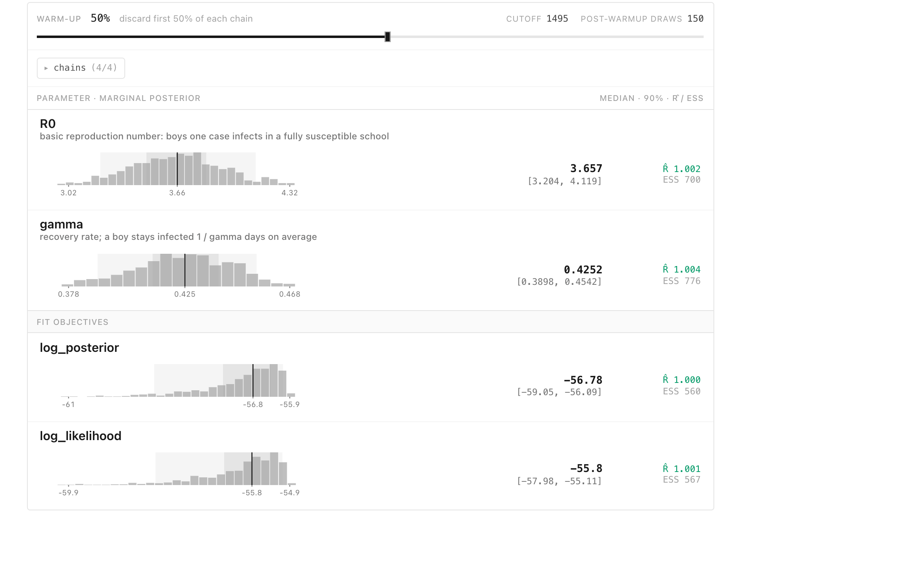

In January 1978 influenza swept through a boarding school in the north of
England. Of 763 boys, 512 fell ill within two weeks, and the school recorded how
many were confined to bed each day. This page fits an epidemic model to those
fourteen counts and asks what they say about how fast the infection spread and
how long a boy stayed ill.

The fit is Bayesian: it starts from prior beliefs about the parameters and
updates them with the data into a posterior distribution. It follows the
[fit workflow](../workflow.md), and it does not go smoothly. The first priors
look harmless and break the sampler; the checks that catch it, and the change
that fixes it, are the point of the page:

1. check what epidemics the priors imply (the prior predictive check);
2. fit, and read the convergence checks when the fit fails;
3. move the prior onto a parameter we can reason about, and fit again;
4. confirm the fit recovers known parameters from simulated data;
5. simulate from the posterior and compare with the data (the posterior
   predictive check);
6. compare the model with one that allows noisier counts.

Every command on this page was run when the site was built, and the output under
it is what camdl printed. The files are in the camdl repository under
[`docs/guide/first-fit/`](https://github.com/vsbuffalo/camdl/tree/main/docs/guide/first-fit);
copy that directory to follow along. The commands assume you are inside it, and
that camdl and camdl 'scope are installed ([Installing camdl](../install.md)).

camdl 'scope is a browser viewer for fits. Start it now, in a second terminal in
the same directory, and leave it running:

```sh
camdl-watch --port 8800
```

Open <http://127.0.0.1:8800>. Each fit appears in its list as soon as it starts
and refreshes while it runs. The screenshots on this page are of the same viewer,
pointed at the same fits.

## The data: boys in bed each day

```{.tsv include="first-fit/data/in_bed.tsv"}
```

`time` counts days from Sunday 22 January 1978, and `in_bed` is the number of
boys confined to bed that day. The outbreak was reported in the *British Medical
Journal* (Anonymous 1978, "Influenza in a boarding school", *BMJ* 1(6112):587).
The note gives 763 boys at risk, three boys in the college infirmary on 22
January, 512 boys ill in all, and influenza A (H1N1) isolated from six of the
eight boys swabbed. The daily counts were read from the note's graph and are
distributed as the `influenza_england_1978_school` dataset of the R package
[`outbreaks`](https://cran.r-project.org/package=outbreaks).

## The model: one transmission route, one recovery

```{.camdl include="first-fit/sir-beta.camdl"}
```

The school is a closed population: every boy is susceptible (`S`), infected
(`I`) or recovered (`R`), and nobody arrives or leaves during the two weeks.
Infection happens at total rate `beta * S * I / N`, so each infected boy infects
susceptibles at rate `beta` times the fraction of the school still susceptible.
Recovery happens at rate `gamma` per infected boy, so a boy stays infected for
`1 / gamma` days on average.

The `~` after each estimated parameter is its prior. Both are log-normal, which
keeps a rate positive; `mu` and `sigma` are the mean and standard deviation of
the rate's logarithm. The prior on `gamma` comes from the BMJ note: boys spent
three to seven days away from class, and went back two to four days after they
were allowed up, so a boy was in bed for roughly one to four days. The prior puts
the mean time infected, `1 / gamma`, at a median of two days with 90% of its
weight between one and four. The prior on `beta` is deliberately vague: its
median is 1 per day and it allows values twenty times smaller or larger.

The `observations` block connects the model to the data. The stream `in_bed`
reads the file's two columns, takes the number currently infected
(`projected = I`) as the expected count each day, and scores each observed count
with a Poisson distribution around it. Treating "in bed" as "infected" is a
simplification, and the end of this page tests it.

The `quantities` block names numbers to report from every simulation without
fitting them: the basic reproduction number `R0` (the number of boys one case
infects in a fully susceptible school), the mean time infected, the fraction of
the school ever infected, and the size and day of the peak. `simulate` sets the
window, day 0 to day 13, and the step `dt` of the stochastic simulation.
[A tour of the language](../intro.md) describes each block in more detail.

```{.camdl-run}
camdl check sir-beta.camdl
```

## The fit, in `fit-beta.toml`

```{.toml include="first-fit/fit-beta.toml"}
```

A `fit.toml` names the model, binds each observation stream to its data file,
and says which parameters to estimate and which to hold fixed. `beta` and
`gamma` are estimated with the priors from the model; the population and the
three boys ill on day 0 are fixed at the numbers the BMJ note reports.

The `[method]` table picks how to fit. `pmmh` is particle marginal
Metropolis–Hastings (Andrieu, Doucet and Holenstein 2010, "Particle Markov chain
Monte Carlo methods", *Journal of the Royal Statistical Society B*
72(3):269–342). It is a Markov chain Monte Carlo sampler: each chain proposes a
new value of the parameters, estimates how probable the data are under it with a
particle filter of 1000 simulated epidemics, and accepts or rejects the proposal
by comparing prior times likelihood with the current value. After a `burn_in` of
1000 steps, the values a chain visits are draws from the posterior. Four
`chains` start from four independent draws from the prior; if they end up
describing the same distribution, the answer did not depend on where they began.
The `start` values are not where the chains begin: they are the point at which
camdl measures the particle filter's noise before sampling. The
[fit.toml reference](../fit-toml.md) lists every key.

## 1. Check the epidemics the priors imply

A prior is a claim about epidemics, not just about parameters. Simulate 200
epidemics, each from a different draw of the priors, and plot them against the
data:

```{.camdl-run figure="prior-beta.svg" caption="Left: R0 = beta / gamma across 200 draws from the priors. Right: the number infected in each of the 200 simulated epidemics (blue), and the observed counts (black)."}
camdl simulate sir-beta.camdl --draws prior --fit fit-beta.toml -n 200 --seed 1 \
  --draws-out prior-beta.tsv -o prior-beta-runs.tsv
uv run plot_prior.py prior-beta.tsv prior-beta-runs.tsv data/in_bed.tsv prior-beta.svg
```

::: {.callout-note collapse="true" title="Reading this output"}
`--draws prior` draws the estimated parameters from their priors, `--fit` says
which `fit.toml` holds them, and `-n 200` asks for 200 draws, each simulated once.
`--draws-out` writes the parameter values of each draw and `-o` the simulated
trajectories, one row per draw and day. The plot is a short Python script,
[`plot_prior.py`](https://github.com/vsbuffalo/camdl/tree/main/docs/guide/first-fit/plot_prior.py),
run with [`uv`](https://docs.astral.sh/uv/), which installs its two dependencies
(polars and matplotlib) on first use.
:::

The priors on `beta` and `gamma` look reasonable one at a time, but together
they say something nobody believes. Their ratio, `R0`, falls below 1 in more than
a quarter of the draws. An epidemic with `R0` below 1 dies out: each case causes
fewer than one more, and the flat lines along the bottom of the right panel are
those draws. Another tail of draws has `R0` above 10, spreading through the
school within two or three days. The prior was meant to describe an influenza
outbreak in a school and instead spends a quarter of its weight on outbreaks that
never happen.

That is a problem for the conclusions, because the posterior is a compromise
between prior and data. It is also, as the next section shows, a problem for the
sampler.

## 2. Fit, and watch it fail

```{.camdl-run}
camdl fit run fit-beta.toml --label beta --seed 4
```

The fit finishes, and says it should not be trusted. Two of the four chains
accepted 0.1% of their proposals, and `R̂` is far above its threshold of 1.05.

::: {.callout-note collapse="true" title="Reading this output"}
- The header confirms what is estimated and fixed, and that the chains start
  from prior draws. The note about long series (`T > 500`) is printed for every
  `pmmh` fit; with 14 observations it does not apply.
- The noise check runs the particle filter twenty times at the `start` values
  and at a nearby proposal. The spread `s` of the log-likelihood ratio limits how
  often any proposal can be accepted, and the check compares that ceiling with
  the acceptance rate the sampler aims for.
- The `adaptive proposal scale` lines record each chain tuning the size of its
  proposals during burn-in. `sat at its lower bound` means a chain shrank its
  steps as far as they go.
- The acceptance rates should sit near the target, roughly a quarter to a third
  of proposals.
- `R̂` compares the chains (Vehtari et al. 2021, "Rank-normalization, folding,
  and localization: an improved R̂ for assessing convergence of MCMC",
  *Bayesian Analysis* 16(2):667–718). Near 1 means they describe the same
  distribution. `bulk` asks whether the chains agree where the posterior sits,
  `folded` whether they agree how wide it is. `ESS`, the effective sample size,
  is how many independent draws the 800 correlated ones are worth.
:::

The traces show what happened:


Each chain started from its own prior draw, and both flat chains started with a
low `beta`, in epidemics that grow too slowly to resemble the data: one at
`R0` = 0.6, an outbreak that dies out, the other at `R0` = 1.9 with `beta`
= 0.64, an outbreak that grows far more slowly than the school's. Where the simulated epidemics look nothing like the data, the particle
filter's estimate of the likelihood is very poor and very noisy. When a noisy
estimate happens to come out high, every proposal looks worse by comparison and
is rejected; the sampler then shrinks its steps, trying to get proposals
accepted, until the chain can barely move. The chain is stuck, not exploring a
second answer: its log-likelihood stays hundreds of units below the other two
chains'.

The noise check's advice, more particles, does not cure this. The two healthy
chains mix well with 1000 particles, and with 4000 one chain still stuck. Running
again with another `--seed` would draw other starts and might pass, but a fit
that converges only for lucky seeds has not converged. The starts come from the
prior, and the prior is what put a quarter of them in epidemics that never
happen.

## 3. Put the prior on R0

`beta` is hard to have beliefs about: it is a rate of effective contacts per
day. `R0` is the number epidemiologists reason with. So estimate `R0` and
`gamma`, and derive `beta` from them:

```{.camdl include="first-fit/sir-r0.camdl" lines="14-26"}
```

Only the parameters change. `R0` gets a log-normal prior with median 2.7 and 90%
of its weight between 1.2 and 6.2; `beta` becomes `R0 * gamma`, a `let`, and the
rest of the model is as before. This is a reparameterization: the same epidemics,
described by different parameters. It does not change what the model can say,
only where the prior is stated, and a prior is easiest to get right on the
parameter you understand.

The prior uses one piece of knowledge the earlier one ignored: this was an
outbreak, so `R0` was above 1. That knowledge comes from the same report as the
data, and it is a choice worth stating rather than hiding. The check shows what
it buys:

```{.camdl-run figure="prior-r0.svg" caption="The same prior predictive check with the prior on R0."}
camdl simulate sir-r0.camdl --draws prior --fit fit-r0.toml -n 200 --seed 1 \
  --draws-out prior-r0.tsv -o prior-r0-runs.tsv
uv run plot_prior.py prior-r0.tsv prior-r0-runs.tsv data/in_bed.tsv prior-r0.svg
```

Now 2% of draws have `R0` below 1, and the simulated epidemics range from slow to
fast without spending their weight on outbreaks that never start. The observed
epidemic sits inside the range, and nothing in the prior was tuned to it.

::: {.callout-note collapse="true" title="How much does the prior fix?"}
While writing this page we ran the Poisson model many times, with several priors
and seeds, and recorded where each chain started and whether it stuck. Of 88
distinct starts, 7 stuck, and all 7 started with `beta` below 0.9: 3 of the 10
starts below 0.5, 3 of 16 between 0.5 and 0.85, 1 of 12 between 0.85 and 1.2,
and none of the 50 above 1.2. The `beta` prior puts 24% of its draws below 0.5
and 44% below 0.85; the `R0` prior, through `beta = R0 * gamma`, puts 6% and 23%
there. Stuck chains become rarer, not impossible: in six fits of the simulated
data below, one chain still started at `R0` = 2.0 with a mean of 4.8 days ill, a
`beta` of 0.43, and stuck. When that happens `R̂` says
so. These runs are not repeated at each build.
:::

## 4. Fit simulated data, where the answer is known

Before fitting the real data, check that the fit can recover parameters you
chose. `truth.toml` sets `R0 = 3.75` and `gamma = 0.4` (a mean of 2.5 days ill).
Simulate one epidemic from it, then fit it with `fit-synthetic.toml`, which is
`fit-r0.toml` with the data file changed to `synthetic.tsv`:

```{.camdl-run}
camdl simulate sir-r0.camdl --params truth.toml --seed 7 --obs-only synthetic.tsv
camdl fit run fit-synthetic.toml --label synthetic --seed 1
```

```{.camdl-run}
camdl fit summary @synthetic
```

::: {.callout-note collapse="true" title="Reading this output"}
`--label synthetic` names the run so later commands can refer to it as
`@synthetic`, and `--seed` makes it reproducible. `fit summary` reads a finished
fit from disk. The verdict at the top says whether every parameter passed `R̂`.
The posterior table gives each parameter's mean with its effective sample size
and `R̂`; the convergence table splits `R̂` into its bulk and folded halves; the
chain table flags a chain whose log-likelihood is out of line with the others.
:::

The summary gives means; the Posterior tab gives each parameter's median and
90% interval:



The true values sit inside both 90% intervals: `R0` 3.75 against an interval of
about 3.2 to 4.1, and `gamma` 0.4 against about 0.39 to 0.46. The fit recovers
what it should. This is necessary and not sufficient: it shows the fit works when
the model is right, and says nothing about whether the model is right for the
real school.

## 5. Fit the real data

The same `fit.toml`, pointed at the school's counts, with the seed that failed
before:

```{.camdl-run}
camdl fit run fit-r0.toml --label r0 --seed 4
camdl fit summary @r0
```

Same seed, same starting rule, same particle count; this time all four chains
accept about a third of their proposals and every `R̂` is within 0.01 of 1. The
noise check still prints its warning: it measures the filter at the `start`
values, before any chain has moved, and calls its own ceiling conservative. The
acceptance rates, measured on the real run, are what to believe.

::: {.callout-note collapse="true" title="Reading the summary"}
`R0` has a posterior mean of about 3.8, and `gamma` about 0.49, a mean of a
little over two days infected. The chain table marks chain 1 as an outlier: its
mean log-likelihood is 0.13 below the others'. The flag is a robust z-score
against the spread between chains, and when the chains agree this closely a
tenth of a log-likelihood unit is enough to trip it; it means nothing here. A
stuck chain sits hundreds of units away, as in the `beta` fit.
:::

camdl 'scope shows the same fit from three more angles. The traces now overlap:
four chains, started from four prior draws, wandering over one band.


The pair plot shows each parameter's marginal posterior on the diagonal, with
its prior shaded behind it, and the joint posterior of each pair below. The
posterior is a narrow spike on a nearly flat prior: the data determined both
parameters far more tightly than the prior did. `R0` and `gamma` lean against
each other, because a slightly faster recovery with a slightly higher `R0` draws
almost the same epidemic.


The Diagnostics tab collects the sampler's telemetry in one place: acceptance per
chain against the healthy band, effective samples per iteration and per second,
the longest run of rejected proposals in any chain (a stuck chain shows a stall
of thousands; here it is 14), and the effective sample size of each parameter by
chain.


The verdict at its top, `bulk-ESS = 388 < 400`, differs from `fit summary`'s
because the viewer sets its own warm-up, the slider at the top, which by default
discards half of each chain rather than the fit's 1000 steps. Four hundred is
the minimum bulk effective sample size Vehtari et al. (2021) recommend for four
chains. The chains agree, so the fit is converged; the flag says that a longer
run, more `iterations`, would describe the posterior's tails more precisely.

## 6. Check the posterior against the data

The posterior predictive check simulates the epidemic from 200 posterior draws,
with observation noise, and asks whether the observed counts look like a typical
simulation. `fit predict` does it two ways: `free_forward` runs each simulation
from day 0 without seeing the data, and `one_step` predicts each day's count from
the particle filter's picture of the epidemic up to the day before.

```{.camdl-run figure="ppc-r0.svg" caption="Posterior predictive check of the Poisson model: median (line), 50% and 90% bands, and the observed counts (black)."}
camdl fit predict @r0
uv run plot_predictive.py ppc-r0.svg Poisson=results/fits/fit_r0-*/predict/*/
```

The free-forward band is wide, because an epidemic that happens to take off a
day early or late stays early or late. The rise, the peak of 298 on day 5 and the
decline fall inside its 90% band on 13 of the 14 days; the exception is the last
day, when 4 boys were in bed and the band starts at 6. The observed counts run
above the median on days 7 to 10 and below it on days 11 to 13: the school's
epidemic ended more abruptly than a simple SIR model ends, a hint that boys in
the infirmary infected fewer others than an `I` in the model does.

The one-day-ahead band is narrow, because it knows where the epidemic was
yesterday, and it holds only 10 of the 14 counts. Given yesterday's count, the
Poisson model is too sure of today's.

::: {.callout-note collapse="true" title="Reading this output"}
`fit predict` writes its output under the fit's directory in `results/fits/`:
`predictive/in_bed.tsv` holds the quantiles for each day and horizon,
`observed/` the data they are compared with, and `quantities/` the posterior
quantiles of every quantity in the model's `quantities` block.
[`plot_predictive.py`](https://github.com/vsbuffalo/camdl/tree/main/docs/guide/first-fit/plot_predictive.py)
draws one row per fit and one column per horizon from those files.
:::

## 7. A model that allows noisier counts

A Poisson count has variance equal to its mean, so with 300 boys in bed it
expects the count to be within about ±35 (two standard deviations) of the
model's number infected. Counts
read off a graph of a school infirmary are unlikely to be that tight. The
negative binomial adds a dispersion parameter `k`: the variance is
`mean + mean² / k`, so a small `k` allows much more scatter and a large `k`
approaches Poisson.

```{.camdl include="first-fit/sir-negbin.camdl" lines="15-26"}
```

```{.camdl include="first-fit/sir-negbin.camdl" lines="41-48"}
```

`k` gets a log-normal prior with median 20 and 90% of its weight between about
4 and 100, wide enough to allow nearly Poisson counts or several times more
scatter.

```{.camdl-run figure="ppc-both.svg" caption="Posterior predictive checks of both models, as above."}
camdl fit run fit-negbin.toml --label negbin --seed 4
camdl fit predict @negbin
uv run plot_predictive.py ppc-both.svg Poisson=results/fits/fit_r0-*/predict/*/ \
  "Negative binomial"=results/fits/fit_negbin-*/predict/*/
```

All four chains converge from the same seed, and the two models tell the same
story about the epidemic: `R0` between 3.7 and 3.8 and about two days ill. They differ in
how much a day's count may scatter. The negative binomial's one-day-ahead band
is wider and holds 13 of the 14 counts, where the Poisson model's held 10.

## 8. Compare the two models

```{.camdl-run}
camdl compare @r0 @negbin
```

`camdl compare` scores each fit by how well it predicts each day's count from
the days before it, averaged over 64 posterior draws. `elpd`, the expected log
predictive density, is the total log probability a model gives the 14 observed
counts; higher is better. `crps`, the continuous ranked probability score, is an
error measured in boys in bed; lower is better. `PIT_cov90` is the fraction of
days whose count fell inside the model's one-day-ahead 90% interval.

The difference in `elpd` is 0.3, with a standard error of 2.2: the counts do not
prefer either model, and camdl says so (`within noise`). The coverage is where
they differ. The Poisson model's one-day-ahead 90% intervals contain only 71% of
the counts, 10 of the 14 days; the negative binomial's contain 93%. Given
yesterday's count, Poisson is too sure of today's. Its smaller `crps` is the
same fact from the other side: narrow intervals score well when they are close
and are punished only by `elpd` and coverage when they miss.

Fourteen points cannot settle the choice by score alone, and camdl notes that
the scores are in-sample, which favours the more flexible model. The negative
binomial is the model to report: it gives the same answer about the epidemic and
honest intervals around it.

::: {.callout-note collapse="true" title="Why the two checks disagree"}
`camdl compare` scores one day ahead, like the right-hand column of the figures.
A model can pass the free-forward check and fail the one-day-ahead one, as the
Poisson model does here, because the free-forward band is dominated by
uncertainty about when the epidemic took off, which hides how much a single
day's count is allowed to scatter. `camdl compare --explain` defines every
column of the table.
:::

## 9. What the fit cannot see

One quantity disagrees with the record. Both models infer that nearly the whole
school was infected (`attack_rate`), but the BMJ note counts 512 of 763 boys ill,
67%. The fit had no way to notice: the daily counts never say how many boys
escaped. Either about a third of the boys were infected without falling ill
enough to be counted, or the model is wrong in a way the counts alone do not
expose, for instance because boys in the infirmary were isolated and infected
fewer others than an `I` in the model does. Telling those apart needs data the
fit did not use. This is why a model is checked against everything known about
the outbreak, not only the series it was fitted to.

## What a full fit adds

The [fit workflow](../workflow.md) adds steps this small fit could skip: a
likelihood survey before a fit with more parameters, and profiles of parameters
the data may not identify. [Diagnosing a fit](../diagnosing-fits.md) explains
what to do when a check fails.
