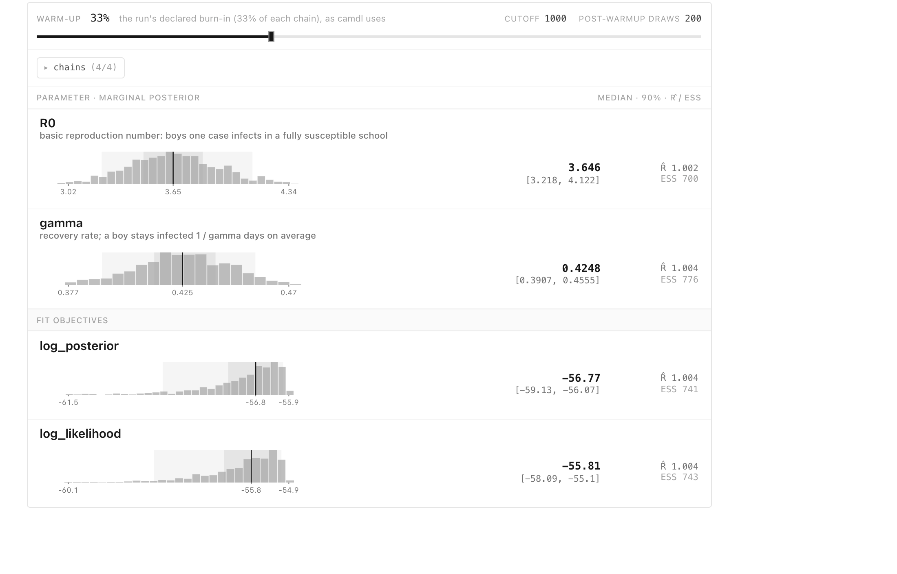

[Your first fit](first-fit.qmd) fitted an SIR model to the 1978 boarding-school
influenza counts and converged at the first attempt. It did so because the
prior was placed on the basic reproduction number $R_0$. The more obvious
choice is to put it on the parameter that appears in the infection rate, the
transmission rate $\beta$, and to make it vague because we know little about
$\beta$. This page makes that choice and follows the consequences: a prior that
looks harmless implies epidemics nobody believes, two of four chains stop
moving, and the diagnostics say so. We'll work out why the chains stopped, see
why the remedy the fit suggests does not cure it, and then check the fix on
simulated data where we know the answer.

The data, model and sampler are those of the first page, and the commands run
in a copy of the same directory,
[`docs/guide/first-fit/`](https://github.com/vsbuffalo/camdl/tree/main/docs/guide/first-fit).

## A vague prior on the transmission rate

`sir-beta.camdl` differs from the first page's model only in its parameters:

```{.camdl include="first-fit/sir-beta.camdl" lines="14-23"}
```

There is no `let beta = R0 * gamma`; $\beta$ is estimated directly. Its prior is
log-normal with median 1 per day and 90% of its weight between about 0.2 and
5.2 per day, a range wide enough that it seems to commit to nothing. The prior
on $\gamma$, the recovery rate, is unchanged: a mean time infected of one to
four days. The fit configuration, `fit-beta.toml`, is the first page's with
`beta` in place of `R0`.

## The prior predictive check fails

Each prior looks reasonable on its own, but the epidemic depends on the two
together, through $R_0 = \beta/\gamma$. Simulate 200 epidemics from the priors,
as on the first page:

```{.camdl-run figure="prior-beta.svg" caption="Left: R0 = beta / gamma across 200 draws from the priors. Right: the number infected in each of the 200 simulated epidemics (blue), and the observed counts (black)." show-match="generated 200 prior draws"}
camdl simulate sir-beta.camdl --draws prior --fit fit-beta.toml -n 200 --seed 1 \
  --draws-out prior-beta.tsv -o prior-beta-runs.tsv
uv run plot_prior.py prior-beta.tsv prior-beta-runs.tsv data/in_bed.tsv prior-beta.svg
```

More than a quarter of the draws have $R_0$ below 1 (the left panel). An
epidemic with $R_0$ below 1 dies out, because each case causes fewer than one
more, and those draws are the flat lines along the bottom of the right panel.
At the other end, draws with $R_0$ above 10 sweep through the school in two or
three days. The fraction follows from the priors: $\log R_0 = \log\beta -
\log\gamma$ is normal with mean $0 + 0.69$ and standard deviation
$\sqrt{1^2 + 0.42^2} \approx 1.08$, so $P(R_0 < 1) = \Phi(-0.69/1.08) \approx
0.26$. A prior meant to describe an influenza outbreak in a school spends a
quarter of its weight on outbreaks that never happen.

That would matter even if the sampler coped, because the posterior is a
compromise between prior and data. It also matters for the sampler, because
each chain starts from a draw from the prior.

## The fit fails, and says so

```{.camdl-run show-match="log L̂ mean|acceptance ceiling|Raise particles| 1/3000|3000/3000|NOT converged|max R̂|chain  acceptance|% ✓|% ✗|by -"}
camdl fit run fit-beta.toml --label beta --seed 4
```

The fit runs to the end and then reports that it has not converged. Chains 0
and 1 accepted 0.05% and 0.1% of their proposals, a handful of moves in 3000
steps, while chains 2 and 3 accepted about 40%. $\hat R$ is 2.25 for $\beta$
and 3.3 for $\gamma$, far above camdl's threshold of 1.05. The progress lines
give each chain's log-likelihood at its first and last step: chains 0 and 1
started at −1362 and −320, at parameter values whose epidemics look nothing
like the data, and ended at −758 and −228, while chains 2 and 3 ended near −60.
The traces in camdl ’scope show the same thing:


The flat chains are not exploring a second answer. They did not move, and their
log-likelihoods are hundreds of units below the moving chains'; even if there
were a second mode where they sit, a gap that size would leave it a negligible
share of the posterior. Both sit at a transmission rate well
below the value of about 1.9 per day on which the moving chains agree.

::: {.warning title="Do not report an unconverged fit, or rerun it until it passes"}

When chains disagree like this, the pooled draws are a mixture of the posterior
and wherever the stuck chains happen to be, and no summary of them is an
estimate of anything. Rerunning with other seeds until one passes is not a
remedy either: a fit that converges only for lucky seeds has not converged.

:::

## Why the chains stuck

PMMH, the sampler, is Metropolis–Hastings with the exact likelihood replaced by
the particle filter's estimate $\widehat p(y\mid\theta)$. From the current
value $\theta$ it proposes $\theta'$ from a proposal distribution $q$ and
accepts it with probability

$$
\alpha = \min\!\left\{1,\;
  \frac{\widehat p(y\mid\theta')\,p(\theta')\,q(\theta\mid\theta')}
       {\widehat p(y\mid\theta)\,p(\theta)\,q(\theta'\mid\theta)}\right\},
$$

where $p(\theta)$ is the prior. The estimate at the proposal is fresh; the
estimate at the current value is the one computed when the chain arrived there,
and it is kept, not recomputed. That is what makes PMMH target the right
posterior, and it is also its weak point. If the estimate at the current value
happened to come out much too high, every later proposal is compared against
that lucky number, and almost none can beat it.

How likely such a lucky number is depends on how noisy the estimate is, and
that depends on where the chain is. `camdl pfilter` runs the particle filter at
fixed parameters, and with `--replicates` it runs it repeatedly and reports the
mean and standard deviation of the log-likelihood estimates. First, near where
chains 2 and 3 mix:

```{.camdl-run show-match="loglik ="}
camdl pfilter sir-beta.camdl --fit fit-beta.toml --particles 4000 --replicates 20 \
  --param beta=1.87 --param gamma=0.49 --param N0=763 --param I0=3
```

Then at the point where chain 1 sits, read off the traces:

```{.camdl-run show-match="loglik ="}
camdl pfilter sir-beta.camdl --fit fit-beta.toml --particles 4000 --replicates 20 \
  --param beta=0.64 --param gamma=0.33 --param N0=763 --param I0=3
```

Both use four times the fit's 1000 particles. Near the posterior, twenty
estimates agree to within a fraction of a log unit. At chain 1's point, where
almost every simulated epidemic is improbable under the counts and a few carry
all the weight, they scatter by about 19 units around −292. With the fit's own
1000 particles, the filter at that point cannot even finish twenty runs: one
of them puts all its weight on a single simulated epidemic (`EssCollapsed`),
where the estimate is undefined, and `pfilter` stops.

```{.camdl-run expect="fail" show-match="EssCollapsed"}
camdl pfilter sir-beta.camdl --fit fit-beta.toml --particles 1000 --replicates 20 \
  --param beta=0.64 --param gamma=0.33 --param N0=763 --param I0=3
```

Chain 1 holds an estimate of −228.5, made with 1000 particles. That is more
than three of the 4000-particle standard deviations above their mean: a lucky
outlier. Its proposals, which are close to where it is, get fresh estimates
from a distribution at least this wide, and almost none come out higher.

The rest follows. A chain whose proposals are all rejected looks to the
sampler like a chain whose steps are too big, so during burn-in it shrinks the
proposal scale toward its target acceptance rate. Smaller steps change nothing,
and the scale falls to its floor ($\lambda = 4.5\times10^{-5}$ in the
acceptance table) and stays there. Chain 0 sits further out still, at −758.

::: {.internals title="How noisy can the likelihood estimate be before PMMH stops mixing?"}

Suppose the log of the likelihood estimate is normal with standard deviation
$\sigma$, the same at every $\theta$. For proposals so small that the true
likelihood barely changes, a move is accepted only when the fresh noise beats
the noise held at the current value, and the acceptance rate tends to
$2\Phi(-\sigma/\sqrt2)$ (Sherlock et al. 2015, "On the efficiency of
pseudo-marginal random walk Metropolis algorithms", *Annals of Statistics*
43(1):238–275). At $\sigma = 1$ that is 48%; at $\sigma = 19$ it is about
$4\times10^{-41}$. Doucet et al. (2015, "Efficient implementation of Markov chain
Monte Carlo when using an unbiased likelihood estimator", *Biometrika*
102(2):295–313) recommend choosing the particle count so that $\sigma$ is
between about 1 and 1.7 near the posterior.

Two departures from that idealization matter here. The noise is not the same
everywhere: it is small near the posterior and enormous far from it, so a
particle count tuned near the posterior says nothing about a chain that starts
far away. And while the estimate of the likelihood is unbiased, its logarithm is biased
low, by more the noisier it is, so the occasional high estimate that traps a
chain is an outlier above even the mean of the log estimates. [Inference in
camdl](../inference.md#the-particle-filter) describes the filter's estimate and
its effective sample size.

:::

## The noise check, and why more particles do not cure this

Before sampling, the fit ran the particle filter twenty times at the `start`
values and at a nearby proposal; the first lines of the excerpt above are its
report. It found a standard deviation of about 2 log units at the `start`
values ($\beta = 1.5$, $\gamma = 0.4$), and a spread $s$ of the difference
between two estimates large enough that its ceiling on the acceptance rate,
$2\Phi(-s/2)$, is far below the 33.7% target. Its advice was to raise the
particle count.

That advice is about the point the check measured, not the points where chains
0 and 1 stuck. More particles do reduce the noise everywhere, roughly as one
over the square root of their number, but the `pfilter` runs above show what
four times as many leave at chain 1's point: a standard deviation of 19 log
units, where PMMH needs about 1. The same fit with 4000 particles:

```{.camdl-run show-match="log L̂ mean|NOT converged|max R̂|chain  acceptance|% ✓|% ✗"}
camdl fit run fit-beta-4000.toml --label beta-4000 --seed 4
```

At the `start` values the noise check now finds a standard deviation of about
1, half the 1000-particle figure, as one over the square root predicts. Yet one
chain still sticks, accepting 0.3% of its proposals, and $\hat R$ is still far
above 1.05; the fit costs four times as much. The chains that mixed
in the first fit did so with 1000 particles, so the particle count was never
the limit near the posterior. The starts are the problem, and the starts come
from the prior.

## Put the prior on $R_0$

$\beta$ is hard to have beliefs about: it is a rate of effective contacts per
day. $R_0$ is the number epidemiologists reason with. So estimate $R_0$ and
$\gamma$, and derive $\beta$ from them, as the first page did:

```{.camdl include="first-fit/sir-r0.camdl" lines="14-26"}
```

$R_0$ gets a log-normal prior with median 2.7 and 90% of its weight between 1.2
and 6.2, and `let beta = R0 * gamma` computes the transmission rate. The
transitions, observations and data are unchanged. Run the same check:

```{.camdl-run figure="prior-r0.svg" caption="The same prior predictive check with the prior on R0." show-match="generated 200 prior draws"}
camdl simulate sir-r0.camdl --draws prior --fit fit-r0.toml -n 200 --seed 1 \
  --draws-out prior-r0.tsv -o prior-r0-runs.tsv
uv run plot_prior.py prior-r0.tsv prior-r0-runs.tsv data/in_bed.tsv prior-r0.svg
```

Now 2% of draws have $R_0$ below 1, and the simulated epidemics range from slow
to fast without spending their weight on outbreaks that never start. The prior
on $R_0$ uses one piece of knowledge the prior on $\beta$ ignored, that this
was an outbreak; [Your first fit](first-fit.qmd) discusses whether that is
fair.

::: {.modeling title="Did the reparameterization fix the sampler, or the prior?"}

The prior. Writing $\beta = R_0\gamma$ changes nothing about which epidemics
the model can produce or how probable the counts are under each; the likelihood
is the same function, expressed in other coordinates. What changed is the
prior: the new one, transformed to $(\beta, \gamma)$, puts far less weight on
small $\beta$ than the old one did. Because the chains start from prior draws,
far fewer of them start where the filter is hopelessly noisy, and the posterior
moves too, if only slightly, because the prior is part of it.

Two consequences follow. A prior written directly on $\beta$ that implied the
same distribution would have worked equally well; the reparameterization is a
convenient way to state a prior you can defend, not a numerical trick. And a
prior on $R_0$ makes stuck chains rarer, not impossible: a draw with $R_0$ near
1 and a long infectious period still gives a slow epidemic far from the data.
When that happens, $\hat R$ says so. Starting the chains from an earlier
estimate rather than from the prior is the other remedy;
[Inference in camdl](../inference.md#mcmc-initialization-strategy) describes
the options.

:::

## Check the fit on data where the answer is known

Before trusting the new configuration on the real counts, check that it
recovers parameters we chose. `truth.toml` sets $R_0 = 3.75$ and
$\gamma = 0.4$, a mean of 2.5 days infected, with the school's population and
three initial cases. Simulate one epidemic from it, and fit that epidemic with
`fit-synthetic.toml`, which is `fit-r0.toml` with its data file changed to
`synthetic.tsv`:

```{.camdl-run show-match="observations written|refused|converged|max R̂|% ✓|Rhat="}
camdl simulate sir-r0.camdl --params truth.toml --seed 7 --obs-only synthetic.tsv
camdl fit run fit-synthetic.toml --label synthetic --seed 1
```

Two of chain 2's prior draws were rejected before sampling began (the
`refused` lines). At those parameters the simulated epidemics were so far from
the data that the particle filter's weight collapsed onto one or two particles
(`EssCollapsed`), the condition under which the estimate is useless. camdl
refuses such a start and draws another, which keeps the worst starts out of
the chains without hiding that it happened. All four chains then accept about a
third of their proposals, and $\hat R$ is at most 1.004.



The true values lie inside both 90% intervals: $R_0 = 3.75$ against an
interval of 3.22 to 4.12, and $\gamma = 0.4$ against 0.391 to 0.456. The fit
recovers what it should. This shows that the sampler, the particle filter and
the configuration work when the model is right; it says nothing about whether
the model is right for the real school, because the simulated data came from
the model itself. One recovery from one simulated epidemic is also a single
check, not a demonstration that the 90% intervals cover the truth 90% of the
time. [The reasoning behind the fit workflow](../concepts.md#synthetic-recovery-is-necessary-not-sufficient)
says more.

## The same seed, now converged

Finally, the real counts, with the seed whose `beta` fit failed:

```{.camdl-run show-match=" 1/3000|acceptance ceiling|converged|max R̂|chain  acceptance|% ✓|Rhat="}
camdl fit run fit-r0.toml --label r0 --seed 4
```

All four chains now accept 34% to 38% of their proposals and every $\hat R$ is
within 0.01 of 1. They started from prior draws at log-likelihoods between
about −700 and −110, and all of them found their way to the posterior.

The noise check still fires, with an even lower ceiling than before. The
`start` values are the same point as before, so the noise there is the same;
what differs is the proposal the check happened to draw. The chains did not
stay at that point, and their acceptance rates, measured on the run itself,
are what to believe. That is the general lesson of this page: the pre-run check
is a diagnosis at one point, and the end-of-run diagnostics, acceptance per
chain, $\hat R$, and the chains' log-likelihoods side by side, are the verdict.
[Diagnosing a fit](../diagnosing-fits.md) covers the failures this example did
not reach, and [Criticizing an epidemic model](criticizing-a-model.qmd) turns
from whether the fit worked to whether the model is right.
